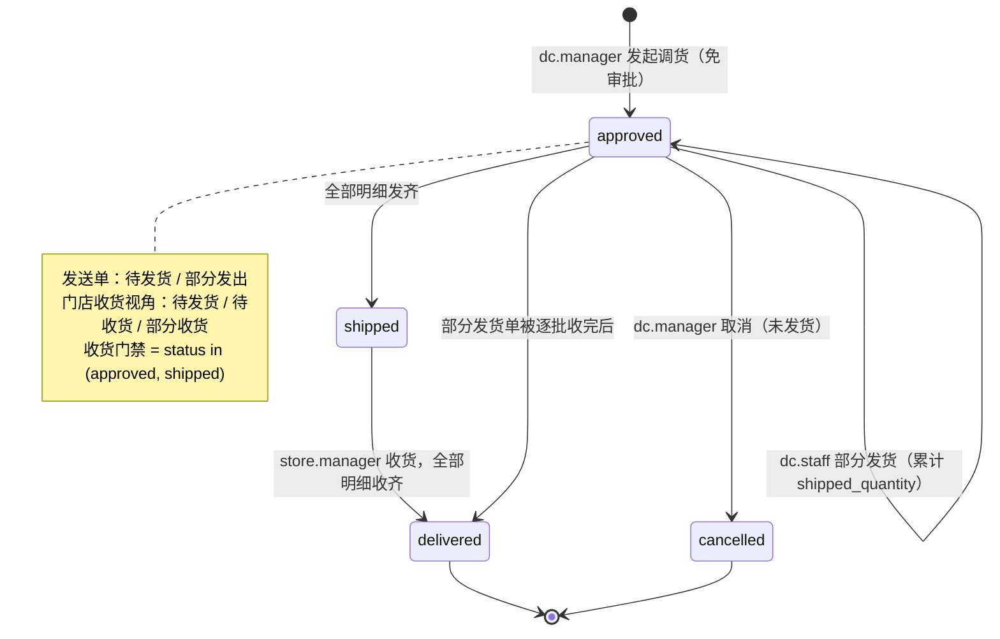

# 总仓调货（DC Transfer）设计与实现

> 2026-10-19 · 状态：已实现（`feat/dc-transfer-order`）
> 相关代码：`blueprints/dc_transfer.py`、`blueprints/dc_transfer_pure.py`、`blueprints/store_ordering_pure.py`、`db/__init__.py`
> 2026-11-01 扩展（Issue #107）：Owner eric 在 [comment966](http://hub01:3000/eric/dailycheck/issues/107#issuecomment-966)
> 批准 [comment961](http://hub01:3000/eric/dailycheck/issues/107#issuecomment-961)，允许配送中心间调货。
> 本文「收货仓/分仓」可为同租户的其他配送中心或门店；门店既有入口保持不变。

## 1. 需求与结论

**场景**：总仓需要向某个分仓发货时，由**总仓管理员主动发起**调货，创建一笔发往指定分仓的发送单；分仓收到后确认接收。整个发送 / 接收流程复用现有订货流程，但**不经过门店订货申请与审批**。

**结论**：不新建单据体系。调货单就是 `store_orders` 表中一行 `flow_type='dc_transfer'` 的记录，发货、部分发货、收货、部分收货、库存流水、状态历史、通知全部复用订货流程的既有实现。新增的只有：单据流向判别、免审批建单、调货专属流水文案、两套视角状态派生、一个列表页与一个建单页。

## 2. 数据模型

### 2.1 复用与新增

| 表 | 用途 | 调货是否新增 |
|---|---|---|
| `store_orders` | 单据主表 | 新增列 `flow_type`（`store_order` / `dc_transfer`），默认 `store_order` |
| `store_order_items` | 明细（`canonical_id` + 数量 + 已发 / 已收累计） | 复用，不加列 |
| `store_order_deliveries` | 发货批次（支持多次部分发货） | 复用 |
| `store_order_receipts` | 收货流水（支持多次部分收货） | 复用 |
| `store_order_status_history` | 状态历史 | 复用 |
| 各仓 `stock_movements` | 库存流水 | 复用表，新增两个 action 文案 |

**方向列复用**（不新增 from/to）：

- `dc_warehouse_code` = **发货仓**（总仓）
- `store_warehouse_code` = **收货仓**（分仓）
- `requested_by` = 调货发起人（总仓管理员）
- `approved_by` / `approved_at` = 建单时同时写入发起人与时间（语义为「免审批发起」，`approved_note='总仓发起调货'`）
- `shipping_fee` = 恒为 0（内部调拨不产生运费与结算金额）

**单号**：`DT-YYYYMMDD-XXXX`，与订货单 `SO-` 共用 `order_no` 唯一约束但分号段；`generate_order_no(prefix="DT")` 按完整前缀查序号，两个号段互不干扰。

### 2.2 迁移

- 新库：`MASTER_SCHEMA` 直接带 `flow_type TEXT NOT NULL DEFAULT 'store_order'`。
- 老库：`init_master_db()` 用 `PRAGMA table_info` 守卫补列，**索引 `idx_store_orders_flow` 必须建在补列之后**（写在 `MASTER_SCHEMA` 里会让 legacy 库在 `executescript` 阶段报 `no such column: flow_type`，已实测）。

## 3. 角色权限

新增权限点 **`transfer.create`**（order 分组，risk=sensitive），进 `manager` / `admin` 两个内置包；`staff` 不含。权限包大小契约同步为 `manager 18 / admin 19`（总数 26 点）。

| 动作 | 谁能做 | 守卫 |
|---|---|---|
| 发起调货（建单） | 总仓 manager / admin；平台超管 | `require_warehouse_type("distribution_center")` + `require_permission("transfer.create")` |
| 查看发送单列表 | 总仓 staff 及以上 | `require_warehouse_type(DC)`；建单按钮仅对持 `transfer.create` 者渲染 |
| 安排发货 / 部分发货 | 总仓 staff 及以上 | 复用 `store_ordering.ship_order_route`（`require_role("staff")` + DC 类型 + `_assert_order_belongs_to_current_dc`） |
| 查看待收货的调货单 | 收货仓用户 | 门店进「本店订单」（调货列表对门店 302 回订单列表）；DC 进调货列表的「收货单」 |
| 确认接收 / 部分接收 | 收货仓 manager / admin；平台超管 | `receive_order_route`：order.receive + 经理角色；当前仓=收货仓，仅 dc_transfer 允许 DC 收货 |
| 一次性收齐已到货物 | 收货仓 manager / admin；平台超管 | `deliver_order_route`：order.ship + 经理角色 + 同一收货仓归属校验；调货复用 receive_partial 幂等协议 |
| 取消调货单 | 总仓 manager / admin，且**未发货** | 复用 `cancel_order_route` 的 `approved` 分支 + `cancel_order()` 新增「已有发货记录不可取消」守卫 |
| 收到发起 / 发出通知 | 分仓 manager / admin | `notify_order_event(EVENT_TRANSFER_CREATED / SHIPPED / DELIVERED)` |

> 门店不能发起调货；配送中心可向其他配送中心或门店调货，禁止向自身、研发仓或跨租户仓调货。
> 收货方不能取消来货，即使操作者另有发送仓角色；取消调货要求当前仓为发送仓，且未发货。
> 平台管理员收货也必须切换到实际目标仓；现有角色包与权限点不变。
> 该目标仓规则仅作用于调货：普通门店订货保留既有平台管理员跨门店会话代收能力、
> storefront 类型守卫及拒绝后的原跳转，不因本扩展改变普通订货行为。

## 4. 状态流转

单据主状态仍用既有的 `pending / approved / shipped / delivered / cancelled`。调货单**永不出现 `pending`**：创建即 `approved`。

### 4.1 发送单（总仓视角）

| 状态 key | 展示 | 判定 |
|---|---|---|
| `awaiting_ship` | 待发货 | `approved` 且已发量 = 0 |
| `partial_shipped` | 部分发出 | `approved` 且 0 < 已发量 < 订货量 |
| `shipped` | 已发出 | 主状态 `shipped`（全部明细发齐） |
| `completed` | 已完成 | 主状态 `delivered`（分仓全部收齐） |
| `cancelled` | 已取消 | 主状态 `cancelled`（仅未发货时可进入） |

### 4.2 收货视角（门店或接收 DC，由明细派生）

> 门店侧**不引入「接收单」概念**：收到的调货单就是一张待收货的订单，列在「本店订单」里，状态按收货进度显示（2026-10-19 owner 明确）。
> 接收 DC 在既有调货列表选择「收货单」；详情按目标仓显示收货进度及本仓入库流水，不显示出货表单。

| 状态 key | 展示 | 判定 |
|---|---|---|
| `awaiting_ship` | 待发货 | 可收量 = 0（总仓尚未发出任何数量） |
| `pending_receive` | 待收货 | 可收量 > 0 且已收量 = 0 |
| `partial_received` | 部分收货 | 可收量 > 0 且已收量 > 0 |
| `received` | 已收货 | 主状态 `delivered` |
| `cancelled` | 已取消 | 主状态 `cancelled` |

> 可收量逐行用 `order_item_receivable_qty()` 计算：`max(0, min(已发, 订货) − 已收)`。列表上的「待收 N」与详情页收货输入框上限**同源**，不会出现「显示可收 5、实际收不了」。
>
> **不能用主状态代替**：分批发货期间主状态停在 `approved`，只看 `status` 会把「已发 5、待收 5」显示成「待发货」。这是本模块状态派生必须独立于主状态的原因。

### 4.3 状态图

## 5. 与现有订货流程的复用点

| 能力 | 复用实现 |
|---|---|
| 明细模型与跨仓统一键 | `store_order_items.canonical_id` |
| 批次发货 | `_ship_order_partial_impl`：累计 `shipped_quantity`、写 `store_order_deliveries`、校验不超库存、逐批扣总仓库存 |
| 部分收货 | `receive_order_item`：写 `store_order_receipts`、分仓自动建 items、累计 `fulfilled_quantity` |
| 收齐转完成 | `receive_order_item` 内 `shipped → delivered` |
| 库存流水 | `stock_movements`，仅 action 文案按 `flow_type` 切换 |
| 状态历史 | `store_order_status_history` |
| 详情页 / 发货表单 / 收货表单 | `store_ordering.order_detail` + `order_detail.html`，按 `flow_type` 切文案 |
| 通知 fan-out | `notify_order_event`，按 `flow_type` 切文案 |
| 取消 | `cancel_order` + `cancel_order_route` |

## 6. 与现有订货流程的差异点

| 维度 | 门店订货 | 总仓调货 |
|---|---|---|
| 发起方 | 门店用户 | 总仓 manager 及以上 |
| 入口 | 购物车 → `submit_order` | 建单页直接勾品项 → `create_transfer_order` |
| 审批 | `pending → approved`（DC 审批） | **无审批**，创建即 `approved` |
| 单号 | `SO-` | `DT-` |
| 运费 / 金额 | 按运费规则计算并锁定 | 恒 0，详情页不显示金额卡 |
| 库存流水 action | 门店订货出库 / 入库 | 总仓调货出库 / 入库 |
| 报表口径 | 计入订货报表 | **排除**（`compute_store_order_report` 只统计 `flow_type='store_order'`） |
| 取消限制 | 已收货不可取消 | 在「已收货不可取消」之外，**已发货也不可取消**（在途货物不能凭空作废） |
| 通知文案 | 订货单 | 总仓调货单；创建时额外通知分仓准备接收 |
| 列表 | `/store-ordering/orders` 本店订单 | DC 用 `/dc-transfer/` 发送单、`?scope=incoming` 本仓收货单；门店仍在本店订单里看 |

## 7. 页面与接口

| 方法与路径 | 作用 |
|---|---|
| `GET /dc-transfer/` | DC 默认仅本仓发送单；`?scope=incoming` 仅本仓收货单（含进度、待收量）；门店仍 302 回「本店订单」 |
| `GET /dc-transfer/new` | 建单页：选同租户其他 DC / 门店 + 勾品项数量（仅列主数据启用且库存 > 0 的品项） |
| `POST /dc-transfer/new` | 创建调货单，字段 `to_warehouse_code`、`items[<canonical_id>]`、`note` |
| `GET /store-ordering/orders/<id>` | 调货单详情（复用），发送 / 接收 / 取消入口同页 |
| `POST /store-ordering/orders/<id>/ship` | 总仓发货（复用） |
| `POST /store-ordering/orders/<id>/receive` | 分仓收货（复用） |
| `POST /store-ordering/orders/<id>/deliver` | 收货仓一次性收下已到货物；调货表单携带 op_no，同键只重放原批次，可恢复未应用 receipt |
| `POST /store-ordering/orders/<id>/cancel` | 总仓取消（复用） |

## 8. 边界与已知限制

1. **建单不锁库存**：与门店订货 A7 口径一致，库存校验放在实际发货时（硬校验、永不跌负）。建单页只列当前有库存的品项，但建单与发货之间库存可能被其他单据占用。
2. **无拒收流程**：分仓只能按实发数量收货，不能整单退回。若需拒收，走「总仓取消 + 重新建单」（取消仅在未发货时允许），或后续单独设计退货单。
3. **部分发货后不可取消**：这是对既有订货流程的同步收紧（原先 `approved` 状态即使发过货也能取消，会造成已扣库存 / 在途货物失去账面对应）。
4. **调货不进入订货报表**：`compute_store_order_report` 明确排除 `dc_transfer`，避免内部移库虚增门店订货量与 DC 出货量。若需调拨统计，应另设口径。
5. **库存健康报表已同步**：`reports_health_pure.INBOUND_ACTIONS / CONSUME_ACTIONS` 与 `restock` 入库历史都加入了调货动作；漏改任何一处都会让调拨造成的库存增减被静默漏算。
6. **状态历史表仍显示英文状态码**：与订货单现状一致，未在本轮改造。

## 9. 测试

Issue #107 扩展的真实临时 SQLite / Flask 回归覆盖 DC→DC 与 DC→门店、非法候选/建单、
自调货、staff 建单/收货拒绝、错仓及无关仓可见性/收货/发货拒绝、普通订货单 DC 收货拒绝、
双角色收货方取消拒绝、部分/最终收货、发送/接收库存与流水、通知及幂等重放。
收货仓故障注入验证单行和整批收货可原键恢复，整批旧键重放不吸收后续到货。
实现仍复用原库存协议，无独立库存写、schema 或权限包扩展。

`tests/test_dc_transfer.py`（18 个用例）覆盖：

- 建单：跳过 `pending`、单号递增与 `DT-` 前缀、跨仓 / 反向 / 未知品项 / 空明细拒绝、同 canonical 合并；
- 状态：部分发货 → 部分收货 → 发齐 → 收齐的完整链路，总仓发送 / 门店收货双视角断言；
- 库存：`总仓调货出库` / `总仓调货入库` 流水与两仓库存数量；
- 报表：调货单不计入 `compute_store_order_report`；
- 取消：未发货可取消、发货后拒绝；
- 路由与权限：DC manager 建单成功、DC staff 403、分仓无法进建单页、分仓待接收列表的 `scope` 行为。
