# DailyCheck 技术架构

> **本文件是 Eric 拍板的硬性要求**：每次开发前必读，每次 commit 触及架构子系统时必同步。
> 门禁：`scripts/git-hooks/pre-commit`（已装）— 触及子系统但本文件未在同 commit 改动 → 拒绝。
> 辅助：`scripts/arch_touched_sections.py` — 基于 `git diff --cached` 提示需更新章节。
> 维护成本：< 5 分钟/次。**不维护的代价**：下一个开发者必然踩坑。

**分工（2026-10-17 确立）**

| 想知道 | 看哪里 |
|---|---|
| 有哪些路由、每条要什么权限、有哪些数据表、哪些模块在役 | [`ARCHITECTURE_MAP.md`](ARCHITECTURE_MAP.md) —— **机器生成、禁止手改**；`tests/test_arch_map.py` 在 CI 的 `test` job 里强制校验一致性 |
| 为什么这样设计、踩过什么坑、怎么部署、怎么回滚 | 本文件（人工维护，只写「为什么」与稳定结构） |

本文件**不再收录逐条路由清单与模块规模**——它们随每个功能变化，一律由派生图回答。
要改派生图的内容就改 `scripts/arch_map.py`，然后 `python3 scripts/arch_map.py --write`。

**想知道「这一周架构变了什么」**：`python3 scripts/arch_digest.py`（默认近 7 天，可 `--since "30 days ago"` 或 `--base <sha>`）。
它比的是派生图的结构化事实，只报新增/删除路由、鉴权收紧、表增删、蓝图装配变化，不会把表格重排当成变更。

---

## 目录

1. [项目一句话](#1-项目一句话)
2. [系统拓扑（容器视角）](#2-系统拓扑容器视角)
3. [部署拓扑](#3-部署拓扑)
4. [数据架构](#4-数据架构)
5. [应用层模块图](#5-应用层模块图)
6. [蓝图依赖关系](#6-蓝图依赖关系)
7. [请求生命周期](#7-请求生命周期)
8. [鉴权架构](#8-鉴权架构)
9. [MCP 架构](#9-mcp-架构)
10. [业务领域模型](#10-业务领域模型)
11. [PWA / 移动端](#11-pwa--移动端)
12. [测试架构](#12-测试架构)
13. [关键约定与坑](#13-关键约定与坑)
14. [pre-existing 风险清单](#14-pre-existing-风险清单)
15. [文档索引](#15-文档索引)

---

## 1. 项目一句话

**单租户、多仓、带主数据治理的轻量库存管理系统，对 AI Agent 通过 MCP 协议开放 32 个工具。**

- **目标用户**：连锁餐饮/零售的小企业（5–50 仓规模），现场用手机做日常操作。
- **核心问题**：让一家公司能管 N 个门店/DCN/R&D 的库存，并让 AI Agent 读得到。
- **核心约束**：多租户 PoC 已落地（2026-10-10，轻方案：tenants 注册表 + 三表 tenant_id +
  请求级租户闸；canonical 扇出/订单/MCP 全链路租户化为 PoC 后续阶段）。

---

## 2. 系统拓扑（容器视角）

Issue #140 的外仓页由 Flask 调用独立 Web 范围 WMS SELECT 服务连接外部 SQL Server；
不依赖 MCP HTTP 进程在线，也不通过本地 SQLite 镜像外仓库存。

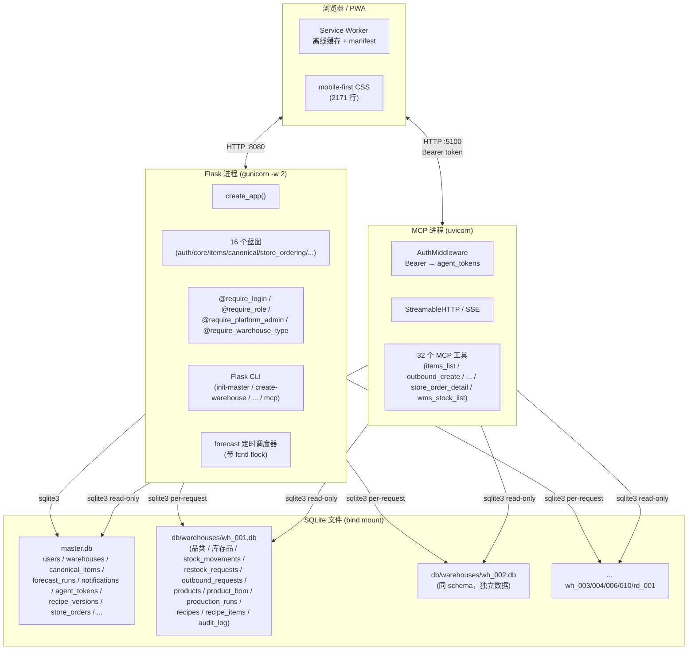

---

## 3. 部署拓扑

外仓 Web 上线需在 Flask 运行环境具备 WMS 环境变量、`pymssql` 驱动与来源
网络白名单；不引入 schema 迁移或新守护进程。真实外仓连接仅由部署环境验证，
本地/CI 使用桩数据；凭据缺失只使该页显示明确未配置状态。

### 3.1 Dev 环境

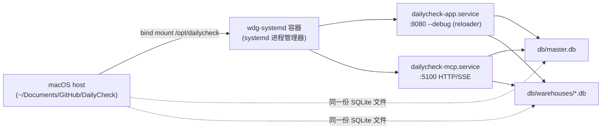

**关键**：bind mount 实时同步，**改 .py Flask 自动 reload**，**MCP 进程无 reloader**，改 `mcp_server/*.py` 必须手工 `systemctl restart dailycheck-mcp`。

### 3.2 Prod 环境

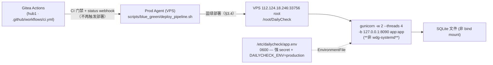

### 3.3 ⚠️ 部署重大差异（必读）

| 维度 | Dev | Prod |
|------|-----|------|
| **时区** | UTC | **Asia/Shanghai (CST+8)**，unit 未设 TZ |
| **数据库路径** | bind mount（容器/host 同一文件） | 本地文件系统 |
| **进程管理器** | systemd in container | gunicorn -D（无 systemd） |
| **Flask reload** | `--debug` 自动 reload | 无 |
| **MCP 进程** | systemd unit | **未部署**（MCP 只在 dev 跑） |
| **部署方式** | mount + edit | **Prod Agent 蓝绿部署**（§3.4：`deploy_pipeline.sh` → up/verify/promote/switch/观察窗；2026-10-25 起 deploy-first：验证通过后 FF-only merge）。`scripts/deploy_vps.sh` 保留为**应急手动路径**（sqlite 热备 + rsync + migrate + 重启 + 探活 + 失败回滚），CI 不再调用（`f293746` 移除 deploy job）。**db/ Python 包必须进代码备份**（2026-10-10 dev 演练踩坑）。**凭据类文件（`vps_key`/`*.pem`）双向排除**：打包与 rsync 两侧各自再排除一次，切换前显式 `rm -f $APP_DIR/vps_key` 清历史残留——rsync `--delete` 不处理排除项（Issue #9，2026-10-24） |
| **备份/DR** | 无 | `scripts/backup_all.sh`（cron 每日，integrity_check + tar + 可选异地）+ `scripts/verify_restore.sh`（每周还原演练）+ `docs/runbook-dr.md`（RPO=24h/RTO=1h） |
| **入口端口** | :8080 / :5100 | :8090（仅 Flask） |

### 3.4 蓝绿部署（Phase 1 实装，2026-10-13 起）

Prod 专用（dev 不涉及）。`scripts/blue_green/` 6 脚本：`up.sh`（起绿：DB `cp -a` + systemd **restart** + 30×2s 健康检查，**重启前先判绿是否在承流**，在役则先切蓝；**并把 unit 复位成静息态**——`DRY_RUN=true` + 副本库）→ `verify.sh`（八项生产验证，报告落 `backups/prod-verifications/`）→ `promote.sh`（**绿转正**：关 `DRY_RUN` + DB 指回真库 + daemon-reload/restart + 健康复核，幂等 + 备份 + 失败回滚）→ `switch.sh`（nginx upstream weight/down 切流量，`nginx -t` 验证 + 失败自动还原备份）→ `rollback.sh`（秒级切回蓝 + journalctl/DB 取证）→ `down.sh`（绿下线，`--keep-blue` 保留 DB 7 天）。端口：蓝 :8090/:5100，绿 :8091/:5101。全脚本支持 `--dry-run`（只回显不执行）。**完整时序**：up（复位静息态 → 重启为 `DRY_RUN=true` + 副本库）→ verify → promote → switch（5/50/100）。

**多仓履约发布节奏（T1→T2→T3，2026-10-29，spec §6/D14）**：
- **T1 兼容发布**：新代码（含 MCP / bot / 订单板 / 报表）全量上线，`config.MULTI_WAREHOUSE_FULFILLMENT`
  **保持关闭** → 目录/提交/发货与存量逐字节恒等（单仓路径）；master v4/v5/v6 与每仓 schema v6 迁移在
  T1 发布时执行，播种 pending 清单交人工配置。
- **T2 开跨仓**：确认**蓝绿双实例均 ≥ T1**（都能识别行级来源）、且灰度期没有旧写者承流后，
  才开启 `MULTI_WAREHOUSE_FULFILLMENT`（2026-11-02 起由 env `DAILYCHECK_MULTI_WAREHOUSE=1`
  驱动，见 §13.15，切换不重新发版）。**首张跨仓单产生后，回滚目标版本必须仍是 T1+**，
  严禁回滚到不识别 `source_warehouse_code` 的版本（否则按头仓扣所有行）。
- **T3 收敛**：`dc_warehouse_code` 降级为纯展示，报表/MCP/健康报表的参与仓谓词已切换完成。
- 灰度期蓝绿同池（`switch.sh` 5%/50%）时**绝不开启跨仓创建**——旧实例按头仓扣行的风险由此关闭；
  本设计不改部署流水线（红线不动）。


**铁律**：
- **nginx 备份绝不写 `sites-enabled/`** —— 主配置 `include sites-enabled/*` 会把 `.bak` 当配置加载 → duplicate upstream 永久 fail（Issue #24 Bug A）。统一落 `BACKUP_DIR`（默认 `/var/lib/dailycheck-blue-green-backups/`）。
- **`verify.sh` 禁用 `set -e`** —— check 失败由 `OVERALL_PASS` 跟踪，`trap _write_report EXIT` 兜底保证任何失败路径都写报告（Issue #24 Bug B）。
- **check 1 全量与测试隔离（Issue #103）** —— 包含 MCP 目录，pytest 的 `DAILYCHECK_DB_DIR` 与 basetemp 落独立临时目录；结束后清理测试目录，并原样返回零新增门禁结果。部署数据库隔离证据与其余七项验证保持原有语义。
- **check 1 禁止兜底** —— 真跑 pytest（`-rf` 产出 FAILED 行）+ 复用 `scripts/check_known_failures.py` 判「失败集 ⊆ known_failures.txt」，不允许把失败兜成 PASS。
- **check 2 禁止静默跳过** —— `scripts/playwright/sim_user.py`（纯 stdlib）真走 登录→选仓→总览→库存→健康报表 5 路径（含 CSRF 回填）；凭据走 `SIM_USER_USER` / `SIM_USER_PASSWORD` 环境变量，缺失直接 FAIL。末条 `/report/health`（Issue #38 补）需 **manager+ 账号**（平台 admin 放行），403 按失败处理不降级；同时校验落点须停在 `/report/health`——会话丢失会 302 到 `/login` 再返回 200，只看 status 会假绿。
- **check 2 凭据必须 provision 进「绿」库（Issue #34）** —— sim_user 的 HTTP 凭据校验发生在**绿进程持有的库**上，而 verify.sh 跑的 wrapper shell 不在绿 unit 环境里。因此 `_ensure_sim_user_in_green_db()` 必须用**显式 `DAILYCHECK_DB_DIR=${GREEN_DB}` 覆盖**（子 shell 内赋值，禁止继承调用者环境）幂等 ensure 账号，且必须带 **`--admin`**（非 admin 用户在选仓页只看到 `warehouse_users` 绑定的仓，而 create-user 不写绑定 → 空选仓页 → 探针路径 3 必失败）；探针前再复核「绿库有该账号 + 密码匹配 + 未停用（`is_active`）+ 有可见仓」（覆盖 up.sh 快照里同名不同密码 / 已停用 / 非 admin 账号的情形），并在**写库之前**先用「路径形态 + inode 相异」双闸自证 `${GREEN_DB}` 不是蓝库（check 7 排在 check 2 之后，误配时否则会先把一个已知口令的 admin 写进 production 真库）。**裸跑 `flask create-user` 会写蓝库（production 真库）** —— 绿库查无此人导致路径 2 恒 401，实测见 Issue #34；任何新增的「verify 里要碰 DB 的步骤」都必须照此 pin env 到目标侧库。
- **verify 探针凭据可移植 + 失败明细可读（Issue #123）** —— `deploy_pipeline.sh` 自动生成的探针密码必须带固定字母前缀：`secrets.token_urlsafe(18)` 约 1.5% 以 `-` 开头，会被 click 当成选项（`Error: No such option '-i'`）→ check 2 假红 → 整次部署 rc=21 并被回退（#119 实证）；`verify.sh` 的 `create-user` 一律使用 `--` 选项终止符，运营显式传入 `--sim-pass -xxx` 同样安全。verify 失败时 `_emit_failure_summary` 向 stdout 输出 `FAILED_CHECK=<n>` + 检查名 + 该 check 日志尾 3 行，使 pipeline 日志与 `deploy_report.py` 的 40 行 tail 能指出具体失败 check，而不是只有 `rc=21 / undetermined`。由 `tests/test_verify_probe_portability.py`（6 用例：生成器 300 次首字符断言、真实 Flask CLI 带/不带 `--` 的正反证、失败明细抽取真跑）钉住，两处变异（去掉字母前缀 / 去掉 `--` 终止符）各自打红。
- **DB 隔离（Issue #28）** —— 蓝绿不许共享物理库：`config.py` 在 import 期读 `DAILYCHECK_DB_DIR` env（Flask 与 MCP 同源覆盖）；`up.sh` 从真库 `${APP_DIR}/db` 用 `cp -aL` 解软链拷独立副本，且守卫绿 unit 必须声明 `DAILYCHECK_DB_DIR` 与拷贝目标一致，否则拒启；`verify.sh` check 7 取三重证据（绿进程 environ 声明 + master.db 非软链 + 蓝/绿 inode 相异）。**改部署布局（软链/数据目录迁移）必须保持这三个语义**。**语义边界（勿与「绿转正」冲突）**：本条约束的是**验证期**（绿以 `DRY_RUN=true` 承接 0 流量）；一旦按下方 DRY_RUN 铁律走「绿转正」承接生产流量，绿必须把 `DAILYCHECK_DB_DIR` 改指生产真库 `${APP_DIR}/db` —— 转正后蓝绿同库是**设计预期**（单写者：蓝 standby 不写），此时 check 7 的「inode 相异」不再适用，写安全改由 DRY_RUN 守卫保证；转正后重跑 `verify.sh` 若 check 7 报红，属预期而非回归。**同源影响 check 2**：`_ensure_sim_user_in_green_db()` 之所以能靠「路径形态 + inode 相异」双闸拒绝写蓝库，前提同样是验证期的库隔离；转正后该前提消失（`GREEN_DB` 变量值仍在、实际库已是真库，双闸退化为假保证）。因此**转正后如需复跑 `verify.sh`，应先在蓝绿框架下回蓝（`switch.sh blue 100`）并恢复验证期布局**，或在明确「已知同库」的前提下判读 check 2 / check 7 的红。
- **nginx 单 upstream 蓝绿同池（Issue #32）** —— `location` 的 `proxy_pass` 永远指向合并的 `dailycheck` / `dailycheck-mcp` upstream，蓝绿是同 upstream 内的两个 `server` 节点；切流量只改 server 行的 `weight=N` / `down` —— **switch.sh 不动 location 也不新增 `dailycheck-blue/green` upstream**（旧布局下 location 硬编码，upstream 切了真实流量不动 → 502 必现，Issue #32 实测）。三道防线：① `switch.sh` 头部布局守卫 grep `proxy_pass http://dailycheck-(blue|green)` 命中旧布局直接拒跑（exit 2），强制 Prod Agent 先按 `scripts/blue_green/nginx-site.conf` 模板重构；② `switch.sh` 尾部 post-switch 探活，过 nginx 入口（默认 `http://127.0.0.1:8080`，可用 `NGINX_ENTRY` 环境变量覆盖，dry-run 路径也透传）取 `http_code`，5xx/000 自动 cp 备份回滚 + reload；③ `verify.sh` check 8 终态保险，再过一遍入口探活捕获 reload → observe window 期间的状态漂移。**改 nginx 布局必须保持单 upstream 模型**，新增独立 upstream 必须同时承担布局守卫与探活的改造。
- **DRY_RUN 实例绝不承接流量（Issue #41，2026-10-15 P0 事故）** —— 绿实例的 `DRY_RUN=true` 写隔离只允许存在于验证期：窗口期曾发生「绿实例接管生产流量 44 分钟、全部写操作被吞」（HTTP 200 / 审计照记 / DB 不落盘）。`switch.sh` 四道防线：① **DRY_RUN 守卫** —— 切换后凡承接流量（weight>0）的实例检测到 `DRY_RUN=true`（取证次序：进程 `/proc/<pid>/environ` → unit `systemctl show Environment`；无法判定仅告警）即拒跑（exit 3），必须先按 README「绿转正」（关 DRY_RUN + DB 指回真库 + restart）再切；② **conf 应用核验** —— sed 后逐行核对 4 条 server 行与期望一致（sed 未命中时 `nginx -t` 仍过、reload 仍「成功」而权重根本没变，静默失败）；③ **reload 失败显式回滚**（旧版 `set -e` 直退会留下 conf/运行态分歧）；④ **落点核验** —— 100%/0% 边界用带 nonce 的探针核对流量真实落到目标实例 access log（**全部尝试**均未命中目标且至少一次落对侧=回滚；日志不可读=仅告警）；**探针必须重发（Issue #55）**：nginx worker 在 `reload` 后需 1-3 秒才刷新 in-memory upstream，只发一次探针必然落在旧配置（对侧），「反复 grep 同一个 nonce」等不来路由改变 → 必然误判「reload 未生效」并自动回滚（2026-10-16 生产实测：`switch.sh green 100` 被误判失败，部署只能人工 `sleep 3` 绕过）。现为「每次尝试用**新 nonce** 重发探针 + 轮询日志」，命中目标 access log 即成功（默认最多 `LAND_TRY_MAX=5` 次、每次轮询 4×0.25s、尝试间等 1 秒 ≈ 常态等待预算 10 秒；探针自身 `--max-time 5`，入口持续无响应的最坏耗时可到约 35 秒）；对侧命中不再一票判死（那是 race 的正常表现），只有「所有尝试均未命中目标且至少一次落对侧」才认定 reload 真的没生效 → 回滚；若最终命中而此前有探针落过对侧，成功信息会额外回显一行说明，避免运维把刷新窗口当故障。`LAND_TRY_MAX < 2` 会打 WARNING（等于退回 #55 的只发一次，仅供调试）。节奏参数 `LAND_TRY_MAX` / `LAND_POLL_MAX` / `LAND_POLL_STEP` / `LAND_RETRY_SLEEP` 可 env 覆盖（测试用 0 秒只跑行为断言）。**「绿转正」标准步骤见 `scripts/blue_green/README.md`**。
- 端口 0 权重不被 nginx 1.24 接受，用 `down` 关键字标记不参与负载。
- **活流量守卫：绿在役时 up.sh 必须先切蓝（Issue #81，2026-10-17 P0 事故）** —— `up.sh` 在 restart 绿之前解析 nginx conf（`NGINX_CONF`，默认 `/etc/nginx/sites-enabled/dailycheck`）：`server 127.0.0.1:8091` 非 `down` 且 `weight>0` = 绿在承流 → **先探活蓝**（`BLUE_HEALTH_URL`，默认 `http://127.0.0.1:8090/health` 须 200），健康则 `switch.sh blue 100` 把流量挪走，再继续重启绿；蓝不健康 → 报错 exit 1 且**绝不重启在役的绿**。绿不承流（`down` / `weight=0` / 不在 upstream）行为与加固前一致。**conf 读不到 / 无 `upstream dailycheck` 块 / `weight` 值不可解析 → 一律 exit 1 拒绝执行**（此刻无法判断重启会不会打断在役实例，静默放行等于赌运气）。时机关卡位置：守卫必须在「拷 DB / 重启 unit」**之前**——一旦开动，绿的在役状态已被破坏，再想先切蓝已无处可退。事故形态即「绿承接 100% 流量时原地 restart 绿」→ 全站 502 +（unit 仍带 `DRY_RUN` 时）把线上实例换回「写隔离 + 副本库」→ 写操作静默假成功；`switch.sh` 的 DRY_RUN 守卫只挡「切换动作」，挡不住这条路径。
- **转正必须是可重放脚本，不能只是 README 步骤（Issue #81）** —— `promote.sh` 固化「关 `DRY_RUN` + DB 指回真库 + `daemon-reload` + restart + 健康复核」，语义与 README「绿转正」段一一对应：unit（及存在的 `GREEN_ENV_FILE` / `GREEN_MCP_ENV_FILE`）的 `DRY_RUN=true→false`（**无该行则不加**）、`DAILYCHECK_DB_DIR=*` → `${APP_DIR}/db`；改前备份到 `BACKUP_DIR`（清单化，供恢复）、改后**复验**（sed 未命中 = 静默失败，必须显式拦下）；任一步失败 → 按清单恢复 + `daemon-reload` + exit 1；**已转正 → 打印 `already promoted` 并 exit 0，绝不重复 restart 在役实例**（重启在役实例就是事故本身）；沿用部署锁门禁（无锁 exit 10，`DAILYCHECK_DEPLOY_UNLOCKED=1` 逃生）。退出码：0 成功/已转正、1 失败（已回滚）、10 无锁、64 参数错。
- **静息态复位是 up.sh 的职责，且只能在「流量已离开绿」之后做（Issue #28 闭环）** —— `promote.sh` 转正会把绿 unit 改成「真实态」（`DRY_RUN=false` + DB 指回 `${APP_DIR}/db`），而生产当前绿就是转正态；若 `up.sh` 不复位，下一轮部署要么被隔离守卫 `exit 1` 拒启（fail-closed 停摆），要么让绿以**真实写能力**跑副本库（写进将被丢弃的库）。故 `up.sh` 步骤 3.0 负责把 app unit 的 `DRY_RUN` 置 `true`、两个 unit 的 `DAILYCHECK_DB_DIR` 指 `${GREEN_DB}`（缺行则插入 `[Service]` 段首——转正侧「无该行则不加」、复位侧「必须保证在」，两边刻意相反），env 文件（`GREEN_ENV_FILE`）里的 `DRY_RUN=false` 一并改（systemd 语义：`EnvironmentFile` 覆盖 unit 的 `Environment=`；同理 `promote.sh` 转正时也一并改）。**三条安全边界**：① 复位必须排在 2.5 活流量守卫**之后**——绿在承流时改 unit，任何一次 restart（本脚本 / 别的会话 / systemd `Restart=always`）都会把在役实例变成写隔离；② 复位 → 断言 → `daemon-reload` → restart 之间不插入别的动作，把「文件≠运行态」的窗口压到最短；③ **绝不**在 `switch.sh green` 成功后把 unit 改回 `DRY_RUN=true`——复位只在 `up.sh` 开头做（`promote.sh` 是反向的唯一入口）。幂等：已静息 → 打印 `already resting`，**不写文件、不 daemon-reload**。改写用「awk → 临时文件 → mv」（跳过整行注释；`sed -i` 与 sed 的 `a\` 插入命令 GNU/BSD 语法不同，均为不可移植陷阱），改完**复验**（awk 未命中 = 静默失败）+ step 3.5 三层取证（文件生效行 / `systemctl show -p Environment`（抓 drop-in 覆盖）/ unit 必须声明 DB），任一不通过 → 按 `BACKUP_DIR` 清单恢复 + `daemon-reload` + exit 1 且**不重启绿**。注意 3.5 **不**看 `/proc/<pid>/environ`：此刻还没 restart，进程环境是上一轮转正的事实。
- **起绿必须 `systemctl restart`（Issue #38）** —— `up.sh` 步骤 4 对绿 Flask / MCP 两个 unit 一律 `restart`（未跑则起、在跑则重启）：`start` 对**已在运行**的 unit 是 no-op，而步骤 3 已把新 DB 拷进绿库 → 变成「新 DB + 旧代码」，verify / switch 判定的对象一半新一半旧。两处 restart 必须带 `|| true`（`set -euo pipefail` 直退会跳过步骤 7 的 journalctl + DB 取证，失败现场就丢了），失败交给步骤 5/6 健康检查判红；另须在 restart 前回显 `systemctl is-active` 的 pre-state（「新库 + 旧码」只有对照 pre-state 才看得出），该回显要绑到 live 分支的命令本体而不是 dry-run 的 echo 文案。改 up.sh 启动段必须同时保住这四个语义（restart / `|| true` / 取证可达 / pre-state 真实查询）。
- 单测：`tests/test_blue_green_implementation.py`（80 用例，bash -n / dry-run 回显 / 参数解析 / 关键不变量 / sim_user 假服务器全流程（含 Issue #38 路径 5：500 拦截 / 403 提示 / 落点校验防假绿）/ 绿库账号 provision（Issue #34：env pin 覆盖语义 + `--admin` + 可见仓/停用/密码三条复核 + 写库前「拒绝写蓝库」双闸（路径形态 + inode），函数按标记抽取真跑）/ config env 覆盖；关键断言逐条经变异验证）。**夹具凭据一律不写字面量**：口令用 `secrets.token_hex()` 运行期生成（`_SIM_PW` / `_OTHER_PW`）——`password="<字面量>"` 会被 GitGuardian 的 Generic Password 规则判为泄露、直接把 PR 检查打红，而断言从不依赖取值。另有 `tests/test_blue_green_dryrun_guard.py`（13 用例：DRY_RUN 守卫拦截/放行/无法判定三态、conf 应用核验、落点核验（命中/对侧回滚/不可读告警/**reload race 重发重试（Issue #55：第 1 次探针落对侧 → 重发后命中，不误回滚；绿/蓝两个方向）+ 重发默认预算静态钉死**）、灰度跳过；live 全流程跑 switch.sh，PATH 前置 fake systemctl/nginx + 本地假入口服务器（假服务器可按探针**次数**分别落目标侧/对侧，用于复现 worker 刷新窗口）；关键断言逐条经变异验证）。两文件合计 93 用例（80 + 13）。另有 `tests/test_blue_green_promote_guard.py`（25 用例：`promote.sh` 的 dry-run 无副作用 / 正常转正（含 unit DB 值**带引号**形态）/ 幂等不重复 restart / 锁门禁与 `DAILYCHECK_DEPLOY_UNLOCKED` 逃生 / 健康失败与 restart 失败各自回滚恢复 / env 文件里的 DRY_RUN 覆盖也一并转正 + `up.sh` 活流量守卫的 绿在役先切蓝（**调用顺序**断言）/ 蓝不健康拒跑 / conf 解析失败与缺失拒跑 / 绿不承流行为不变 / 切蓝失败阻断重启 + `up.sh` **静息态复位**的 已转正态被复位（**切蓝之后、restart 之前**，用 fake `switch.sh` 的「切流量瞬间 unit 快照」硬断言）/ 缺行插入 `[Service]` 段 / 幂等（文件与 mtime 不变、零 daemon-reload）/ dry-run 零副作用 / drop-in 仍覆盖成 `DRY_RUN=false` 时 fail-closed 且不重启绿 / 注释行不被改写 / env 文件覆盖一起复位；fake systemctl/curl/ss/switch + tmp unit，macOS 与 Linux 同解；关键断言经变异验证 —— 去掉 `switch.sh` 调用、短路复位分支、把复位挪到切流量之前，三者各自打红对应用例）。
- **协作流程与门禁**：Dev 提 PR 必含「生产侧事项」段（`check_reports.py` 强制，缺失即红），只写规范流程粒度不写操作脚本；**merge 由 Prod Agent 判定执行**（CI 全绿 + 独立审查，异议打回），红线清单见 `docs/agent-framework/workflow.md` §四。**merge 后删除源分支**（2026-10-25 owner 拍板）：工作已并入 main，分支留着污染列表；漏删的存量用 `scripts/cleanup-merged-branches.sh` 批量清理（只删已合入 main 的分支；远程删除走 `--no-verify`——pre-push hook 对删远程分支恒拦截，脚本运行前提即已获 owner 拍板，见 workflow.md §三）。
- **红线机验（2026-10-24 起）**：`scripts/agent_framework/check_redlines.py` 跑在 `agent-framework-reports` job 内，把「改了什么」变成判据 —— 改动路径命中红线（`.github/workflows/*`、`branch-protection.md`、`workflow.md`、`session-bootstrap.md`）、或 `known_failures.txt` 净增行 > 0、或 PR body 自述「需拍板」却无授权声明 → 该 check 红，Prod Agent 合不动。豁免靠 PR body 的 `Owner-Authorization:` 行（自述，留审计痕迹）。**红线 4（弱化 ARCHITECTURE 铁律）刻意不机验**：该文件每次子系统改动都要同步，按路径拦会制造噪音、训练出绕过习惯。由 `tests/test_redline_gate.py`（19 用例）钉住，关键断言经变异验证（还原 `lstrip("./")` 路径归一化 bug → 3 红；授权识别恒真 → 5 红；回退两点 diff → 落后分支用例红；回退 markers → 2 红；去掉否定排除 → 1 红）。同一 job 的 checkout 还需 `fetch-depth: 0` —— 否则取 diff 时 base 不在本地会失败，而 `generate_reports.sh` 那条是 `|| true`，失败被静默吞掉。
- **改动集合一律用三点 diff**：`git diff base...head`（merge-base..head），不用两点。CI 传的 base 是 base 分支当时的 tip、head 是 PR head，两者通常不是祖先关系 —— 两点 diff 会把 base 分支上别人合入的改动算进本 PR，于是「分支建于上次合并之前」的 PR 会无端命中自己没碰过的红线，作者只能编一行授权去消红。同一个坑在 `ci.yml` 的 ruff 步骤、`generate_reports.sh`、`check_redlines.py` 三处都出现过，改的时候必须一起看（Issue #24）。ruff 那处额外加 `--diff-filter=d` 排除已删文件（否则 `E902`）；红线检查不排除删除——删掉红线文件本身就该拦。
- **开工规范机验（2026-10-24 起，Issue #26）**：`scripts/agent_framework/check_pr_hygiene.py` 同在 `agent-framework-reports` job 内，把「接手 issue 后怎么开工」从个人记忆变成判据 —— 分支前缀必须属于白名单（`fix/ feat/ chore/ docs/ ci/ test/ refactor/ perf/`）；分支名含 `issue-<N>` 时 body 必须有 `Closes #N` 或 `Part-Of: #N`（同一个号），否则分支不带号时必须有 `No-Issue: <理由>`；落后 base > 30 个提交只打印提示不拦（落后不是错误，冲突才是）。拿不到分支名 → exit 2，不静默放行。**刻意不机验**：是否真复现、有没有人认领、worktree 起点与 upstream、PR 颗粒度是否真的是「一个可独立回滚单元」，理由逐条列在 `workflow.md` §二②′。由 `tests/test_pr_hygiene.py`（32 用例）钉住，三处变异验证（H2 恒通过 / 移除 Part-Of 识别 / H3 恒通过，各自打红后还原）。**规模阈值与依赖白名单经 owner 2026-10-24 明确排除，不做**。
- **报告 01 门禁的判定机制与模板契约（Issue #11，2026-10-24 owner 拍板 A）** —— `check_report_01_present` 判定对象是 `pr_body.split("## 报告 1/4")[1].split("## 报告 2/4")[0]`。`split` 每遇一处匹配就切一刀，因此标题字面在 body 里**只能各出现一次**：注释里再写一次标题 → `[1]` 退化为「两处标题之间的注释残余」，**R 表整段被挤到 `[2]`、彻底逃出检查范围**（漏检）；注释残余若自带红叉则反向恒红、作者改 R 表无法自救 —— 旧模板「一建 PR 就红且改代码无用」与 PR #10 之后「R 表一个字不填也绿」是同一 bug 的两种表现，根因都不是「占位符不好看」。PR #10 把 R 表占位从红叉换成方块，而判定只认红叉 → 未消解状态被放行。owner 拍板 **A**：占位恢复红叉、模板注释不留标题字面、`check_report_01_present` **判定逻辑零改动**。契约由 `tests/test_pr_template_gate.py` 5 用例锁死（模板原样必红 / 占位消解后必绿 / 占位必须是被门禁识别的红叉 / 标题恰好出现一次 / 三段齐全），两条变异（占位改回方块、注释写回标题字面）各自打红对应用例。⚠️ 动 PR 模板或该门禁前先跑这个文件。

### 3.5 PR Webhook 接收器（2026-10-15 实装）

**Issue #160 共存准备**：hosting transport 默认仍为 Gitea；显式 GitHub 配置仅支持隔离的 shadow intake，不能接现有生产 inbox。签名、原生 delivery ID 与多 PR 关联在边界归一化，GitHub admission / finalization 未启用；配置与 CI 可移植边界见 §3.17。

Dev Agent 提完 PR 后，**Gitea repo → webhook → VPS `dc-webhook-receiver` → `inbox.jsonl` → `dc-inbox-watcher`（≤5s 触发）→ Prod Agent 入口 → 跑 merge 决策**。秒级通知，替代 30 分钟轮询。

**组件**（`scripts/blue_green/webhook_receiver.py`，Flask 127.0.0.1:8443）：
- **HMAC-SHA256 验签**（`X-Hub-Signature-256` + `WEBHOOK_SECRET` env）—— 拒伪 + 拒重放，constant-time 防时序攻击
- **事件过滤**：`pull_request`（action 仅 `{opened, synchronize, synchronized, reopened}`——Gitea 的 synchronize 拼作 **synchronized**，两个都收）只落 reducer 状态；CI 更新（GitHub `check_suite` completed；Gitea 没有该事件，改用 `status` 并按 sha 反查 open PR）也全部落盘，running/failure/partial 由 reducer 静默记账。只有确定性 readiness gate 通过后才产生一次 `MERGE_READY`
- **幂等**：按 `X-GitHub-Delivery` / `X-Gitea-Delivery` 去重（两端都会重试，receiver 必须幂等否则 inbox 写脏）
- **反压**：`inbox_size ≥ MAX_INBOX_LINES`（默认 1000）返回 503，投递方暂停重试（指数退避 1s/2s/.../1h）
- **inbox 落盘**：每行 JSON，append-only，含 `delivery_id / event / action / pr_number / pr_title / pr_head_sha / pr_base_ref / pr_author / repo_full_name / received_at_ms`；`check_suite` 记录追加 `check_conclusion / check_head_branch / check_suite_id`（payload 没有的字段如 pr_title / pr_author 填空串，字段形状与 pull_request 记录对齐）

**部署**（owner / Prod Agent 手动，不进 Dev 自动化）：
- **前置：443 入站必须放行**（2026-10-16 实测踩坑）——残留 ufw 链 + `INPUT` policy DROP 布局下，`ufw-user-input` 须含 `tcp dpt:443 ACCEPT` 且 `/etc/iptables/rules.v4` 同步补行；**本机 `curl` 走 `lo` 接口被直通——200 不能证明外网可达**，必须外部 vantage 复验（详见手册 §2/§4）
- DNS：`hook.kjtang.cn` A 记录 → 112.124.18.246（与主站同 IP）
- 证书：hook **独立**阿里云免费 DV 证书（单域名，`/etc/nginx/ssl/hook.kjtang.cn.{pem,key}`，90 天轮换）——免费证书不能给主证书加 SAN，主站证书不动
- systemd：`deploy/systemd/dc-webhook-receiver.service`（监听 127.0.0.1:8443，单 worker，gunicorn，Restart=always 5s）
- nginx：`deploy/nginx/hook.kjtang.cn.conf` 部署为**独立文件** `/etc/nginx/sites-enabled/hook.kjtang.cn`（与蓝绿 `switch.sh` 解耦：布局守卫只检查 dailycheck 文件；443 TLS 终结 + proxy_pass，limit_req 30r/s 防滥刷；`limit_req_zone` 只能放 http 上下文，勿放 `server{}` 内）
- WEBHOOK_SECRET：32 字节强密码，写 `/etc/dailycheck/webhook-secret`（600 root），**不出现 git 仓库 / 文档 / prompt**（仅 systemd unit `EnvironmentFile=` 引用 + Gitea repo webhook 设置）
- Gitea repo：Settings → Webhooks → 添加（类型 **Gitea**），URL `https://hook.kjtang.cn/webhook`，Secret 同上，Events 勾 **pull_request + pull_request_sync + pull_request_comment + status**（`status` = CI 完成快通道；Gitea 没有 Check suites）

**生产侧操作手册**：`docs/2026-10-15-webhook-setup.md`（50-70 分钟手动部署；DNS / **443 放行核验** / 申请 hook 独立证书 / systemd / nginx reload / Gitea 配 webhook + 端到端验证）。

**测试**：`tests/test_webhook_receiver.py`（25 用例：HMAC 三态 / event 过滤 / action 白名单 / 幂等 / 反压 / inbox 字段完整性 / `/health` 端点 / check_suite success 与 failure 落盘 / 无 PR 拒绝 / 非 completed 拒绝 / action 白名单分叉 / Gitea status success/pending/failure 落盘且 check_conclusion 保真）。receiver 只做 PR 关联与传输幂等；required contexts 的精确判断由 reducer 单测覆盖。

**Prod Agent 集成（2026-10-16 实装，Issue #47；Issue #56 收紧 provider 边界）**：`scripts/prod_agent/inbox_watcher.py` 常驻订阅 `inbox.jsonl`，新条目 **≤5s** 内触发 `--trigger-cmd`（事件 JSON 原样走 stdin；`deploy/scripts/dc-notify-prod-agent.sh` 只在 reducer 产出 `MERGE_READY` / `deploy_result` 时调用 Hermes）。要点：

- **两个 provider 路由**（`dc-notify-prod-agent`）：确定性的 `MERGE_READY` → `wdg-ci`，`deploy_result` → `dailycheck-deploy`（部署收尾，见 §3.4）。`pull_request` 与 `wdg-pr` 在 reducer、shell adapter 和 sender 三层都不可形成 provider 调用；已有 `wdg-pr` secret 不读取、不改写，可留待运维清理。
- **`deploy_result` 的 `action` 复用 `completed`**：watcher 的 `--actions` 白名单已含它，不为新值改 systemd unit。分流只看 `event`。

- **tail 语义**（纯 stdlib、跨平台）：轮询 `stat(inode, size, mtime)` 检测变更（默认 0.5s 间隔），只处理以 `\n` 结尾的完整行（半行留待下轮）——不用 inotify（Linux-only）、不引三方库
- **去重语义**：全文件扫描 + `handled_ids` 状态集合（原子写 `inbox_watcher_state.json`）—— 重启 / rotate 换 inode / 停机期间新增等任何时序下，每条 `delivery_id` 至多触发一次、未触发过的必然补触发
- **机械过滤**（纵深防御）：仅 `repo_full_name == eric/dailycheck` 且 action 属白名单（unit 显式传 `--actions opened,synchronize,reopened,completed`，`completed` 供 check_suite 事件使用）的条目触发；draft 等业务语义交 reducer/Prod Agent 判定，本脚本不预判
- **失败重试**：触发非 0 退出 / 超时 → 指数退避（1s→60s 封顶）+ WARNING 留痕，绝不静默丢弃。退避到期**不再依赖 inbox 文件签名变化**（Issue #51 修复）：主循环条件为 `sig != last_sig or retry_due(state)`，inbox 无新行时退避条目也会自行重试；`retry_due` / `_next_at` 与 `load()` 归一化共用 `state.sane_ahead` 上界（= `retry_max + 300s` 时钟余量）。下方兜底轮询继续保底
- **兜底轮询（2026-10-16 实装，§3.9）**：Prod 侧 Hermes cron 每 30 分钟跑 `dailycheck_pr_poll.py`（repo 同源 `deploy/scripts/`）直接查 Gitea `GET /api/v1/repos/eric/dailycheck/pulls?state=open`——webhook 快通道整体故障时的保底发现通道；无 open PR 零 stdout（agent 回 `[SILENT]` 无投递），有 PR 走同一 `dailycheck-prod-agent` skill 判定
- **CI merge-ready 快通道（Issue #56）**：PR-associated `check_suite` / Gitea `status` 走同一 inbox → watcher 链路。`event_reducer.py` 调用 stdlib Gitea helper 精确核对 PR open、head 未变、mergeable 与全部 required contexts success；只有该 `(repo, PR, head)` 首次从非就绪转为全绿时，才向 `wdg-ci` 入队一条 `MERGE_READY`。running/failure/partial、malformed API response、重复状态事件均静默且不调用 Hermes；`pull_request` 生命周期只更新 reducer state，不产生 provider work。
- **归档（防反压挂死）**：`scripts/prod_agent/inbox_rotate.py` + 每日 timer 把 >7 天旧行迁到 `inbox.archive.jsonl`（rename+重建+收敛回填，与 receiver 并发不丢行）—— inbox 是反压闸门（≥1000 行 receiver 返 503），只增不减会挂死新通知
- **部署**：`deploy/systemd/dc-inbox-watcher.service`（Restart=always / 5s）+ `dc-inbox-rotate.{service,timer}`（每日 00:30）。⚠️ 两个要点（2026-10-16 实测）：unit 的 `ProtectHome` 必须 ≤ `read-only`（`=true` 屏蔽整个 `/root` → `203/EXEC` 无限重启）；触发命令走 Hermes 时必须用 venv 绝对路径 `/root/hermes-agent/.venv/bin/hermes`（`#!/usr/bin/env python3` wrapper 在 watcher 的 PATH 下会解析到 DailyCheck venv，缺 yaml）。手册见 `docs/2026-10-15-webhook-setup.md` §3.8/§3.9
- **测试**：`tests/test_inbox_watcher.py`（**85 用例**：完整行/半行/U+2028 不误切 / 过滤 / 去重（重启不重复、停机补触发）/ 失败退避 / rotate 七态 / 真实子进程 ≤5s 端到端 / 确定性「旧 fd 窗口」收敛回填 / **json 层损坏不崩（4301 位整数 / 非 UTF-8 字节 / 超深嵌套）** / **代理字符键与代理字符 inbox 值均不崩** / **inbox 行解析三形态不崩** / **孤立代理字符 delivery_id 按坏行处理** / **退化退避到期后无新行自动重试（端到端）** / **8 类条目级 + 3 类容器级损坏归一化与 WARNING 留痕** / **`next=1e308` 不再永久锁死** / **天文位数 attempts 不挂死** / **prune 排除已 handled 的失败残留（否则 retry_due 恒 True → 主循环空转）**；关键断言经变异验证真 FAIL —— 删去重 / 删半行等待 / 失败走成功分支 / 删尾部回填 / 边界反转 / 回退日志转义 / 回退 gating / 回退归一化 / 回退 ldexp 各自对应测试 FAIL）

**事件 reducer / 持久队列（Issue #54，2026-10-26）**：`inbox_watcher` 仍是唯一的 inbox 读者；`deploy/scripts/dc-notify-prod-agent.sh` 把同一条 stdin JSON 交给 `scripts/prod_agent/event_reducer.py`（纯 stdlib + SQLite），不再在 shell 里按事件名直接 `exec`。这层解决四件相互独立的事：输入归一化、delivery/等价事件去重、短窗口合并、以及 provider 调用的单 PR 串行化。

- **状态是唯一事实源**：默认 DB `/var/lib/dailycheck-prod-agent/event_reducer.sqlite3`，WAL + `synchronous=FULL`。`deliveries(delivery_id PK, event_key)` 做幂等；`trigger_queue` 保存 pending/claimed/done、`trigger_id`、`route`、规范化 payload、`due_at_ms`、租约、尝试次数和 collapse 数；`pr_state(repo, pr PK)` 保存 `head_sha / checks_status / review_status / deploy_status / last_event / next_action / updated_at_ms / merge_ready_at_ms / merge_ready_trigger_id / gate_reason`；`provider_state` 保存 Hermes 的 closed/open/half-open、连续失败与 cooldown deadline。
- **provider 边界与等价键**：支持 inbox 已有的扁平 Gitea 记录，也接受带 `repository` / `pull_request` / `check_suite` 的嵌套形状。校验合法非空 `delivery_id`、正 PR 编号、7–64 位十六进制 head SHA、事件/action 白名单；provider route 只有 `wdg-ci` 与 `dailycheck-deploy`。`pull_request` 在 reducer 中只更新 `pr_state`（首次 opened/reopened 为 `pr_state_updated`，新 head 为 `head_reset`），不进入 trigger queue；新 head 同时把旧 head 的 pending/claimed 行标成 done + `superseded_head`，清空旧 `merge_ready_at_ms`/trigger id，并让旧 lease 的后续 complete/fail 失效。输入在持久化前按 RFC JSON 校验：坏 JSON、NaN/Infinity、数值溢出、重复键、非 UTF-8、代理字符、超深嵌套、超长输入均为 `suppress/invalid_payload`，退出 0，且不会创建毒行。
- **确定性 merge readiness（Issue #56）**：`scripts/prod_agent/merge_readiness.py` 是 stdlib-only helper，复用 `GITEA_TOKEN` / `GITEA_TOKEN_FILE` / `GITEA_URL`（及既有 token 文件回退）且所有请求有 timeout、禁止 3xx 跟随。它查询事件 `repo_full_name` 对应的 `GET /pulls/{N}` 与 `/commits/{head}/status`（helper CLI 未带事件上下文时使用 `GITEA_REPO`），要求 PR `state=open`、返回 head 与事件 head 完全相同、`mergeable=true`，并逐个精确匹配 `DAILYCHECK_REQUIRED_CONTEXTS`（默认 `test,agent-framework-reports`）的状态；匹配按完整 context 或 `/` 后的 job 叶名精确比较，不做子串猜测。只要同一 required context 存在非成功状态就继续等待/失败，避免旧 success 掩盖新 pending。malformed JSON/字段、token 缺失、超时/网络错误一律 fail-closed。仅第一次全绿转换写成 `MERGE_READY`（payload 带 `trigger_name` 和 `merge_ready_contexts`）并进入 pending；同 `(repo, PR, head)` 的后续事件直接 suppress，零新增 provider 请求。
- **defer / collapse 语义**：只有 `MERGE_READY` 与 `deploy_result` 进入 pending，`due_at = first_seen + debounce`；deploy 可合并同 PR 同 head 的待处理项并保持最高优先级，窗口最多延长到 `max_debounce`。同 delivery 重试 `MERGE_READY` 若已到期会 claim 既有 trigger（watcher 秒级路径），新 delivery 的重复 CI 则 suppress 为 `already_merge_ready`；旧 head 的 CI/deploy 迟到事件 suppress 为 `stale_head`。
- **单 PR 租约与 recovery**：`BEGIN IMMEDIATE` 内先回收 `lease_expires_ms <= now` 的 claimed 行为 pending（保留 `last_error=lease_expired`），再只选择一个 due pending。SQLite partial unique index 保证同一 `(repo, pr)` 最多一行 claimed；attempt 递增后生成确定性 lease token，默认 TTL 20 分钟，必须长于 Hermes `agent.gateway_timeout`。Hermes HTTP 2xx 是异步 **enqueue accepted**（正常 202），adapter 立即 `complete`，不等待 agent turn；失败或中断则 `fail` 或到期回收，均不会把事件静默吞掉。完成一个 PR 后才允许该 PR 的下一条 pending trigger；不同 PR 可各自持有一条 active。
- **429 / circuit breaker**：入站事件、HTTP route 响应或失败报告中的 429/quota 会打开 `provider_state=open`；immediate `Retry-After` 决定 deadline（默认 60s，封顶 1h），写入 `last_error` 前会脱敏 bearer/token/key/password 等凭证形态文本。非法负值按默认 60s cooldown 处理，不允许把 quota 失败退化成立即重试。外部 stdlib breaker 由 timer 每 30s 只读 Hermes `errors.log` 的新增完整字节；无 provider 上下文的泛化 quota 文本不计入，provider 上下文 quota 与显式 429 仍计入，5 分钟内 3 条错误打开 15 分钟 cooldown。日志带 provider reset / `Retry-After` 时最多延长到 1h；cursor 和 pending trip 原子落盘，重启不重放旧事件。deadline 前 drain/ingest 都返回 `defer/provider_cooldown`。到期转 half-open 后，每次 drain 事务可 claim 一个 due work；并发 drain 可各自 claim 不同 PR 的一条，并非全局单探针；成功后回 closed。
- **CLI 与 watcher 兼容**：`event_reducer.py ingest` 从 stdin 读一行并输出单行 JSON；`drain` 取一条 due work；`status` / `inspect --pr N` 分别做总体与单 PR 观测；`complete` / `fail` 只接受匹配 lease。shell 对 `suppress` 返回 0、对 `defer` 返回 75、对 `trigger` 用 stdlib sender 把原样 body、真实 event 头和稳定的语义 `X-GitHub-Delivery` 发到本地 Hermes route；sender 不跟随任何 3xx，避免把签名 body/header 转发到别处。HMAC secret 只从 `webhook_subscriptions.json` 的对应 route 读取且不回显，HTTP 2xx 入队后 complete 并返回 0。任何未消费失败返回非 0，watcher 原有 delivery-ID 安全和 timeout/backoff 行为不变。
- **第二条 recovery 路径**：`dc-prod-agent-drain.{service,timer}` 每 30s 调 `dc-notify-prod-agent --drain`，只在 timer 启动后启用；它与 watcher 可并发但 SQLite claim 使其不会为同一 PR 产生第二个 active wake。timer 服务失败保持非 0，journal 可见，不会伪装成功。
- **rollout**：前置是 `wdg-ci` 与 `dailycheck-deploy` route 可读（已有 `wdg-pr` secret 不需要移除或改写），且 `agent.gateway_timeout` 小于 20 分钟 lease；Gitea token 必须对 PR/status API 可读。部署 reducer/helper/adapter/sender/breaker 后跑 `event_reducer.py status`，用 synthetic opened→running→success→duplicate 验证零/零/一次/零 provider 调用，再观察 24h 的 pending/claimed 与 gate_reason。**rollback**：停用 drain 与 breaker timer，恢复上一版 adapter/sender/reducer，保留 SQLite 与 breaker cursor 供审计；不把 DB 当第二事件源，也不回写 inbox。
- **测试**：`tests/test_merge_readiness.py` 覆盖 exact context 解析/匹配、open/head/mergeable、missing/running/failure、malformed response 与凭证 fail-closed；`tests/test_event_reducer.py` 覆盖生产 CLI 用真实 readiness client + fake curl 的 ready/not-ready 事件仓库流、PR 零 queue、旧 head lease 失效、非就绪静默、全绿一次 `MERGE_READY`、重复事件 suppress、watcher retry、deploy 保留、429 cooldown、RFC JSON/NaN、redaction、shell HTTP 与并发 drain。`tests/test_provider_breaker.py` 继续覆盖 cooldown 与 secret 不落盘。

- **输入层损坏不崩（Issue #66 审核 H-1 / M-3 / L-6，2026-10-17 加固）**：① `WatcherState.load()` 的异常网从 `(OSError, json.JSONDecodeError)` 放宽为 `(OSError, ValueError, RecursionError)` —— 覆盖非 UTF-8 状态文件的 `UnicodeDecodeError`、`json.loads` 对 **>4300 位整数字面量**抛的 ValueError（`sys.get_int_max_str_digits()` 默认 4300，比 `float()` 的 309 位阈值更早触发）、超深嵌套 JSON 的 `RecursionError`；修复前三者直穿 `main()` → `Restart=always` 崩溃循环。② `_parse_record()` 的异常网同样放宽为 `(ValueError, RecursionError)` —— 单条含 >4300 位整数 / 超深嵌套的 inbox 行此前会让 `process_once` 抛出并**反复崩在同一行**（该行永远进不了 `bad_hashes`，故永不跳过）。③ `_delivery_id()` 拒绝**无法 UTF-8 编码**的 id（inbox 行里 `"\ud800"` 这类孤立代理字符能被 `json.loads` 解出，但 `print` / 状态写盘都会抛 `UnicodeEncodeError`）→ 按坏行处理（指纹去重 + `!r` 转义打印）。三处均与孪生副本 `deploy/scripts/dailycheck_dashboard_on_pr.py` 同口径；同 PR 另修两条同型缺陷：① 两侧 `action` 为 list / dict 等**不可哈希**值时 `x in frozenset` 抛 TypeError → 崩溃循环（M-1-r4，先判 `isinstance(action, str)`）；② `triggered:` 日志的 `pr_number` / `pr_head_sha` 未转义 → 代理字符值崩溃循环（H-1-r3，统一过 `_short()`）。`tests/test_inbox_watcher.py` 在同 PR 内由 38 用例扩至 84

### 3.6 项目任务 Dashboard 自动生成（2026-10-16 起）

**目标**：每次 PR webhook 触发时，自动拉 gh + git 状态渲染 `dashboard.html` + 落 SQLite 快照到历史库——替代之前的"手写一次 / 不动"快照，让状态有真正的"上次 vs 现在"差。

**组件**：
- **核心包** `scripts/dailycheck_dashboard/`（dev 端，可 commit）：
  - `__main__.py`：CLI 三子命令 — `render`（拉数据 + 渲染 + 落 db）/ `history`（列最近 N 快照）/ `diff`（最近两次 KPI 对比）
  - `db.py`：SQLite 封装（`snapshots` 主表 + `issues_snapshot` / `prs_snapshot` / `worktrees_snapshot` 三个子表 + `schema_version` 幂等迁移；autocommit 模式 + WAL + `synchronous=NORMAL`）
  - `fetchers.py`：**Gitea REST API 直连**（`/repos/{repo}/issues` 与 `/pulls`，`limit=50` 最多 6 页；字段驼峰/小写→snake_case 规范化；`state` 还原成 `OPEN`/`CLOSED`/`MERGED` 三值，因为 `/pulls` 的 state 只有 open/closed，「已合并」靠 `merged`/`merged_at` 判）。**不用 gh CLI**（Gitea 没有 gh）。地址按运行位置取（生产 `172.28.129.216:3000`、本机 `hub01:3000`），可用 `GITEA_API_BASE` 覆盖。仓库 private，**没有匿名兜底**：token 依次取 `GITEA_TOKEN` → `/root/.gitea-token` → `~/.config/gitea-token`，全无则抛 `FetchError`（宁可显性失败，也不返回空列表被读成「今日 0 个合并」）。⚠️ Gitea 时间戳带 `+08:00`，`_norm_ts` 必须真正换算成 UTC（截断补 `Z` 会让交付周期差 8 小时）。⚠️ **Issue/PR 过滤（Issue #98，2026-10-30 实测）**：Gitea 28.1.0 起 `/issues` 返回的**真 issue 也带 `pull_request` 键，值为 `null`**（PR 为 dict，旧版 Gitea 真 issue 不含该键）；判据必须是 `it.get("pull_request") is None`，用 `"pull_request" not in it` 会把真 issue 全剔成 `Open 0 · 总 0` 的假零
  - `issues_cache.py`：Issue 列表**每日缓存**（`ISSUES_CACHE_TTL_SECONDS = 24h`，Owner 2026-10-30 降频拍板）。命中（`fetched_at` 距今 < TTL）直接用缓存、不发 Gitea 请求；过期/缺失则拉取，成功回写；**拉取失败但缓存存在（哪怕过期）→ 回退旧缓存并在 Issue 追踪卡标注「陈旧缓存 <fetched_at>」**（拉不到 ≠ 没有，不显示假零）；拉取失败且无缓存 → 抛 `FetchError` 走既有降级。缓存文件 `/var/lib/dailycheck-dashboard/issues_cache.json`（`--issues-cache` 可覆盖），结构 `{"fetched_at": "<ISO8601>", "issues": [...]}`；open_issues KPI / diff / 告警阈值自动吃缓存后的数据
  - `render.py`：HTML 渲染（`string.Template` 内嵌 CSS，零三方依赖，KPI 卡片差异行用 `↑N` / `↓N` / `→` 三态箭头）
  - **零三方依赖**：纯 stdlib（`sqlite3` / `subprocess` / `json` / `urllib` / `pathlib` / `string.Template`）
- **触发 listener** `deploy/scripts/dailycheck_dashboard_on_pr.py`（VPS 端，systemd 拉起）：订阅 `inbox.jsonl`，收到 PR 事件（`{opened,synchronize,reopened}`）→ 调 `python -m scripts.dailycheck_dashboard render --trigger-kind pr_xxx --trigger-event-id <delivery_id>`。**与 `dc-inbox-watcher` 完全独立、互不干扰**（各自一份 handled_ids state-file；同一 inbox.jsonl 多读者，写者只有 receiver）。⚠️ 该脚本是 `scripts/prod_agent/inbox_watcher.py` 的**同源孪生副本**（退避语义、状态归一化规则共享，默认参数与触发方式有意不同）——**任一侧改动必须同步另一侧**，历史上出现过「一侧修、另一侧漏」的单侧漂移（Issue #51 → #66）。⚠️ **孪生口径已收口（2026-10-17，Issue #66 收口 #51）**：规则 7（损坏状态归一化 + 留痕 + `sane_ahead` 上界）现已**两侧同时落地**——本侧首发，孪生侧 `inbox_watcher.py` 随同一 PR 补齐（`_sane_next` / `_normalize_failure` / `_str_set` / `_next_at` / `_attempts` / `retry_due` / `state.sane_ahead`，主循环 gating 同为 `sig != last_sig or retry_due(state)`）。收口背景（按**实测**记录）：Issue #51 的修复分支（`6b70183`）只有 `retry_due` + `_next_at`，**不含** `_normalize_failure` / `_sane_next` / `_str_set` / `sane_ahead`——8 种条目级损坏形态与 3 种容器级形态**全部零 WARNING**，即「合并 #51 并不等于孪生侧收口」；故 owner 于 2026-10-17 拍板由 #66 统一收口，**#51 已关闭（not planned，留收口说明）**，本 PR 为该缺陷族唯一落点。⚠️ **修复前的风险口径（不得低估）**：在役 `dc-inbox-watcher` 对**非数值 / 溢出** `next` 是**抛异常崩溃**（`next="x"` → `ValueError`、`next=10**309` → `OverflowError`；`state.save()` 不执行 → 条目永久留在状态文件 → `Restart=always` 永久崩溃循环），「静默锁死」只描述**有限但越界**（如 `1e308`）这一种形态——两者现已同时关闭
- **systemd 单元** `deploy/systemd/dc-dashboard-generator.service`（套 `dc-inbox-watcher.service` 模板：`Restart=always` / `RestartSec=5` / `ProtectHome=read-only` / `ReadWritePaths=/var/lib/dailycheck-dashboard,/var/lib/dailycheck-prod-agent`；触发命令走 venv 绝对路径）

**数据布局**：
- **SQLite db**（VPS）：`/var/lib/dailycheck-dashboard/dashboard.db` —— 单文件、`synchronous=NORMAL` 适配 flush 频次
- **HTML 快照**（VPS）：`/var/lib/dailycheck-dashboard/snapshots/<id>.html` + `/var/lib/dailycheck-dashboard/latest.html`（latest 同步刷新供 nginx / curl 读）
- **Issue 缓存**（VPS）：`/var/lib/dailycheck-dashboard/issues_cache.json`（在 unit 的 `ReadWritePaths` 之下）
- **dev 副本**（可选）：脚本 `--db` / `--html-dir` / `--html-latest` 参数全部可覆盖；Mac 本地手动跑也走同一份代码
- **dashboard.html 不入 git**：`.gitignore` 已隐式 ignore `reports/` 整目录，dev 端手写产物天然不污染 git history

**触发链路**（与 §3.5 复用 + 独立 listener）：
```
PR webhook → dc-webhook-receiver → inbox.jsonl (append)
                                ↓
                  ┌──────────────┴─────────────┐
                  ↓                             ↓
        dc-inbox-watcher (已有)        dc-dashboard-generator (新)
        → 触发 Prod Agent              → 调 dashboard render
        → 决策 merge / HOLD            → 写 db + 刷 latest.html
```

**KPI 字段**（每次 render 都重算，存进 `summary_json` 用于 diff）：
- `open_issues` — `state=OPEN` 的 Issue 数
- `merged_7d_total` — 距今 ≤7 天合并的 PR（按 `merged_at` 严格过滤，不是 gh 总 merged 数）
- `worktrees_total` — 当前 `git worktree list --porcelain` 行数
- `closed_unmerged` — `state=CLOSED` 的 PR 数（含历史停滞 DRAFT）

**diff 子命令**：列最近两次快照的 KPI 差值（如 `open_issues: 4 → 5 (+1)`）。dashboard.html KPI 卡片底部也直接显示 `↑N` / `↓N` / `→` 差异箭头，**v1 不做完整差异视图**（成本/价值不匹配）

**为什么 db 放 VPS 不放 dev**：
1. 触发在 VPS 端，db 与触发同侧 = 零网络跳转
2. 避免 dev 多机器 db 漂移（Eric 现有 Mac + 任何未来的 dev 容器都只读不写）
3. 路径不在 git 仓库内 = 不污染 `db/`，不污染 git history

**设计要点**：
- **inbox 多 listener 共存**：dashboard trigger 跟 inbox-watcher 共享同一 inbox.jsonl，**只读不写**，互不阻塞。inbox 的写者仍只是 receiver（append-only）
- **handled_ids 独立 state**：dashboard trigger 用 `dashboard_trigger_state.json`（与 inbox-watcher 的 `inbox_watcher_state.json` 物理隔离），同一 delivery_id 各自去重
- **退避重试**：触发非 0 / 超时 → 指数退避（2s→120s 封顶，比 inbox-watcher 的 1s→60s 更宽容，因 render 偶尔慢）+ WARNING 留痕，绝不静默丢弃。**退避到期自身即驱动一轮处理（Issue #66 修复）**：主循环的 `process_once` 触发条件 =「inbox 文件签名变化 **或** `retry_due(state)`」—— 重试不写 inbox（receiver 单向 append-only），签名不会变，只看签名会让失败条目在下一条新事件到来前永不重试。**损坏状态在 `TriggerState.load()` 边界一次性归一化并留痕**（`_normalize_failure` / `_sane_next` / `_str_set`，全模块唯一口径；上界 `sane_ahead` 存在状态对象上，归一化点与使用点共用）：`next` 非数值 / `None` / `±inf` / `NaN` / ≥309 位整数（`float()` 抛 **OverflowError**，不是 ValueError）/ 负数 / 超出 `now + sane_ahead` → 一律钳制为 `0.0`（等价「已到期」，下一轮重试后自愈重写）；`n` 非数值 / 越界（>1024）/ ±inf / 负数 → 归 `0`；**容器级**损坏（`failures` 不是对象、`handled_ids`/`bad_hashes` 不是列表、集合含非字符串元素）→ 归一为合法形态；非 dict 的条目值丢弃。**凡发生钳制或丢弃（条目级与容器级）都打一条 `state 损坏` WARNING**（不静默——否则运维无法从 journal 区分「状态正常」与「损坏但被静默降级」；`handled_ids` 静默清空会导致同一 delivery 被重复触发）。退避时长用 `math.ldexp` 计算，天文位数的 `n`（`10**18` / `int(1e300)`，旧式 `base * 2**(n-1)` 实测挂死 >8s / >5min）直接封顶 `retry_max`。归一化的异常网必须覆盖 `OSError` + `ValueError`（含 `json.JSONDecodeError`、非 UTF-8 字节的 `UnicodeDecodeError`、`json.loads` 对 **>4300 位整数字面量**抛的 ValueError）+ `RecursionError`（超深嵌套 JSON）；同一异常网也用于 `_parse_record()`（inbox 行，否则单条畸形行会让服务反复崩在同一行）；**一切来自状态文件 / inbox 的键值进日志前必须 `repr` 转义**（孤立代理字符原样 `print` 抛 `UnicodeEncodeError`，那又是一条直穿 `main()` → systemd 崩溃循环的路径）
- **run-as-unit**：单实例（Type=simple，inbox append-only 无并发需求）；`MemoryMax=512M`（dashboard render 子进程 + gh 子进程峰值）

**任务运行监控面板移除（2026-10-30，Owner 拍板，Issue #98）**：页面不再渲染「触发链组件 / reducer queue / Hermes provider / merge-ready / Dashboard · 本次渲染」整块；随之删除 `fetchers.fetch_reducer_state`、`RenderInput.reducer_state`、`--reducer-db` CLI 参数与 `tests/test_dashboard_reducer.py`（Inbox 事件 KPI 卡 `fetch_inbox_stats` 保留）。生产沙箱（WAL + `ProtectSystem=strict`）下 reducer 读取失败的问题**因此不修**。

**响应式排版（2026-10-16 起，手机 / iPad 适配）**：
- 产物为**单文件自包含 HTML**，内嵌 CSS 三档断点：**≤480px 小屏手机** / **≤760px 手机**（KPI 2 列、任务卡单列、nav 单行横滚、字号与留白收紧、`env(safe-area-inset-bottom)` 防 iPhone 底栏遮挡）/ **≤1024px 平板档**（iPad 竖屏仅留白微调，KPI 保持 4 列桌面布局）
- **表格横滚容器 `.tbl`**：所有 `<table>` 由渲染函数包 `<div class="tbl">`（`overflow-x:auto` + 小屏 `min-width`）——页面自身永不横向溢出（375 / 414 / 768 / 1024 四档实测 `scrollWidth == innerWidth`）
- 网格用 `minmax(0,1fr)` 而非裸 `1fr`（防长内容撑破列）；长文本 `overflow-wrap:break-word`；行内徽章改为 `flex-wrap` 容器（防 `white-space:nowrap` 徽章撑爆窄屏）

**手动出活**（验证用）：`python3 -m scripts.dailycheck_dashboard render --trigger-kind manual` —— 与 PR 触发的产物格式完全一致，仅 `trigger_kind` 字段差异

#### 3.6.1 运维看板（交付流水线 / token / 验证矩阵，2026-10-17 起）

**目标**：把「今天 PR 处理得怎么样」变成一屏可读的事实——交付周期、部署各阶段耗时、卡在哪一步、token 花在谁身上。回答的是「哪一步慢了」，不是「有没有跑」。

**为什么不用常驻 webhook 触发器**：`dc-dashboard-generator.service`（§3.6，PR #54）从 10-16 写出来到 10-17 一直**没在生产装过**——四件套（unit + 触发二进制 + 状态目录 + inbox 订阅）任何一环没落地就整条链不出活。故本版改为**两段式**：
1. **主路径**：`deploy_pipeline.sh` 尾部钩子（部署成功后同步渲染，秒级）。钩子写在**脚本里**而不是 Prod Agent 的 SKILL 指令里——会话随时会在中途终止（#97 实测：promote 后会话死掉、流量压在蓝 7 分钟），脚本一定会跑到最后一行。失败只 WARN（`|| true`）+ 落 `dashboard-hook-failed` audit 事件（2026-10-18 F4：此前只 WARN 到易被忽略的日志、被 timer 兜底掩盖成「看起来没事」，故钩子长期静默坏掉都没人发现），绝不让部署变红；`DAILYCHECK_DASHBOARD_HOOK=0` 可关。⚠️ 钩子用 `${PY}`（venv 优先）跑 `-m scripts.dailycheck_dashboard`——裸 `python3` 会被 VPS `dist-packages/scripts` 常规包遮蔽（见 §3.4 F4）。
2. **兜底**：`dc-dashboard-refresh.timer`（15 分钟 oneshot）。覆盖钩子够不到的三种场景：会话中途终止 / 手动改库补数 / 历史回填。新鲜度换组件数——日维度报表晚 15 分钟没人疼，多一个常驻单元就多一处会静默死掉的地方。

**数据源与分工**（三个源各自降级，任一不可用只丢那一块，页面不白屏）：

| 源 | 路径 | 取什么 | 失败时 |
|---|---|---|---|
| 部署审计 | `/var/lib/dailycheck-deploy/audit.log` | up/verify/promote/switch 时间戳 | 瀑布图空，其余照常 |
| 验证报告 | `backups/prod-verifications/*-pr-N.md` | 八项检查逐项 PASS/FAIL | 矩阵与徽章空 |
| Hermes state.db | `/root/.hermes/state.db`（**只读** `mode=ro`） | 日 × source 的 token 聚合 | token 图空 |
| 派单账本 | `/var/lib/dailycheck-dashboard/ledger/ledger.jsonl` | 每次派单的模型 / 复杂度 / token / 成本 / PR | 评估区块显示「数据源不可用」 |

**为什么成本不显示**：`state.db.sessions` 的 `estimated_cost_usd` / `actual_cost_usd` **近 8 天 3298 个会话全为 0**（`api_call_count` 同样全 0）——库内没有可信金额，硬画就是编数字。当前只出 token 数 + 缓存命中率；要金额须另配价目表（owner 决定先留空）。

**为什么部署耗时不能从 state.db 取**：`webhook` 来源的会话 `ended_at` 普遍为 NULL（长会话不落结束时间，近 8 天 98 个），拿不到时长。故阶段耗时只认 `audit.log` 的时间戳序列。

**解析口径（三条必须遵守）**：
- **JSON 起点用 `find("{")` 不能用 `rfind`**：审计行尾部是 `{… "lock": {…}}`，`rfind` 抓到内层对象 → `json.loads` 见 `…}}` 抛错 → `lock.pr` / `lock.sha` 全丢 → 无 `pr=` 参数的 promote/switch 行被整行丢弃，瀑布图只剩 `up` 一段（2026-10-17 实 hit，已由 `tests/test_dashboard_ops.py` 锁死）。
- **switch.sh 取最后一次**：同一条 PR 的 switch.sh 会出现多次（verify check 4 的回滚演练也调它），只有最后一次才是真切流。
- **不猜「中断」**：阶段耗时超阈值只标 `stalled`（仅 `up` / `promote` 这类秒级阶段，阈值 300s），渲染侧只上色不改事实。`verify` 天然 10–15 分钟，不参与卡顿判定。
- **`promote.sh` 不总留审计行**（生产实测：#97 有、#89/#90/#94/#96 无，推测与是否走 `deploy_pipeline.sh` 及 `deploy_state check` 调用点有关）。因此当 promote 标记缺失时，段会从 `verify` 一路并到切流 —— KPI 相应改名为**「验证到切流」（verify → switch，含 promote）**，不叫「八项检查耗时」：后者会把 #97 的 10:08 说成 16:37。

**存储（事件型，与快照型分开）**：`db.py` 的三张表是快照型（每次渲染整份写一份），按 15 分钟一次存会 96 份/天的重复。故新增 `ops_db.py` 三张**时间序列表** + 幂等 upsert（主键 `(pr, sha)` / `(day, source)` / `(pr, generated_at)`），只借 `db.connect()`，不改既有表。

**版面（`render_ops.py`，注入主模板 `${ops_css}` / `${ops_html}` 两处占位符）**：顶部 6 张运维 KPI（今日合并 / 交付周期中位数 / 今日部署 / 验证到切流 / 今日 token / 部署卡顿）→ 交付流水线瀑布（每 PR 一行：创建→合并→up→verify→promote，红色斜纹＝卡顿）→ token 7 日堆叠（按 source 拆 webhook/cron/feishu）→ 验证矩阵（8 项 × 最近 6 次）→ **闭环完整性（4 张 KPI + 明细，2026-10-18 复盘新增，见下）** → 异常归因。原 ①–⑤ 章节顺延为 ②–⑥。

**闭环完整性（§4，2026-10-18 复盘新增）**：现有 KPI 度量的是**吞吐与耗时**，而复盘发现的问题全在**闭环的真实性**——人工接管了几次、有没有工作树漂移、观察窗有没有被悄悄压缩。此前一个都看不见，只能靠事后 review 对话发现。本节把它们变成一等公民：

| KPI | 口径 | 判据来源 |
|---|---|---|
| 自动闭环率 | `auto / (auto + manual)`，**分母不含未标注** | `audit.log` 的 `lock.session` / `session=` |
| 人工接管 | 非自动前缀的会话记录数 + 涉及 PR 号 | 同上 |
| 异常留痕 | `pipeline-event` 行按 kind 计数 | F1/F4/F5 由 `deploy_pipeline.sh` 的 `_audit_event` 写入 |
| 数据盲区 | 不可观测量条数（当前 1：回滚） | 见下 |

四条铁律（每条都对应一个可能的假信号）：
1. **白名单式分类**（`AUTO_SESSION_PREFIXES`）：只有 `hermes-` / `pipeline-` / `webhook-` / `release-` 算自动，其余非空一律人工。宁可多报不漏报——漏报人工接管会让「闭环成立」变成假结论。
2. **未标注单列，不摊进任何一侧**：session 机制是后加的（实测 88 行里 58 行为空），摊进 auto 虚高、摊进 manual 虚低。
3. **无标注时自动率渲染「—」而非 100%**：0/0 显示 100% 是典型假绿。
4. **盲区必须声明，绝不报 0**：`switch.sh` 只审计 `target=green`，切蓝（回滚）不留痕 → 回滚次数**不可观测**（实测 `audit.log` 里 `target=blue` 为 0 条，尽管 #110 的验证报告记录了回滚演练 PASS）。把「没记录」说成「没发生」比不报更坏——会让人以为「回滚从没发生 = 部署一直成功」。故列 `blind_spots` 且不伪造计数字段。
5. **「异常留痕 0 起」必须先证明埋点已部署**（铁律 4 的同型应用，2026-10-19 实测补）：#118（看板）先于 #116（埋点）合并，生产 `deploy_pipeline.sh` 还没有 `_audit_event`，看板却渲染「漂移 / 压缩观察窗 / 跳过验证 / 钩子失败**均未发生**」——而实测生产系统 `python3` 对 `scripts.dailycheck_dashboard` 抛 `ModuleNotFoundError`，**钩子一直是坏的**，只是没人记。故 `detect_event_instrumentation(repo_dir)` 三态探测：`deployed`（脚本定义了 `_audit_event`）→ 0 起才可说「无异常」；`absent` / `unknown` → 异常留痕 KPI 渲染 `—` + hot、计入盲区、明说「0 起不代表没发生」。渲染侧 `events_observable` 缺键时 **fail-closed 当作不可观测**。
   ⚠️ 探测用**函数定义正则** `^\s*_audit_event\s*\(\s*\)\s*\{` 而非裸子串：脚本注释里只要提到 `_audit_event` 就会让子串匹配假阳性判成 `deployed`，假信号随即复活（实现时实测命中，已加回归用例）。

⚠️ **单一归一化口径**：`audit.log` 只读一次（`parse_audit_records`），部署事件与闭环完整性由**同一份记录**派生；session 的两个来源（阶段行的 `lock.session`、事件行的 `session=` 参数）在同一处归一。分两处解析必然漂移（同型缺陷见 `inbox_watcher`，Issue #51→#66）。

⚠️ **`build_deploy_events` 只用 `STAGE_SCRIPTS` 归组**：`pipeline-event` 行若一并归组，会为「只出现过一条事件、从没跑过 up」的 PR 造出幽灵部署事件（`segments=[]`、`total=0`），污染「今日部署」计数（实现时实测命中）。注意与**合法单点部署**区分：只跑过 `up.sh` 一条的 PR 同样 `segments=[]`，那是真实事实，不是幽灵。

实测值（88 行 audit.log）：自动 22 / 人工 8 / 未标注 58 → **自动闭环率 73%**，人工接管涉及 PR #80 #96 #101 #111。这量化了白皮书「CI 全绿→合并人工介入 = 0」的**取样偏差**：那句只统计到 merge，而事故全发生在 merge 之后。

**回归网**：`tests/test_dashboard_ops.py`（42 用例，本节占 20）锁死上述五条铁律——白名单分类 / 空值单列 / 自动率分母排除未标注 / 全无标注时 `None`（渲染「—」）/ 盲区声明且**不得伪造 `rollback_count`** / **埋点三态探测（含注释不得假阳性、真实定义三形态须命中）** / **埋点未部署时「0 起」不得渲染成「均未发生」**（KPI 出 `—`、明细走 hot）/ 幽灵事件不出现 / session 双来源归一 / 无部署事件时本节仍渲染（盲区本身是事实）/ 章节号顺延。六处变异验证（分类改黑名单、分母含未标注、去掉阶段过滤、清空盲区、探测恒返 `deployed`、渲染层忽略 `events_observable`）各自打红对应用例。

**KPI 口径（不粉饰）**：「验证到切流」= verify 起点到切流完成的跨度，**含 promote**。`promote.sh` 并不总在 `audit.log` 留行（#97 有，#89/#90/#94/#96 都没有），缺标记时 verify 段会一路并到切流；从审计日志无法区分「verify 慢」和「promote 没打点」，硬拆只能靠猜，所以改标签不改算法。精确的八项耗时唯一可信源是 `backups/prod-verifications/*.md` 的生成时间。

**「今日」是严格语义**：`今日部署` / `验证到切流` / `今日 Token` / `今日合并 PR` 只统计当天事件。今天没部署就显示 `0 次` / `—`，**不回退成历史值**，副标题补「最近一次 #PR · 日期」以免 0 被读成「数据没跑」。兜底会把「今天一次没部署」渲染成「今天部署了 12 次」——这跟「PR 列表拉不到却显示 0 个合并」是同一类错误，只是方向相反（2026-10-18 生产实测命中，当天零部署而卡片显示 12 次）。「部署卡顿」跨历史统计，但标签里写明范围「近 N 次中」。

**「拉不到」不等于「没有」**：`fetch_prs` 失败时 `pr_data_ok=False`，两张 PR 相关 KPI 出 `—` + 「Gitea 拉取失败」，**不出 0** —— 把「拉不到」渲染成「今日 0 个合并」是错误事实，比空着更糟。同理其余源失败一律进 `ops_unavailable`，页面底部列出不可用源。

**数据源演进（2026-10-18）**：首版走 `gh` CLI，上线当天即发现生产 `/root/.config/gh/hosts.yml` 的 token 失效，两张 PR KPI 长期 `—`。改 REST 匿名后实测拿到 63 条真实 PR（编号 1–105，中间 42 个缺号是历史删除，并非漏抓）+ 41 条 Issue。**不引入新密钥**：仓库 public，匿名配额（60/h）对 15 分钟一轮的渲染绰绰有余；`GH_TOKEN` 存在则自动升级到 5000/h，留作将来仓库转私有时的开关。

**访问入口 `GET /ops`（`blueprints/ops.py`，2026-10-18 起）**：产物此前只躺在 VPS 文件系统（`/var/lib/dailycheck-dashboard/latest.html`），**没有任何 URL**，要看只能 ssh/scp 取文件。现由应用托管：
- **原样返回 + 两处包装**：注入 `<meta http-equiv="refresh" content="300">`（文件 15 分钟一换，浏览器 5 分钟自刷足够）+ `Cache-Control: no-store`（否则用户会长期盯着缓存里的旧图）。**不解析、不重排、不缓存**——渲染口径的唯一事实来源在 `render_ops.py`，Web 层只做搬运。
- **权限 = `PLATFORM`（`users.is_admin=1`）**：内容含部署阶段耗时与会话 token 用量，属内部运维信息；用 `@require_platform_admin` 而非 `report.view`，避免门店 viewer 看到发布链路。
- **产物缺失返回 200 而不是 500/503**：路由本身可达，缺的是内容。页面给出路径 + `systemctl start dc-dashboard-refresh.service` 自救命令；若返 503，`/land` 与侧栏的可达性巡检（`test_nav_integration`）会把一次「还没生成」判成链路故障。
- **入口两处同集**：侧栏「管理员」分组 + `/land` 管理员卡片，删一处会被 `test_nav_integration` 的对称差断言拦下。
- 测试：`tests/test_ops_dashboard.py`（10 用例：正常返回 / 不缓存 / meta 注入位置 / 无 `<head>` 退化 / 缺失与空文件说明页 / 非超管 403 / 匿名 302 / 默认路径 / 权限矩阵意图）。

---

**部署（owner 手动）**：
1. `mkdir -p /var/lib/dailycheck-dashboard/snapshots` + `chown -R root:root /var/lib/dailycheck-dashboard`
2. `cp deploy/scripts/dailycheck_dashboard_on_pr.py /usr/local/bin/dc-dashboard-trigger` + `chmod 755`
3. `cp deploy/systemd/dc-dashboard-generator.service /etc/systemd/system/`
4. `systemctl daemon-reload && systemctl enable --now dc-dashboard-generator.service`
5. `journalctl -u dc-dashboard-generator -f` 跟日志；触发链路手测：append 一行 mock JSON 到 `inbox.jsonl`，观察 journal + `/var/lib/dailycheck-dashboard/latest.html` 刷新

**已知限制**：
- ⚠️ **dashboard 内容只覆盖实时数据章节**（Issue / PR / Worktree / Inbox）—— 静态章节（"模型用量说明" / "专家使用" / "风险与遗留"）按 v1 暂不纳入，原因是这些信息更迭慢 + 写死在 dashboard 会与 MEMORY.md / docs/ 形成单一事实漂移。v2 再考虑拉 MEMORY.md 末段 / agent-framework 元数据
- ⚠️ **inbox.jsonl rotate 后的历史不在 dashboard 视角内**：rotate 把 >7 天旧行迁到 `inbox.archive.jsonl`，dashboard 启动时只扫当前 inbox（`lines` / `deliveries` 数会显示下降）。rotate 前后的连续性需要查 archive
- ⚠️ **diff 视角 v1 只到 KPI 行**：`history` / `diff` 子命令能查完整历史，但 dashboard.html 自身不展示「上次 vs 这次」对比视图（KPI 卡片底差异行是 v1 唯一差视图）
- ⚠️ **`next` 合理性上界由配置推出**：`base = retry_max`（`retry_max` 不是正有限值时用默认 120s，见 `sane_ahead_for`），`sane_ahead = base + 300s`（默认 420s）—— 程序自身只可能写出 `next ≤ now + retry_max`，故更晚的 `next` 一律判损坏（`→ 0.0` + WARNING，立即重试）。300s 余量用于容忍宿主时钟小幅回拨；判错只导致提前重试一次，无副作用（跨配置启动时——例如先用 `--retry-max 1000` 写入再以 `--retry-max 5` 启动——会多一条 WARNING，属预期）。**`--retry-max` 必须是有限正值**（启动期校验，`nan`/`inf` 一并拒绝，否则封顶失效可写出 `next: Infinity`）；`--retry-base 0`（立即重试）仍合法
- ⚠️ **inbox 读不通**（权限 / EIO）且**存在已到期失败条目**时，`retry_due()` 恒 True → 每轮一条 `cannot read inbox` WARNING（默认轮询 0.5s → 约 2 条/秒，journald 有限流）。`next` 尚未到期的条目不计入该条件，此时不会有 WARNING。该态下服务本已降级，WARNING 属预期信号，未做额外节流
- ⚠️ **inbox 不存在**且存在已到期条目时：`process_once` 读不到 inbox 会立即返回，故**零进度、零日志**（无 `cannot read inbox`，因为不是读失败而是文件缺失）—— 为免运维面对「进程在跑却完全沉默」，`main()` 启动时按「文件此刻不存在」打一条 `inbox … 不存在` WARNING（只在启动时一次，不随轮询刷屏；正常时序里 receiver 很快创建 inbox）

**测试**：`tests/test_dashboard_on_pr_trigger.py`（74 用例：完整行触发 / 半行等待 / repo 与 action 过滤 / 坏行指纹去重 / delivery_id 去重 / 重启不重复 / 停机补触发 / 失败退避 / `retry_due` 到期判定 / **无新行时退避后自动重试（Issue #66 端到端）** / **`_retry_delay` 对 `10**6` `10**18` `int(1e300)` 不崩不挂死** / **load() 边界损坏形态归一 + 每条钳制必留痕（按形态计数，`None` `±inf` `NaN` 309 位整数 负数 有限巨值 `1e308` 非 dict 超上界）** / **容器级损坏留痕（`failures`/`handled_ids`/`bad_hashes` 形状不对、集合含非字符串）** / **`1e308` 不再锁死条目（#51 M-1 反回归）+ 超 `now+sane_ahead` 判损坏（`(now+retry_max, now+sane_ahead]` 残余带按设计采信 = 300s 时钟余量）** / **json 层损坏不崩（4301 位整数 / 非 UTF-8 字节 / 超深嵌套）** / **代理字符键不崩（4 形态×2 留痕分支，须 capsys —— fd 捕获会假绿）** / **inbox 行解析三形态不崩** / **`n` 上下界（1024 保留 / 1025 归 0）** / **`--retry-max` 有限正值校验（含 `nan`/`inf`）** / **孤立代理字符 delivery_id 按坏行处理** / **inbox 缺失时启动留痕** / 损坏条目重试后自愈重写 / prune 排除 handled 残留 / 主循环 gating 空闲不空跑 / `--once` 退出码 / **`triggered:` 日志对代理字符 inbox 值不崩（H-1-r3，须 capsys —— fd 捕获会假绿）** / **`action` 非哈希值（list / dict / None / 5 / bool）按非白名单处理不崩（M-1-r4）**）。本文件补的是该副本**自 PR #54 起完全缺失的回归网** —— 缺网正是三类同型缺陷能在此存活的原因

---

#### 3.6.2 模型效能评估（工作树事实，Issue #102，2026-10-31）

**主维度**：每棵工作树一行，展开 Worker → Dispatch → provider 会话/实际模型事件；
角色 × 模型 × 复杂度是同一事实的辅助视图。`eval_facts.py` 统一身份、事件、PR、
覆盖与时间口径；`eval_view.py` + 内嵌 `eval_view.js` 在既有静态报表内完成筛选、
排序、分页、键盘展开和手机卡片，不增加服务或改变 `/ops` 平台超管权限。
完整事件在账本留审计，HTML 按执行/会话/模型/CST 日精确聚合用量，保留事件数与首末
引用；日窗口总计不截断，运行区间不压缩，避免全历史原始事件膨胀刷新载荷。

**持久化**：原 JSONL 字段兼容，v2 增加实例/Dispatch/session/生命周期与 usage_events；
原 `dispatch_ledger` 仅增量添加 facts_json，UTC 身份幂等，保留删除工作树历史。
缺时间的存储哨兵查询后恢复 null，不能成为业务时间。源失败退回历史并显示陈旧/未知，
新鲜度取源 collected_at，非 DB updated_at。各源独立降级。内存回退也恢复 fact_ts，
存储哨兵不能重现为业务日期；日桶最近活动排序使用 last_at，不使用日首。
fresh、历史回退与归档记录合并后，按 event_id 统一分配用量：执行优先于未归属会话，
同类优先当前记录，再按稳定身份决定唯一持有者；不因输入行顺序重复分配。

**数量和 Token**：repo+host+worktree instance 优先，历史路径归组标近似；Worker 认
process incarnation，缺身份执行与未归属会话单列，Dispatch 不冒充人数，retry_of 才算重试。
PR 按 repo+number 去重、顶部跨树再去重，准确 head_ref 可建立分支关联。
Token 基础项互斥，reasoning 仅为输出子项；多模型事件按实际段过滤，不拼接假模型。
无事件时间的历史整次用量明确按派单时间归档，模型不可拆分总量单列。
缺 Claude 缓存字段保持 null/partial；无事件 ID 的历史总量若可能与新事件重叠，
保留 legacy_usage_audit 原值及原因、详情可见，排除出已知合计并降低覆盖；已证明
不同实例/路径/会话的历史及来源失败但没有重叠的已知用量仍保留。

**时间**：默认近 7 天、CST 日边界转 UTC 半开区间；执行区间截断窗口，同 Worker
先求并集再跨 Worker 累加，工作树历时另算。缺结束只在 agent projection.liveness
确证 live 时计至 observed_at；PTY live、mtime、PR merge、最后日志均不能补时长。
缺字段显示未知/已知下界和独立覆盖，不能伪零。

**交付**：merged 不等于 delivered；完整成功须当前 SHA 两 required CI、Issue 关闭、
合并和相应 production SHA 的验证/完整观察窗成功及引用。复用 PR fetch 保留 SHA，
读取既有 deploy events.jsonl 为补充，rc=0 不单独证明交付；证据不足显示 awaiting/unknown。
主视图不显示成本；兼容成本为 CNY，采集占位零价不解释为免费。

**测试/设计**：`tests/test_worktree_eval.py` + 既有采集/账本/ops 测试；变异验证覆盖
去重、累计/推理、区间、并发归属、窗口、agent 存活与交付证据；浏览器检查真实 `/ops`
以及桌面/手机/平板。完整字段、边界及既有 cron 原子同步接线见
[`2026-10-31-worktree-model-eval-design.md`](2026-10-31-worktree-model-eval-design.md)。

---

### 3.7 报告 HTML 视图（手机 / iPad 阅读，2026-10-16 起）

**目标**：把 agent-framework 报告（Markdown）渲染成**自包含、响应式**的 HTML —— 供手机 / iPad 直接打开阅读；**Markdown 原件为准，HTML 只是只读视图产物**（Markdown 不带版式，窄屏可读性由渲染器决定、不可控；HTML 才能把版式握在手里）。

**工具**：`scripts/agent_framework/report_html.py`（依赖 `pandoc` 作为渲染引擎；缺失时退出码 64 + 安装指引）

**命令**：
```bash
# 转换（目录递归全部 *.md，跳过隐藏目录）
python3 scripts/agent_framework/report_html.py convert reports/ issue-reports/

# 生成索引页（自动先转换缺失 / 过期的 HTML）
python3 scripts/agent_framework/report_html.py index reports/ issue-reports/ -o reports/index.html
```

**产物**：
- `reports/*.html` / `reports/pr-<n>/04-*.html` / `issue-reports/*.html` —— 与被渲染的 md **同目录同名**（`X.md` → `X.html`）
- `reports/index.html` 聚合入口：**📊 仪表盘**（置顶）+ **📋 PR 门禁报告** + **🔍 Issue 巡检报告** 三组，条目按 mtime 倒序
- ⚠️ 全部为视图产物（**不入 git**，与 dashboard.html 同约定）；重新生成幂等覆盖

**技术要点**：
- 渲染 = `pandoc -f gfm -t html5 --wrap=none` + 后处理（`<table>` 自动包 `.tbl` 横滚容器）
- 版式与 §3.6 dashboard **同一视觉语言**：同一 `:root` 变量、同款三档断点（≤480 / ≤760 / ≤1024）、同款表格与代码块样式
- 标题提取：**跳过代码块**（防 `# shell 注释` 误判为一级标题），级联 `# ` → `## ` → 文件名
- 跨目录链接用 `os.path.relpath` 相对索引页计算（`reports/index.html` → `../issue-reports/2026-10-16.html` 可跳转）

### 3.8 部署单飞（single-flight deploy，2026-10-16 起）

**Issue #161 repair-1：候选阶段内撤销与改树的排序**。`tests/test_deploy_candidate_ownership.py` 通过真实 helper/restore-fetch pipe 暂停、受支持 `clear-lock --yes` 和临时 successor checkout 复现阶段内部的撤销后改树（修复前六例失败）。candidate helper/merge helper 返回后、restore 的 fetch 返回后均重新判断原 attempt；远端 merge 成功事实先记录，再判断本地恢复权限，失去权限不回滚/改写 successor checkout、不推进成功锚点、不回写成功。助手失败仍保留 candidate/merge 原失败码 25/26，cleanup 中失去权限保留原阶段失败码。

两个本地改树路径统一调用 `deploy_state.py owned-checkout`：在同一 `.state.lock` 临界区内校验不可变身份并执行 detach candidate 或恢复 main；状态边界与 attempt 两个描述符均传给 Git 子进程，使等待它的 Python 进程被 KILL 后，尚未完成的本地改树仍阻塞受支持的撤销。`clear-lock` 同样使用 `.state.lock`：撤销先完成则旧 checkout 被拒绝；checkout 先获得临界区则它先结束，撤销才能返回，之后的手工 successor checkout 不被旧进程覆盖。fetch/远端 helper **不在该临界区内**，仍可及时撤销；已在途 fetch 可以更新 Git 对象/远端跟踪引用，但无权在返回后改 checkout。该约束不是针对任意同用户/特权文件篡改的安全边界，也不改变外部 merge/最终确认策略。

回归还验证正常/被杀父进程下的 candidate 与 main 两种 checkout 排序（真实 FIFO、独立 kernel flock 探针、并行 clear-lock 和 heartbeat，无 sleep 充当证明）、原始四类 helper 撤销、restore/cleanup fetch 撤销、同 PR successor 身份与既有锚点不变，以及成功远端事实/非零回写/原失败码。原有八项验证、真实默认观察窗、DB/DRY_RUN 和应急 rollback/down/switch-blue 豁免保持原样。

**Issue #161 attempt 所有权修复（本地实现，待独立审查）**：`deploy_pipeline.sh` 在幂等读取/抢租约之前，通过 `deploy_state.py run` exec 自身并继承 `${STATE_DIR}/.attempt.lock` 的 POSIX flock 描述符。锁覆盖 setup、阶段间隙、八项验证、观察窗、merge/finalization、release 和结果回写，直到进程及持有描述符的子进程退出；短事务 `.state.lock` 仍只保护状态读改写。**心跳过期不是退出证明**：暂停/存活的普通 pipeline 不可被 TTL 抢占，独立 `acquire` 也必须经过同一进程锁；不新增队列服务。锁文件不可在活跃 attempt 期间删除/替换；`clear-lock` 只清租约，不解除 OS 进程锁。

`acquire` 返回的 token/PR/完整 SHA/session 固定为一个 `AttemptIdentity`，由 pipeline 只读保存并传给子进程；heartbeat/release 明确使用原 token，不再重读可变的 `lock.token`。后台 heartbeat CLI 即使使用旧的默认文件交接，也只在启动时读取一次。up/verify/promote/switch-green 的 pipeline 子调用在原守卫前验证描述符和完整身份，同 PR 的替代 attempt 也不能放行；原有人工逃生变量不能绕过该校验。阶段边界续约失败立即停止后续普通部署动作（rc 28），失去身份后不恢复共享工作树。release/锚点写入失败返回 rc 27，保留日志和 `release-failed` 审计、失败/unknown 恢复证据，不写成功结果、不重试为 success；已经完成的 merge 事实仍保存在原日志和仓库事实中。该失败可能发生在流量切绿或 merge 之后，必须核验实际状态，不可把失败结果解释为“未 merge”。

`status --json` 中完整 40 位 SHA 的精确相等才允许幂等跳过；人读 status 的 12 位缩写不参与决策。旧状态文件/人工 token-file CLI 保持可读；独立旧租约只在进程锁空闲时按既有 TTL 恢复。应急 rollback/down/switch-blue **不获取 attempt 锁**，原有每阶段蓝绿 flock 和 DRY_RUN/DB 隔离不变，默认真实观察窗仍为 10 分钟，八项验证保持原样。

本地回归入口 `tests/test_deploy_attempt_fencing.py` 使用真实 pipeline/CLI 子进程、SIGSTOP/CONT/KILL 与 pipe 栅栏，验证过期活进程互斥、setup/观察/收锁/回写的覆盖、同 PR 替换身份、真实临时文件锚点 I/O 错误、成功本地合并后的失败结果、全 SHA 前缀碰撞、退出后恢复及应急豁免。全部状态/SQLite/nginx/命令夹具都在临时目录；不连接生产服务。

**Issue164 native-G seam（本地实现，激活关闭）**：GitHub 原生 MERGE 的 H（公开 PR head）、
B（原始事件创建基线）、G（实际测试/部署的 merge group）、P（Git parents 的直接前驱）
分别保存。H tip 必须一父；G 至少二父且包含所有成员 H；两种 producer domain 不重叠。
GitHub 自行排集成顺序，允许当前 + 一个 speculative CI；生产只接受 live front/main/
deployed=P，已合并并锚定的前驱证据不可省。B 不要求等于 admission 时的 main。

`native_queue.NativeQueue` 复用本节的 state.json/.state.lock/.attempt.lock；单一 dispatch
可注入 `PipelinePort.execute(candidate, guard_fd, attempt)`。真实 GitHub G 必须提供独立安装的
`ProtectedPipeline`，缺失不退回 candidate shell；旧 owned-loopback fixture 显式保留原
`--native-candidate` shell 路径，普通 Gitea pipeline 入口不变。保护 executor 运行原有
candidate→up→verify→promote→switch→观察窗，只有 trusted parent 在实际子进程退出0后
写已有阶段 journal；候选不接触 attempt token/FD、state/journal 或 signer/read/report 凭据。
完整验证和 ≥600 **真实 monotonic 秒**后先 seal verified evidence，再写 durable intent，
不能调用普通 release 来提前拿 receipt。HTTP 子进程显式继承 fence；保留到异步 merge 和
exact-G reconciliation。intent 后超时、进程死亡、出队/同 G 再入队、TTL 不代表撤销或释放。
普通 acquire/run/release/init/clear-lock 不能跨过 unresolved barrier。

同 trusted state 目录的 `native-queue.guard` 只保存初始化/待对账标记，无正向授权；marker
先于 external intent durable 写入，缺失、损坏、marker/state 不一致均阻断 healing/admission。
不存在第二个 queue/DB/lock；不能删除/替换 trusted state 目录或锁文件。恢复先取同一 OS
fence，只读 host/runtime，绝不重复部署或 grant；未知 main、wrong merge SHA、缺事实、incident
保留 reconcile_required。仅 PR merge SHA=main=runtime=G、原完整检查和观察均确认时，同一
原子 state 写锚点 + 一份 outcome，再退 pending marker。崩溃窗口宁可阻断，不能重发 green。

**Issue163 发布接线（本地实现，未激活）**：`release` 在既有原子状态提交里，除
`deployed`/`last_attempt` 外还写入不可变 outcome（generation/完整 H/PR/public sink/
实际 deployment provenance/真实 result/rc/stage/UTC 时间/随机 UUID4 public_receipt +
私有 attempt token/session）并清锁；成功与失败部署都记录实际 result/rc/stage，release
操作失败、失去所有权、直接 CLI、dry-run 或幂等跳过不产生可用 outcome。`acquire` 捕获
实际部署来源并递增 generation，后继 attempt 使旧 outcome 永久失效。`deploy_report.py`
的 GitHub 路径不再依赖调用方注入 adapter 或手写 context：它按 (PR, 完整 H) 读取当前
outcome、要求 deployment 就是本 GitHub code PR、在锁内冻结 typed facts/body hash、解析
私有 `bindings.json`，构造 `publication_authority.DurablePublicationAuthority` 并复用
既有 `publish_public`。进程退出后的重试自行获取 `.attempt.lock` 排他并只承认既有
outcome。publication POST 的实际 HTTP 子进程显式继承 `.attempt.lock` 描述符（reporter
被 KILL 仍保持互斥）；未来绑定写入方使用 `publication_config_transaction` 与 POST 排序。
详见 §3.17.1；Gitea 默认路径、events/inbox 与 161 ownership/checkout 语义不变。

**问题**：Prod Agent 的一个「merge → 部署」会话是 40-60 分钟长流程（up → verify → 绿转正 → switch → 观察窗），而 webhook 事件天生并发（两个 PR 同时全绿 / 同一 PR 多个 check_suite / 兜底轮询补刀）——两个部署会话在同一套蓝绿设施上重叠 = up/switch/rollback 交错互踩。**单飞 = 同一时刻全系统至多一个部署会话在动蓝绿设施**，且「谁欠谁一次部署」由状态事实判定，不靠会话记忆。

**① 状态原语** `scripts/blue_green/deploy_state.py`（stdlib only；状态目录 `DAILYCHECK_DEPLOY_STATE_DIR`，默认 `/var/lib/dailycheck-deploy/`）：

- **会话级部署锁**（心跳式，TTL 1800s，`DAILYCHECK_DEPLOY_HEARTBEAT_TTL` 可调）：`acquire --pr N --sha <sha>`（返回 token，并写 `<state_dir>/lock.token`）→ 长步骤间 `heartbeat [--phase <阶段>]` → 收官 `release --result success|failed`（token 缺省从 `lock.token` 读，也可 `--token` / `--token-file` 显式指定）。独立 CLI 的旧租约在进程锁空闲时可按 TTL 抢占（`last_evicted` 留证据），普通 pipeline 的完整生命周期由上述 OS 锁保护；`clear-lock --yes` = break-glass 人工清锁。
  - `heartbeat --loop --interval <秒>` = 常驻续约循环（供编排脚本后台跑）：一个进程存活期内持续打心跳，`SIGTERM`/`SIGINT` 优雅退出 rc 0；token 失效（锁被抢占或已 release）→ 立即退出 rc 11，不空转。`--phase` 只在**第一拍**写入，主流程后续可用单发 heartbeat 推进阶段而不被盖回去。
  - ⚠️ **TTL 必须明显长于单步最长耗时**：verify 实测 12-14 分钟，原 900s 会在 verify 中途过期 —— 2026-10-17 PR #96 实测 `last_evicted`（心跳 20:17:10，20:37:19 被抢占），等于「合法抢占」把单飞保证打穿。取 1800s（≈2 倍余量）。
- **token 交接走文件（0600），不走 stdout**：会话层（Hermes / 飞书）会把 stdout 里形似密钥的值脱敏成 `***`，`acquire` 返回的 token 在会话侧拿不到 —— 若只走 stdout，调用方只能去 `state.json` 手抠，而 `cat … | python3` 会撞上「管道进解释器」审批门禁（2026-10-17 PR #96 实测卡 5 分钟、PR #95 同遇脱敏）。故 acquire 同时落 `lock.token`、release / clear-lock 删除；`state.json` 与状态目录一并收紧到 `0600` / `0700`。
- **事实锚点 + 追平检测**：`release success` 把 `deployed.sha` 推进到已部署 sha；`catchup` 对比 `origin/main` vs `deployed.sha` → `rc 0` 已追平 / `rc 1` 有欠账（该部署）/ `rc 2` 同 sha 上次失败（**不自动重试**，防坏 main 死循环）/ `rc 3` 未初始化（先 `init`）/ `rc 65` 取不到 main。**正确性不依赖任何会话「记得排队」**：任何后来者（含兜底轮询）都能从事实独立算出「要不要部署」。
- 退出码：0=正常 / 1=欠账 / 2=失败待决 / 3=未初始化 / 10=锁被占用 / 11=token 不匹配 / 12=锁属另一 PR / 64=用法错 / 65=无法确定 main。除 `status` 外输出均为单行 JSON。
- **激活**：`init --sha <sha>` 一次性建目录 + 设 deployed 基线；**状态目录存在 = 机制激活**（不存在 = 全部守卫放行，向后兼容窗口；删状态目录 = 卸载机制）。

**② 六脚本守卫**（仅 live；`--dry-run` 完全跳过，CI / 演练行为不变）：

| 脚本 | 会话级锁校验 | 进程级 flock | 角色 |
|------|-------------|--------------|------|
| `up.sh` | 需活跃锁且 PR 匹配（`check --pr`；无锁 / 锁属他 PR → exit 10） | `-n` 立即拒 | 部署方向 |
| `verify.sh` | 同上（**守卫必须放在 `trap _write_report EXIT` 注册之前** —— 被拒时不产出「八项从未运行」的误导报告） | `-n` 立即拒 | 部署方向 |
| `promote.sh` | 需活跃锁（不校验 PR 归属——转正无 PR 参数；无锁 → exit 10） | `-n` 立即拒 | 部署方向（转正会 restart 生产实例，绝不能与另一会话重叠） |
| `switch.sh` | 仅 `green` 目标需活跃锁（不校验 PR 归属——switch 无 PR 参数）；`blue` 目标**豁免** | `-n` 立即拒 | green=承接流量方向；blue=安全方向（rollback 演练内嵌 switch 不被锁阻塞） |
| `rollback.sh` | **免校验**（应急止损不被部署锁阻塞） | `-w 30` 等待 | 应急方向 |
| `down.sh` | **免校验**（清理不被部署锁阻塞） | `-w 30` 等待 | 清理方向 |

- 进程级锁文件 `/var/lock/dailycheck-bluegreen.lock`（`DAILYCHECK_BG_LOCK_FILE` 可覆盖）；**嵌套调用经 `DAILYCHECK_BG_LOCK_HELD=1` 环境变量继承跳过**（verify.sh check 4 内嵌调 switch.sh —— 父已持锁时子脚本不得对自己的锁自锁死）。
- 放行路径记 `audit.log` 审计行（`up.sh pr=N {...}`）；`DAILYCHECK_DEPLOY_UNLOCKED=1` = 人工逃生舱（警告放行）；`deploy_state.py` / `python3` / `flock` 不可用时降级为警告跳过（不打断应急路径）。
- **会话侧协议**（Prod Agent skill，merge 后）：先 `acquire`；`rc 10`（他人在部署）→ **不排队、直接结束** —— 欠账由任何人下一次 `catchup` 从事实发现并补上（兜底轮询 ≤30 分钟保底）；部署失败则 `release --result failed`（记 `last_attempt`）。长步骤间必须 heartbeat，否则 30 分钟 TTL 到期会被下一会话合法抢占。
- **激活顺序（一次性，防自锁）**：先更新 Prod Agent skill 到「会话侧协议」→ 再 `init` 建状态目录。反序（机制先激活、旧 skill 不握锁）会让下一次 up.sh 在守卫处拒跑（exit 10）。

**③ 编排固化** `scripts/blue_green/deploy_pipeline.sh <pr> <sha>` —— 一条命令跑完 merge 后的整条链（2026-10-17 起）：

```
acquire → 起后台 heartbeat --loop → up → verify → promote → switch green 100 → 观察窗 → release
```

**为什么要有这一层**：此前编排由 Prod Agent 会话「读 SKILL.md 现场拼命令」承担，一天内撞出四类同型故障 ——
① switch 跑在 promote 之前被 DRY_RUN 守卫拒（顺序靠自然语言约束不可靠）；
② verify 10 分钟 / promote 7.5 分钟期间无人打心跳，锁在 900s TTL 下被合法抢占（PR #96 `last_evicted`）；
③ 会话空回复终止 → 绿已转正但流量仍压在蓝，挂到人工接管（PR #97）；
④ 漏 `release` → `deployed` 锚点不前进，`catchup` 永远 behind。
四者共同的根因是**步骤记忆**这个变量。把顺序写进代码、心跳交给后台进程、收锁交给 `trap`，这四类故障在结构上消失。

- **顺序不可配**：`promote` 必须早于 `switch`（switch 的 DRY_RUN 守卫会拒未转正的绿），脚本内写死。
- **收锁结果必须诚实**：`trap cleanup EXIT` 保证尝试收锁；成功须确认 `release success` 已推进锚点，失败/中断尝试 `release failed`（记 `last_attempt`，`deployed` 不假前进）。release 失败不得回写 rc 0，日志/审计保留未知状态待恢复核验；不自动重试。
- **进度心跳**：`heartbeat --loop --interval 120` 后台常驻并固定原 token；互斥依赖完整 attempt OS 锁，TTL 仅描述租约新鲜度，不代表进程退出。
- **幂等**：结构化 `deployed.sha` 与目标完整 40 位 SHA 精确相等 → 直接 rc 0 退出，不动任何子脚本。
- **`--dry-run`**：只透传子脚本的 `--dry-run`，**不** acquire / 不 release / 不进观察窗（不碰部署状态）。
- **⚠️ 工作树漂移守卫（F1，2026-10-18）**：verify 前后各取一次 `git -C ${REPO_ROOT} rev-parse HEAD`，**不一致即 rc 21 中止，绝不 promote/switch**。根因是 #110 首轮 verify 判红（195 failed + `BuildError: feedback.submit_feedback_api`）的真因不是代码——verify 跑的 10 分钟里另一会话合了 #111 并 `git pull`，**工作树被换**：check1 的 pytest 进程已 import 旧模块、Jinja 模板却读新文件；check2 的绿实例同理（`WorkingDirectory` 固定 `/root/DailyCheck`）。结构性漏洞是**部署锁只护脚本、护不住 `git pull`**。守卫把「神秘 195 failed」变成「工作树在 verify 中被改动」这条明确归因。⚠️ **不能用 `run_stage` 包 verify**：它在子命令失败时直接 exit，而 #110 正是 verify 因漂移而失败 → 检测永远跑不到、恰好错过要诊断的场景，故手动捕获 rc 后先判漂移再判失败。两侧 HEAD 取不到（非 git 目录）时守卫跳过（dev 沙盒 / 离线不误伤）。**残余缺口**：让绿实例也跑 pinned 代码需改生产 systemd unit（`WorkingDirectory` 指向 `git worktree` 出的固定树），属 owner 决策 + 运维执行，脚本层做不到。
- **观察窗**：默认 10 分钟，每 5 分钟探 `:8080/` 与 `journalctl -u dailycheck-green | grep BLOCKED`；任一异常即 `switch.sh blue 100` 回滚并 rc 24。**BLOCKED 的统计起点是观察窗开始时刻，不是「回溯总观察时长」**——promote 之前绿实例还在 DRY_RUN 下承接 verify 探针，那批 `[dry_run] BLOCKED` 会被按总时长回溯的窗口捞进来，使首次检查（+5min）必然误判「写隔离没关」并回滚蓝（2026-10-17 PR #101 首次完整跑观察窗即命中：脚本判定 rc 24、回滚蓝成功，新代码白转正没上线，靠人工 `switch.sh green 100` 恢复）。回滚输出写 `${LOG}.rollback` 独立文件——与主日志同文件双写时，父进程 stdout 缓冲会按旧 offset 覆盖子进程刚写的行，把「观察 +Nmin / 观察窗异常」两行诊断吃掉，事后只剩「已回滚」而无缘由。观察窗的三个外部依赖（`curl` / `journalctl` / unit 名）都可经 `DAILYCHECK_PIPELINE_CURL` / `_JOURNALCTL` / `_GREEN_UNIT` 注入，测试才能脱离 Linux 与真流量同构跑。
- **压缩观察窗必须留痕（F5，2026-10-18）**：`--observe-min < OBSERVE_MIN_REQUIRED(10)` **不阻断**（人工应急确实需要能压缩），但落一条 `observe-window-shortened` audit 事件。#111 实测压到 10min 却无任何留痕——「压了却没人知道」正是要消灭的静默降级。`--skip-verify` 同理留痕。
- **结构化事件通道 `_audit_event`**：以上非常规动作（漂移 / 压缩观察窗 / skip-verify / 仪表盘钩子失败）统一写一行 `pipeline-event kind=<k> pr= sha= session= <detail>` 到 `${STATE_DIR}/audit.log`，供运维仪表盘消费（让 owner 不必 review 对话就能发现降级）。best-effort：状态目录不存在或写失败只 WARN，绝不阻塞部署主链。
- 退出码：0 成功 / 10 锁被占 / 11 acquire 失败 / 20 up / **21 verify（含工作树漂移）** / 22 promote / 23 switch / 24 观察窗异常 / 64 参数错。
- **⚠️ `PY` 必须 venv 优先（F4，2026-10-18）**：`PY="${PYTHON:-${REPO_ROOT}/.venv/bin/python}"` → 回退 `python3`。旧版直接用裸 `python3`，撞上 VPS `/usr/local/lib/python3.12/dist-packages/scripts/` 这个**常规包**——它 import 优先级高于仓库的 namespace 包 `scripts/`（PEP 420 namespace 仅在全路径都找不到常规包时生效）→ 尾部 `render_dashboard` 的 `-m scripts.dailycheck_dashboard` **必报 No module**，钩子长期静默失败、只 WARN 靠 15min timer 兜底掩盖。`verify.sh` 早已 venv 优先（`DC_PYTHON_BIN`），此处对齐同口径；钩子失败现在也落 `dashboard-hook-failed` audit 事件。

**会话侧协议**（Prod Agent skill）随之收缩为一行调用 —— 不再有「第 1 步到第 9 步」需要 LLM 记住。

**部署结果回写 PR**（`scripts/blue_green/deploy_report.py` 出网 + `deploy_triage_pure.py` 纯判定，2026-10-25 起）：

退出码 20~24 标了「死在哪个阶段」，但这份信息过去只存在于**跑部署那个终端的滚动缓冲**里：窗口一关证据就没了。于是任何后来者（人或 agent）都答不出「这个 PR 上次部署为什么红」，只能重跑一遍碰运气 —— 而后来的自动化 agent 更糟：它连「该去看 PR」都不知道。

- **挂点选 `cleanup()`（`trap EXIT`）末尾，不是各 `exit` 点**。脚本有十来条退出路径（`die 64/10/11`、`run_stage 20~23`、`observe 24`、幂等跳过、成功），逐条插桩必漏；`cleanup` 本来就拿得到 `$?` 和 `FAIL_STAGE`，是唯一能全覆盖的位置。**回写绝不改退出码** —— 那是上层判断「死在哪」的对外契约。
- **不建 issue**。部署事故单混进 issue 队列会被巡检 agent 当需求认领，拿一个「nginx 配置漂了」去自动改代码，比没人管更坏。留档用 **PR 评论** —— 没人会抢，且它天然挂在「这次改动」旁边。
- **⚠️ 面向 agent，不面向人（2026-10-25 修正）**：早期版本在失败时推企微群「喊人处理」。这与本流程的根本设定冲突 —— 整条链路的目的是**减少人的介入**，人在其中的位置是「被告知」或「必要审批」，不是值班执行者；在关键路径上留一个叫人出口，等于把 agent-first 的设计从背后接回人工。现已**彻底移除对外推送**，改为**事件流投递**（见下条）。旧 env `WECOM_DEPLOY_WEBHOOK` / `WECOM_FEEDBACK_WEBHOOK` 对本脚本已无任何效果，且有用例守着「不得再打任何非 Gitea 端点」。人要看就去看 PR —— 那是留档，不是工单。
- **三个通道，各管一件事**：① **PR 评论** = 人可读留档 + 事件文件丢失时仍可回读的持久化副本；② **事件文件** `DAILYCHECK_DEPLOY_EVENT_LOG`（默认 `/var/lib/dailycheck-deploy/events.jsonl`，JSONL append-only）= agent 的**事实**收件箱。每行自包含：`pr / sha / rc / stage / kind / scope / verdict / next / reason / action / report_comment / log`，agent 拿到就知道「发生了什么、该干什么、去哪看现场」，不需要解析自然语言。注释在 `deploy_pipeline.sh` 里取 `${STATE_DIR}/events.jsonl`，所以演练/测试的事件不会混进生产收件箱。③ **唤醒队列** `DAILYCHECK_PROD_AGENT_INBOX`（默认 `/var/lib/dailycheck-prod-agent/inbox.jsonl`）= Hermes 的**唤醒**队列，解决的是另一件事：事件文件写下了，但 agent 怎么知道有这件事？
- **为什么要有第三条：写了没人读等于没写**。事件文件只保证「事实留下」，不保证「agent 什么时候看得见」——它要么等兜底轮询（有延迟），要么等人去看（而人不是执行者）。既有链路 `inbox.jsonl → dc-inbox-watcher → dc-notify-prod-agent → webhook 订阅` 已经能做到 ≤5s 唤醒 agent（实测 41s 内完成判定并静默返回），复用它比新增常驻服务或再开一条 cron 便宜得多，也少一处要跟着 PR 节奏走的配置。
- **复用 `action=completed` 而不是新造 action**：watcher 的 `--actions` 白名单已经含它，为一个新值去改 systemd unit 不划算。真正的分流在 `dc-notify-prod-agent`，它按 `event` 字段路由（`deploy_result` → 订阅 `dailycheck-deploy`），不看 `action`。**这两条过滤是静默的**：repo 名不符或 action 不在白名单的条目会被 watcher 直接记 handled 后不再关注、不报错，所以有用例专门守着这两个字段的取值。
- **payload 字段全部平铺**：订阅 prompt 只做 `{key}` 字面替换，嵌套结构虽然能点号取（`{a.b}`），但一旦键名漂了会静默留一个 `{a.b}` 在 prompt 里给模型看。平铺 + 用例守着。
- **成功也投唤醒事件**：agent 需要知道 `deployed` 锚点已推进。不投的话，兜底轮询的 `catchup` 会对着旧锚点反复判 behind，白跑一轮部署。
- **`next` 是动作授权枚举，不是描述**。`deploy_triage_pure.next_action()` 把 verdict + kind 压成**六个穷举值**，消费端只查表、不推理 —— 让每个 agent 自己解释 verdict，迟早解释出不同的动作，其中一个直接去改了不该改的代码：`none`（成功）/ `autofix`（失败在本 PR 影响面内，可在 PR 范围改代码）/ `envfix`（环境/流程问题，修环境，**禁止改 PR 代码**）/ `derive`（PR 没声明目标，先推导并补写目标再重判）/ `audit`（rc=64 调用姿势错）/ `halt`（熔断）。
- **`autofix` 必须有界**：`MAX_AUTOFIX=3`，计数从**事件流自身**累计（不另存计数器 —— 事件就是状态，多存一份就多一个会和事实脱节的真相源）。到顶落 `halt` 而不是继续试：连续三轮修不好，说明**这个改动方向本身有问题**，正确的动作是重审目标，不是再修一次。
- **`unverifiable` 不再等于「等人补 PR body」**。agent-first 下它的动作是 `derive`：agent 自己从 PR body 的 `Closes/Fixes` 链接与本次 diff 推导目标，以**追加**方式补写「报告 1/4」节（不改原文），再重跑 `assess` 重判；推导不出来才落 `halt`。人只在 agent 补不出证据时才被告知，而不是被要求来填空。
- **按 sha 幂等**：同 sha 重跑编辑同一条评论，不同 sha 各留一条。PR 被刷成日志墙就没人看了，等于回到「没有留档」；但多次部署的历史本身是「这次改动修好了没」的证据链，必须留。
- **归因不猜**。`triage()` 只认能确定的：`verify-drift`（工作树被另一会话换掉）、`[dry_run] BLOCKED`（绿未转正）、锁冲突（10/11）三类**确定与本 PR 代码无关**，直接判 `out-of-scope`，不给模型任何参与机会 —— 让模型从零 judge，等于给它机会把环境问题说成代码问题然后自动改错地方。判不了的写 `unknown`，不编原因。
- **对齐判定是动作授权，不是描述**。`assess_alignment()` 四态：`aligned`（失败日志指向本 PR 改过的文件 → 可继续，且限本 PR 范围）/ `drifted`（与本 PR 无关 → **禁止改代码**，去修环境或重跑）/ `unverifiable`（读不到需求条目）/ `unknown`（交语义层）。
- **硬保险**：`unverifiable` 的触发条件是 PR body 里没有可解析的「报告 1/4」R 条目。这把「PR 必须写需求对齐表」从文案规范变成**机器闸门** —— 一个没声明目标的 PR，「失败是否偏离目标」这个问题本身无意义，任何自动判断都是编的。agent 侧动手前应调 `deploy_report.py assess`（**exit 0 才代表 aligned**），不要各自实现一遍规则。
- **脱敏在两层**：`log_tail()` 抹一遍，`render()` 再抹一遍（不依赖调用方）。挡 `password=xxx` / `password: xxx` 与 `Bearer xxx` / `token xxx` 两种形态 —— 只挡前一种会让 header 形态的凭据漏进评论，而 PR 评论对仓库内所有成员可见。
- **机器可读契约**：评论首行固定 `<!-- deploy-report:v1 -->`，正文带 commit 短 sha 与 `下一步` 行。消费端按标记 + sha 检索，不解析自然语言。
- **best-effort**：Gitea 不可达 / token 缺失 / `deploy_report.py` 文件缺失都只 WARN。这是收尾路径 —— 让回写失败把一次成功部署变成红，本末倒置。**评论写失败也照样投事件**：事件是 agent 唯一入口，Gitea 抖动不该让一次部署失败凭空消失。评论与唤醒队列各自独立失败：inbox 写不进去时，agent 仍能在下一轮兜底轮询里从事件文件 / PR 评论补上。`DAILYCHECK_DEPLOY_REPORT=0` 整体关闭（含事件与唤醒）。
- **配置**：`DAILYCHECK_GITEA_TOKEN_FILE`（默认 `/etc/dailycheck/gitea-token`，0600）、`FEEDBACK_GITEA_API` / `FEEDBACK_GITEA_REPO`（复用 §3.10 口径）、`DAILYCHECK_DEPLOY_EVENT_LOG`（默认 `/var/lib/dailycheck-deploy/events.jsonl`）、`DAILYCHECK_PROD_AGENT_INBOX`（默认 `/var/lib/dailycheck-prod-agent/inbox.jsonl`）、`DAILYCHECK_CURL`（测试注入 fake）。
- **沙箱收件箱随状态目录隔离（Issue #38）**：`deploy_pipeline.sh` 默认状态目录仍为 `/var/lib/dailycheck-deploy`，生产唤醒队列仍指向 `/var/lib/dailycheck-prod-agent/inbox.jsonl`；但当 `DAILYCHECK_DEPLOY_STATE_DIR` 被指向任意非默认目录（pytest / 演练）且收件箱为空或仍是生产默认值时，pipeline 将收件箱改投 `${STATE_DIR}/inbox.jsonl`。显式自定义收件箱保持原值，避免改变模板调用语义。pytest 的 `pipeline_sandbox` 同时在夹具层强制隔离该变量，双层防止测试事件唤醒生产 agent。

**deploy-first 合并助手（2026-10-25 起）**：`scripts/blue_green/deploy_merge.py`（stdlib）负责 FF-only 合并前的 PR 校验与合并后复核；Gitea 配置复用 `deploy_report.py` 口径（`FEEDBACK_GITEA_API` / `FEEDBACK_GITEA_REPO` / `DAILYCHECK_GITEA_TOKEN_FILE` / `DAILYCHECK_CURL`）。退出码 0/30/31/32/64，stdout 单行 JSON（`pr` / `sha` / `merged` / `merged_sha` / `reason`）。30 = 非快进（main 在验证期间被改动），31 = PR 前置不匹配，32 = API/token 失败。

`deploy_pipeline.sh` 新增 `--candidate`：部署前 fetch `refs/pull/<pr>/head`，校验 `FETCH_HEAD == sha`、PR open/非 draft/base=main、且 sha 包含当前 `origin/main`，然后 `checkout --detach <sha>`。任一不满足 exit 25，不触碰蓝绿；失败清理把工作树恢复为 `origin/main`。

新增 `--merge-pr`：观察窗通过后、`release success` 之前调 `deploy_merge.py merge`；FF 失败（main 在验证期间被改动）先 `switch.sh blue 100` 回滚，再 exit 26。成功路径 `fetch origin main` + `checkout -B main origin/main`，保证本地树与远端 main 一致。

归因：rc 25（候选前置不满足）与 rc 26（FF 合并失败）均映射 `KIND_ENV` / `SCOPE_OUT` / `NEXT_ENVFIX`，`stage=candidate` / `merge` 写入事件流；两者都不授权改 PR 代码。

`deploy_report.changed_files()` 候选感知：sha 已合入 `origin/main` 时用 `sha^1..sha`；否则用 `merge-base(origin/main, sha)..sha`，保证 deploy-first 下 autofix 能看到整个 PR 的改动。

**PR 兜底轮询**（`scripts/prod_agent/pr_poll.py`，2026-10-25 迁移）：

webhook 快通道整体失效时，这是**唯一**还能发现「有 PR 没人管」的通道，所以它自身的失败必须是可见的。

- **从 `gh` 迁到 Gitea REST**：原实现 `gh pr list --repo ericmr1981/DailyCheck`，GitHub 账号 10-21 起 suspended，此后每轮只会吐「gh 退出码 1」的假故障（cron 也因此被 pause）。改走 `GET /repos/{repo}/pulls?state=open` + 逐 PR 查 `/commits/{sha}/status` 拿 combined state 与未过的 context。
- **实现从 `~/.hermes/scripts` 搬进本仓**：Hermes 的 cron `script` 字段被限定在 `HERMES_HOME/scripts/` 内（scheduler 有路径守卫），所以仓库侧留真实现 + `deploy/scripts/dailycheck_pr_poll_shim.py` 薄包装。理由是**可测性**：兜底通道坏掉时没有任何人会知道，放进 git 至少有 pytest 和 code review，留在 Hermes 目录就只能靠人记得它长什么样。
- **静默语义不变**（skill `no-agent-cron-script-pattern`）：全部无事 → 零 stdout（cron 收空 → 不投递）；有 PR / 有部署欠账 → 输出块。**失败一律出声**：token 读不到、HTTP 非 200、返回非数组、单个 PR 的 status 查不到，都必须落成可见告警 —— 尤其「返回对象而不是数组」不能当成「没有 PR」静默放过。
- **状态码不能跟着响应体一起丢**：响应体不是 JSON（nginx 502 页、Gitea 明文报错）时仍要报出真实 HTTP code —— 告警里 `HTTP 502` 和 `HTTP 0` 的排查方向完全不同。

**测试**：`tests/test_deploy_state.py`（43 用例：CLI 黑盒 —— 锁全生命周期 / TTL 过期抢占 / PR 交叉校验 / release 双结果 / catchup 四态 + 同 sha 失败防重试 / 损坏 state 治愈留证 / init 幂等 / check 只读无副作用 / **token 文件交接（0600、抢占换 token、收官删文件、缺文件 fail-closed）**；时间推进用改 `heartbeat_at` 而非 sleep）+ `tests/test_blue_green_deploy_lock.py`（17 用例：五脚本守卫的拒绝 / 放行 / 豁免 / 逃生舱 / dry-run 跳过路径 + fake systemctl 自检）+ `tests/test_deploy_pipeline.py`（49 用例：编排沙盒 —— 把真 `deploy_pipeline.sh` + 真 `deploy_state.py` 复制进 tmp，用「记录调用顺序」的假四阶段脚本替换 systemd/nginx 依赖，因此可在 macOS dev 与 Linux CI 同构运行。断言覆盖 **up→verify→promote→switch 的固定顺序**、失败/中断必收锁且 `deployed` 不前进、锁被他人持有时 rc 10 且不碰子脚本、已部署幂等跳过、`--dry-run` 不写状态，`heartbeat --loop` 的常驻续约 / 锁丢失退出 rc 11 / SIGTERM 优雅退出 / phase 不被循环盖回，以及**观察窗四态**（绿无 BLOCKED → 放行；BLOCKED>0 → rc 24 + 回滚蓝且锚点不前进；探针 502 → 回滚；回滚输出落独立文件不污染主日志，且 `--since` 不得是 `N min ago`）。**2026-10-18 复盘新增 13 用例**：F1 漂移守卫（用 `repo_sandbox` 把 `REPO_ROOT` 造成真 git 仓库 —— 普通 sandbox 的 REPO_ROOT 落在 pytest basetemp 根、非仓库且多测试共享，故必须把脚本放 `<repo>/scripts/blue_green/` 才对齐 `${SCRIPT_DIR}/../..`；覆盖 漂移→rc21+audit+阻断promote/switch+仍收锁、HEAD不动→放行、verify真失败但无漂移→归因不得是漂移、非git目录→跳过）；F5 压缩留痕（5min / 0min → `observe-window-shortened`、10min → 不记、skip-verify → 记）；F4（venv 优先命中、PYTHON 覆盖优先于 venv、钩子失败落 `dashboard-hook-failed`）。关键断言做过变异验证：对调 promote 与 switch、摘掉失败路径的 release、让循环每拍覆写 phase、把 BLOCKED 窗口退回总时长、把回滚输出写回主日志、**漂移守卫令 head_after 恒等 before、观察窗留痕条件短路、venv 分支短路**，八处变异分别打红对应用例）。全部状态目录 tmp_path 覆盖，**绝不碰 `/var`**；live 用例只走到「第一真动作」（up 停 APP_DIR 检查、switch 停布局守卫），不触 systemctl / nginx —— 这条契约由模块级 autouse fixture 装配 fake `systemctl` 与 tmp `NGINX_DAILYCHECK_CONF` **强制兑现**（Issue #81：此前只写在注释里，prod 上被证伪）。
 `tests/test_deploy_report.py`（69 用例：归因十态（含 `verify-drift` 优先于 rc、DRY_RUN BLOCKED 判 out-of-scope）/ 需求解析（加粗 `**R-001**` 与下划线标识符 `DRY_RUN` 不得被误洗）/ 对齐四态（含「无需求条目即挡住自动化」）/ **动作授权表逐格覆盖 + autofix 上界 + 「不存在面向人的动作」的穷举守卫** / 脱敏两形态 / 渲染含标记与 `下一步` 行且不漏明文凭据 / CLI write 的 POST 新建·同 sha PATCH 幂等·Gitea 500 仍 rc 0·`DAILYCHECK_DEPLOY_REPORT=0` 关闭·**失败时除 Gitea 外不得打任何外部端点**（守着「不再推企微」）/ **事件流四例**（自包含字段、Gitea 挂了仍投递、半行 JSON 不废熔断计数、开关关闭不投）/ **唤醒队列七例**（字段自包含且平铺、**必须过 watcher 的 repo 与 action 两道静默过滤**、成功也投、inbox 写失败不影响 rc 与事件流、路由脚本必须有 `deploy_result` 分支且保留默认分支）/ **aligned 端到端给 autofix**（真 git 仓库 + 日志命中改动文件，防映射表对而 write 传错参）/ assess 退出码 / **pipeline 集成六例**（verify 失败后 rc 仍为 21 且真发出评论与隔离 inbox、`deploy_report.py` 缺失只 WARN、开关生效、**Issue #38：临时状态目录在收件箱缺失或为生产默认值时改投 tmp，自定义路径保持原值**））。
 `tests/test_deploy_merge.py`（14 用例：FF-only 合并助手 —— open/closed/draft/sha 不符/base 非 main 前置、FF 成功 payload 必须是 `{"do":"fast-forward-only"}`、405 → rc 30、500/非 JSON/未标记 merged → rc 32、token 缺失 → rc 32、dry-run 不 POST、输出不含 token；fake curl 响应队列，不触网）。
 **2026-10-25 deploy-first 新增**：`test_deploy_pipeline.py` 9 例（候选前置 rc 25 不触蓝绿 / checkout 先于 up / dry-run 不 checkout / 失败恢复 `origin/main` / merge 在 switch 后 release 前 / merge 失败切蓝 rc 26 / `--merge-pr` 缺 `--candidate` 用法错）；`test_deploy_report.py` 4 例（rc 25/26 归因、`changed_files` 候选感知）。
+ `tests/test_pr_poll.py`（12 用例：无 open PR 与单飞未初始化均静默 / PR 清单含 head·mergeable·draft / 未过 context 逐条列出且不混入已过项 / 多 PR 全列 / token 缺失·HTTP 非 200·返回非数组·单 PR status 查不到全部**出声** / `main()` 兜住未捕获异常（异常必须变可见告警，不能变成空输出）/ 薄包装的 `TARGET` 指向真实存在的文件）。

---

### 3.9 外部通知通道（企业微信群机器人，2026-10-16 起）

站内通知（`notifications` 表 + 通知中心页，§10.3 的 fan-out）只覆盖登录用户——门店提交订货单后，DC 审批人未必正在看页面。本节补的是**系统第一条对外推送通道**：新订货单提交 → 企微工作群机器人，秒级提醒。

**链路**：`blueprints/store_ordering.py::submit_order_route`（`sop.notify_order_event(...)` 站内 fan-out 之后）→ `_notify_wecom_new_order(order)` → `blueprints/wecom_notify_pure.py` → `urllib` POST 群机器人 webhook。**站内通知与对外推送互不依赖**：任一条链路失败都不回滚订单（订单已 commit），对外推送失败最多留一条 WARNING 日志。

**组件**（`blueprints/wecom_notify_pure.py`，纯标准库 `urllib`，不引 `requests`）：

- `build_store_order_markdown(order, item_count, total_qty, submitted_at, base_url)` —— 锁定模板：标题 + 单号 / 门店 / 品项 / 时间 + 单据链接，**不含金额**（订货金额属敏感信息，工作群不需要）。计数取订单行项目（`order["order_items"]`），取不到就**省略**「品项」行，不编造；时间容错解析（19 字符 / 16 字符 / ISO-T 三形态，见 §13.8），都解析不出就省略该行。门店标识与全站页面一致用 warehouse code（`order["store_name"]` 存在时优先用名称）。
- `send_webhook_markdown(webhook_url, markdown, timeout=3, retries=1)` —— POST `{"msgtype":"markdown"}`，超时 3s；HTTP 异常 / 非 JSON 响应 / `errcode != 0`（key 失效、机器人被移出群等业务错）**均判失败**并重试 1 次（最多 2 次尝试）；返回 bool，**绝不抛异常**。
- `notify_store_order_event(event_type, ...)` —— 事件 → 通道分发入口。`background=True`（默认）用 `threading.Thread(daemon=True)` 发送，**不阻塞下单请求**（webhook 慢 / 挂不影响用户提交）。
- `mask_webhook_url()` —— 日志脱敏：保留 host + path，查询串一律打码成 `key=***`。**webhook 的 `key=` 就是密钥**，完整 URL 不得出现在任何日志 / 异常信息里（与 §3.5 的 `WEBHOOK_SECRET` 同一口径）。
- **扩展位**：`WEBHOOK_EVENT_MAP` 一行一事件，v1 只登记 `store_order_submitted`。后续要推「审批通过 / 已发货」时加一行即可复用整条链路；未登记的事件在 `webhook_for_event()` 处返回空串 → 静默跳过（不报错）。

**配置**（`config.py`，全部由服务器 env 注入，**不进 git**）：

| env | 缺省 | 作用 |
|-----|------|------|
| `WECOM_STORE_ORDER_WEBHOOK` | 空串 | 群机器人地址；**空 = 功能关闭**（静默 return，不报错、不刷日志） |
| `PUBLIC_BASE_URL` | `https://kjtang.cn` | 消息里「查看单据」链接的域名（群里点得开 = 公网域名，不能用 127.0.0.1） |

**生产侧**：`WECOM_STORE_ORDER_WEBHOOK` 写 `/etc/dailycheck/app.env`（0600）后重启进程生效；群里「添加机器人」拿到的地址即用。**机器人被移出群 / key 轮换后旧地址失效**，此时推送失败只记 errcode（`wecom_notify_dropped`），无兜底重发队列（见 §14）。

**测试**（三份，共 65 用例）：`tests/test_wecom_notify_pure.py`（57 用例：模板字段与链接 / `base_url` 尾斜杠收敛 / 无 base_url 不发链接 / 金额不出现 / 计数缺失即省略 / 时间三形态 / 空 webhook 不发送 / `errcode=0` 成功 / `errcode≠0` 失败 / **`errcode` 为 bool 判失败** / 首败重试成功（2 次调用）/ HTTP·超时·非 JSON 各自 False 且不抛 / `retries=0` 仅一次 / `background=False` 直发一次 / `background=True` 走 daemon 线程 / 通道异常只记 WARNING / **成功日志 WARNING 级** / 日志不含 key / **畸形 URL 四形态（缺 scheme·scheme 拼错·带引号·ftp）只返回 False 且不泄露 key** / P0 无 emoji）+ `tests/test_wecom_notify_hook.py`（4 用例：提交点计数接线、后台语义、通道异常不外溢、空订单 no-op）+ `tests/test_wecom_notify_route_wiring.py`（4 用例：**从 HTTP 入口**验证「恰好一次 + 计数正确」/「独立连接可见订单，即 commit 先于通知」/「被业务校验拦下的提交不推送」/「通知抛异常时订单仍落库且响应 200」）。**全部用例 monkeypatch `urllib.request.urlopen` 或挂钩出口，不透网**；关键断言逐条经变异验证真 FAIL（去重试 / errcode 当成功 / 日志漏 key / 改同步发送 / `base_url` 不收敛尾斜杠 / 编造计数 / 不吞异常 / **删掉视图里的 `_notify_wecom_new_order(order)`** 各自对应测试 FAIL）。

---

### 3.10 用户反馈闭环（问题提单 → 管理员判定 → 开发任务，2026-10-17 起）

前九节的链路都是「系统 → 用户」的下行推送；本节补的是**上行通道**：用户在任意页面遇到问题，就地提一条，管理员收到提醒后判定「忽略」或「派发开发」，派发即生成一张 Gitea Issue 进入标准开发闭环（开发 → PR → CI → merge → 部署）。

**二审制**（2026-10-25 起）：一审只回答「这条值不值得修」；认为值得则**先由 LLM 按 Issue 处理标准做预分析**（读真实代码片段 → 根因假设 / 可疑位置 / 可核对验收项 / 信息缺口），把结果摆给管理员做**二审**，确认或改写后再派发。理由：一审时管理员要在还没定位到代码的情况下亲手写出可执行的任务单，正文质量取决于他当天写得多细；拆开后模型负责「拟稿」，人只负责「这个判断对不对」——判断比撰写便宜，也更容易保持一致。

**为什么不复用 `notifications` 表**：站内通知是「一人一行」的扇出（`user_id` 维度、只读即可），而反馈单需要状态机、管理员评论、以及到 Issue 的单向绑定。两套语义混在一张表里，`read_at` 与 `status` 会互相污染。因此**新建两张表**，`notifications` 只承担「提醒超管有新单」这一个扇出动作。

**数据模型**（`master.db`，见 `db/__init__.py` 的 `MASTER_SCHEMA`）：

| 表 | 作用 | 关键列 |
|---|---|---|
| `feedback_tickets` | 反馈单主体 | `ticket_no`（`FB-YYYYMMDD-NNNN`，UNIQUE）、`user_id`、`warehouse_code`、`page_path`、`category`、`title`、`body`、`status`、`issue_number` / `issue_url`、`handled_by` / `handled_at`；二审追加 `analysis_text`（分析 JSON）、`analysis_error`、`analysis_model`（`template` = 未调模型的兜底）、`analysis_at`、`analysis_page_path`（本次分析依据的页面）、`draft_title` / `draft_body`（二审编辑器初值，管理员改过的版本优先） |
| `feedback_comments` | 管理员处理评论 | `ticket_id`、`user_id`、`body`、`is_admin`、`dispatched_at`（非空 = 这条评论触发了派发） |

落 master.db 而非仓库库：反馈描述的是「这套系统用起来哪里不对」，跨仓可见才符合运维语义。

**状态机**（五态，两个终态）：

```
open ─（一审通过）→ analyzing ─（分析完成）→ analyzed ─（二审确认）→ dispatched
  │                     └─（分析失败）→ open（可重试 / 模板兜底）
  ├─（任一非终态）────────────────────────────────→ ignored
  └─ 忽略同样可从 analyzing / analyzed 发起
```

- **一审**（`/analyze`）= 「值得修」，触发后台分析；`mode=template` 是**不调模型的显式降级**，直接产模板草稿进二审。
- **分析中**（`analyzing`）不可派发；页面限次自动刷新（4 次 × 7s）而不是无限 reload —— 进程重启会让状态永远停在 `analyzing`，无限刷新就成了自己咬尾巴的页面。
- **失败退回 `open`** 而不是停在 `analyzing`：停住后这张单既不能派发也没人能推，只能人工改库。退回待处理至少还是红点，点进去能看到失败原因和「重新分析 / 换模板草稿」两个出口。
- **二审**（`/dispatch`）只接受 `analyzed`。允许从 `open` 直接派发等于给了一条绕过复核的暗道，而这条暗道一定会被用（谁都想快点结束）。真要跳过模型就点「跳过分析，用模板生成草稿」，一步之遥但状态机完整。
- 刻意**不设「已解决」态**：真解决了是 Issue closed，再在站内标记一次只会造出第二套真相。
- 管理员待办角标（`count_open()`）口径是 **`status ∈ {open, analyzing, analyzed}`**，不是 `status='open'` —— 只数 open 会让角标在二审阶段静默清零，而闭环恰恰卡在那儿。收件箱排序同理：**待二审 > 分析中 > 待一审**。

**路由**（`blueprints/feedback.py`，逻辑在 `feedback_pure.py`）：

| 路由 | 权限 | 作用 |
|---|---|---|
| `GET /feedback` | 登录 | 我提交过的（含已忽略/已派发，用户能看见处理结果） |
| `GET /feedback/new` | 登录 | 提交表单（`?page=` 自动回填出问题页面） |
| `POST /feedback` | 登录 | 落库 → 站内扇出超管 → 企微推送（PRG：302 回「我的反馈」） |
| `POST /feedback/api` | 登录 | 同上，但回 JSON `{ok, ticket_no, message}`；校验失败 **400**；单号生成耗尽 **503** `{reason:server_busy}`（服务端瞬时故障，非用户输入问题，见 §3.10 失败语义）。悬浮窗专用（Issue #108） |
| `GET /feedback/<id>` | 登录 | 详情。**非本人且非超管一律 404**（不用 403：403 会泄露 id 存在） |
| `GET /admin/feedback` | 平台超管 | 收件箱，`?status=open\|ignored\|dispatched` 筛选，待处理置顶 |
| `GET /admin/feedback/<id>` | 平台超管 | 处理页：原文 + 评论历史 + 判定操作 |
| `POST /admin/feedback/<id>/ignore` | 平台超管 | 标记忽略（任一非终态生效） |
| `POST /admin/feedback/<id>/comment` | 平台超管 | 仅存评论，不分析不派发 |
| `POST /admin/feedback/<id>/analyze` | 平台超管 | **一审**：存意见 → 置 `analyzing` → 起后台分析；`mode=template` 直接产模板草稿进二审 |
| `POST /admin/feedback/<id>/dispatch` | 平台超管 | **二审**：校验并落草稿 → 建 Issue，置 `dispatched`（仅 `analyzed` 生效） |

`ROUTE_MATRIX` 已登记全部 11 条（用户侧 `LOGIN`、管理侧 `PLATFORM`），未开权限点：派发会对外建 Issue 并触发部署，与 `admin.user.manage` 同档，属平台级动作，不进任何仓库角色包。

**悬浮窗提交**（Issue #108，`templates/_feedback_widget.html` + `static/feedback-widget.js`）：

ctx-bar 的「反馈」原先是整页跳转，用户在填单途中点它，**当前页填了一半的内容、滚动位置、已展开的抽屉全丢**，于是「想提但懒得提」。现在改为就地弹层：

- **渐进增强**：入口仍是 `<a href="/feedback/new?page=…">`，JS 只是拦下点击。脚本没加载 / fetch 拿不到结构化响应 → 回退原生表单提交（`action` 指向 PRG 端点），行为与改造前一致，**不会出现「点了没反应」**。
- **两条服务端路径共用校验**：`blueprints/feedback.py:_create_ticket()` 是唯一的落库入口，表单端点与 `/feedback/api` 只差响应形态。不要为弹层另写一套校验 —— 两份判据必然漂移（空标题一处放行一处拒绝）。
- **失败语义必须显式，且按「谁的错」分状态码**：`/feedback/api` 校验失败返回 **400 + `{ok:false, message}`**，前端据此把错误留在弹层内、输入不清空。若回 200，前端会把「没提交成功」当成功收起弹层，用户以为提了。**单号生成重试耗尽（并发撞车超预算）是服务端瞬时故障，不是用户输入问题** —— 回 **503 + `{ok:false, reason:server_busy}`**（可重试），由 `TicketNoExhaustedError`（RuntimeError 子类，故意不继承 ValueError）与校验失败区分；表单端点则仍走 302 PRG、靠 flash 文案区分（浏览器不跟随 503 的 Location）。2026-10-18 复盘 F6：旧版两者共用 `ValueError` → 端点统一 400，把「服务端没能建单」谎报成「你提交的东西有问题」。
- ⚠️ **JSON 端点仍应显式返回 401/409，别依赖 3xx 兜底**：全局 `register_ajax_handlers()`（`blueprints/_helpers.py`）会把带 `X-Requested-With: fetch` 的 3xx 改写成 JSON 信封。**2026-10-18 起该 hook 已按 Location 语义分流**（`_redirect_kind`）：→登录页（非 logout）判 `auth` 返 **401 `{ok:false, reason:auth_required}`**、→选仓页判 `warehouse` 返 **409**、其余 PRG 才返 200 `{ok:true}`。这修掉了旧版「任何 3xx 一律 200 ok:true」造成的假成功（登录过期被当成操作成功、清空输入、一条没写）。但 `@require_login` 套在 JSON 端点上仍不推荐——依赖 hook 的 Location 分类是隐式契约，端点自己用 `before_request` 守卫（如 `feedback.py:_api_guard()` 返回 401/409 JSON）才是显式的。前端也不以 `ok` 为成功判据，**必须见 `ticket_no`**。
- **`page_path` 由前端填当前页**：`location.pathname + search`，服务端 `normalize_page_path()` 仍会拦站外 URL —— 派发时 `feedback_introspect` 靠它定位代码。
- **不丢字**：失败留在弹层；非 JSON 响应（CSRF 过期回 HTML 400）先把草稿存 `sessionStorage` 再提示刷新。只有 fetch 网络层 reject 才回退原生提交 —— 4xx/5xx 回退会在服务端「已落库但响应丢失」时建第二张单。

静态资源版本：弹层样式走 `style.css?v=N`、`static/sw.js` 走 `CACHE_NAME=dailycheck-vN`，改任一个 `/static/` 文件都必须同批 bump —— `/static/` 下的 GET 走 cache-first，只改文件不升版本，老客户端会一直用旧 CSS/JS。**本文不写死具体版本号**（此前写死 `v10`，下一次 bump 立刻腐烂成假信息）；当前值以 `static/sw.js` 第 1 行与 `templates/base.html` 的 `?v=` 为准。

**双通道提醒**（提交后同时触发，互不依赖）：

1. **站内**：`feedback_pure.build_admin_user_ids()` 取 `users.is_admin = 1` 的全部 id → `notifications_pure.emit_event("feedback_submitted", ...)` 扇出。`target_url` 指向处理页。无超管时只记 WARNING，不造假收件人。
2. **企微**：`blueprints/feedback_notify.py` 复用 `wecom_notify_pure.send_webhook_markdown`（脱敏、3s 超时、1 次重试、**绝不抛异常**全部继承，不重写第二份）。模板：标题 + 单号 / 问题 / 分类 / 提交人 / 时间 + 处理页链接。**无 `PUBLIC_BASE_URL` 时整行省略链接**（相对路径在企微客户端点不开）。

两条提醒都跑在**业务事务之外**（企微走 daemon 线程），任一失败不回滚已落库的单子，也不阻断用户的成功页。

**Issue 派发**（`blueprints/feedback_dispatch.py` 只管 Gitea API，正文渲染在 `feedback_issue_body.py`；`urllib` 直调 REST）：

- **先落评论，再建 Issue**。顺序是刻意的：外部 API 挂了最多是没建单，管理员写的处理意见一个字都不丢 —— Issue 正文正是由这些评论渲染的。
- **幂等**：`attach_issue()` 的 `WHERE issue_number IS NULL` 保证重复点「发送」不会造第二张单；已派发的单子点派发只回一句「未重复建单」。
- **标签**：`user-feedback`（`0e8a16`）。先 `GET /labels` 查，没有才 `POST` 建；建不出来就不带标签建单 —— 标签是给自动化识别用的增强，不是前提。
- **降级**：`FEEDBACK_GITEA_TOKEN` 为空 → 只存评论 + 明确提示「请手动建 Issue」，**绝不伪装成功**；HTTP 失败同理。
- **回填链接不复用 `html_url`**：Gitea 的 `html_url` 由实例 `ROOT_URL` 决定，生产指向内网 `172.28.129.216:3000`，办公端打不开（2026-10-24 实测 `000`）。`issue_url()` 按 `FEEDBACK_GITEA_WEB_BASE`（默认 Tailscale 地址）自己拼；该键为空才退回 `html_url`。API 走内网、人点链接走 Tailscale —— 两个地址是刻意分开的（VPS 到 Tailscale 那个地址实测不通）。
- **Gitea 两处与 GitHub 不同**：① 建单的 `labels` 收**标签 id** 不收名字；② 同名标签不去重（重复 POST 同样 201），所以必须先 GET 查再建，不能靠 409/422 判幂等。
- 正文含 **闭环要求** 一节，明确「开发 → PR → CI 全绿 → merge → 部署」，避免开发侧拿到一张只有一句话的 issue 无从下手。

**LLM 预分析**（`blueprints/feedback_llm.py` 网络 + 线程，`feedback_analysis_pure.py` 提示词/解析，2026-10-25 追加）：

一审通过后跑一次模型，产出**二审页要看的那张分析卡**，并把渲染好的 Issue 正文草稿一并落库。四层分工刻意拆开：

| 模块 | 职责 | 是否出网 |
|---|---|---|
| `feedback_analysis_pure` | 提示词构造 / 模型输出解析 / 兜底分析 / Issue 草稿渲染 | 否（纯函数，可单测） |
| `feedback_llm` | OpenAI 兼容 `/v1/chat/completions` + daemon 线程编排 | 是 |
| `feedback_introspect.collect_snippets()` | 读真实代码片段喂模型 | 否（只读文件） |
| `feedback_issue_body.build_issue_body(analysis_section=...)` | 正文骨架（四要素 / 闭环要求不变） | 否 |

四条设计约束：

1. **分析与正文分层，正文骨架不交给模型**。模型只回一段结构化 JSON（`verdict` / `severity` / `summary` / `root_cause` / `affected` / `reproduce` / `acceptance` / `gaps` / `notes`），正文仍由 `build_issue_body()` 渲染，分析作为 `## 分析（机器预判，非最终结论）` 一节插入。让模型自由写整篇正文，结构会漂、幻觉路径会混进「代码线索」，比没有更坏。
2. **必须读真代码，只给坐标等于给废话**。`collect_snippets()` 按线索读源文件（函数前 3 行起 120 行，带行号）与模板（前 80 行），总预算 7KB。只给 `blueprints/items.py:120`，模型只能回「请检查空值处理」这类放之四海皆准的话；给它 20 行真代码，它才能说「第 118 行的 `for row in rows` 没判空」。只读仓库内 `.py` / `.html`，`resolve()` 后必须仍在仓库根之下（`page_path` 来自用户输入，多挡一次路径穿越）。
3. **后台线程 + 状态落库，成功失败都可追溯**。线程内开**独立 sqlite 连接**（请求的 `g.master_db` 在请求结束时就关了），先复查状态仍为 `analyzing`（期间可能已被忽略/重跑，结果作废），成功走 `save_analysis()` 落 `analysis_text` + 模型名 + 草稿，失败走 `fail_analysis()` 退回 `open` + `analysis_error`。**模型挂了不等于这条反馈不值得修**：降级分析照样进二审，只是 `analysis_model='template'`，页面明确写「这次没有调用模型」——不能让管理员把模板话术当成模型结论去签字。
4. **DRY_RUN 实例不跑分析**。线程用的是裸连接，绕过了 `DryRunConnection` 包装器，写库不会被拦 —— 所以在 `launch()` 里直接拒绝（状态由调用方退回），否则绿实例会真写库并白烧 token。

失败语义同 §3.10 既有口径：`LLMError` 只记 HTTP 状态码或异常类型名，**key 绝不进日志**；单次失败不自动重试（线程里重试要么拖长占单时间，要么撞限流），由管理员点「重新分析」控制节奏。

⚠️ **`MAX_OUTPUT_TOKENS` 是「推理 + 正文」的总预算，不是正文长度**（2026-10-25 生产事故修正）

生产默认模型 `MiniMax-M3.1-Flash` 是**推理模型**：回复里先有 `reasoning_content` 再有 `content`。原来的 1600 被 `reasoning_tokens` 吃光，推理没收敛就撞 `finish_reason=length`，此时上游返回的 `message` 里**只有 `reasoning_content`、没有 `content` 键** —— `message["content"]` 抛 KeyError，被笼统包装成「响应结构不可解析」，一审静默降级成模板兜底，而 DB 里 `analysis_error` 是空的，只有 `gaps` 里那句含糊的说明。

同一张单（prompt 2012 tokens）实测三档：

| max_tokens | finish_reason | reasoning_tokens | content |
|---|---|---|---|
| 1600 | `length` | 1599 | **无该字段** |
| 4096 | `length` | 4095 | **无该字段** |
| 8192 | `stop` | 3325 / 2324 / 4100（三次） | 1805~1901 字符合法 JSON |

所以两条一起改，缺一不可：

- 预算抬到 **8192**（不是刚够的 4096，推理长度波动大）。**⚠️ 该基准已于 2026-10-26 被 16384 取代，见下节。**
- **解析层必须区分三件事**：结构真坏（无 `choices` / 空列表 / `message` 非对象）→「响应结构不可解析」；`finish_reason=length` 且无正文 →「输出被 max_tokens 截断（reasoning 已用 N tokens）」；有 `content` 但为空 →「模型返回空内容（finish_reason=X）」。把「预算不够」混报成「上游返回物怪异」，会把排查引向错误方向 —— 这次就绕了一圈才定位到。

`tests/test_feedback_analysis.py` 有三条用例分别守着上述三种分支，另有两条守预算：`MAX_OUTPUT_TOKENS >= 16384`（防止有人觉得「正文才 1800 字符，1600/8192 够了」又改回去）与 `test_chat_sends_current_output_budget`（payload 里的 `max_tokens` 必须取自常量）。

⚠️ **8192 只对「短 prompt + reasoning 短」的单够用，长单会压在上沿**（2026-10-26 二次标定，Issue #46）

8192 是拿 ticket 9（prompt 2012 tokens）标定的。同一模型换成 ticket 11 / FB-20261025-0001（prompt 2074 tokens），reasoning 需求涨到 6559~8190：

| max_tokens | 三次调用结果 | 落库 |
|---|---|---|
| 8192 | `length` / `stop` / `length` —— **2/3 截断**（两次 reasoning 8190 吃满、无 `content`；成功那次 reasoning 6559、content 2656 字符） | 2/3 落 `analysis_model=template` |
| 16384 | `stop`，reasoning 7440、content 2181 字符、113s | 主路径成功 |

⚠️ **换单后 reasoning 需求翻倍与 prompt 长度不成比例**（ticket 9 的 3325 → ticket 11 的 6559~8190，而 prompt 只从 2012 涨到 2074，+3%）—— 这是 n=1 的单次观测，**不能**据此用 prompt 长度推断安全预算。

即 8192 落在这张单 reasoning 分布的上沿、余量近零；而且 8192 下观测到的 8190 是**被天花板截断的值**，真实上界不可知。**「预算不够」与「等得不够久」在库里同形**（都是 `analysis_model=template`），只有 `gaps` 文案能区分。所以预算定在 **16384**：

- 覆盖已验证的最坏需求 8190，并留一倍余量吸收推理长度波动 —— 是「降低截断概率」，不是「保证不再截断」；
- 预算对已收敛的单不产生额外消耗（模型 `stop` 即止），多花的只是本来会被截断的那批；
- 余量核算：113s 完成 reasoning 7440 + content 2181 字符 ≈ 9000 completion tokens（中文按约 1 token/字粗估）⇒ 约 80 tok/s；吃满 16384 约 205s，对默认 300s 只剩 **1.5 倍**（解码降速约 46% 会先撞超时）。16384 本身不需要抬高超时，但这 1.5 倍不是「很足」，若后续再抬预算必须同步核 `FEEDBACK_LLM_TIMEOUT`；
- 若仍撞 `length`，错误文案会报出 `16384` 与当时的 reasoning 用量，据此再定下一档。

⚠️ **超时与预算是同一个旋钮的两半**（2026-10-25 二次事故修正）

预算抬到 8192 后，同一张单在生产环境的单次真实耗时 **108s**，而 `FEEDBACK_LLM_TIMEOUT` 默认 90s —— 模型还没说完就撞 `TimeoutError`，照样降级，DB 里同样只留 `analysis_model=template` + `gaps` 一句「调用失败（TimeoutError）」。**「预算不够」和「等得不够久」在现场完全同形**，这是本次排查最费时的地方（先疑凭证、再疑网络、最后才回到耗时）。

所以：

- 默认超时 **90s → 300s**（`config.FEEDBACK_LLM_TIMEOUT` 与 `feedback_llm._timeout()` 的兜底值必须同时改，两处都是 300）。**10-25 口径**：300 对 108s 留了近 3 倍余量；**16384 预算下这条余量已降到约 1.5 倍**（吃满约 205s），见上节。
- 超时**单独报文案**：「调用超时（上限 300s，已等 108s）」，不再混进泛化的「调用失败（TimeoutError）」。上限和已等时长写进去，下次再撞一眼就知道该抬哪一头。
- 用例守 `_timeout() >= 280`（`test_timeout_covers_reasoning_latency`），防止有人把默认值改回 90；16384 预算吃满约 205s，280 是 1.37 倍的下限。
- **改一方必须看另一方**：抬 `MAX_OUTPUT_TOKENS` 就要确认超时跟得上；反之缩超时就要确认预算没超。

蓝实例（`dailycheck.service`）的 `EnvironmentFile` 只在**启动时**读取 —— 往 `/etc/dailycheck/wecom-notify.env` 加 `FEEDBACK_LLM_*` 后不 restart 蓝实例，切回蓝就会静默退回「未配置 → 模板兜底」。切流量前先确认目标实例进程 env 里有 key（`tr '\0' '\n' < /proc/<pid>/environ | grep FEEDBACK`）。


**Issue 精确化**（`blueprints/feedback_introspect.py`，2026-10-17 追加）：

派发出的 Issue 是交给自动化巡检（`automation-1784861165563`，每 4 小时，`gh issue list --state open` 全量拉取，不依赖标签）执行的任务单。巡检侧对「判断不清或有产品决策属性」的 issue 会跳过并转人工，所以正文的精确度直接决定这单是「自动跑」还是「回到人工」。而精确度**不来自用户措辞**——用户不懂代码、管理员只做判定，这两处粗糙是常态；精确度来自机器能从 `page_path` 反查到什么。

正文结构（`build_issue_body()`）：

| 段 | 作用 | 来源 |
|---|---|---|
| 顶部结论 | 「已确认需要修复，不需要再回问」 | 固定文案，挡在巡检的「转人工」门外 |
| `## 现象（用户原文）` | 引用块，逐行 `>` | `feedback_tickets.body` |
| `## 管理员判定` | 判定依据与期望 | `feedback_comments`（`is_admin=1`） |
| `## 代码线索（自动生成）` | 路由 / endpoint / 文件:行号 / 模板 / 近期 5 次改动 | **`feedback_introspect.collect()` 反射生成** |
| `## 信息缺口` | 缺什么 + 「开发侧自行推断，不要阻塞等待」 | `detect_gaps()` |
| `## 验收标准（逐项核对）` | 可复核项（含「失败集 ⊆ known_failures」+ 「核对线索页面是否就是现象所在页面」） | 固定模板；**不绑定具体页面路径** |
| `## 范围边界` | 不做顺带重构；语义变更须先评论 | 固定文案 |

⚠️ **`page_path` 的语义边界（Issue #93，2026-10-17 实测修正）**

`page_path` 是「**用户点「反馈」那一刻所在的页面**」，不是「出问题的页面」。两者通常一致，但以下情况必定不一致：

- **纯中转页**：登录 / 登出 / 仓库选择（`auth` 蓝图下全部四个路由）。用户可能只是**路过**就顺手提了反馈，页面上没有任何业务内容。
- 用户在 A 页遇到问题，切到 B 页（查数据等）后才想起来提反馈。

实测代价（#93）：真凶是 `templates/store_ordering/dc_items.html` 里一个漏了 `data-ajax` 的 form，自动定位却认成了 `blueprints/auth.py`（仓库选择页），并且这个错误路径被写进了**验收标准第一条**——开发侧照着改就是改错文件，还自以为在验收。**给错线索比不给线索更坏。**

因此三条护栏：

1. `collect()` 对 `endpoint` 以 `TRANSIENT_ENDPOINT_PREFIX`（`auth.`）开头的页面**拒绝出线索**，返回 `matched=False` + `reason=transient_page`。按 endpoint 前缀而非硬编码路径判定 —— 改路由时黑名单不会静默失效。
2. `matched=False` 分三种，文案**必须可区分**（可信度不同）：`no_path`（没记路径）/ `unmatched`（路径无路由）/ `transient_page`（已知不可信，正文明确写「不能作为出问题位置的证据，以现象为准」）。正文「来源」段的字段名也改成 **「提交时所在页面」**，措辞本身就是警示。
3. 管理员可在派发前用 **「实际页面」** 输入框覆盖 `page_path`（`dispatch_feedback` 读 `page_override`，经 `clean_path()` 同样受「只可能是站内相对路径」约束）。覆盖生效时正文同时保留「提交时所在页面」与「实际页面（管理员指定）」两行，谁改的能追溯。

**代码线索怎么来**（全程 fail-soft，绝不阻断派发）：

1. `clean_path()` — 只留 path 部分；非站内值（`https://` / `//host` / `javascript:`）一律丢弃，与 `page_path` 的既有注入约束同一条边界（该字段会进 Issue 正文）
2. `match_endpoint()` — `app.url_map.bind("localhost").match(path, method="GET")` 反查 endpoint；只用 GET（用户停在 GET 页面），`static` 与匹配失败返回空
3. `locate_view()` — `inspect.unwrap(app.view_functions[endpoint])` 取**真实视图函数**。权限装饰器都用了 `functools.wraps`，**不解包会定位到 `permissions.py` 的 wrapper，行号毫无意义**（该行为有变异验证覆盖），再取 `getsourcefile` / `getsourcelines` / 函数体内的 `render_template("x.html")`
4. `recent_commits()` — `git log -5 --format=...- - <源码> <模板>`，**3 秒超时**，失败返回空表

整个探测只读、不 import 蓝图模块、不碰业务库，毫秒级完成。任一步失败 → 正文写「未能自动定位：<原因>」+「按关键词在 `blueprints/` 全文检索」，**不留白也不假装有线索**。

**管理员侧预览**：`GET /admin/feedback/<id>` 在 `status=open` 时算一次线索，渲染成「派发后 Issue 会带上这段代码线索」，管理员据此判断自动定位对不对。三种失败状态各自给不同提示：`transient_page` 用 `feedback-warn` 明说「这条路径不会写进 Issue，否则等于让开发侧改错文件」；`unmatched` 提示「未能自动定位到路由」；`no_path` 不占版面。定位成功时也补一句「依据是**提交反馈时所在的页面**，不符请在「实际页面」里更正」。

判定区 textarea 提供「插入结构模板」按钮（`现象 / 影响范围 / 期望结果` 三段），**不强制**——强制分段会让管理员嫌烦，一键插入更现实。⚠️ 该按钮的两个坑（Issue #93 实测）：

- 骨架**前置插入**后必须 `setSelectionRange(3, 3)` 把光标放到「现象：」之后。不设的话 `value` 重设后 selection 归末尾，人会顺着最后一行往下写，三行骨架全空着被提交。
- 即便前端修好，也**不能指望所有入口都守规矩**：`strip_empty_structure()` 在后端渲染前剥离「值为空的 `现象：/影响范围：/期望结果：` 行」（`_EMPTY_STRUCT_LABEL_RE` 只匹配标签后无内容的行，`现象：点导出没反应` 原样保留）。净化放在 `admin_notes()` 入口，正文与「信息缺口」判定共用一份清洗结果。

**与巡检自动化的契约**（本节另一半在 `automation-1784861165563` 的 prompt 里，2026-10-17 同步升级）：

- 巡检新增 `2c-pre`：接手前必须 `gh issue edit` 把正文固化成 `现象 / 根因 / 修复方案 / 验收标准` 四节，原文移入 `## 原始记录`。把「用户口语 → 可执行任务」的翻译点显式化，而不是让开发 Agent 边猜边改
- 巡检 2c 的「判断不清 → 转人工」新增例外：正文带「已确认需要修复」的**默认按确定要修处理**，只有实现中撞到产品行为语义变更才转人工


**配置**（`config.py`，全部服务器 env 注入，**不进 git**）：

| env | 缺省 | 作用 |
|-----|------|------|
| `WECOM_FEEDBACK_WEBHOOK` | 空串 | 反馈专用群机器人；**空 = 不推企微**（站内通知照发） |
| `FEEDBACK_GITEA_TOKEN` | 空串 | 建 Issue 的 token（`write:issue`）；**空 = 不建 Issue**（降级为只存草稿 + 提示手动建单）。旧键 `FEEDBACK_GITHUB_TOKEN` 作兼容回退 |
| `FEEDBACK_GITEA_REPO` | `eric/dailycheck` | `owner/name` |
| `FEEDBACK_GITEA_API` / `FEEDBACK_GITEA_WEB_BASE` | 内网 API / Tailscale 展示基址 | **API 与给人点的链接刻意分开**（Gitea 的 `html_url` 是实例 ROOT_URL，办公端不可达） |
| `FEEDBACK_LLM_API_KEY` | 空串 | 二审预分析用的模型 key；**空 = 不调模型**（一审降级为模板兜底分析）。回退 `LLM_API_KEY` |
| `FEEDBACK_LLM_BASE_URL` / `FEEDBACK_LLM_MODEL` | `https://api.minimaxi.com` / `MiniMax-M3.1-Flash` | OpenAI 兼容端点与模型名；回退 `LLM_BASE_URL` / `LLM_MODEL`（生产与企微库存助手共用一套凭证） |
| `FEEDBACK_LLM_TIMEOUT` | `300` | 单次调用总超时（秒）。分析在后台线程里，超时只影响这张单的等待时长。**必须与 `MAX_OUTPUT_TOKENS` 成对调整**：16384 预算下单次实测 113s（8192 时 108s），90s 会让模型没说完就被掐断 |
| `PUBLIC_BASE_URL` | `https://kjtang.cn` | 消息与 Issue 正文里的域名（复用 §3.9 同一项） |

`WECOM_FEEDBACK_WEBHOOK` 与 `WECOM_STORE_ORDER_WEBHOOK` **刻意分开**：反馈消息与订单消息频率、受众不同，合用一个 webhook 就无法单独静音其中一路。

**UI 入口**（三处，覆盖桌面与移动）：

- 侧边栏「通知」组：`问题反馈`（所有人）、`反馈收件箱`（超管，带待处理角标）
- `ctx-bar`（每页右上）：`反馈` 链接，自动带 `?page=<当前路径>`
- 移动端「更多」→ `问题反馈` 卡片：提交 / 我提交过的 / 收件箱（超管）

角标 `feedback_open_count` 由 `blueprints/_helpers.py:register_template_context` 注入，**只对超管查**（普通用户看到「3 条待处理」却点不进去是纯噪音）。

**测试**（`tests/test_feedback.py` 51 用例 + `tests/test_feedback_introspect.py` 32 用例）：纯逻辑（空值/超长/分类回落/单据号递增/忽略终态/派发幂等/评论派发时点/收件箱排序/超管 id 取数）、**页面字段注入防护**（`https://` `//host` `javascript:` 一律丢弃）、企微渲染（关键字段/无 base_url 不发链接/空单据不崩/未配置静默跳过）、Issue 渲染与创建（token 缺失返回 None / 标签缺失仍建单 / 422 判失败 / 缺 `number` 判失败）、路由端到端（未登录 302 / 非超管 403 / 别人的单子 404 / 提交后站内扇出 / **跨用户：门店提交 → 超管通知中心可见** / 忽略流转 / 无 token 时评论保留且状态不变 / 派发成功置终态 / 重复派发不建第二单 / 仅存评论不建单 / 空评论不派发）。全部用例 `monkeypatch` 掉 `_request` 与 `send_webhook_markdown`，**不出网**。

精确化层单测（`tests/test_feedback_introspect.py`）：`clean_path` 六种外部值全部丢弃 + 五种 path 归一、`match_endpoint` 命中既有路由 / 未知路由返回空 / 忽略 query / `app=None` 不崩、`locate_view` 定位到 `items.py` 且行号 > 0（**变异验证：去掉 `inspect.unwrap` 该用例变红**）、`collect` 完整字段（`with_commits=False` 不依赖宿主 git 历史）、定位失败与外部 URL 均为 soft 返回、`recent_commits` 对非仓库路径返回空表、正文四要素（「已确认需要修复」／代码线索／验收标准／范围边界）逐段断言、无线索时写实话、`detect_gaps` 对短描述与缺线索报警而对完整输入不误报、`admin_notes` 过滤非管理员与空评论、管理员页线索预览与「未能自动定位」提示。三组变异验证（去掉 `inspect.unwrap` / 去掉既定结论声明 / `clean_path` 放行外部 URL）各自让对应用例变红。

`page_path` 语义边界回归（`tests/test_feedback_page_path.py`，Issue #93）：中转页三种（`/select-warehouse` `/login` `/logout`）`collect` 必须返回 `reason=transient_page` 且**不带出 `source`/`endpoint`**；正文写「是纯中转页 / 不能作为出问题位置的证据 / 以「现象」为准」且**不含 `blueprints/auth.py`**；`unmatched` 与 `no_path` 文案可区分；正文标签为「提交时所在页面」；验收标准**不再断言**「站内 `<page>` 页面按现象复现」而改成「核对线索页面是否就是现象所在页面」；`strip_empty_structure` 四种输入（含全角冒号、尾随空格、有内容标签不误删）；全空骨架的评论被 `admin_notes` 丢弃；`page_override` 生效时正文含「实际页面（管理员指定）」并定位到 `items.py`，外部 URL 覆盖被 `clean_path` 拦掉；**模板层断言** `dc_items.html` 的可订开关 form 必须带 `data-ajax` + `data-ajax-mode="reload-stay"`（pytest 抓不到 JS 行为，锁住"标记存在"这个可静态检查的前提）。四组变异验证（去掉中转页判定 / 去掉骨架净化 / 不读 `page_override` / 模板去掉 `data-ajax`）各自让对应用例变红。

---

### 3.11 付款凭证（随订单提交上传，Issue #135）

**问题**：财务审批订货单时看不到付款凭据，只能线下问门店；提交页原本没有任何附件入口。

**链路**：`templates/store_ordering/submit.html`（`enctype="multipart/form-data"` + `name="payment_proofs"` 多选）→ `blueprints/store_ordering.py::submit_order_route` → `_validate_payment_proofs`（建单前）→ `sop.submit_order()` 落单 → `_save_payment_proofs`（建单后，需要 `order_id` 建目录）→ `blueprints/payment_proofs_pure.py` 落盘 + 写 `store_order_payment_proofs`。查看走 `GET /store-ordering/orders/<id>/payment-proofs/<proof_id>`。

**四道边界**（都在 `payment_proofs_pure.py`，可直接单测）：

| 边界 | 规则 | 落地 |
|---|---|---|
| 类型 | 只收 JPG / JPEG / PNG / WEBP / PDF | `ALLOWED_EXTENSIONS`；MIME 由扩展名映射，不信任客户端 `Content-Type` |
| 大小 | 单文件 ≤ 8MB；全局 `MAX_CONTENT_LENGTH` 由 4MB 提到 16MB | `validate_upload` + `app.py` |
| 数量 | 每单 ≤ 3 个 | `MAX_FILES_PER_ORDER` |
| 命名 | 落盘名 = `uuid4().hex + ext`，原名只进 `original_name` | `store_upload`；`proof_path` 再兜一次目录穿越 |

**文件落点**：`config.PAYMENT_PROOF_DIR = BASE_DIR/uploads/payment_proofs/<order_id>/<uuid>.<ext>`，目录不进 git。表里只存 `stored_name` 不存绝对路径——蓝绿两实例共用 `BASE_DIR`，凭证天然共享；将来换目录也不用改库。

**权限**：上传复用 `order.create`（能下单的人才能带凭证）；查看复用订单详情的 `_order_viewable`（本店 / 本单 DC / admin），`ROUTE_MATRIX` 登记为 `LOGIN` + 视图内二次校验。**不单独设凭证权限点**：凭据是订单的一部分，单开一个点会让「能看订单却看不了凭证」变成一种新故障。

**失败语义**：类型 / 数量 / 大小校验在**建单前**，不通过就不建单（避免留下无凭证的单）；落盘失败在建单后，只记 WARNING + flash 提示，**不回滚订单**——单已经下了，凭证缺失可补，退单不是。

**测试**（`tests/test_order_payment_proofs.py`，15 用例）：纯函数（扩展名四形态 / 空文件 / 超限 / 原名保留 / uuid 命名 / 跨目录穿越被拒）、表操作（insert/list/count/get 按订单隔离，跨单取同 id 返回 None）、视图 helper（multipart 字段名接线 / 4 个文件被拒 / 落盘 + 落库闭环）、HTTP（本店 200 且字节一致 / 他店 403 / 跨店 admin 200 / 未知 proof 404 / 未登录 302）。

---

### 3.12 企业微信库存助手（自然语言查库存，2026-10-21 起）

**问题**：门店和研发的同事要看库存得登录系统翻页面，而他们真正想知道的往往只是一句话——「这个东西还有多少」。在企微群里 @ 一下就能问，是成本最低的形态。

**先排除两条走不通的路**：

| 方案 | 结论 |
|---|---|
| 微信群个人机器人 | 官方无接口。只能 iPad 协议 / PC Hook，违反协议、会封号、还要常驻一台设备 → **不采用** |
| 企微群机器人 webhook | **只发不收**（§3.9 就是这种），群里 @ 它没有任何回调 → 做不了问答 |

可行路径只有**企微智能机器人 + API 模式 → 长连接**。它只覆盖企业内部通讯录；外部群、微信个人用户没有官方通道。

**PR1 不直接开放 MCP 的设计依据（历史阶段）**：MCP 那 29 个工具里有 10 个是写操作（`restock_create` / `outbound_create` / `canonical_*`）。把它们交给 LLM，员工说一句「帮我下 10 箱」就可能真被调用，提示词拦不住注入。PR1 机器人只暴露 9 项 LLM schema（v1 是 6 个只读函数）+ 4 个旧名兼容实现，查询连接固定 `mode=ro`，七项 canonical 写一律禁止 bot 执行——这是绕不过去的边界。MCP 保留原用途（外部 AI 客户端协商），机器人直接 import 查询函数，少一跳序列化也少一个进程。**唯一例外**是 #78 D4 批准的三写（`restock_create` / `outbound_create` / `outbound_rollback`），在 PR1 阶段它是有条件、尚不可执行的未来能力，不改变 `mode=ro` 查询边界，详见 [`docs/integrations/dailycheck-bot-runtime-contract.md`](integrations/dailycheck-bot-runtime-contract.md)。

**MCP 接入边界（Issue #80 PR2）**：依据 [Owner #78 comment 714](http://hub01:3000/eric/dailycheck/issues/78#issuecomment-714)（选项 [635](http://hub01:3000/eric/dailycheck/issues/78#issuecomment-635)，审计 [634](http://hub01:3000/eric/dailycheck/issues/78#issuecomment-634)）复用原 14 + 八读共 22 项 MCP handler；五自有与四旧名保留，共 31 个可配置名称。动态展示仍是 MCP 注册集合 + 五自有；发现新工具不会授予执行权限。七个 canonical 写禁止，`get_price` 隐藏。唯一写例外是 `restock_create` / `outbound_create` / `outbound_rollback`，必须通过下述护栏；提示词不作为授权依据。

**链路**（VPS 主动出站，入站端口 0 个，不动 nginx / 安全组 / 蓝绿）：

```
员工在企微提问 → 腾讯企微服务器
  → WSS 长连接（VPS 主动建立 wss://openws.work.weixin.qq.com:443）
  → bot/serve.py 剥 @ 前缀
  → bot/agent.py 调 MiniMax（function calling，最多 3 轮）
  → bot/tools.py 只读查询 / bot/mcp_tools.py 显式上下文调用 MCP handler
  → 三写独立护栏通道（开关 + 真实 userid + 路径/仓库权限）
  → reply_stream 分段覆盖推送
  → 员工看到打字机效果
```

**查询只读边界与三写限定例外**：

1. `bot/tools.py` 仍只有查询，SQLite 连接仍 `file:...?mode=ro`；MCP 查询显式传 `AuthContext(allowed_write_paths=[], read_only=True)`，UoW 也以 `mode=ro` 打开，禁止查询触发迁移/缓存写入。库初始化和迁移归应用生命周期；缺库不创建。
   `warehouse_paths.resolve_warehouse_path` 是仓库元数据路径的共享解析器：bot 读/最小写上下文显式携带 `warehouse_base_dir=db_dir().parent`，UoW、无缓存采购与 canonical bindings 都用此根解析相对路径，和旧 bot 工具一致，不依赖进程 CWD 或代码根。绝对路径保持原值；HTTP/stdio 未传根时保留原有行为。canonical 只读详情遇到缺失仓库库明确失败，不静默返回零绑定。
2. `bot/mcp_tools.py` 只允许固定批准池；原三写须先通过消息快照开关、可信 frame userid 白名单、部署策略路径/仓范围检查，然后才构造仅含本次路径与单仓的写上下文。无 MCP 进程 token/遗留 ContextVar 继承，不 patch `resolve_ctx`。
3. 每次写调用先落审计 attempt（日志不可写则不执行），完成或拒绝后记录 who/tool/args/result/duration；最终回复追加真实结果回执，模型摘要不能省略。七项 canonical 写始终无 bot schema/adapter。

**部署策略**：PR1 表不能表达路径/仓范围，所以 `BOT_AUTH_POLICY` 指向运维维护的 JSON 文件（按真实 userid 键控，字段 `read_paths`、`write_paths`、`warehouses`、`global_read`）。每消息读一次；配置了文件时未知用户/坏文件拒绝所有数据权限；未配置文件保留旧全仓库存读、写范围为空、全局 canonical 读不授权。六个 canonical 读必须显式 `global_read=true` **且** `warehouses=null`，不把受限仓提升为全局。`BOT_OWNER_USERID` 只可在 Owner/Prod 取得真实 userid 证据后设置；未设置时保留历史白名单默认 `LinJi`，但身份核实门槛拒绝所有写入。

**旧查询工具（10 个实现函数，9 个 schema，get_price 隐藏）**。v1 只有 6 个（搜索 / 详情 / 价格 / 低库存 / 仓清单 / 仓内品项），2026-10-21 按实际提问补了 4 个：

| 工具 | 补它的原因 |
|---|---|
| `list_store_overview` | 员工问「各门店库存状况」，原来只能逐个仓调 `list_warehouse_items`，模型查一两个就开始编，剩下几家直接答「没出现在清单里」。**必须一次返回全部** |
| `get_item_consumption` | 「最近消耗了多少」原来完全答不了。数据在 `stock_movements`，**按动作取 `SUM(-delta)`**（出库 / 门店订货出库 / 总仓调货出库），补货入库和出库回退是正数，混进来会把消耗抵消掉 |
| `list_orders` | 订单在 `master.db` 的 `store_orders`，原来没接。返回带 `{BASE}/store-ordering/orders/<id>` 链接——群里只给订单号等于没给 |
| `get_project_help` | 「你能干什么」由模型自由发挥时格式每次都不一样。改成固定文案（`bot/help_text.py`）原样转发 |

> **口径提醒（Issue #78）**：上表是 **bot 已实现的读取函数**（dispatch 10 项，其中 `get_price` 不在 LLM schema、保持隐藏）。LLM 实际 schema 是 9 项（`bot/tool_schema.py`）；展示层由实时 MCP 注册 29 项 + 五自有 = 34 主行构成，四个旧名作为子条目挂在父 MCP 行下，**展示不等于执行**。批准边界、九项故障回退与三写限定例外见 [`docs/integrations/dailycheck-bot-runtime-contract.md`](integrations/dailycheck-bot-runtime-contract.md)。

两个数据侧的坑写在这里，免得下次又踩：

- **研发仓（`warehouse_type=rd`）不存实物库存，但系统给它设了安全库存**，于是 136 个品项全是 0、常年霸占缺货榜首。概览里必须标注类型并排在最后，否则员工会以为公司全线缺货。
- 概览**刻意不给跨单位总量**：箱、个、包相加没有业务含义，报出去只会被读成「库存很多」。

**价格语义**：`items.selling_price` 是本仓售价；`price_follow_canonical=1` 时改取 `canonical_items.selling_price`（Q6 预留开关，生产当前全 0）。两者都为 0 时返回 `null` 并标「售价未维护」，**绝不报 0 元**——把未维护当 0 是最容易让员工误判的坑。成本价 `unit_cost` 一并返回（Eric 2026-10-21 明确「售价和成本两个接口都预留」）。

**数字对账**（`bot/verify_pure.py`）：模型会**算错数**（把六个仓自己加一遍）。回复生成后，把工具返回的数字收成可信集合，扫回复里 > 20 且无出处的数字；命中就用一次无工具的小调用只订正数字（超时 10s，失败保留原答）。`BOT_VERIFY_NUMBERS=0` 一键关闭。

两个容易做错的细节（都踩过）：**可信集合要包含字符串字段里的数字**——品名规格（`标签纸40*30`）和 `note` 里的计数都是我们自己生成的事实，只认数字类型会让模型照抄品名反被判成幻觉；**规格表达式要整段跳过**（`40*30` / `20 × 30` / `21x29`），那是尺寸不是库存量。

工具结果超长时**砍列表尾部而不是硬截断**——半截 JSON 会让模型瞎猜，也会让对账丢掉整份可信数据。

**性能取舍**（实测 61s → 首字 1.4-3.8s）：真流式（SSE 逐行解析）+ 同轮工具并行 + 轮次 5→3 + **仓清单写进提示词**（省掉模型为查编码多跑的一整轮 2-3s）。剩余瓶颈是模型首 token 的固定开销。

⚠️ **首 token 是运气，不是常量**：同一句话、同一份提示词，生产实测 1.0s 与 16s 都出现过（2026-10-21 `XuLiMing` 问订单汇总耗 22.3s，其中 16s 全在等首 token）。所以不能用「平均首字」判断代码好坏——必须同 prompt 当场复测基准。等待期靠**滚动状态**兜住感知：5s「正在查数据…」/10s「数据有点多，还在查…」/15s「快好了，稍等…」，三次封顶。⚠️ `reply_stream` 是**累积覆盖**语义，滚动状态和正文推送是两个协程，必须用 `asyncio.Lock` 串行化，否则状态文案会把已经流出的正文盖掉。

**配置**（全部 env，不进 git）：

| env | 必填 | 作用 |
|---|---|---|
| `WECOM_BOT_ID` / `WECOM_BOT_SECRET` | 是 | 智能机器人 API 模式凭证 |
| `DAILYCHECK_DB_DIR` | 是 | 库目录，生产 `/root/DailyCheck/db` |
| `LLM_API_KEY` | 是 | MiniMax key（缺省回退读 WorkBuddy MCP 配置） |
| `LLM_BASE_URL` / `LLM_MODEL` | 否 | 缺省 `https://api.minimaxi.com` / `MiniMax-M3.1-Flash` |
| `BOT_OWNER_USERID` | 启写前 | Owner/Prod 核实的真实企微 userid；未设置拒写，不把历史 LinJi 当成证据 |
| `BOT_AUTH_POLICY` | 启写/限制读范围前 | 按 userid 的受信 JSON 路径/仓库策略文件；每消息加载，未配写范围为空 |
| `BOT_VERIFY_NUMBERS` | 否 | `0` 关闭数字对账 |
| `BOT_PUBLIC_BASE_URL` | 否 | 消息里链接的域名，缺省 `https://kjtang.cn`。**不能用 127.0.0.1**，群里点不开 |
| `BOT_TOOL_CALL_LOG` | 否 | 工具调用计数 JSONL 路径；缺省 `<DAILYCHECK_DB_DIR>/../bot_tool_calls.log`（bot 写入端与 Web 读取端共用该推导） |

**部署**：独立 systemd unit `dailycheck-bot.service`，**不在蓝绿流程里**——它不接 HTTP 流量、不与两实例共享进程，重启不影响订货。⚠️ 长连接是**单连接**：同一 BotID 只能有一个进程在线，本地调试前必须先停生产进程，否则互相挤掉。

**管理配置台与热加载（Issue #79 PR1，2026-10-29 起）**：

- 入口 `/admin/bot-agent`（GET）与 `/admin/bot-agent/save`（POST），均 `@require_platform_admin`；保留 Flask-WTF 默认 CSRF；审计复用 `blueprints/audit_pure.append_admin_audit`。
- 配置落 `master.db.bot_agent_config(key TEXT PRIMARY KEY, value TEXT, updated_at, updated_by)`，键为 `tool.<name>` / `llm.reasoning_effort` / `write.allowed_userids`；迁移 v3 注册，`init_master_db()` 同步幂等建表（新库与存量库都覆盖）。
- 展示集合 `D = get_tools()` 实时 29 项 + bot 五自有 = **34 主行**；四个旧名（`list_warehouses` / `list_warehouse_items` / `get_item_detail` / `get_item_consumption`）作为兼容子条目，`get_price` 单列诊断（D1=A / D6=A）。行集合**不复制静态清单**：新增注册项会自动出现并标「待确认」。
- PR2 执行池为批准 MCP 22 + 旧九项；原 14 与旧九项正常配置默认 on，八读默认 off/逐项显式启用。四旧名须同时满足子/父开关；UI 保留独立子偏好和计数。PR1 保存的旧九项键继续生效；新键缺省遵循 PR2 默认，不迁移/覆盖旧配置。
- `bot/agent.py:answer_stream()` **每条消息只调用一次** `load_effective_config()`；同一快照用于 `tools` 数组、`_run_tool` 过滤与 `reasoning_effort`。主答与数字校正辅助调用都在请求体**顶层**携带 `reasoning_effort`。
- 回退：缺表 / 锁库 / 读取异常 / 非法配置值 → 现有 9 项全开 + `medium`；回退绝不启用新写能力。
- 计数：`bot/usage.py` 在真实工具调用后向 DB 同级的 `bot_tool_calls.log` 追加 JSON 行（`BOT_TOOL_CALL_LOG` 可覆盖）；页面只聚合最近 7 天，不另造遥测平台。
- 性能采样：`docs/2026-10-29-bot-reasoning-effort-benchmark.md`（同 prompt/模型 5 组配对；baseline 默认 max 在 4000 token 内 5/5 无 content，medium 5/5 产出 content；生产 bot 环境用真实问法复测仍归 Prod）。

**已知坑（都踩过）**：

| 现象 | 根因 | 修法 |
|---|---|---|
| `853000 invalid bot_id or secret` | 本机代理转发 WSS 时破坏订阅帧（REST 接口不受影响，所以 `get_token` 成功却订阅失败是典型信号） | `force_direct_connection()` 给 `websockets.connect` 注入 `proxy=None` |
| `40008 invalid message type` | 长连接被动回复**只接受 `stream`** | `reply_stream(frame, stream_id, content, finish=True)` |
| 模型编出「一共 30 项」 | 数据里只有 15 条，属真幻觉 | 数字对账命中 → 订正为「这些项」 |
| **认证成功、心跳正常，但员工发消息毫无反应** | 长连接被腾讯侧掐断（`no close frame received or sent`），断连窗口内到达的消息**直接丢失**——长连接模式企微不存离线消息，也没有补拉接口。心搏 `lastsnd` 仍每 30s 归零，**看着完全健康** | 只能重启进程/重连恢复。排查口诀：`journalctl` 里搜不到「提问」就是消息没到进程，先看有无断连记录，**不要先怀疑凭证和配置** |

**测试**（`tests/bot/`，99 用例）：工具层（只读边界拒绝三种写 / 仓名容错 / 跨仓汇总 / 售价缺失语义 / 停用品项不可见 / 主数据停用不可见）、数字对账（多精度变体容差 / 阈值边界 / 年份与百分数排除 / 顺序去重）、结果裁剪（保持合法 JSON / 砍不动时明确报错）、凭证装载与 @ 前缀剥离。

**运行契约（Issue #78 / #88，2026-10-30 起）**：Owner 按 [comment 714](http://hub01:3000/eric/dailycheck/issues/78#issuecomment-714) 采纳 D1–D7。展示集合 `D(t)=get_tools()∪五自有` 动态计算（当前 34 主行），四旧名挂父 MCP 子条目；执行集合仍是已实现 schema ∩ 消息配置快照 ∩ 身份/范围。七项 canonical 写只展示、默认 off、不可执行；D4 仅批准 `restock_create` / `outbound_create` / `outbound_rollback` 三写作有条件例外：PR1 不可执行，#80 PR2 接入上述独立护栏通道，生产启写仍需真实身份与范围策略核实；查询连接仍 `mode=ro`。八读由 #80 接入并逐项验收，`replenishment_board` 由 #81 承接。完整契约见 [`docs/integrations/dailycheck-bot-runtime-contract.md`](integrations/dailycheck-bot-runtime-contract.md)。

---

### 3.13 Owner 拍板队列（红线 PR 不再静默挂着，2026-10-21 起）

**问题**：Prod Agent 命中红线后只做一件事——开一张 Gitea issue，然后 PR 就停在那里。owner 不主动刷 Gitea 就永远不知道有东西等他拍板。2026-10-20 的 #137（CI 门禁并行）就这样挂了 8 小时，直到会话里被追问才被发现。

诊断结论是**缺推送**，不是缺审批界面：issue 里写得清清楚楚，问题在没人告诉他。所以本方案的重心是「把信号推到人眼前」，不是「把代码托管平台搬进站内」。

**闭环四步**：

```
Prod Agent 判红线 → POST /api/ops/approvals 登记（Bearer）
  → 落 owner_approvals 表（status=pending）
  → 同步推企微「反馈通知群」（WECOM_FEEDBACK_WEBHOOK）
  → owner 点消息里的链接 → /ops/approvals 点「批准」
  → 表里 status=approved
  → Prod Agent 巡检 GET /api/ops/approvals → 拿到 approved → merge
  → POST /api/ops/approvals/<pr>/consume 回写 merged
```

**为什么用「登记制」而不是站内反查 Gitea**：

判定的第一现场在 Prod Agent——它读 PR diff、对照红线清单，只有它知道这次为什么被拦。站内反过来猜（open PR + CI 状态 + 评论措辞）等于把判据复制一份，两份迟早不一致；而且反查要额外持有读权限、每开一次页面就打一轮 API，偏偏它是用来兜底的。代价是 Prod Agent 必须改一行（见「生产侧事项」），但这本来就该是它的职责。

**为什么不在这里直接 merge**：merge → 部署链路（release / 蓝绿）由 Prod Agent 持有，应用侧不该拿到 Gitea 写权限。站内只记录「owner 说可以」，执行权和执行结果留在 Agent 那边。

**状态机**（`status` 记的是 owner 的**决定**，不是进展）：

| status | 含义 | 谁能写 |
|---|---|---|
| `pending` | 等 owner 拍板 | 登记 / 返工重登记 |
| `approved` | 批了，等 Agent 执行 | 站内按钮 |
| `rejected` | 驳了，等 Agent 收尾 | 站内按钮 |

「已执行」不是独立状态，是 `consumed_at` 非空。这样「当初批了还是驳了」不会因为执行完就被覆盖掉。`UNIQUE(pr_number)` + upsert：PR 返工后重新登记会整行重置回 `pending` 并清空上一轮决定——同一个 PR 只保留最新一轮，历史决定在 `admin_audit.log`。

**两套鉴权，刻意不统一**：

| 端点 | 鉴权 | 理由 |
|---|---|---|
| `GET /ops/approvals`、`POST /ops/approvals/<pr>/decide` | session + `@require_platform_admin` + CSRF | 人在浏览器里点 |
| `POST/GET /api/ops/approvals*` | `Authorization: Bearer <OPS_AGENT_TOKEN>`，**CSRF 豁免** | 机器调，没有 session，也拿不到 csrf_token |

共用一套要么给机器发 cookie，要么给浏览器关 CSRF——两个都是错的。`OPS_AGENT_TOKEN` 为空时三个 API **一律 403**（不是放行），令牌比对用 `hmac.compare_digest`。

**为什么发反馈通知群**：owner 指定「那个群是企微这边的管理员」。群里本来就只有管理员，且反馈单也要他们处理，同一批人同一个群，不新建通道。

**测试**（`tests/test_owner_approvals.py`，39 用例）：纯函数（畸形 payload / `bool` 与 `float` 挡掉 / `javascript:` URL 丢弃 / 长度截断 / 空令牌不放行）、鉴权（无令牌 401 / 错令牌 403 / 未配置 403 / CSRF 豁免仅限 API）、状态机（重复同状态幂等不刷新 `decided_at` / 改判被拒 / 返工重登记回到 pending）、消费（回写 `consumed_at` 后 Agent 不再取到，`status` 仍是 approved）。两组变异验证：`_agent_authorized` 改恒真 → 3 红；去掉 `csrf.exempt` → 1 红。

---

### 3.14 周度采购建议邮件（每周二发企业微信邮箱，Issue #145）

**需求**：补货看板（§3.11 的 `/forecast`，数据层 `replenishment_data`）算出来的东西只有主动打开页面才看得到。而「每周该向供应商订什么」是**周期性决策**，需要主动推送：哪些要采、采多少、这些品项在各门店还剩多少、最近 7 天消耗了多少。渠道是**企业微信邮箱（SMTP）**，不是群机器人——这是一份给人存档、转发、打印的采购单。

**分层**（与看板同一条取数链，不重写公式）：

```
replenishment_data.build_board()           ← 看板与邮件共用（同一份数）
        │  rows: 逐 (仓, 品项) 计划
        ▼
procurement_digest_pure.pick_purchase_rows()   ← DC + 可订 + 有建议量 + critical/due
        │
procurement_digest_pure.build_digest()         ← 补各门店库存 / 近 7 天消耗 / 汇总
        │
   ┌────┴────┐
   ▼         ▼
render_text  render_html  →  procurement_digest.send_mail()（SMTP）
   ▲
   └── GET /forecast/digest（预览，与定时任务同链）
```

**三条口径红线**：

1. **只取 DC 行**。门店行是「向 DC 订货」，DC 行才是「向供应商采购」。混在一张单里会让采购量翻倍——这是 2026-10-20 引入 `scope` 时的原话，邮件里同样适用。
2. **`is_orderable=0` 不进采购单**。该标记含义是「该品项已改门店自采，DC 不再统配」，不是「暂时下不了单」。把它算进 DC 采购 = 替门店多订一批。
3. **「近 7 天消耗」必须是实际动账聚合，不是 `rate × 7`**。`rate` 是加窗估计的日均（含近期加权），用于定安全库存；而邮件里问的是「这周到底用了多少」。门店消耗是脉冲式的，两者在长尾品项上能差一个数量级。实现是 `replenishment_data.store_stock_and_consumption()`：按 `date(created_at)` 聚合 `生产消耗` + `出库`，剔除 note 含盘亏/盘盈/盘点的调整行，扣掉回退，负值截 0。

**调度与去重**：`procurement_digest.start_scheduler()` 起一条独立 daemon 线程（与看板 03:00 日批互不影响），默认周二 08:00（`DIGEST_WEEKDAY=1` / `DIGEST_HOUR=8`，服务器本地时间），60s 轮询。

gunicorn 每个 worker 都有自己的线程（生产 `-w 2 --threads 4`，蓝绿并存时 4 条），所以「今天发过没」**必须落盘 + 加锁**：

* 状态文件 `<master.db 目录>/procurement-digest-YYYY-MM-DD.json`（`status` / `attempts` / `claimed_at`）；
* 互斥用 `<同名>.lock` 上的 `fcntl.flock(LOCK_EX|LOCK_NB)`，把「判定 → 投递 → 写结果」整段串起来。**只有 O_EXCL 首次创建是原子的**，失败重试与 pending 接管都是「读改写」，不加锁就会两个 worker 各发一封（审核 R1 的 M2 就是这条）。
* **状态写不下就不发**：`_write_sentinel` 失败时直接 `state_unwritable` 返回。写不进去意味着下一次 tick 会以为「从没发过」，在 `hour >= H` 的全天窗口里就是每 60s 一封（约 900 封）。另加进程内 `_CONFIRMED_SENT` 兜底，覆盖「发成功但状态文件随后丢失」。
* 失败写 `status=failed` 并累计 `attempts`，最多 3 次——一次网络抖动不该让整周没有报告，也不该无限重试把自己打成垃圾邮件源。`pending` 超过 5 分钟视为「进程发送途中被杀」，接管时 **attempts 必须 +1**，否则这条最危险的路径可以无限接管、上限永远不生效（R1 的 M3）。
* **发送窗口是 `hour >= DIGEST_HOUR`，不是严格相等**：发布/蓝绿切换就是 restart gunicorn，08:0x 重启会让本周邮件永久不发且无人知道。放宽后靠 sentinel 防重复：发过就 `already_sent`，整天重入也只发一封（R1 的 M5）。
* `force=True`（手动补发）忽略「今天已发」，但**仍过同一把锁与同一个 attempts 计数**——否则双击按钮或与自动 tick 撞点就是两封信。

**失败语义**：与 §3.9 一致——`send_digest()` 绝不抛异常，`sent: false` + `reason` 表达原因。`POST /forecast/digest/send` 的状态码区分 `not_configured`(503) / `send_failed`(502) / `already_sent`、`in_progress`、`attempts_exhausted`(409) / `build_failed`、`lock_failed`、`state_unwritable`(500)；`GET /forecast/digest` 是预览页，只有 200 与装配失败 500 两种。

⚠️ 手动补发走浏览器会话（`@require_platform_admin` + 全局 `CSRFProtect`），运维脚本裸 `curl -X POST` 会得到 **400**（缺 csrf_token），要带 `X-CSRFToken` 或从预览页点按钮。前端**只能认响应体 `sent`**，不能拿 200 当成功（`ajax-form` 钩子会把 3xx 改写成 200 的历史坑，见 §13）。

**三个「数」的区分**（同一封信里不能自相矛盾）：

| 字段 | 含义 |
|---|---|
| `item_count_total` / `total_value` | 本周**全量**条数与金额 → 主题、摘要口径 |
| `item_count` / `listed_value` | 邮件里**实际列出**的条数与金额 |
| `truncated` | 被截掉的条数（默认只列 20 行，超出附「另有 N 项（合计 ¥X）」） |

只按列出部分报总额，收件人照单下单就会少订被截掉的那部分——这是 R1 的 H1，采购单的核心数字不能错三分之一。

**「—」与 0 的区别**：门店库整库读取失败时，该店在这一列显示「—」而不是 0，**合计行同样显示「—」**（全部门店都未知时合计不能是 0），并在数据说明里记名。0 表示「这家店确实没这个品项」，两者混同会让采购员按假缺货下单（R1 的 M6）。同理，空清单的三种成因（真无需求 / 未找到 DC / 门店库缺失）在**邮件主题**上就能区分，不允许数据故障伪装成「本周不用买」（R1 的 M4）。

**配置**（`config.py`，全部 env 注入，不进 git）：

| 变量 | 默认 | 说明 |
|---|---|---|
| `DIGEST_MAIL_HOST` | `smtp.exmail.qq.com` | 企业微信邮箱 SMTP |
| `DIGEST_MAIL_PORT` | `465` | 465 走 `SMTP_SSL`，其余端口明文 + STARTTLS |
| `DIGEST_MAIL_USER` / `DIGEST_MAIL_PASSWORD` | 空 | 任一为空 = 功能关闭 |
| `DIGEST_MAIL_FROM` | = USER | 发件人 |
| `DIGEST_MAIL_TO` | 空 | 收件人，支持逗号/分号/空格分隔多个 |
| `DIGEST_WEEKDAY` / `DIGEST_HOUR` | `1` / `8` | Python 口径 0=周一 |

`_env_int()` 对非法值回退默认而不是抛——config 是 import 期求值，一个手滑的 `DIGEST_MAIL_PORT=` 不该让整个 app 起不来。

**测试**（`tests/test_procurement_digest_pure.py` 23 + `tests/test_procurement_digest.py` 25 + `tests/test_procurement_digest_route.py` 8 = 56 用例）：纯渲染（四个决策数字都在 / 截断后总额仍按全量 / 失败店显示「—」/ 空清单三态可在主题区分 / 品项名 HTML 转义 / 缺 `orderable` fail-closed）、取数（真实临时 sqlite：盘点盈亏剔除 / 回退扣减 / **窗口两端 [today-6, today] 钉死** / 坏店记名 / 负消耗截 0）、装配（DC 缺失与未绑主数据的告警）、投递（未配置不发 / 只发一次 / 失败可重试至上限 / 接管 attempts+1 / flock 争用返回 in_progress / 锁文件打不开返回 lock_failed / 状态写不下拒发 / force 仍过锁 / 结果里不含密码）、路由（非超管 403 / 503、502 分流 / GET 405）。

---

### 3.15 Orca 角色模型路由（2026-11-03 项目表作废）

**现状**：DailyCheck 不再维护项目级模型路由表。模型、effort、quota pool 和
fallback 由用户全局策略 `~/.agents/skills/orca-model-routing/` 决定；本项目
采纳记录见 [`agent-framework/orca-overlay.md`](agent-framework/orca-overlay.md) §5。

**历史资产与 fail-closed**：

| 资产 | 状态 |
|---|---|
| `agent-framework/orca-model-routing.json` | `deprecated: true`，仅供审计，不参与派活 |
| `scripts/agent_framework/model_routing.py` | 读取到 deprecated 文档时退出码 2，不生成 `worker-start` 命令 |
| `tests/test_orca_model_routing.py` | 通用解析/校验用例保留；真实文件用例断言 deprecation |

**安全边界**：基础设施失败可切换、语义失败不切换等规则由全局策略定义；
项目侧不再维护独立 fallback 顺序。模型选择以全局 `routing.json` 为准；同一
worktree 仍遵守单写者铁律。

---

### 3.16 模型效能账本采集器 `scripts/model_eval/`（Issue #91 / #102）

**只读来源**：automation dispatch.jsonl；公开 Orca worker-list（本仓库、分页）、
worker-show、worktree-show；Claude transcript 与 Codex rollout；CNY 价目表。
`lifecycle.py` 记录可审计 process incarnation、Task/Dispatch/retry、工作树实例和
真实执行起止/agent 存活证明，不读写 Orca 内部数据库。CLI 失败保留历史与覆盖警告，
Run-scoped 查询明确不覆盖其他 Run，`--no-orca` 支持离线测试。

**用量关联**：精确唯一 preamble Task/Dispatch 标识或显式 provider session 优先，
其次 cwd + 唯一可证明执行区间；长会话按事件切任务，同树并发不可确认则保留未归属。
全局发现后按本项目记录路径/当前 git worktree 清单证明 cwd，陌生或未知 cwd 过滤且仅报
数量，其他项目的未归属会话不得默认归 DailyCheck；主目录 root 会话可保留。
mtime 只用于发现候选文件，不参与归属/时长。Claude message.id 去重；Codex 现行与
legacy 二选一，有时间按累计增量/重置段，无时间取末次总量；无法拆模型单列。
Token = input + output + cache_read + cache_write；reasoning 已在 output 内，不重复计。
缺量/缺价/占位零价为 null。旧 JSONL 字段保留，v2 增量扩展见 §3.6.2 与设计文档。

**输出**：`python -m scripts.model_eval collect` 原子写本机 ledger，保留已归档身份及
源消失的历史用量（保持原采集时间，不能假装新鲜）；`--dry-run` 只输出 JSONL。
事件去重覆盖完整合并结果；未归属会话被执行全部接管后移除，执行身份仍保留。
部分接管的记录重算剩余事件的 Token / 模型，未知分项保持 null；无法重定价的成本
置 null，不能沿用接管前总价；无剩余事件的执行用量保持未知，不伪造覆盖。
历史回退保留原用量警告并补回缺失的 agent 来源，重复对账不丢失这些元数据。
不写 automation state，不修改 Orca，不碰生产。

**传输入口**：`python -m scripts.model_eval.publish --destination <approved-host>`
提供本地锁、collect → 唯一远端 staging → 原子 rename，任何阶段失败非零退出。
`--dry-run` 仅打印 argv；目标参数禁 shell 字符。复用现有本机 cron，启用/频次/主目录
代码更新由 owner/Prod 运维接手，开发不安装新 daemon、不改 cron、不操作 VPS。
既有目的端 ledger 路径与 15 分钟静态 HTML 刷新架构不变。

**回归**：`tests/test_model_eval_collect.py`、`tests/test_worktree_eval.py`，覆盖显式与
并发归属、实际模型段、累计/重置、源失败、历史保留、原子同步顺序与失败隔离。
Issue #155 的历史合并回归断言 fresh / archived / fallback 组合的事件唯一性、
用量合计、部分覆盖、原采集时间及重复对账结果。

---

### 3.17 Hosting transport 共存准备（Issue #160）

`DAILYCHECK_HOSTING_PROVIDER` 缺省为 `gitea`，现有生产地址、凭据路径、部署阶段与
队列不变。`scripts/hosting.py` 定义显式 `Provider` / `AccessRole` / `HostingConfig`，
集中 GitHub REST 认证、JSON 响应、分页与错误边界。未知 provider、缺凭据、错误 host/repo、
不完整或耗尽分页、网络/HTTP 错误（含不符合 GitHub GET/POST/PATCH 契约的 2xx）均拒绝，不能把故障解释为零结果。
GitHub 只接受 `https://api.github.com`；代码角色固定 `DUIDUI-Studio/DailyCheck`
（ID `1448986421`），私有反馈/读取角色固定 `DUIDUI-Studio/DailyCheck-ops`
（ID `1449125557`，Issue #162），不能全局改写 `DAILYCHECK_GITHUB_REPO`。

| 角色 | GitHub 凭据来源 | 可写范围 |
|---|---|---|
| read | `DAILYCHECK_GITHUB_READ_TOKEN` / `_TOKEN_FILE` | 无，代码仓只读 |
| ops_read | `DAILYCHECK_GITHUB_OPS_READ_TOKEN` / `_TOKEN_FILE` | 无，私有运维仓只读 |
| feedback | `DAILYCHECK_GITHUB_FEEDBACK_TOKEN` / `_TOKEN_FILE` | 私有运维 Issue / 固定 label 创建 |
| report | `DAILYCHECK_GITHUB_REPORT_TOKEN` / `_TOKEN_FILE` | 代码仓 PR comment；真实 fencing adapter 尚未接线 |

显式文件不可读或显式凭据非法即拒绝；所有 GitHub 角色均不回退 ambient
`GH_TOKEN` / `GITHUB_TOKEN`、其他角色、Gitea 或当前 `gh` 登录。
这里的角色是应用侧权限约束；真实 token scope 由部署侧独立配置，凭据不入库、不输出到 argv / 日志。
GitHub curl 忽略用户 curlrc、不跟随重定向，auth 经 stdin 的 config 传入。
Gitea 既有各入口的凭据兼容路径继续保留，不能用 GitHub 配置隐式切换生产。

**Readiness**：`scripts/prod_agent/github_readiness.py` 把候选建模为 `(PR, H, B, head_ref)`。
必须是当前 open / 非 draft / mergeable / main base，base repo ID 和 head source repo 符合目标。
读取真实 Actions workflow、run、全部 job attempts 和 Checks；required job 的名字、workflow ID/path、
`pull_request` 事件、源仓库、PR H/B 关联、GitHub Actions app ID/slug、suite 和 job→check-run ID
必须一致。每个 required job 选择最新 attempt，允许 partial rerun 继承未重跑 job 的成功；
同一最新 attempt 重名、缺证据或新 pending/failure/canceled/skipped 均不就绪。
旧失败不覆盖新成功，旧成功不覆盖新执行；suite / combined status 单独成功无效。
再次读取最新 workflow run 和当前 PR/main，变化即拒绝。输出 H/B、run/attempt/check IDs、
采样时间与 freshness 标签；这是可复核快照，不是部署租约，后续 admission/finalization 必须重验。
`merge_readiness.py` 保留 Gitea 入口；现有 reducer 对 GitHub 证据强制 `ready=false`，
`deploy_merge.py` 明确拒绝 GitHub finalization，不引入 merge queue / group delivery。
Shadow 边界不依赖 readiness helper：`hosting.py` 统一严格 JSON object 解析与 policy 分类。
raw sender、shell ingress/output guard、reducer 和存储行共用重复键、finite number、UTF-8、
1 MiB、深度 100 保护；body 错误与 hosting config 错误分离，不能把解析失败当成缺省输入。
只有 guard 的实际空输入允许 config-only drain；`null` / array 不可进入该分支。
通用 sender object（如 `{}`）不要求 reducer domain fields，HMAC/POST 保留原始 bytes。
每个已提供的 `repo_full_name`、`repository.full_name`、row/envelope `repo` 和递归 `payload`
均按 `strip().casefold()` 检查；任一目标 identity 或 shadow provenance 即阻断，
非目标 alias 的既有优先级不变。显式 GitHub 配置对所有 body 均 shadow-only。
`dc-notify-prod-agent.sh` 在 ingress、config-only drain 和 reducer trigger 输出后复用 sender 的
纯 `--production-guard`，先于状态/临时文件/secret/HTTP；实际 sender 也独立严格解析并阻断。

旧存储行在 claim/coalesce 前严格解析；永久不合格的 pending 行以既有 `done` 状态保留，
`last_error` 与 linked delivery disposition 为 `shadow_rejected` 或 `invalid_stored_payload`，
设置 completion/update 时间、清除 inactive lease，保留原 raw payload、identity/key、attempts 和记录。
这不是投递成功，不调用 `complete()`、不 reset provider health。三条 claim 调用路径明确区分
claimed / rejected / not eligible；同/等价 delivery 不复活拒绝行，也不把拒绝标成 triggered。
每次 drain 在一个 immediate transaction 内最多处理 K=32 个拒绝并领取一个有效 lease，
HTTP 在 commit 后；预算耗尽 commit 后输出 `defer/rejection_budget`（native 75）。
健康存储/provider、已到期且无 blocking live lease 时，N 个拒绝行后的有效工作在
`floor(N/32)+1` 次 drain 内可领取。live lease 不被抢占，expired recovery 与拒绝一起提交；
真实 SQLite/commit 错误仍 rollback/retry。既有 HTTP 接受后、complete 前 crash 仍可能在 lease
过期后重投；本准备不保证外部业务 exactly-once，也不改变 exact-H deploy-first 顺序。

CLI 的 SQLite 路径在构造和每次连接前检查，DB 以及 `-wal/-shm/-journal` 均必须在解析
symlink 后位于 shadow root；缺 root 或越界在任何 mkdir/SQLite 写入前失败。
GitHub 配置的 drain 不启用 provider work，Gitea 正常路由/租约/输出继续兼容。

**调用方**：poller 的 GitHub 分支只输出 shadow readiness，不运行生产 catchup；dashboard 使用
GitHub sort/pagination、状态形状与 `git:github.com/` identity。反馈 label 传固定名字；
GitHub 报告禁止同 SHA 查找/任意正文 PATCH，只接受下述 typed projection 与真实 attempt claim。
GitHub 人类 PR URL 用 `/pull/N`；Gitea 仍用 `/pulls/N`，保留原同 SHA comment 更新路径。
反馈的缺凭据降级继续保留，外部失败不丢已保存草稿/管理员评论。

#### 3.17.1 私有反馈与公开投影（Issue #162；本地实现，未启用）

运维目的地必须显式设置 `DAILYCHECK_GITHUB_OPERATIONS_REPO`、`_REPO_ID` 和
`_EXPECT_PRIVATE=true`；不提供缺省公共 fallback。私有 mutation 前由 transport
逐次认证 GET metadata，要求完整且精确的 ID/full_name/API URL/web URL、
`private=true`、`visibility=private`、`has_issues=true`、`archived=false`、`disabled=false`。
缺字段、public/internal、重定向、认证/网络/HTTP 错误均保留私有草稿并阻断。
这不是原子 visibility lease；Owner 对可见性与继承成员访问的治理仍是独立前置。
只读 Dev/Prod 可用 `HostingClient(HostingConfig.from_environment(AccessRole.OPS_READ))`
先 `verify_repository()`，再 GET 经过完整 identity 映射的私有 Issue；不授予新成员权限，
不把运维/反馈/Prod 凭据传入 CI。

Flask 二审先保存原评论和带版本 CAS 的草稿，再调用 `deliver_private`；调用时传入
本次请求审核过的草稿版本。claim 在同一个 `BEGIN IMMEDIATE` 事务内重新读取票据并
比对版本：若私有 metadata GET 期间已有并发一审替换草稿，则不建 receipt、不调外部
创建接口，保留新草稿并要求对它重新二审。
唯一新增 master 表 `feedback_delivery_receipts` 以 ticket_id 为主键，保存固定
provider/host/repositoryID/kind、稳定 request UUID、精确 payload/hash、原审核人/评论、
owner/generation/120 秒租约和 remote ID/number/URL。DDL 在 `db/__init__.py`
（`FEEDBACK_DELIVERY_RECEIPTS_DDL`）单点定义；`init_master_db` 幂等建表保留为兜底，
注册迁移 master v8（`migrations/feedback_receipts.py`）让 `flask migrate up` 先备份
再安装同一张表。只增表，不重写旧票据；旧 schema 缺表时送达 fail closed，升级后可继续。
本任务只在临时 SQLite/合成 v7 库验证，未执行真实生产 DB migration。
新增 receipt 表同时由既有 `scripts/arch_map.py --write` 同步派生表清单
`docs/ARCHITECTURE_MAP.md`；生成器与 schema version 规则不变。

状态为 `ready → sending → linked | uncertain`，事实变化时 `blocked`。
SQLite immediate transaction 只保护 claim/finalize，HTTP 在 commit 后；过期 claim
只能恢复已发生 intent，旧 owner 不能创建或 finalize。Issue POST 前落 durable intent，
丢响应/重启后完整分页 GET `issues?state=all`（含 closed），精确匹配 private request marker、
正文/标题、kind、repository/API/web identity。恰好一项才原子绑定主 Issue link/原评论；
零项、多项、foreign/PR/正文变动均不重发、不换 UUID、不宣称成功。
重试不覆盖较新的原始草稿/分析/评论；未知结果需私有侧人工核实，不能从一次 GET 零结果
推断远端不存在。旧 Gitea stored issue_url 原样保留；相同数字不构成跨仓身份。

`feedback_pure.public_engineering_projection(draft, request_id, approval_receipt, *, review)`
是现有外部 `dc_state.create_issue` 未来公共路径的 ABI，**NOT WIRED**，应用不新增 public
Issue editor/写 token/自动发布。draft 仅含 `title/problem/synthetic_reproduction/acceptance/
component/label`，component 和 label 为固定技术枚举；拒绝未知字段、自由 URL/图片、
私有引用、bare closing 编号及已知 credential 形态。review 是可信代码适配器
`verify_projection(receipt, *, payload_sha256, request_id, repository_id) -> None`，必须从
独立私有记录确认审核角色、真实 receipt、请求/目标仓与精确 canonical JSON hash，失败抛错。
应用用户的 approved/valid 布尔值不提供 authority；任意 prose 的语义保密仍须实质审核，
语法筛查/LLM 改写不构成去密证明。原始用户/仓库/页面/admin/model/planner/标签上下文
留在现有私有 app/运维 sink；外部 Coordinator 必须分开保存 private source 与已审核
public Issue/PR 映射，公共分支/Closes 只使用真实 public engineering Issue。
六个旧 source 映射没有分配目标编号，不复制历史讨论。

`deploy_report.PublicDeployFacts` 仅接受 public PR/full H/nonsecret receipt UUID/UTC outcome time、
bounded rc 和 stage/kind/scope/verdict/next 枚举。`render_public` 无原因/需求/log/path/planner/
private identity 参数；保留 `deploy-report:v1`、短 Commit 字段和 dashboard 的五字段投影。
`render_private` 保留详细原因、对齐/需求、redacted log；GitHub `write` 在 shadow 内保存
0600 私有诊断文件，events/Hermes 的原因/action/log 继续留在私有 lane，已知 credential
形态继续 redaction。诊断文件随机名仅是文件名，不是部署 receipt。Gitea 默认 full renderer 保留。

GitHub 发布 ABI 为 `publish_public(facts, context, *, authority)`。CLI 的
`--publication-context` 仅保留给可信代码注入方；真实 CLI 路径从 durable outcome +
`bindings.json` 内部构造 context 与 adapter（见下）。
`PublicationContext.parse` 严格字段为 provider/host/repository_id/repository/pr/sha、
真实私有 attempt_id、单调 generation、不可变 outcome_at、nonsecret public_receipt、
private_source 六字段 identity 和精确 `{"body": render_public(facts)}` canonical JSON SHA256。
source identity 不是 public body 参数；public receipt 不是 lock/attempt token。
可信代码 `PublicationAuthority.claim(context, payload_sha256)` 必须返回 context manager，
校验真实 attempt/outcome/私有源→public PR/H 映射/hash，并持有 fencing 直到 HTTP/receipt
结束；yield 的 `PublicationClaim` 提供 durable `state/comment_id`、`check_current()`、
POST 前落 uncertain 的 `intent()`、fenced CAS 的 `bind(comment_id)`。所有方法失败抛错，
后到旧 attempt（含已存在更新成功）不得写。模块不根据 JSON 布尔值、任意 UUID、匹配 SHA、
环境开关或合成 receipt 获得授权。正向测试仅注入明确 TEST ONLY 的合成可信 SQLite adapter。

每个 sink/PR/fullH/public_receipt 的独立 marker 完整分页恢复精确 comment，验证 issue_url
和 mapped comment ID；uncertain 时零/多/foreign/changed-body 不再 POST，私有 comment ID
不能 PATCH public sink。同 H 的不同真实 attempt 使用不同 receipt/comment，原结果不可变，
所以本 ABI 不编辑旧结果来覆盖新成功。返回 comment ID 仅证明 publication，不证明部署成功。
**Issue163 接入（本地实现，未激活）**：本 base 现已把真实 pipeline 与 162 ABI 接上。
`deploy_state.py` 在既有 `state.json` 原子写 / `.state.lock` 域内新增 additive 字段
`generation`、`outcomes`、`publications`：`acquire` 每次成功 attempt 递增 generation，并
捕获**实际部署来源** `deployment={provider,host,repository,pr}`。pipeline 不再复制
alias 策略：它调用 `deploy_report.deployment_target()`（即真实 candidate/report 使用的
`provider()` + `_api_base()`/`_repo()`；Gitea 走 `FEEDBACK_GITEA_API`/
`FEEDBACK_GITEA_REPO` 或 legacy 默认，GitHub 走 `HostingConfig(READ)` 的 repo 与
`github.com`），把结果传给 `acquire`。该解析 auth-free；解析失败/输出非法时 provenance
留空（普通部署继续，但不产生 GitHub authority）。仅当 release
操作成功且由真实 pipeline 进程描述符 + 身份锁拥有时，release 的同一原子提交写入不可变
outcome（attempt_id、generation、PR、完整 40 位 H、public sink identity、实际
deployment provenance、真实 result/rc/stage、私有 verification、UTC outcome_at、随机
UUID4 public_receipt；attempt token/session 仅私有保留）。**成功与失败部署都产生 outcome**：
pipeline 的 `_release failed` 显式传结构化 `--rc`/`--stage`（不是解析 note），成功路径为
rc=0/stage=complete；两者都在同一事务域冻结。release 操作失败/失去所有权/直接 CLI/
dry-run/幂等跳过/短 SHA/非数字 PR/缺失 deployment provenance 均不产生可用 outcome；
旧 Gitea 状态无 outcome 仍可正常部署但无法授权 GitHub 发布。首次发布时在同一锁内冻结
typed facts 与 body SHA256，重试复用同一 receipt/time/hash，不因日志/对齐重算改变 payload。

`publication_authority.DurablePublicationAuthority` 是 162 Protocol 的具体实现：
pipeline 释放逻辑租约后仍持有继承的 `.attempt.lock` 描述符，adapter 直接验证它；
进程退出后的主动重试必须自行获取同一描述符排他，再按 (PR, 完整 H, 当前 generation)
匹配已有 outcome，绝不从参数重建 outcome。**GitHub 发布要求 outcome 的 `deployment`
就是本 GitHub code PR**（provider=github、host=github.com、repository=
DUIDUI-Studio/DailyCheck、pr 相同）；Gitea/缺失/legacy 未证明来源的部署一律 fail closed，
裸 PR 编号/H 巧合或后续 provider 配置不能把 Gitea 部署重标为 GitHub authority。私有
work-item 来源可与部署 code PR 不同：真正的 GitHub 部署仍允许 provider-qualified 的
Gitea private issue binding。claim 在 HTTP 前后与 bind 前在短事务内重验
outcome/generation/完整身份/deployment/hash；`ready -> uncertain(intent-before-POST) ->
linked` 的每步都在同一 `state.json` 事务域。缺失/篡改/foreign outcome、失败 release、
后继 acquire、clear-lock+后继、丢失响应后的零/多/改写 body 均不发布或重复 POST。

**HTTP 互斥生命周期**：pipeline/retry 持有的 `.attempt.lock` 描述符通过
`PublicationClaim.transport_guard_fd` 显式传给 `HostingClient.request(..., guard_fd=...)`，
且只用于 publication POST；默认 READ/feedback/Gitea 请求不继承任何额外 fd。实际 curl
子进程在 reporter 被 SIGKILL 后仍持有该描述符直到退出，因此 successor acquire 继续返回
10；HTTP 子进程退出后 successor 才能取得 generation+1，旧 publication 保持 uncertain，
不会伪绑成功。这是既有进程 fence 的显式能力传递，不是新 lock family 或全局 fd 继承。

私有 `bindings.json`（同状态目录，未来特权安装器放置；代码永不自动创建）只声明
PR → 固定 public code identity + provider-qualified private source tuple，授予零部署/
审核权限。缺失/非法/歧义/变更绑定在 public POST 前阻断，私有 outcome 与诊断保留。
绑定的版本+条目 hash 记入 publication 记录，变更使旧 claim 失效。未来配置写入方使用
`deploy_state.publication_config_transaction`（同一 `.attempt.lock` 排他 + 既有 state
事务）更新绑定：writer 先胜则 claim 读到变更后的 hash 并在 POST 前失败；claim 先胜则
writer 阻塞到实际 HTTP 子进程与 publication 事务结束，因此接受的绑定变更排序在 POST
之后。信任边界是既有特权 Prod 控制的 0700/0600 文件与进程能力，不是对恶意 root/owner
UID 的密码学保护。`tests/test_deploy_publication_wiring.py` 用真实 pipeline/state/locks、
真实 loopback HTTP 与 curl URL shim 覆盖成功/失败发布、幂等、跳过、缺失/变更/歧义绑定、
篡改 outcome、CLI rc/stage 覆盖、丢失响应精确对账（成功与失败）、零/多/改写 body、
parent-death HTTP fence、后继与 clear-lock 竞态，以及 binding writer 排序。

**仍未启用/未证明**：没有安装真实 `bindings.json`、没有分配 public/ops issue 编号、
没有真实凭据、没有 off-repo installer/Prod 部署、没有 finalizer/admission，也没有
GitHub 生产激活或 public source import。`dc_state.py`/`dc_delivery.py`、项目技能与
Prod 安装仍属外部依赖；CI/policy/生产模式未变。返回的 comment ID 只证明 publication，
不证明真实 Prod review/admission；现有 review、候选验证、观察窗、merge/Issue closure
仍仅由 Prod 执行。

**Issue164 CI reuse 修复**：owned tiny H/G fixture 的 pytest session hook 逐次记录真实
子进程；`test_ci_runs_full_pytest_once_per_H_and_G` 先在 a0f2cf 行为测得每个 workflow 两次，
修复后每个 H/G workflow 只有 test 执行一次完整 pytest。两个 required context 保持真实
成功/失败语义与完整 gate 覆盖；reports 复用精确 test proof 并运行实际报告/成员门禁。

**Issue164 CI/发布增量（本地未激活）**：`candidate_binding.py` 的 GitHub PR/group 使用
v3 tagged H/G，Gitea 保留原 v2 compact identity。`merge_group.py` 通过固定只读 GraphQL
query 分页读取 authenticated queue/entry/repository/members，不解析 queue branch 拼写。
manifest 绑定完整 tree/ordered parents/成员 H/body digest；CI 不接触私有 Issue tuple。
只在已构建 entry 中定位 event G，再严格验证截至 G 的完整 prefix；其后的普通
`headCommit=null/baseCommit=null` queued tail 不属于本次 proof。included prefix 的 null、
重复、位置/graph/base/repository 不一致仍拒绝；tail 长度或 build concurrency 不改变 manifest。
两个 literal required jobs 在 H/G 均覆盖完整门禁；每个 workflow 仅 test 全量跑一次
pytest/native/session/hash，reports 用 always() 并显式拒绝 upstream failed/skipped/missing。
GitHub compact binding 额外绑定 workflow path/blob；test job 输出完整 envelope digest，
reports 在同 repo/run/attempt/event/H或G/B/member manifest 下验证 digest 并保留原 envelope，
不重跑、不重建 native exit/session。Gitea 保持原 compact reuse/defaults。每个成员 H 的 body/MCP/
redline/hygiene 和 G 的四报告均须通过；不以 check 同名 green 或 caller JSON 代替 producer
证据。只有同 PR 旧 run 可取消；group key 含 event/G/run，不能取消 production。

固定 workflow 最后记录 compact job-log attestation；独立只读 `NativeGitHubFacts` 验证 approved
workflow blob、repository/workflow/run/attempt/job/check/App IDs 和最新 producer/evidence。
reports attestation 明确以 pytest_source 链接实际 test artifact/envelope digest；reader 要求
两个 context 的 envelope 完全相等并匹配实际可信 test attestation，不能用自洽伪摘要替代。
日志下载只接受 authenticated API 的限定 presigned HTTPS host，下载不转发 auth。真实 Prod
runtime、independent review 和 signer identity 必须来自受保护 port；本源码不安装这些 port。
默认 signer 缺失即拒绝，shadow reducer/HostingClient 写权限不扩张。

**Issue164 producer ownership 修复（local fixture only，真实激活仍关闭）**：protected
新增 `native_ports.py` / `native_gate.py` / `native_controller.py` 是独立安装的 H admission /
baseline preflight 边界：复用真实 `NativeGitHubFacts` 与原 H/core/state 算法，保护 policy、
执行闭包/Python/crypto pin、runtime/review/baseline publisher 记录及专用 App key。固定 CLI
支持 H/初始化、`deploy-front` 和只读 `recover`；不提供独立 grant/release 成功接口。
`deploy-front` 先对账已有 active/uncertain intent，绝不重新部署或重发 grant，再从实际
authenticated queue、approved reports job 的 upstream manifest（双 context digest 绑定）
及私有 binding 重建候选，复用原 start→seal→grant→reconcile。原始 B 和已合并前驱
membership 保留，不以当前 main 或分支拼写重建 lookahead。普通 shadow reducer 与
HostingClient 写拒绝不变。真正的 runtime/review/baseline publisher 是受保护安装前提，
缺失即失败；checksum、PR/CI JSON、旧 source/public map 都不能自授部署锚点。
App HTTP 子进程持继承 flock 到真实请求退出，key/token 不传应用或 argv。

`native_pipeline.py` 的 G 配置是 installed policy 的可选扩展（旧 H policy 仍兼容，缺少扩展
不能部署 G）：固定 helper/OS tool/app venv pins、app UID/GID、外置 source/green DB、只读
release、root 私有日志与备份、systemd/nginx 路径和独立应用环境。控制 Python/helper
闭包在候选树外；按 literal Git blob 导出 root-owned 只读 release，不执行 candidate
checkout hook/filter/export attribute；原 repo 只在既有 fence/state transaction 内移动
脱离分支的 HEAD identity cursor 供原 seal 校验。所有 pytest/plugin、Flask 初始化/迁移、
dependency check、模拟用户和应用启动均使用外置 app Python、低 UID/GID、清空 groups/
capabilities 与净化环境；固定 setpriv launcher 不继承 attempt FD。DB 副本解引用仍保留，
但复制在 app 权限下进行，不能用 root 解引用 app 可写 DB 树；无 privileged 任意命令 RPC。
绿 unit 由固定 env -i/setpriv startup recipe 在任何 Python import 前清空环境、groups 和
capabilities 并切换低身份；可信 launcher 仅暂留 SETUID/SETGID/SETPCAP，candidate 的
实际 CapEff/Groups 必须为空。固定 recipe 同时绑定 G release、NoNewPrivileges 与
受限写路径；原 unit 另存私有备份，up/promote 的 DB 隔离、备份/恢复及 switch 回滚继续执行。
真实 runtime 观察按 active/已锚定 native G 选择固定绿 app/MCP pair，并要求实际完整
stage journal 与 ≥600 秒 observation，独立 publisher 缺失/过期时不 seal/grant。

native verify 仍执行八项检查：trusted parser 校验低身份全量 pytest 的真实 exit/session；
模拟账号只落 green 副本；ab、service/socket、dry-run helper 缺失或失败都不算成功。
check6 的固定 collector 在低身份下真正 HTTP 登录并尝试重置一次性 green 验证用户密码，
要求成功业务响应、窗口内对应 middleware BLOCKED UPDATE 和前后全部 SQLite logical
content digest 相等；noop/错误/更新泄漏（即使行数未变）/缺日志均失败。日志落 root 私有目录。
旧 Gitea 参数/defaults、原 stub 的非 native exit78 及原有 legacy skip 行为保持；严格失败传播
只在 installed native 路径生效。观察窗用真实 monotonic 时间，不能从调用参数缩短。
专用 `GitHubGProdGate` 在父进程和实际 HTTP child 中再次验证既有 durable intent、候选/
proof/request digest、policy epoch 和 App/install identity；H/G child 上下文分离并共用原
响应校验/fence 生命周期。只有原 reconcile 的实际 main/runtime/PR merge=G 可写锚点。

以上是 source implementation；没有安装/激活或实际生产验证。portable seam tests 使用
owned HTTP/crypto/小型 Git/子进程及测试 stage 命令；不证明 Linux 降权、实际八检查或新
600秒观察成功。真实 executor/publisher、外置 app runtime、UID/文件权限、服务依赖、App/
hosted policy、baseline-first receipt 和独立审查仍须另外证明；当前 activation 保持 OFF。
runtime 的固定 loopback MCP `/health` 单独使用 protected policy 的
`mcp_health_token_file`（私有文件，不能复用 GitHub read token 或 App key 路径）；
仅 MCP 请求携带 Bearer，应用健康请求仍公开。MCP 原 AuthMiddleware 不变，凭据缺失、
错误或文件保护不符即拒绝 H admission。完成初始化后，在同一 fence/state transaction
中核对保存的原始 receipt/source anchor/policy/epoch 以及当前 runtime/main/deployed 一致性，
直接返回原 initialization ID，不重写 guard、receipt、outcomes 或部署记录；publisher 的
观察时间与 runtime digest 刷新不构成新 epoch。只有首次转换读取新鲜 bootstrap receipt；
partial/corrupt/active/uncertain state 仍拒绝，不自动修复 guard。
signer 使用固定 Python `-I -B`，既隔离导入路径，也不向 authority/venv 写 bytecode cache。
受控容器的 PID1 在 reporter 死亡后按具体子 PID 收集 orphan exit，不能把仍存在的
zombie 当成活跃 mutator，也不能在尚无退出证据时清理 fixture。便携 loopback /
JWT/parser 控制不证明跨 UID 隔离；真实 Linux UID 内核控制与 hosted/Prod 验收单列，
未取得对应证据前不能声明激活或完整 bridge 通过。应用 root UID 与 candidate checkout
脚本执行仍须未来 protected G pipeline 安装修复，本次没有接通 G 部署或放行。
bc77 独立 review 证实原 preview 的 candidate venv 查找与 native0 成功判据可跳过 T11。
full-native 验收夹具从 YAML 的 `run` 字段执行 legacy capture/gate；HTTP reporter 子进程
按完整 `ProducerPolicy` 传递 producer pin。便宜的同 helper policy 正反例和真实 HTTP/fence
控制不替代原场景的 genuine >=600 秒 observation、grant intent 与 reconcile 验收。
修复后 trusted CI 的固定 Python gate supervisor 只在子进程正常返回 pinned entrypoint 后
成功；通过独立 IPC 接收正常返回，且同时检查子进程 exit，而非依赖 stdout token/native0。
SystemExit0、os._exit0、异常、缺失返回均失败。该机制不是任意恶意 Python app 的密码学证明。
`ProducerPolicy.producer_manifest_blob_sha` 与 workflow blob 分别固定；approved YAML 用
literal manifest Git blob 导出 `producer_manifest.json` 的整个执行闭包。manifest 不包含自身
或 YAML，避免循环 commit pin；helper/runtime 更新必须产生新的、独立审批的两个 pin，PR
body/HEAD manifest/自报 hash 无审批权。Git blob identity 在已批准的 public history rewrite
后保持稳定，不能混同 source/public commit SHA。缺失 producer policy pin 一律拒绝 native proof。

`trusted_producer.py` 由平台 Python `-I` 在 candidate 之外执行；不安装或导入 candidate
venv/helper。approved bootstrap 生成空 package init，防止 candidate `scripts.py`/package
初始化代码进入 verifier。closure 包括 capture/session/checker/baseline/binding/summary/member/
report/MCP/preview helpers 及未修改的 hosting 依赖。native H/G 在 read-only、nonroot、无网络/
daemon socket/credentials/host PID 的固定 image 容器运行一次完整 pytest；只有 candidate copy
和 tmp 可写。controller 从 daemon wait/inspect/logs 捕获实际 exit/output，session 文件仍是
待核验数据；容器退出并删除后才验证/发布。candidate 日志绝不原样进入 Actions log command
或 attestation channel。timeout/OOM/不明 exit/缺 session/logs 均失败，controller 死亡无 proof。
hosted pytest 每次 capture 使用独立 disk-backed untrusted scratch（与 authority/evidence 分开），
预算 2700s（job timeout 60min）；create 前、wait 中、退出后都要求 host 至少保留 2GiB free。
capture 只删除已证明 exited+removed 的 owned container 与 owned scratch，不 prune。GitHub
standard VM 上固定 trusted producer 以 passwordless sudo 运行，仅保留显式 required CI/event/
upstream/read-token 变量（值不进 argv），使用 `python3 -I` 且不继承 PYTHONPATH/venv，以便
清理 UID65532 私有 scratch；candidate 容器仍为 uid65532、caps none、NoNewPrivileges、无网络/
daemon socket/host PID/凭据。低磁盘/不确定 exit 一律不产生 attestation。

pytest capture 不把 authority 根放进容器 `PYTHONPATH`：candidate 的 `scripts/` 是 namespace
package，而 authority 导出带空 `__init__` 的常规 `scripts` package 会在任意 sys.path 位置
优先并遮蔽 `scripts.prod_agent`/`scripts.dailycheck_dashboard` 等 candidate 子包（实测 14 个
collection ERROR）。capture 只把 pinned `dc_approved_evidence.py`（blob 必须等于 manifest 的
`scripts/ci/pytest_evidence.py`）放入独立只读 `/trusted-evidence`，`PYTHONPATH` 只指向它；
candidate 根仍由 pytest 按 prepend 规则插入，lint/report capture 继续使用 `/authority`。
便宜回归另验证 safe-path 父环境下被测 Python 子进程的显式导入根，以及 source 无 main
branch 时 snapshot 对绑定 public base 的保留（独立 tiny Git repo）；这些控制不运行全仓或
600 秒 observation。
被测 config/shadow/MCP 子进程各自显式接收 candidate 导入根，保留父 safe-path 与只读
evidence plugin 路径；不改变 producer/verifier 的启动环境，也不把 `/authority/scripts`
加入 candidate imports。snapshot 的 `origin/main` 固定为已验证 binding 的 `CI_BASE_SHA`，
不依赖 source checkout 是否有 main branch，不额外导入任何 source/private history。
hosted pytest 使用 Docker `--init` 回收 Git auto-maintenance 及 reporter 死亡后的孤儿，
固定 256 pids/2 CPU/2 GiB/2700s 等限制不变；低 UID owned fixture 的合成 app UID 必须
与 fixture owner 不同且非 root，合成 runtime record 同步该身份，InstalledPolicy 与真实
kernel UID/root 控制保持不变。Linux65532 小探针验证上述差异，不等同 hosted 全仓验收。

reports 复用相同 test capture/envelope；完整报告/成员门禁在 isolated generation 容器执行，
该容器的 authority helper 以 `/authority` 为唯一 helper 根；runtime/approved package 查找
优先于显式 candidate application-under-test 路径。preview 的 `--trusted-ci` 调用 supervised
T11 函数，MCP 与 Python report/member gates 共用正常返回边界。driver 不在可信模式添加
candidate venv，report checker 不再提升 candidate 根到依赖查找首位。默认 Gitea/direct
preview 仍走原入口；T11 业务断言、日期、模板未修改，当前未适配 app 的失败仍保持失败。
新的 read-only verifier 容器不导入 candidate application。其 helper/runtime 与输入 body/proof
均只读；controller 复核生成报告的 exact test evidence，并记录两个真实 gate native exits。
Reader 通过 authenticated immutable Git blob API 核验 protected manifest，再核验 actual
workflow/run/attempt/job/check/App/context、闭包/runtime/native/output/session linkage；两个
context 的 capture 必须相等，不能靠新 envelope hash 接受另一次实际 passing fixture。
Git blob API 的 base64 只去除传输换行 CR/LF，再严格解码并核验不可变 blob SHA；不能将
合法换行误判为 producer 内容变化，也不能忽略其他非法编码字符。

manifest runtime 有两个严格 profile：旧的 `local_fixture_only`（version 1，本地 fixture image，
180s/tmpfs/精确 image 行为不变）与 `approved_hosted_archive`。后者固定公开 release archive 的
URL/bytes/SHA256、OCI index/platform manifest/config 三个不可变 digest、platform=
`linux/arm64` 与完整 rootfs diff IDs（及其 digest）；缺字段、未知字段、index≠image 或 digest
互相矛盾一律拒绝。hosted producer 只从字面 HTTPS 官方 release asset API
`https://api.github.com/repos/DUIDUI-Studio/DailyCheck/releases/assets/<数字ID>` 路由流式下载
（默认 `Accept: application/octet-stream`；v1 兼容仍接受旧的字面
`https://github.com/DUIDUI-Studio/DailyCheck/releases/download/...` browser route），
manifest 解析与下载边界复用同一个纯 route validator：固定 repository、非零数字 asset ID，
拒绝 userinfo/query/fragment/编码穿越/其他 host。精确
size/SHA 校验通过后才 `docker load`；redirect 仅限有界公开资产 host，不转发凭据或记录签名
URL，missing/corrupt asset fail closed。磁盘预检使用独立 stage `runtime-preflight`
（失败 `category=preflight`），与下载 stage `runtime-archive` 分开，避免把磁盘不足误判成
下载失败。仅对分类为瞬态的 transport/HTTP 失败做有界重试：最多 3 次尝试；300s 的流/重试
截止时间在每次 blocking open/read 前后都检查，持续慢速推进也会在截止后中止（`category=
timeout`，不重试），单次在途 I/O 另受 120s 超时约束，固定 1s/2s 退避；因此保守最坏墙钟约
300s+120s（另加本地处理开销），而非严格 300s 上限。HTTP 只重试 408/429/500/502/503/504，永久 4xx 与其他
5xx 不重试；绝不采用服务端 `Retry-After`。size/digest mismatch（`category=integrity`）、
route/redirect 策略失败立即失败、从不重试；每次失败都删除部分文件，重试耗尽不伪造成功。
默认 opener 每次尝试新建，redirect 计数按 attempt 从 0 开始；注入的 opener 由调用方持有并
在尝试间复用（测试显式控制）。加载后只解析已批准
graph 的 daemon 表示（index/platform/config 之一），并核验 linux/arm64 与完整 rootfs；
capture/attestation 记录实际
daemon image 且必须落在同一 graph，不按 backend 改写 manifest。测试 opener 只是函数参数，
没有 CLI/env 运行时覆盖。producer 失败时只在 stderr 增加固定
`[ci-producer] operation=<固定阶段标签> category=<固定错误类别>`；archive 失败可按类别追加
固定整数 `http_status=<100–599>` 与 `attempts=<1–3>`（区分 preflight/transport/http/
integrity 与重试耗尽）。`make_test_envelope` 失败追加固定
`reason=<raw-session-invalid|new-failures|summary-extraction|compact-evidence-invalid>` 与
`session_validated=0|1`；raw/compact checker 拒绝再追加闭合映射的
`subreason=<native-exit|session-shape|completion|raw-summary|raw-output|summary-counts|...
|unknown>`（未知固定 `unknown`，绝不输出异常文本）。`new-failures` 在 raw/session 校验
通过后追加已验证整数 `new_failures=<n>` 与最多 5 个、每个 ≤120 字符的
`new_tests=tests/...py::test[::Class]`（剥离参数括号/值并做严格字符/路径校验）；
raw-session 诊断标记 `session_validated=0`，不认证 native 成功，失败仍不产生 success
attestation。native capture 只在退出
不成立时追加已验证的 `native_exit`（0–255，否则 unknown）与 timeout/OOM/error/image 标志。
异常文本、candidate 输出、URL/签名参数、响应 body、环境值、traceback 均不输出；成功路径与
no-attestation 语义不变。

hosted pytest 捕获额外以固定 `--junitxml=/candidate/.dc-junit.xml` 生成 JUnit（`-q/--tb=no`
与完整选择不变），执行前删除候选预置的该文件。proven child exit 后由 controller 把 JUnit
以可见名 `junit.xml`（候选输入仍为隐藏 `.dc-junit.xml`；upload-artifact v4 默认
`include-hidden-files=false`，不启用 hidden 文件上传）、raw tail（≤1 MiB）、
session/capture metadata（≤256 KiB）复制到固定
`$CI_ROOT/native-diagnostics`；只允许这些固定文件名，缺失/超大/畸形/符号链接逃逸记为
controller-owned `status.json` 的固定状态、大小与 SHA256。这些副本是 untrusted diagnostic
data，不参与 gate/attestation，也不能把有效 native proof 变成失败。GitHub 的 test/
agent-framework-reports job 各自只在 native producer 失败时，用固定 SHA 的
`actions/upload-artifact` 上传该目录（retention 2 天、唯一 run/attempt/job 名、
`if-no-files-found: ignore`）；权限、job/event/runner/runtime 与 Gitea 路径不变。
coordinator-owned `local_fixture_only` image 仍可解析；它不提供 hosted/Prod runtime
或隔离 signer 的安装证明。GitHub runner/platform Python/daemon 属于平台信任根，candidate
不能在该主机执行；runtime 自身恶意或任意 malicious pytest/test intent 不在本次证明内，仍需
独立语义 review。`tests/test_trusted_ci_producer.py` 的普通 parser fixtures 明确标记 synthetic；
只有显式授权的 owned runtime driver 才运行隔离集成证据。旧 native_base 使用 legacy shell/
synthetic isolation facts 作 consumer unit controls，不能冒充修复后原生隔离执行。

私有 binding 的可选完整 source_revision={provider,host,repository_id,repository,sha,
source_public_map_sha256} 独立于 source Issue composite identity；native 必须有该字段，
legacy Gitea/163 publication 仍兼容。所有 cooperating binding writers 继续使用既有
publication_config_transaction，没有 installer；native unresolved barrier 同样阻断 cooperating config transaction，防止
进程退出后绕过对账改写绑定。native outcome 的 sha=G，公开 projection
v2 的 sha=H、deployment_sha=G、creation_base_sha=B；private canary、tuple、attempt/token
不进入 public renderer。public receipt/comment 不是 merge 或 production admission 证明。
Owner 已明确接受 exact verified-G 放行规则；App/installation/保护/隔离 signer/Linux/真实
Prod 安装与验收仍未执行。本地真实 Git/SQLite/shell/loopback 的证据不冒充生产交付。

原 a0f2cf 本地验收入口为 `tests/test_native_queue_contract.py`：真实 Git H/G/parent graph、
当时两条 literal CI 各自运行的 tiny-fixture pytest/native/session/hash、真实 pipeline/state/OS flock、SQLite、
loopback HTTP 与 reporter CLI。一次实际 observation 为 600.1887 秒；短窗不 grant，reporter
SIGKILL 后 HTTP child 持 fence，丢响应/TTL/clear-lock/corruption 保留 barrier，exact G 才写
一次 anchor/outcome/public v2。新增 init/config guard 与 lookahead-manifest 回归单独跑过。
这些证据中的 App/policy/review 是明确 synthetic fixture，up/verify/promote/switch 外部设施
使用 owned stand-ins；没有真实 systemd/nginx/业务库、hosting 或 Linux/Prod 验收。Gitea /
shadow / publication / fencing 兼容回归保留；全仓测试由 Coordinator 在独立 Review PASS 后
另行决定，没有 full-suite lease，也没有把 6b 基线重标成新源码结果。CI reuse 修复仅跑
便宜 CI/readiness/handoff 回归，不重跑这次 600 秒证明，也不把旧 fixture 重标成修复 pin 的执行。
GitHub main push 跳过冗余的 full test job；H/G 两个 required context 与 reports 复用、Gitea
push 行为不变，workflow_dispatch 仍可手动触发。本次未改分支保护、发布或部署设置。

**Webhook shadow**：GitHub 原生 `pull_request`、`check_suite`、`check_run`、`workflow_run`、
`status` 均先 HMAC-SHA256 验签，再按 repository ID/full name 和当前 PR H/base 关联。
check payload 缺 PR 列表也不猜第一个；分页查当前 open PR，同 H 的多个 PR 分别归一化。
记录保留 `source_delivery_id`，传输键为 `delivery:pr:N`，同进程多线程串行检查/append，部分
写入失败的重投只补缺项；已有 processed ledger 也参与查重，不增加新队列或数据库。
只有显式 `DAILYCHECK_GITHUB_SHADOW_DIR` 下的 inbox/processed 路径可用；`ready_for_review`
在边界映射为既有 canonical `reopened`，保留 `source_action`，必须能进入 reducer 规范化。
Gitea 继续只查既有 inbox 的 delivery IDs，不改变其 processed 文件语义。报告 event log/inbox
同样要求独立 shadow 路径，实际 append 边界检查路径，并写入 `hosting_provider=github` /
`intake_mode=shadow`（包括 report event log 和 inbox）。模板 `deploy/github-shadow.env.example` 和
`deploy/systemd/dc-github-shadow.service` 仅供审查，独立 loopback `8444`，无 Install 段、
无生产 watcher 依赖。本变更不安装服务、不配 live token、不投递生产 lane。
`deploy/scripts/dailycheck_pr_poll.py` 的 Gitea 入口保留原 `GITEA_URL`（含 URL root）、
`GITEA_TOKEN_FILE`、参数优先级和逐字输出；仅显式 GitHub 模式调用主 poller。Hermes shim 可用
`DAILYCHECK_SOURCE_DIR` 指定源码目录，缺省 `/root/DailyCheck` 不变。

**CI 共存**（workflow 红线，准备不等于获准落地）：同一两个 required jobs 和现有报告、redline、
hygiene、MCP contracts/impact、零新增失败门禁保留。GitHub native job 用标准
`ubuntu-24.04-arm`（`runs-on` 表达式在 Gitea 保持原 `ubuntu-latest`），两个 job timeout 60min；
GitHub main push 跳过冗余 full test，Gitea push 不变。GitHub 用官方 checkout/setup-python v7，
Gitea 用原生 Git 和 runner 自带 Python；绝对 `uses: http://...` 即使条件不成立也不合法，
因此源 checkout 用 transient Git config 的 scoped auth，既不落 config 也不入 argv。
两端均显式 checkout PR head H，fetch main/base 与完整历史。每个 job 用 `mktemp` 根目录隔离
venv、测试 DB、pytest basetemp、证据和报告临时文件；Gitea 无 run_attempt context 时记录 `1`，
实际目录仍唯一。`scripts/ci/candidate_binding.py` 核对真实 checkout H、base commit 存在、
event SHA、repository、run/attempt；紧凑摘要 v2 携带并在 reports job 比较该 identity，同时
重验真实 native exit/session/hash，v1 仅供已有直接调用，绑定请求不接受降级。
只按同一 PR 取消过时 CI；push/dispatch 各自独立，不配置部署 concurrency。
无 artifact-v4 依赖，不把 canceled/skipped 当成成功。CI 测试依赖显式固定 PyYAML 6.0.3，
用于 workflow fixture 解析，避免 test job 隐式依赖 reports job 的 bandit 间接安装。
官方 action 版本与 Checks/Actions REST 形状经当前文档及目标仓只读 API 核实；本地校验不能
证明远端 Gitea/GitHub runner 执行已成功，真实两端 CI 必须在后续授权发布后验证。

测试：`tests/test_github_transport.py` 经 fake curl 子进程覆盖 credential roles、HTTP/auth、分页、
malformed/stale/producer/rerun、各 caller 和原生签名 webhook；`tests/test_ci_portability.py`
对本机认证 Git HTTP endpoint 真执行 source checkout，并验证 job 隔离；
`tests/test_github_shadow_boundary.py` 真跑 receiver→CLI、adapter→sender、本机 HTTP 捕获器与
预存未标记 SQLite row，断言零 shadow POST / 零越界写，且 Gitea 正控仍恰好投递一次；
`tests/test_pytest_gate_completeness.py` 用真实 pytest 子进程验证候选/运行绑定的摘要转交。
`tests/test_transport_boundary_repair.py` 的原始回归覆盖 raw sender/guard、带空白的冲突 alias
和混合旧行队列的实际 shell/HTTP/SQLite 行为；这些回归先在 `25b125a` 上记录失败，
后续通过真实 entrypoint/HMAC/SQLite 验证严格解析、K=32 进度、双 duplicate-ingest、
并发租约、503/429 重试、事务 rollback 和 pre-commit process interruption 的收敛。

## 4. 数据架构

### 4.1 整体形态

```
db/
├── master.db                          # 单文件，全局（含 tenants 注册表）
├── warehouses/                        # 租户 1（存量单租户）的仓
│   ├── wh_001.db  (中央仓 storefront)
│   ├── wh_002.db  (新世界 storefront)
│   ├── wh_003.db  (新天地 storefront)
│   ├── wh_004.db  (韩国街 storefront)
│   ├── wh_006.db  (浦发时光里 storefront)
│   ├── wh_010.db  (泰柯富阳 storefront)
│   ├── wh_000.db  (配送中心 distribution_center)
│   └── rd_001.db  (研发 rd)
└── tenants/<tid>/warehouses/*.db      # 租户 N（PoC 起新租户的放置路径）
```

### 4.2 master.db 核心表（ER 简图）

```mermaid
erDiagram
    USERS ||--o{ WAREHOUSE_USERS : "per-warehouse role"
    USERS ||--o{ AGENT_TOKENS : "created_by"
    USERS ||--o{ NOTIFICATIONS : "user_id"
    WAREHOUSES ||--o{ WAREHOUSE_USERS : "warehouse_id"
    WAREHOUSES ||--o{ STORE_ORDERS : "store / dc"
    CANONICAL_CATEGORIES ||--o{ CANONICAL_ITEMS : "category_code"
    CANONICAL_ITEMS ||--o{ CANONICAL_ITEM_ALIASES : "alias"
    CANONICAL_ITEMS ||--o{ CANONICAL_CLAIM_REQUESTS : "claim"
    CANONICAL_ITEMS ||--o{ CANONICAL_CONFLICTS : "freeze on fanout"
    CANONICAL_ITEMS ||--o{ CANONICAL_PUBLISH_EVENTS : "fanout"
    CANONICAL_ITEMS ||--o{ STORE_ORDER_CART_ITEMS : "by canonical_id"
    CANONICAL_ITEMS ||--o{ STORE_ORDER_ITEMS : "by canonical_id"
    RECIPE_VERSIONS ||--o{ RECIPE_PUBLISH_EVENTS : "rd → storefront"
    ITEM_PUBLISH_EVENTS ||--o{ ITEM_PUBLISH_EVENT_ITEMS : "rd → storefront"
    AGENT_TOKENS ||--o{ ACCESS_LOG : "MCP access"
    ROLES ||--o{ WAREHOUSE_USERS : "role code"
    ROLES ||--o{ ROLE_PERMISSIONS : "角色 = 权限点集合"
    PERMISSIONS ||--o{ ROLE_PERMISSIONS : "permission_code"
    PERMISSIONS ||--o{ PERMISSION_ROUTES : "点 → HTTP 路由（Phase B）"

    USERS {
        int id PK
        string username
        string password_hash "werkzeug pbkdf2"
        int is_admin "平台管理员"
        int is_active "启用/停用 (v2 账号管理)"
        int tenant_id FK "P0-1 多租户 PoC；默认 1"
        string created_at
        string last_login_at
    }
    ROLES {
        int id PK
        string code "staff|manager|admin|viewer|finance"
        int tenant_id
        int is_builtin "内置包=1"
        int rank "阶梯 1/2/3；旁支 NULL"
    }
    PERMISSIONS {
        string code PK "order.approve / report.cost.view"
        string category
        string risk "normal|sensitive|critical"
    }
    ROLE_PERMISSIONS {
        int role_id FK
        string permission_code FK
    }
    PERMISSION_ROUTES {
        string permission_code FK
        string method
        string path_pattern "Web / MCP 共用词汇表"
    }
    WAREHOUSES {
        int id PK
        string code UK "wh_002 / wh_000 / rd_001"
        string name
        string db_path
        string warehouse_type "storefront|rd|distribution_center"
    }
    WAREHOUSE_USERS {
        int user_id FK
        int warehouse_id FK
        string role "staff|manager|admin|viewer|finance（code，非 FK）"
    }
    CANONICAL_ITEMS {
        int id PK
        string canonical_sku UK "IC-000001"
        string name
        string category_code FK
        string unit "锁死"
        real gram_per_unit "锁死"
        string status "active|disabled (Q3=deactivate_only)"
        real selling_price "Q6=canonical_managed"
    }
    CANONICAL_PUBLISH_EVENTS {
        int id PK
        string status "pending|partial|complete|failed"
        string target_warehouse_codes_json
        string backup_paths_json "Q7 措施①"
    }
    AGENT_TOKENS {
        int id PK
        string token_hash "pbkdf2"
        string token_prefix "索引前缀 8 字符"
        string encrypted_token "DB at rest 加密"
        string allowed_read_paths_json
        string allowed_write_paths_json
        string allowed_warehouse_codes_json
        string revoked_at
    }
    BOT_AGENT_CONFIG {
        string key PK "tool.<name> / llm.reasoning_effort / write.allowed_userids"
        string value
        string updated_at
        string updated_by
    }
    STORE_ORDERS {
        int id PK
        string order_no UK
        string store_warehouse_code FK
        string dc_warehouse_code FK
        string status "pending|approved|shipped|delivered|cancelled"
        real shipping_fee "v3.1 锁定"
    }
```

> **权限精细化新增表（2026-10-13 起）**：`permissions` / `roles` / `role_permissions` / `permission_routes` / `approval_policies`（5 张，均 `CREATE TABLE IF NOT EXISTS`，对存量 master.db 为 no-op 追加；由 `init_master_db()` 幂等播种）。角色包与权限点目录的**单一事实来源**是 `permissions_manifest.py`（守卫 / 管理 UI / 测试四方共用）。详 §8.7。
>
> **Bot 配置表（Issue #79 PR1，2026-10-29 起）**：`bot_agent_config` 由迁移 v3 注册，同时写进 `MASTER_SCHEMA`，因此新库初始化、存量库迁移、重复初始化三条路径都得到同一张表；配置值只由 `/admin/bot-agent` 写，bot 侧只读。

**多仓履约 schema（2026-10-29，实施计划 Task 1）**：

- `store_order_items.source_warehouse_code TEXT` 固化每行来源仓，
  `ship_op_no TEXT` 留存最近一次发货操作号；`store_order_deliveries.warehouse_code TEXT`
  固化每批发货仓。头级 `dc_warehouse_code` 仍保留供兼容展示。
- `store_order_delivery_items(delivery_id, order_item_id, warehouse_code, item_id,
  quantity, op_no, created_at)` 记录实际扣库批次行；`op_no TEXT NOT NULL UNIQUE`，
  批次头/订单明细外键级联删除，`item_id` 是对应来源仓内的行 ID。
- `item_routing(tenant_id, canonical_id, fulfillment_warehouse_code, updated_at,
  updated_by)` 以 `(tenant_id, canonical_id)` 为主键，关联租户、主数据、来源仓和维护人；
  播种迁移（master v5）与 `/admin/item-routing` 配置入口见 §10.2。
- `store_order_carts.dc_warehouse_code` 改为可空，历史非空值原样保留；
  `UNIQUE(user_id, store_warehouse_code)` 继续保证每用户每门店一车。
  迁移在 FK ON 和 runner 外层事务内通过 create/copy/drop/rename 重建，
  同时保存并重建子表，保留购物车及明细、索引、触发器和自增序列，避免父表 DROP 级联丢数据。
- 仓内 `stock_movements.op_no TEXT` 用于外部发货/收货操作回链（可空，不限制每个操作的流水行数）。
  仓库版本升至 v6，已有 v5 仓的请求迁移会幂等补列。
- master v6 迁移（`migrations/receipt_op_protocol.py`）：`store_order_receipts` 增
  `op_no TEXT`（UNIQUE，行级派生键 `f'{op_no}:{order_item_id}'`）与
  `applied INTEGER NOT NULL DEFAULT 1`；存量行回填 `applied=1`（旧路径写入即已入库）。
  迁移幂等可重跑，表不存在时直接跳过；新库 DDL 内联列约束、不在 `init_master_db`
  的 executescript 里单建索引，避免老库缺列时整段 DDL 失败。测试 `tests/test_receipt_migration.py`。

存量迁移注册为 master v4（`migrations/multi_warehouse_fulfillment.py`）；公共契约
`migrate_multi_warehouse_fulfillment(master_conn, warehouse_conns) -> dict`，
`warehouse_conns` 为仓 code 到已打开连接的映射，事务由调用方提交或回滚。
返回 `{backfilled_items, backfilled_deliveries, carts_rebuilt, anomalies}`，前三项为本次写入行数/
是否重建，重跑分别为 `0 / 0 / False`。来源与批次仓回填只写 NULL，已固化的跨仓来源不会覆盖；
违反 `0 ≤ fulfilled_quantity ≤ shipped_quantity ≤ quantity` 的行进入 `anomalies`
（含订单/明细 ID 和原始数量），该行连来源字段也不写，交人工处置。
注册表适配器按 `warehouses.db_path` 打开仓文件（相对路径按 `config.BASE_DIR` 解析），
缺文件拒绝迁移并输出完整迁移报告；迁移不可 down，回退走备份。
新库 DDL 与存量迁移共用两张新增表的 DDL；测试见 `tests/test_migration_multi_warehouse.py`。

生产侧事项：本次属于 master 与全部仓库的 schema 兼容变更，Prod Agent 按标准迁移流程
完成主库及仓库备份、执行版本迁移并审查异常报告；异常行需人工处置，不静默修数。
版本迁移本身不启用跨仓业务；跨仓创建由 `MULTI_WAREHOUSE_FULFILLMENT` 开关控制
（env `DAILYCHECK_MULTI_WAREHOUSE`，未设置即关闭，即 T1 兼容发布），发布节奏见 §3.4「多仓履约发布节奏」。

**默认租户前置**：`init_master_db()` 与 master v5 路由播种迁移均先幂等插入
`tenants(id=1, name='默认租户')`，保证新安装及存量单租户库的 `item_routing.tenant_id`
外键可用；已有租户配置不覆盖，路由 pure 层不代建租户。

**订单变更兼容底座（Issue #144，master v7）**：init 与 runner 共用
`migrations.order_changes.registered_up`，savepoint 内追加行原始量、行/商业 revision、
可空的服务端商品/单价/运费规则快照，以及独立 proposal/line/command/event 和
发货 claim 请求/行表。历史 original_quantity 仅按 quantity 回填，包括异常旧行；
历史价与规则保持 NULL，不猜成交额或已付额。pending 每单唯一，active/recovering
每行唯一占用；终态不复活。迁移不触及仓库，兼容 floor 不可破坏性 down，代码回退
必须保留这些表、快照与活动占用。第一阶段没有 create/accept/reject 业务入口。

### 4.3 warehouse.db 核心表（ER 简图）

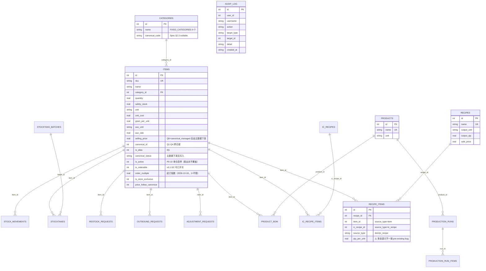

### 4.4 Schema 迁移约定（铁律）

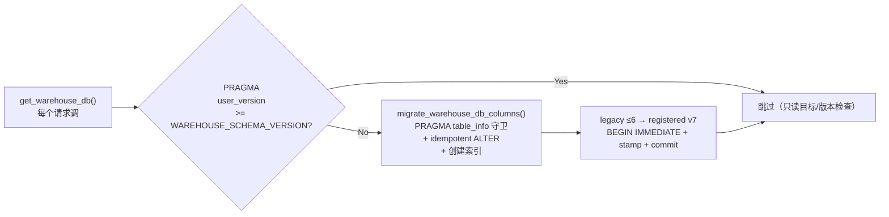

- **`WAREHOUSE_SCHEMA_VERSION = 7`**，改了 ALTER 块必须 bump。
- **新增 items 列只加到 `migrate_warehouse_db_columns()`，不加进 `WAREHOUSE_SCHEMA`**（tests 断言 WAREHOUSE_SCHEMA 不含 is_orderable）。
- **`init_master_db()`** 用 `fcntl.flock` 保护 gunicorn 多 worker 并发 ALTER。
- **所有绕过 `get_warehouse_db()` 直连 sqlite3 的代码（CLI / 测试 / MCP）必须先调 migrate**。
- **P0-6（2026-10-10 起）**：master.db 显式迁移走 `flask migrate status|up|down`（`migrations/__init__.py` 注册表 + `migrations_runner.py`，PRAGMA user_version 门控，每步前 sqlite3 backup API 热备到 `backups/migrations/`）。`init_master_db()` 幂等 ALTER 降级为兜底；**新 schema 变更一律加迁移条目**。回归 `tests/test_migration_runner.py`（9 用例）。当前 master 注册表到 **v8**（私有反馈回执表；仓库仍为 v7，互不混用）。

---

**warehouse v7（Issue #87）**：独立 `migrations/warehouse.py:WAREHOUSE_MIGRATIONS`
（不进入 master MIGRATIONS/v6），`db/warehouse_migrate.py` 为显式单仓 status/up/down 入口，
必须传 `--db`；禁止用 master 的 `flask migrate --db <warehouse> up`。
统一 wrapper 校验既有文件/warehouse表/future版，realpath相邻 flock 保护 SQLite API热备
（integrity_check，backups/migrations）及两阶段升级：旧幂等baseline最多stamp6，再由注册项
在 BEGIN IMMEDIATE 中添加doc_no/line_no/input_quantity/factor、部分唯一索引和永久journal，
同事务stamp7。v7失败全回滚；旧baseline可能留部分DDL，可重试补齐。v7 down安全拒绝，
首选保留schema/data的代码回退；备份恢复只在Prod协调停写与来源checkpoint后执行。
MCP warehouse_connection非只读路径在connect/yield前调wrapper，无需Web预热，mode=rw拒绝静默建空库；bot显式read_only路径不触发迁移，直接mode=ro打开已初始化仓库，保留查询零写入边界；
master_connection不迁移warehouse。软链共享真实路径锁，绿副本独立迁移；已v7不重复备份/ALTER。

## 5. 应用层模块图

**外仓 Web 查询（Issue #136）**：`app.py` 注册 `blueprints/wms.py`，配送中心的
「库存管理 → 外仓信息」在桌面侧栏与移动「更多」页同步出现。`templates/wms.html`
提供仓库/货主选择、库存及入/出库单据的服务端分页；`wms_detail.html` 展示按方向+唯一 ID
查询的头、货主、货物和独立库位分配。列表与详情共用登录/DC/viewer 权限和 no-store；仅 GET，
无同步、配置或库存写入入口。详情返回链接以 url_for 保留原筛选与页码，不接受外部跳转 URL。

**订单详情来源读取容错（Issue #111）**：仅在既有 `get_dc_items_for_order_detail()` 内
按来源隔离读取失败，不新增模块、路由、表或蓝图边界；行为详见 §10.3。

**Bot PR2 复用接线**：`bot.agent` → `bot.mcp_tools` → 22 个批准 MCP handler/service；`bot.tools` 保留旧查询接口。采购计算新增显式配置/只读参数供无缓存只读调用，canonical bindings 新增只读收集模式；没有新增蓝图、路由、表或预测算法。

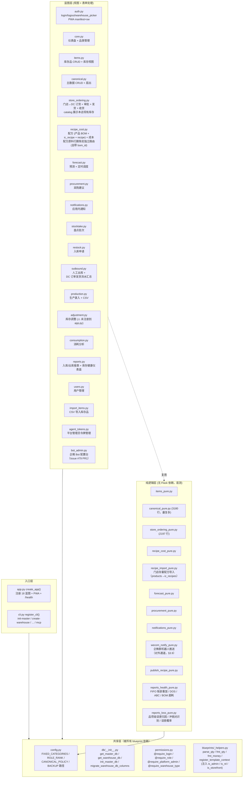

**约定**：`xxx.py`（蓝图，含 Flask 视图）和 `xxx_pure.py`（纯函数/类，便于测试和复用）成对出现。改业务规则时**优先改 pure**，再让蓝图调它。

Issue #107 的 DC 调货接收沿用现有蓝图与模板：`dc_transfer` 提供本仓发送/收货列表，
`store_ordering` 按单据目标仓决定收货视角及收货动作；不新增库存写入口。
普通门店订货沿用原 storefront/admin 守卫；严格目标仓检查只作用于调货，不收紧平台管理员既有代收能力。

`fulfillment_pure.py` 按显式来源仓解析唯一有效履约行，别名/停用行不参与，缺失/多绑定/单位或阻断冲突失败关闭；返回原始成本与库存，独立价格/倍数 helper 沿用订货规则，且不回查当前路由（测试：`tests/test_fulfillment_pure.py`）。
订单详情库存/价格/品类 enrichment 也复用该解析器，并核对已固化的仓内行 ID，避免跨仓同 ID 串读（Issue #109，详 §10.3）。
Issue #111 仅在该详情 helper 内标记来源库读取可用性错误；坏库/缺 schema/锁竞争
按来源隔离，master 与非预期异常继续上抛，不扩展到订货写事务；兼容 Python 3.10+ 的 SQLite 驱动。

**UI 导航结构（2026-10-13 导航模块化起）**：面向用户的信息架构收敛为 **7 模块** —
总览 / 库存管理 / 生产管理 / 门店订货 / 采购 / 通知 / 管理员，三个载体（桌面侧边栏 /
移动底栏 / `/land` 模块卡片）共用同一套模块归属与角色口径。归属决策与载体规则见
[`docs/2026-10-13-nav-modules.md`](2026-10-13-nav-modules.md)。

---

Web单据撤销/删除接线（#87）：outbound rollback/delete、restock status/delete 从读取
状态开始取同一warehouse BEGIN IMMEDIATE锁，成功commit；异常及early return显式rollback。
新增MCP身份不进入Web表单，Web新行仍保留NULL身份/input和factor默认1。

## 6. 蓝图依赖关系

`wms.py` Web 蓝图调用 `mcp_server.service.wms_web`，只复用旧 `wms` 的连接/配置/安全错误
包装；Web 多货主权限不进入 MCP 票据或 Bot，旧 MCP 单货主函数/参数/输出/工具声明保持不变。
`Filters` 在边界解析页码、ID、日期和每页条数；白名单 (1,3) 服务端固定，其他原可见仓仍限配置货主。
无本地或外部库存写路径。`permissions_manifest` 登记列表及 `wms.detail` 两个 DC 登录只读端点。

Issue #111 的来源读取容错留在 `store_ordering_pure.get_dc_items_for_order_detail()`
内部，未新增蓝图间依赖。

**Issue #80**：bot 只读采购 adapter 复用 `blueprints.procurement.compute_store_procurement` 和 `procurement_pure.aggregate_hub`，以显式配置值跳过 Flask 生命周期初始化与缓存写入；canonical 详情复用 `canonical_pure.collect_bindings(read_only=True)`。这些路径只依赖已初始化的数据库，无 Flask request/app context。

```mermaid
flowchart LR
    classDef root fill:#fef3c7,stroke:#f59e0b,stroke-width:2px
    classDef pure fill:#dbeafe,stroke:#2563eb
    classDef bp fill:#e0e7ff,stroke:#4f46e5

    Shared["config / db / permissions<br/>(_helpers)"]:::root

    Auth[auth.py]:::bp --> Shared
    Auth -->|audit()| RecipeCost
    Items[items.py]:::bp --> Shared
    Items --> ItemsPure[items_pure.py]:::pure
    Canonical[canonical.py]:::bp --> Shared
    Canonical --> CanonicalPure[canonical_pure.py]:::pure
    StoreOrdering[store_ordering.py]:::bp --> Shared
    StoreOrdering --> StoreOrderingPure[store_ordering_pure.py]:::pure
    StoreOrdering --> WecomNotifyPure[wecom_notify_pure.py]:::pure
    StoreOrderingPure --> Procurement[procurement.py]:::bp
    StoreOrderingPure --> NotificationsPure[notifications_pure.py]:::pure
    StoreOrderingPure --> ProcurementPure[procurement_pure.py]:::pure
    RecipeCost[recipe_cost.py]:::bp --> Shared
    RecipeCost --> RecipeCostPure[recipe_cost_pure.py]:::pure
    RecipeCost --> RecipeImportPure[recipe_import_pure.py]:::pure
    RecipeCost --> PublishRecipePure[publish_recipe_pure.py]:::pure
    RecipeCost -->|audit()| Auth
    Forecast[forecast.py]:::bp --> Shared
    Forecast --> ForecastPure[forecast_pure.py]:::pure
    Procurement --> ProcurementPure
    Notifications[notifications.py]:::bp --> Shared
    Notifications --> NotificationsPure
    Outbound[outbound.py]:::bp --> Shared
    Outbound --> StoreOrderingPure
    Outbound -->|master.db 只读| StoreOrders
    Users[users.py]:::bp --> Shared
    AgentTokens[agent_tokens.py]:::bp --> Shared
    BotAdmin[bot_admin.py]:::bp --> Shared
    Reports[reports.py]:::bp --> Shared
    Reports --> ReportsHealthPure[reports_health_pure.py]:::pure
    Reports -->|master.db 只读| StoreOrders["store_orders（门店履约）"]
    Others["stocktake/restock/production/<br/>adjustment/consumption/<br/>core/import_items"]:::bp --> Shared
```

**依赖原则**：
- 蓝图层可以调 **pure 层 + 其他蓝图层**（如 `recipe_cost` 调 `auth.audit()`）。
- **pure 层不依赖 Flask 上下文**（不 import flask），便于测试和跨场景复用。
- `store_ordering_pure` 是跨最多业务的纯模块（订货同时触发采购缓存重建 + 通知事件）。
- `store_ordering_pure.list_available_dc_items()` 同时读取 DC 与当前门店仓：DC 行决定
  目录范围/价格/起订倍数，门店行按 `canonical_id` 以 `SUM(quantity)` 提供
  `store_quantity` 展示值。
- `get_dc_items_for_order_detail()` 按订单行固化来源分别建立只读仓库连接，复用
  `resolve_fulfillment_item()` / `parse_price_and_multiple()`；详情查询不触发仓库迁移。
  来源专用 connection/cursor 在执行和取行时标记读取可用性错误，避免把解析器内
  master 查询错误误当来源缺货；驱动有错误码时按稳定 primary code 分类，Python 3.10
  无元数据时只匹配已知 SQLite 读取可用性消息，每来源忙等待 250ms，失败后不重试（Issue #111）。
- 调货的 DC 收货方复用 `dc_transfer_pure` 的收货进度与 `store_ordering_pure.receive_partial()`；
  单行收货和调货的整批收货快捷入口共用既有幂等协议，来源解析仍按冻结的订单行。
- `outbound.py` 复用 `store_ordering_pure` 的发货动作常量，并在 DC 视角只读
  `master.db.store_orders` 给订单发货流水补订单链接。
- `wecom_notify_pure` 是**唯一对外通道**：只读 `config` + 标准库 `urllib`，不碰 DB、不碰 Flask 上下文；蓝图把订单字典传进去，它负责渲染 + POST。任何新事件接入都走 `WEBHOOK_EVENT_MAP`（§3.9），不要在蓝图里自己拼 HTTP 请求。

---

MCP与Web单据写路径通过同一SQLite写锁协调（#87），不新增蓝图依赖。
request物理删除只撤销库存/流水，不删除永久journal，避免后续MCP重放复活。

## 7. 请求生命周期

### 7.1 Web（Cookie 会话）

外仓页沿用会话与选仓初始化，再经 DC 守卫、筛选校验、货主范围外仓列表与
SELECT 查询进入 Jinja 渲染。Web 只提交 GET，响应标记 no-store；上游失败
只回固定安全状态，不让半次结果被误认为完整库存。

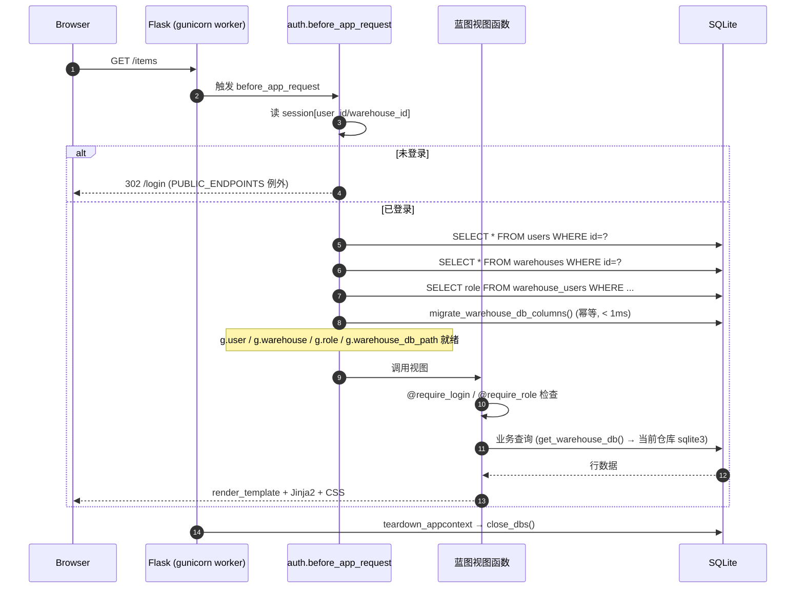

**AJAX 双路径契约**：`static/ajax-form.js` 给请求打 `X-Requested-With: fetch` + `Accept: application/json`。`register_ajax_handlers(app)` 注册的 after_request hook 检测到这两个头时，把视图的 3xx redirect 按 Location 语义改写成 JSON 信封——业务 PRG 返 **200 `{ok:true, location, message}`**、跳登录页返 **401 `{ok:false, reason:auth_required}`**、跳选仓页返 **409 `{ok:false, reason:warehouse_required}`**（2026-10-18 起，修掉旧版「任何 3xx 一律 200 ok:true」的假成功），同时 drain Flask flash 进 `message`；非 AJAX 路径（浏览器整页 POST / curl / MCP）保留 302 redirect 字节级不变。详见 §13.7。

### 7.2 MCP（HTTP Bearer）

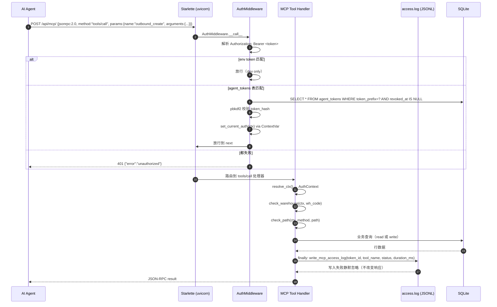

**消费工具 ACL（Issue #103）**：`warehouse_consumption` / `item_consumption` 在 handler 内先按
`GET /api/v1/consumption/warehouse` / `GET /api/v1/consumption/item/<id>` 调用既有
`check_path`，再进入带仓库范围检查的服务层。空读路径、仅写路径或不相干读路径失败关闭；
路径授权与仓库白名单必须同时满足，拒绝发生在仓库解析、打开和迁移之前。

**工具调用审计（Issue #85）**：`protocol/server.py::call_tool` 在 `finally` 中为每次进入该路由的调用追加恰好一条 JSONL 记录。`status` 是业务结果（成功 200 / `McpError.http_status` / 未知工具 400 / 非预期异常 500），不是 HTTP 传输状态；`agent_token_id` 取自 AuthMiddleware 发布的请求级 `AuthContext`，缺失时为 `null`，绝不回退到进程 env token 重新认证。日志写入失败被吞掉，handler 不会重跑。未进入 `call_tool` 的 401/429、SDK 参数校验、`initialize` / `tools/list` 仍只有传输层日志。细节见 §9.5。

### 7.3 跨库发货提交协议（2026-10-29，多仓履约 Task 5）

`POST /store-ordering/orders/<id>/ship` 的**操作仓恒为当前 DC 会话仓**，平台管理员也
不例外：门店会话或未选仓直接 403（`tests/test_ship_op_protocol.py` 场景 h）。订单需在
该仓有来源行（`order_participants`）才可操作；表单行 ID 的来源不是操作仓即整批拒绝，
不扣任何库存（场景 c）。

**显式提交行归属（Issue #146）**：HTTP 适配保留 `shipped_items[N]` 中的零/空数量
ID，把完整 map 交给领域层；`_select_ship_lines()` 先校验每行属于目标订单且来源为
操作仓，再跳过零数量行。混合批次的本单本仓零行仍不发货，显式全零/全空批次拒绝，
不会回落旧版全发；归属校验在幂等批次查询前执行，新请求及同键重放均适用。
失败沿用 PRG 并标记 `flash(..., "error")`，AJAX 对应 HTTP 409 / `ok:false`。

提交分两段短事务，由 `store_ordering_pure.ship_partial()` 串起：

1. **仓库库** `BEGIN IMMEDIATE` → `fulfillment_pure.resolve_fulfillment_item()` 解析本仓
   唯一有效履约行 → 条件原子扣减 `UPDATE items SET quantity=quantity-? WHERE id=?
   AND quantity>=?`（`rowcount==0` → 库存不足，整批回滚）→ 写
   `stock_movements(action, delta=-qty, op_no)` → COMMIT。
2. **master** `BEGIN IMMEDIATE` → INSERT 批次头（`store_order_deliveries.warehouse_code`）
   + 逐行 `store_order_delivery_items` → 行累计
   `UPDATE store_order_items SET shipped_quantity=shipped_quantity+?,
   ship_op_no=? … WHERE … shipped_quantity+?<=quantity AND ship_op_no<>?` →
   **锁内重读全部行**聚合 → `UPDATE store_orders SET status='shipped' … WHERE
   status='approved'`，`changes()==1` 才写状态历史；路由仅在该条件迁移成功时发一条
   `store_order_shipped` 通知（场景 f：两仓各发最后一行 → shipped/通知各恰一次）。

**幂等键**：详情页下发隐藏字段 `op_no`（`generate_op_no()` = uuid4 hex），表单回传；
缺省时服务端补生成（旧客户端兼容）。`store_order_delivery_items.op_no` 是单列 UNIQUE，
因此写入时按行派生 `line_op_no = f"{op_no}:{order_item_id}"`，仓库流水的 `op_no`
用同一派生键；重试经派生键命中既有批次 → 返回原 `delivery_id`、不重复扣减、不重复
通知（场景 b）。仓库段按派生键跳过已应用行，master 段唯一冲突同样回落幂等返回。

**孤儿对账**：仓库已提交而 master 批次未落（场景 d 故障注入）由
`reconcile_orphan_shipments(master_conn, wh_conn_factory)` 兜底——扫描各 DC 仓
`op_no IS NOT NULL AND delta<0` 且无对应 `store_order_delivery_items` 的流水，
回加库存并写 `op_no='REV:<line_op_no>'` 红字冲销；重跑按 REV 键判重，幂等。
库存差额的恢复只在人工调用对账作业时发生，不作为正常请求路径。

### 7.4 跨库收货提交协议（2026-10-29，多仓履约 Task 6）

收货沿用 §7.3 的「op_no 幂等 + 短事务」模式，由 `receive_partial()` 串起三段：

1. **master** `BEGIN IMMEDIATE` → 行级键 `op_no:order_item_id` 查/插
   `store_order_receipts(op_no, applied=0)` → 条件累计
   `UPDATE store_order_items SET fulfilled_quantity=fulfilled_quantity+? … WHERE id=?
   AND fulfilled_quantity+? <= 上限`（超收 `rowcount==0` 整批回滚）。上限按行取
   `fulfilled + order_item_receivable_qty()`，即**受已发数封顶**（旧 v2 数据
   status=shipped 且 shipped=0 时回落订货量）。审批中（approved）也可按行收货。
2. **仓库库** `BEGIN IMMEDIATE` → 按派生键跳过已存在流水；缺 items 行时按 canonical
   自动建行（Issue #130：`selling_price` / `unit_cost` 取自该行来源仓
   `COALESCE(soi.source_warehouse_code, so.dc_warehouse_code)` 经
   `resolve_fulfillment_item()` 解析出的**唯一 active 非 alias 绑定行**，不按
   `canonical_id` 任意匹配；绑定无法解析时记 0/0 并输出 WARN
   `[receiving] source binding unresolved canonical_id=<id> warehouse=<code> error=<class>`；
   源价为 0 时保持 0 并输出 WARN
   `[receiving] auto-created item without price canonical_id=<id>`，均不阻塞收货）→
   原子加库存 + 写 `stock_movements(op_no)` → COMMIT。已存在的绑定行不重新定价。
3. **master** `BEGIN IMMEDIATE` → `applied=1` + 回写 `store_item_id` → 锁内重读全部行，
   全行收齐时 `UPDATE store_orders SET status='delivered' … WHERE id=? AND
   status='shipped'`；`changes()==1` 才写 SHIPPED→DELIVERED 历史并置收货时间。

**幂等与故障恢复**：同 op_no 同数量重试返回 `idempotent=True`（不重复入库/通知），
同键换数量或换订单直接拒绝。仓库段失败 → master 侧 `applied=0` 保留；重试经派生键
补做仓库段后置 1。`reconcile_orphan_receipts()` 扫描 `applied=0` 且仓库缺流水的
receipt 补库并回填，已存在流水则只标记 applied。收货表单隐藏字段 `op_no` 由详情页
下发（每次渲染换新键），旧客户端缺省时服务端生成。

**取消竞争**：`cancel_order()` 在同一 `BEGIN IMMEDIATE` 内条件写
`UPDATE store_orders SET status='cancelled' WHERE id=? AND status IN ('pending','approved')`，
`changes()==0` → 「订单状态已变更」；已有收货/发货记录仍整单拒绝。发货先提交则取消
必然失败、订单保持 approved，不会出现「已取消但货在途」。取消已审批订单的权限改走
`can_act_on_order(..., perm="order.approve")`（D12：需对**全部参与仓**具备
`order.approve`，平台管理员绕过），缺失仓在提示中列出。测试
`tests/test_receipt_op_protocol.py`（纯函数）与 `tests/test_store_ordering_store_route.py`
（路由 op_no 下发/回传/重放）。

---

## 8. 鉴权架构

外仓 Web 使用 `@require_login` + `@distribution_center_only`，并登记
`permissions_manifest.ROUTE_MATRIX`。DC viewer 可读，普通门店/R&D 返回 403；
平台管理员保留既有仓库类型绕过。外部仓库筛选仍限定服务端配置的同一货主，
不接收调用方 customer/owner，不改变 MCP 路径 ACL 或 Bot 批准池。

### 8.1 三种身份

| 身份 | 用途 | 凭证 | 鉴权位置 |
|------|------|------|----------|
| **Web 用户** | 浏览器访问 | Flask session cookie（HttpOnly + SameSite=Lax，prod Secure） | `auth.before_app_request` |
| **MCP Bearer** | AI Agent 通过 HTTP 调用 | `Authorization: Bearer <token>` | `mcp_server/main.py:AuthMiddleware` |
| **CLI** | `flask ...` 命令 | 无（进程级，信任部署环境） | 直接 sqlite3 |

### 8.2 装饰器

| 装饰器 | 文件 | 作用 |
|--------|------|------|
| `@require_login` | `permissions.py` | 必须登录 + 已选仓库（除非 view 在 `WAREHOUSE_EXEMPT`） |
| `@require_role(min_role)` | 同上 | 必须达 `min_role`（staff=1/manager=2/admin=3）；`is_admin` 平台管理员 bypass |
| `@require_platform_admin` | 同上 | 必须 `g.user.is_admin=1`（不绕过） |
| `@require_warehouse_type(*types)` | 同上 | 当前仓库类型必须在白名单（rd/storefront/dc） |
| `storefront_only` / `distribution_center_only` | 同上 | 上述的白名单语义糖 |
| `@require_permission(*codes)` | 同上 | **权限点（RBAC）**：当前用户须持有全部 codes（AND）；语义与 `require_role` 对齐（登录→超管 bypass→选仓→权限） |
| `@require_any_permission(*codes)` | 同上 | 任一 code 命中即放行（OR），用于「owner 或提权」场景 |

### 8.3 鉴权关键路径

```mermaid
flowchart TB
    Request[HTTP Request] --> Check{endpoint 在<br/>PUBLIC_ENDPOINTS?}
    Check -->|Yes| Skip[跳过鉴权]
    Check -->|No| HasUser{session 有 user_id?}
    HasUser -->|No| Login[302 → /login]
    HasUser -->|Yes| LoadUser[加载 g.user/warehouse/role]
    LoadUser --> Decorator{视图装饰器}
    Decorator -->|@require_login| NeedWh[需要 warehouse_db_path]
    Decorator -->|@require_role| RoleCheck{role 达 min_role?}
    Decorator -->|@require_platform_admin| AdminCheck{is_admin?}
    Decorator -->|@require_warehouse_type| TypeCheck{wh_type 匹配?}
    NeedWh --> RoleCheck
    RoleCheck -->|Yes| Execute[执行视图]
    RoleCheck -->|No| Flash403[flash + abort 403]
    AdminCheck --> TypeCheck
    TypeCheck --> Execute
```

**注意**：`@require_role` 和 `@require_platform_admin` 都允许 `is_admin=1` 通过。`@require_platform_admin` 反而**要求** `is_admin`，这是有意区分（前者"在这个仓库里权限够" vs 后者"全局管理权限"）。

### 8.8 深链回跳（next 透传 + 同源校验，2026-10-17 起）

**症状**：企微群订货通知带 `https://kjtang.cn/store-ordering/orders/<id>`，点开后落到登录页，登录完回到仓库选择页 / 首页，**回不到那张订单**。

**根因是三处断点连成的链**（缺一处就断）：

1. `templates/login.html` 的 `form action` 用 `url_for('auth.login')`，**不含查询串** → POST 打到无 `next` 的 `/login`，`request.args.get("next")` 恒为 `None`；
2. 跳转侧只给 `request.path`（丢查询串），且 `/select-warehouse` 跳转**不带 next**；
3. `warehouse_select` 结束固定 `redirect(url_for("core.land"))`，深链在这一步彻底丢失。

**契约（新增跳转必须照此实现）**：

| 环节 | 产出 / 消费 | 代码位置 |
|------|-------------|----------|
| 未登录跳登录 | `next = permissions.current_relative_path()`（`request.full_path` 去掉结尾 `?`，即 **path + query**） | `permissions.py` 全部守卫（`require_login` / `require_role` / `require_platform_admin` / `require_warehouse_type` / `_guard_prelude`）+ `blueprints/auth.py:load_user_and_warehouse` |
| 已登录未选仓跳 picker | `next` 同上，`warehouse_picker` 读回并传给模板 | `permissions.py`、`blueprints/auth.py:warehouse_picker` |
| 登录表单 | action 带 `next` **且** 加 `<input type="hidden" name="next">`（双保险：action 丢 query 时仍拿得到）；模板只渲染**已过 `_safe_next`** 的 `next_url`（视图传参），未校验值不进 HTML | `templates/login.html`、`blueprints/auth.py:login` |
| 登录成功 | `nxt = _safe_next(request.values.get("next"))`（`values` 覆盖 query + 表单）；无 `next` 时：恢复上次仓库成功 → `core.land`，否则 `url_for("auth.warehouse_picker")`（§8.9） | `blueprints/auth.py:login` |
| 选仓表单 | action + 隐藏域都带 `next_url`（视图传入，无则空串） | `templates/warehouse_picker.html` |
| 选仓成功 | 有 `next` → `redirect(next)`；无 → `redirect(url_for("core.land"))` | `blueprints/auth.py:warehouse_select` |

**`_safe_next(raw)`（`blueprints/auth.py`）是唯一可信入口**：`next` 会经浏览器往返，回来时按不可信输入处理——裸 `redirect(next)` 等于开放重定向（`/login?next=https://evil.example`：受害者真登录，然后落到钓鱼页被再收一次密码）。只接受**同源相对路径**：非空、以单个 `/` 开头、不以 `//` 或 `/\` 开头、`urlsplit()` 的 `scheme`/`netloc` 为空、无控制字符；其余一律返回 `None`（调用方回落默认页），**不抛异常**（畸形值不能把登录流程变成 500）。

**铁律**：任何人新增「跳转 + 回跳」逻辑，`next` 必须过 `_safe_next`；直接 `redirect(request.args.get("next"))` 视为安全缺陷。`warehouse_select` 的租户闸 / 绑定闸（→ 403）与 `next` 无关，先校验后跳转，顺序不得调换。

**回归**：`tests/test_auth_next_redirect.py`（34 用例）——未登录/未选仓两条链路的 next 保留、登录（隐藏域 + 查询串两种形态）、选仓有无 next 两个分支、开放重定向 6 种载荷参数化（`http://evil.com` / `//evil.com` / `/\evil.com` / `https:/evil.com` / `javascript:` / 空串）、跨租户与未绑定仍 403、以及端到端链 `未登录深链 → 登录 → 选仓 → 订单详情 200`。

### 8.9 登录后恢复上次仓库（2026-10-19 起）

**症状**：点企微通知里的审批链接 → 未登录 → 登录成功 → **仍先停在 `/select-warehouse`**，要再点一次仓库才回到审批页。`next` 没丢（§8.8 已修），丢的是「上次在哪个仓」。

**根因是两条独立决策叠加**：`login` 成功时 `session.clear()` 把 `warehouse_id` 一并清掉；picker 原设计又明确「不记忆、每次都要点」（`no auto-remember of last warehouse`）。对通知深链来说，这一跳纯属多余。

**实现**：

| 环节 | 行为 | 代码位置 |
|------|------|----------|
| 记住 | 手动选仓成功后写 `users.last_warehouse_id` | `blueprints/auth.py:warehouse_select` |
| 恢复 | 登录成功后读回该列，校验通过则写入 `session["warehouse_id"]` | `blueprints/auth.py:login` |
| 校验 | 恢复前重跑**租户闸 + `warehouse_users` 绑定闸**（`_warehouse_visible_to`）；仓库已删/已解绑/跨租户 → 视为「没选过」，回落 picker | `blueprints/auth.py` |
| schema | `users.last_warehouse_id INTEGER`（可空 = 从未选过），`init_master_db()` 里 PRAGMA 守卫做幂等 ALTER | `db/__init__.py` |

**铁律**：自动选仓不得比手动点按钮更宽松——三条入口（每请求钩子、登录恢复、picker POST）必须共用 `_warehouse_visible_to`。给它加任何「免绑定」豁免都等于开越权口子：非 admin 的合法组合只有「本租户 **且** 有绑定」。

**回归**：`tests/test_auth_remember_warehouse.py`（12 用例）——写入/403 不写入、登录直达深链（含端到端 200）、无历史仍走 picker、跨租户/解绑/删仓三种失效回落、admin 跨租户例外、session 里塞未绑定仓被清回 picker。

### 8.6 租户隔离（P0-1 轻方案 PoC，2026-10-10 起）

- `master.db`：`tenants` 注册表 + `users/warehouses/canonical_items.tenant_id`（默认 1 = 存量单租户，老库 ALTER 自动回填）。
- 请求上下文：`g.tenant_id`（auth 钩子从 user 行取）。
- 三道闸：① 钩子加载仓库时校验 `warehouse.tenant_id == user.tenant_id` **且 `warehouse_users` 存在绑定**（`blueprints/auth.py:_warehouse_visible_to`；`is_admin` 平台管理员豁免。绑定闸 2026-10-19 补齐，见 §8.9）② picker 只列本租户 ③ `/select-warehouse/<id>` 走同一函数（跨租户 / 未绑定脏数据 → 403）。
- 新仓放置：租户 1 保持 `db/warehouses/`；租户 N 落 `db/tenants/<N>/warehouses/`（`flask create-warehouse --tenant N`）。
- **PoC 未覆盖（后续阶段）**：canonical 扇出/订单/MCP token/报表查询的租户化过滤；当前仅列/读仓与选择入口强制。回归 `tests/test_tenant_isolation.py`（8 用例）。
- **账号管理（v2 2026-10-12 起）补完**：`/users` 路由全套按 tenant 过滤 —— `list_users` 接受 `?tenant_id=`（admin 跨租户可指定，非 admin 强制 scope 到 `g.tenant_id`）。见 §8.7。

### 8.7 账号管理 v2（feat/user-admin-v2，2026-10-12 起）

- **页面重写**：Notion/Linear 风格 —— 顶部工具栏（搜索/角色/租户/启停/排序/新建）+ 紧凑表格（一行一用户，6 列）+ 右侧 360px 抽屉（编辑/创建/批量绑定/启停/删除）。`templates/users.html` 重写，`static/users-admin.css` + `static/users-admin.js` 新增（零依赖）。
- **schema**：`users.is_active INTEGER NOT NULL DEFAULT 1` + 复合索引 `idx_users_tenant_active (tenant_id, is_active)`。PRAGMA 守卫做幂等 ALTER（`db/__init__.py:init_master_db`）。
- **登录拦截**：`blueprints/auth.py:login` 在密码校验之前先查 `is_active=0`，命中返回 403 + flash「账号已停用，请联系平台管理员」。不进入失败计数（避免已停用账号仍触发锁定）。
- **新 endpoint**：
  - `POST /users/<id>/toggle-active`：切换 `is_active`（不能停用自己 —— 防锁出唯一 admin；可重新启用）。
  - `POST /users/bulk-bind`：body=`user_ids[] + warehouse_id + role`，`INSERT OR IGNORE` 保证幂等（已绑定的 (user, warehouse) 静默跳过），无 user 时 flash 报错。
- **list_users 查询参数**：`q`（≥2 字 LIKE）/ `role`（用户在任一仓库持有该角色）/ `tenant_id` / `is_active` / `sort`（白名单 id/username/last_login_at，可加 `-` 前缀降序）/ `page` / `page_size`（默认 20、上限 100）。`?format=json` 显式开启返回 JSON envelope（默认浏览器走 HTML）。**sort 白名单必须比对「剥离 `-` 之后」的列名**：先去掉前导 `-`（`sort[1:] if sort.startswith("-")`）再查集合，否则 `-last_login_at` 会落到 fallback `id` 且方向仍是 DESC（降序静默变 id 倒序）。
- **守卫统一**：移除 `blueprints/users.py:_require_admin()`，全 view 改用现成的 `@require_platform_admin` 装饰器（`permissions.py:54`）。`agent_tokens.py` 的同名内联守卫本次不动（独立 PR 范围）。
- **测试**：`tests/test_users_admin_v2.py`（40 用例）覆盖搜索/筛选/启停/批量绑定/租户过滤/守卫/停用登录拦截/分页/排序（升降序 + 白名单兜底）/创建权限矩阵默认值/`/users` 不可缓存（含 `sw.js` 缓存边界的静态断言）/schema 迁移幂等/既有 endpoint 回归。Spec：`docs/decisions/SPEC-user-admin-v2.md`。⚠️ 抽屉 JS（`users-admin.js`）无 pytest 覆盖：`escapeHtml`、radio 默认值、刷新时序、SW 缓存这类缺陷只能靠浏览器冒烟（Playwright + 本地实例：admin 登录 + 选仓后断言 URL 不含 `format=json`、每仓库恰 1 个 `:checked`、改库后同 URL 取到新值、离线导航落 `offline.html`）——后续应把冒烟脚本沉淀为自动化用例。
- **工具栏刷新机制（2026-10-13 修正）**：筛选/翻页走 `fetch(带筛选参数的 /users)` + `DOMParser`，只替换 `#users-tbody` 与 `.users-pagination`，`history.replaceState` 同步地址栏；表格/分页标记仍由 Jinja 渲染（JS 不重复实现行渲染，避免两套标记漂移）。三条硬约束：① **禁止 `window.location.assign` 到带 `?format=json` 的 URL**——那会把整个管理页换成裸 JSON（曾发生：点一下筛选/翻页页面就没了）；② 待替换的分页节点会被整块换掉，`click` 监听必须挂 `document`，插回时锚点用 `.users-table-wrap`（`tbody.insertAdjacentHTML` 落在 table 上下文会触发 foster parenting，分页条被塞进表格内部）；③ 只认最后一次请求（`refreshSeq` 序号），change 分支不 debounce，旧响应晚回来不得覆盖新结果。URL 参数以地址栏现有值为基底（`page_size` 等非工具栏字段得以保留），并强制 `delete('format')`。④ 页面内 `fetch` 的 HTML **必须不可缓存**：这正是当初踩到 SW cache-first 的原因，见 §11「SW 缓存边界」。两层各自的作用：HTTP/代理层靠 `Cache-Control: no-store`；SW 的 Cache API 层靠 `sw.js` 的「只缓存同源 `/static/`」范围判断（**no-store 对它无效**）。
- **抽屉 JS 约定（2026-10-13 修正）**：`static/users-admin.js` 用 `innerHTML` 拼抽屉内容，所有来自 DB 的字符串（用户名/仓库名/租户名）必须过 `escapeHtml()`——实体表必须是真实体（`'&': '&amp;'` 等），写成裸字符等于空转、构成存储型 HTML 注入。抽屉里的编辑目标 uid 必须由调用方把被点击的 `tr.users-row` **显式传给 `renderEditDrawer(row)`**（uid 在函数内从 `data-user-id` 取出），不要经 `drawerBody` 的 DOM 属性中转（那段 html 在属性写入之前就拼好，会拿到空的或上一个用户的 id → 批量绑定绑错人）。**同一 radio group 内只能有一处 `checked`**：浏览器取文档序靠后的那个，创建抽屉的权限矩阵曾因此把"不动矩阵直接创建"变成"给新账号授上每个仓库的 manager"（v1 默认是「无权限」，必须保持）。
- **明确不做**（v2 不引入）：自助改密（无"个人中心"页）、租户 CRUD（PoC 仅做了字段）、agent_tokens 页面重写、修改用户名、审计 UI（`admin_audit.log` 仍是 JSONL）。

### 8.4 CSRF 保护（2026-10-10 起）

- `app.py` 挂 `CSRFProtect`（Flask-WTF）；`_csrf_testing_gate` 在 `CSRFProtect` **之前**注册（Flask before_request 按 FIFO 执行），`TESTING=True` 时默认关闭 CSRF（存量测试零改动），专测设 `WTF_CSRF_FORCE_ENABLED=True` 打开。
- 所有 `method="post"` 表单均带 `{{ csrf_token() }}`（`scripts/add_csrf_tokens.py` 注入 + `--check` 校验，新增模板后跑一次）。
- MCP（`/api/mcp/`）在独立 Starlette 进程、Bearer 鉴权，不经 Flask CSRF。
- 回归：`tests/test_csrf.py`（7 用例）。

### 8.5 Rate limiting（P0-4，2026-10-10 起）

- **全局**：`app.py` 内存滑动窗口（`rate_limit_pure.SlidingWindowLimiter`），每 IP 600 次/分钟（env `DAILYCHECK_RATE_LIMIT_PER_MIN` 可调），`/health`/static 豁免；TESTING 默认关（`RATE_LIMIT_FORCE_ENABLED` 打开）；超限 429。gunicorn 多 worker 各自计数、重启清零（v1 约定，Redis 升级路径预留）。
- **登录锁定**：master.db `login_throttle` 表（跨 worker），(ip, username) 维度，15 分钟窗内连错 5 次 → 锁 30 分钟；成功登录清零。**时间一律 UTC naive**（`datetime.utcnow()`），与进程时区无关，规避生产 CST/UTC 坑。
- **MCP per-token 配额**：`agent_tokens.rate_limit` 列（NULL=`MCP_DEFAULT_RATE_LIMIT`=120/分钟），`AuthMiddleware` 内存滑动窗口按 token_id 限速，超限 429；单进程内共享、重启清零。
- 回归：`tests/test_rate_limit.py`（15 用例）。

### 8.7 权限点（RBAC）精细化管理（2026-10-13 起）

**模型**：角色 = **权限点集合**。25 个权限点目录（order 5 / stock 6 / item 6 / report 3 / admin 5）定义于 `permissions_manifest.py::PERMISSION_CATALOG`；5 个内置角色包（`ROLE_PACKAGES`）——阶梯包 `staff(10) ⊆ manager(17) ⊆ admin(18)`，旁支包 `viewer(3)` / `finance(4)`（`rank=NULL`，不参与阶梯）。**单一事实来源** `permissions_manifest.py` 被守卫 / 管理 UI / 测试四方共用（守卫用 `@require_permission`，测试用 `tests/test_route_permission_matrix.py` 校验覆盖与不变式）。

**解析（`permissions.py::current_permissions()`）**：每请求一次 JOIN 查 master.db（`warehouse_users → roles → role_permissions`），结果缓存到 `g.perm_set`——**禁进程级缓存**（gunicorn 多 worker 会各自漂移）；**fail-closed**：任何异常 → 空集 → 403 + 日志；`is_admin=1` 返回全目录哨兵（超管直通）。未知角色 code（JOIN 空集）→ 403。

**订单参与仓与目标仓鉴权（2026-10-29）**：`has_permission(user_id, perm, warehouse_code=...)`
按目标仓解析内置/当前租户角色；省略目标仓时使用当前仓。既有 `has_permission(*codes)`
调用语义及 `g.perm_set` 不变；显式目标解析使用独立的请求缓存 `g.target_perm_sets`，
键为 `(user_id, warehouse_code, tenant_id)`，无绑定、跨租户、未知角色或查询异常均失败关闭。
平台管理员恒放行，显式用户检查不借用当前会话用户的管理员身份。
`store_ordering_pure.order_participation_sql(alias="so")` 返回参数化 `EXISTS` 谓词，
以 `COALESCE(soi.source_warehouse_code, so.dc_warehouse_code)` 识别参与仓，避免多行 JOIN
使计数翻倍；头仓仅兜底历史 NULL 来源行。`order_participants(master_conn, order_id)`
返回去重排序的参与仓；请求内适配器 `can_act_on_order(user_id, order_id, perm="order.approve")`
逐仓校验并返回 `(是否全部授权, 缺权仓列表)`，空订单失败关闭，平台管理员返回 `(True, [])`。
SQL 工具无 Flask 上下文依赖，供后续列表、报表与 MCP 统一复用；本阶段未切换现有路由守卫。
回归：`tests/test_order_participation_pure.py`、`tests/test_permissions_target_warehouse.py`
及既有 `tests/test_route_permission_matrix.py`（断言零修改）。

**存储**（master.db，`init_master_db()` 幂等播种）：`permissions` / `roles` / `role_permissions` / `permission_routes`（Web 与 MCP 共用词汇表，Phase B 填充）/ `approval_policies`（Phase 3 扩展点，空表）。启动断言 `_verify_builtin_packages()`（空包 / 阶梯破坏 / 权限数契约 / 越界点 / 孤儿点）**告警不 raise**（防单点数据问题拒绝启动）。改包后须 `flask reseed-builtin-roles` 显式重播种（`INSERT OR IGNORE` 不更新已存在行）。

**成本脱敏 / 成本读访问**（服务端，`blueprints/cost_redaction_pure.py`）：报表导出 `export_consumption` / `export_summary` 对无 `report.cost.view` 者把成本列留空（列结构不变）；**配方成本读接口**（`recipe_cost` 5 个 CSV 导出 + `api_cost` + `overview` 总览页）挂 `report.cost.view`（staff/viewer 403）；`/summary`、`/inventory` 页**不脱敏**（Eric 终裁④，口径例外）。另 `users.html` 页脚已注明「仓管理(该仓全权，品项删除除外)」（对齐终裁②：`item.delete` 为平台级）。

**兼容层**：`require_role` 阶梯与权限点**并存**——本期未迁移的路由（canonical 管理、import_items、stocktake CSV、forecast 非 index、procurement、store_ordering DC list/ship、reports 营业额写）保持 `require_role`/`require_platform_admin`，语义零变化。回归：`tests/test_route_permission_matrix.py`（49 用例）+ `tests/test_master_db_migrate.py`（RBAC 7 用例）。设计见 `docs/2026-10-12-permission-spec.md` / `-architecture.md` / `-implementation-plan.md`。

**管理 UI（阶段 1）**：`users.list_users` 向 `templates/users.html` 注入 `role_options`（`[{code,label}]`，**来源 `permissions_manifest`，顺序 = `BUILTIN_ROLE_CODES`**（staff→manager→admin→viewer→finance），`label` 取自 `ROLE_META`）；模板的角色选项与标签**一律渲染 `role_options`**——模板不得硬编码角色名单/中文名。**绑定校验与展示同源**：`blueprints/users.py::VALID_ROLES = set(BUILTIN_ROLE_CODES)`（5 包，取代旧 `ROLE_RANK` 仅 3 阶梯包）——管理员可把用户绑定到旁支角色 `viewer`/`finance`；未知角色 code 由 `_parse_binding` 在绑定层先拒（与运行时 JOIN 空集 fail-closed 呼应）。角色标签样式见 `static/role-tags.css`（语义：实心=可写 / 描边=只读；`viewer` 虚线、`finance` teal 描边、平台管理员琥珀）。阶段 2 的 `/admin/permissions` 权限矩阵视图见 Spec §7。

---

## 9. MCP 架构

> **哪些场景不该走 MCP**：MCP 是给 Claude / Cursor 这类外部 AI 客户端协商工具用的协议，不是给人用的 HTTP API；它同时也是**写操作的入口**（32 个工具里 10 个会改数据）。面向员工的自然语言查询走 §3.12 的独立机器人进程，PR1 只暴露 9 项 LLM schema；#80 PR2 按 §3.12 显式复用批准的 MCP handler，查询连接仍 `mode=ro`，七项 canonical 写仍禁止 bot 执行。#78 D4 批准的三写仅能通过独立护栏通道，缺少真实身份或范围策略时仍拒绝执行；不能仅为「复用」接入其他 MCP 写工具。批准边界见 [`docs/integrations/dailycheck-bot-runtime-contract.md`](integrations/dailycheck-bot-runtime-contract.md)。

### 9.1 进程拓扑

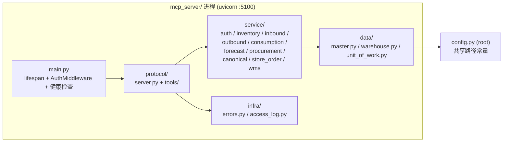

### 9.2 32 个 MCP 工具

**Bot PR2 调用接线**：22 个批准 handler 接受可选的显式 `ctx`，原 HTTP/stdio 未传时保留原鉴权链。bot 永远显式传入，读上下文携带 `read_only=True`，三写仅在护栏通过后构造最小权限上下文。MCP 本身 32 项注册不变，bot 不对七个 canonical 写接线。`AuthContext.warehouse_base_dir` 仅是受信数据根，bot 一律设为 `db_dir().parent`；共享 `warehouse_paths` 供旧工具、UoW、采购和 canonical bindings 使用，解决独立代码/CWD 下相对元数据路径的歧义。消费 handler 自身执行既有路径 ACL（Issue #103），bot adapter 的固定路径矩阵仍保留；采购 hub 聚合前按仓范围过滤。只读连接、采购无缓存 adapter、canonical bindings 无迁移模式的参数均保留主站/MCP 的既有默认行为。

**统一登记（Issue #104）**：`mcp_server/protocol/registry.py::REGISTRY` 是唯一工具登记，
每项包含原始 `Tool` 声明、真实 callable handler、业务域、读写意图、路径/范围的**实际执行位置**、
内部可验证输出 JSON shape、外部子集/Bot批准状态及回归引用。`tools.get_tools()` 深复制声明，
`server._tool_map` 从登记派生；启动时拒绝重名/无效handler，检查命令另扫描全部工具模块，
拒绝漏注册实现、漏实现和错误绑定。Bot 的显式批准白名单仍由 `bot/tool_contract.py` 独立持有，
仅做一致性核对，不从动态发现授予权限；32运行项、19外部集成子集、22 Bot批准项、七canonical写禁用不变。

完整清单由 [`integrations/dailycheck-mcp/registry.md`](integrations/dailycheck-mcp/registry.md)
及 `registry.json` 生成，替代这里的手工平行表；既有 `tools.json` 保留19项子集，不是完整注册表。
`python -m scripts.mcp_contracts --write/--check` 确定性生成/只读校验三份产物，检查失败返回非零；
JSON 对象键递归排序，保留全部元数据和值及数组次序，消除 SDK 字段声明顺序造成的文本漂移；
`--check` 仍逐字校验，不放行真实内容变化、非规范格式或尾随文本。
命令无需服务或数据库，可供CI接线。输出 shape **不**传给SDK `outputSchema`，不启用
`structuredContent`，保留原description/input与TextContent中的JSON业务形状。
其中 `items_detail` 仍列表包装、`procurement_hub` 仍数组、`canonical_fanout_event` 缺事件仍null、
`canonical_fanout` 实返 `per_canonical`；台账如实记录旧description差异，不借本次改包装。
仓清单仍无MCP路径检查，Bot adapter另做检查；两个消费handler已由#103补齐GET路径检查，
登记元数据随已审查依赖同步，仓库范围仍在service校验。全局canonical读、
fanout目标无token仓过滤等现状均显式注明，不把元数据当成新增守卫或授权。

**独立Bot部署接缝**：Bot也import `get_tools()`，新增registry模块树需要随Bot独立部署同步；
主站蓝绿成功不证明Bot已加载新版本。Prod按标准流程核实Bot实际加载版本/依赖及代表性授权读，
七canonical写排除和三写护栏保持原样；writer不接触生产。

**门店订单只读域（Issue #73）**：`store_order_list` / `store_order_detail` 只读 `master.db` 的门店订单五张表（`store_orders` / `store_order_items` / `store_order_deliveries` / `store_order_receipts` / `store_order_status_history`），无迁移、无写语义、无删除语义。策略来源复用 `blueprints/store_ordering_pure.list_orders` / `.get_order_detail`（与 `service/canonical.py` 复用 `canonical_pure` 同一先例），`mcp_server/service/store_order.py` 只负责 ACL 翻译与返回形状整理。

| 项 | 契约 |
|---|------|
| 路径 ACL | `GET /api/v1/store-orders`（列表）、`GET /api/v1/store-orders/<id>`（详情） |
| 仓库可见性 | **「订单参与仓」谓词**（spec §10）：门店仓 **或** 任一明细行来源仓（历史 NULL 行回落头仓；无明细行的存量单回落头仓）命中 `allowed_warehouses` 即可见；`allowed_warehouses=None` 全可见。范围外的单对列表不可见、对详情等同「不存在」（不泄露存在性） |
| **ACL 扩权（显式）** | token 命中**任一参与仓** → 可读**全单**：包括由其他参与仓履约的行、金额与收货历史。已写入工具 `description` 与 `docs/integrations/dailycheck-mcp/` |
| 列表过滤 | `warehouse_code`（门店仓或任一参与仓命中皆可）/ `status` / `limit`（1–500）/ `offset` |
| 详情形状 | `order`（头）+ `items` + `deliveries` + `receipts` + `status_history` 五段；`items` 含 `canonical_name` / `quantity` / `fulfilled_quantity` / `dc_item_id`（null 表示尚未回填配送中心 items.id）/ `dc_item_bound` 布尔标记 / **`source_warehouse_code`（行来源仓）**；`deliveries` 每批含 **`warehouse_code`（实际发货仓）** |

> **统一可见性谓词（多仓履约 Task 10，spec §10）**：列表、计数与详情共用 `mcp_server/service/store_order.py::_visibility_sql()` 一段纯 SQL `EXISTS` 谓词（`EXISTS (… store_order_items soi WHERE soi.order_id = so.id AND COALESCE(soi.source_warehouse_code, so.dc_warehouse_code) IN (…))`，外加门店仓命中与无明细行存量单的头仓兜底）。`EXISTS` 保证多行同仓不把订单计数翻倍。`sop.list_orders` 仍是单仓 AND 过滤器，服务层按「门店侧 + 参与仓」两个入口各查一次再按订单 id 合并去重（`_scope_filters`），分页仍满足「各子集取前 `limit+offset` 行 → 合并去重 → 全局排序 → 切片」。列表 `total` 由同谓词的 COUNT 给出，因此 `list` / `total` / `truncated` / 详情成员关系一致。

**列表分页（Issue #74）**：`outbound_list` / `restock_list` 返回分页信封
`{items, total, limit, offset, truncated}`，口径与 `service/canonical.py` 一致：

| 项 | 契约 |
|---|---|
| `limit` | 默认 100，clamp 到 `[1, 500]`（0 / 负数 → 1；>500 → 500） |
| `offset` | 默认 0，clamp 到 `>=0`（负值 → 0） |
| `total` | 与列表同一数据源的 `COUNT(*)`，**不随 limit/offset 变化** |
| `truncated` | `total > offset + len(items)`（首页 True、末页 False） |

数据层 `list_outbound` / `list_restock_movements` 各带 `LIMIT ? OFFSET ?` 与配套
`count_outbound` / `count_restock_movements`；`ORDER BY created_at DESC, id DESC`
的 `id` tie-break 是分页正确性的一部分（同秒多行时仅按 `created_at` 排序，
逐页 OFFSET 可能重复/遗漏）。回归 `tests/test_mcp_list_pagination.py`（见 §12）。

**口径一致性与入参校验（Prod 复审 B1-B3，2026-10-29）**：
- `count_outbound` / `list_outbound` 统一 `LEFT JOIN items`。`outbound_requests.item_id` 虽有 FK
  声明，但 SQLite 连接默认 `PRAGMA foreign_keys = 0`，库存品物理删除不会清理历史出库申请，
  孤儿行真实存在（生产 `wh_003` 实测 17 行）；统一 LEFT JOIN 后 `total` 恒等于实际可翻页行数，
  孤儿行 `item_name` 为 null 而非被静默丢弃，客户端按 `truncated` 翻页不会多出空页。
- `mcp_server/service/pagination.py` 严格解析 `limit` / `offset`：非整数（None / 非数字字符串 /
  小数 / 布尔）抛 MCP 结构化 `ValidationError`，由 `protocol/server.py::call_tool` 捕获，
  不再让裸 `ValueError` / `TypeError` 穿透成非结构化错误。
- 外部 agent 的机器可读契约 `docs/integrations/dailycheck-mcp/tools.json` 同步 `limit` / `offset`
  与 `{items,total,limit,offset,truncated}` 信封描述。
- 回归 `tests/test_mcp_list_pagination.py` 补孤儿行 fixture、`truncated` 终止判定、
  类型守卫与实际 `call_tool` 的结构化错误序列化用例；生产同形种子（1630 条关联行 +
  17 条孤儿行）返回 1647 条、17 页、末页 47 条且 `truncated=False`。变异仅将
  `count_outbound` 改回 INNER JOIN，5 个出库分页用例转红。

> **`restock_list` 的数据源（Issue #72，2026-10-27）**：读 `restock_requests` LEFT JOIN `items`，
> 返回 `{id, item_id, item_name, quantity, status, reason, created_at}`（`created_at DESC, id DESC`）。
> 此前读 `stock_movements` 且过滤 `action='restock'`，而入库流程写入的是 `action='补货入库'`，
> 因此该工具恒返回空数组。写路径（`restock_create`）未改动；分页信封见上方 Issue #74 契约。

**单据行写契约（Issue #87）**：restock_create/outbound_create 保持原required三字段，quantity均number；
reason后新增keyword-only doc_no/line_no/factor（默认1）。doc/line成对、不接受显式null，保留大小写/
前导零；doc_no为opaque字符串，`<source>:<external_doc_no>`是调用方约定，不强制前缀。
Decimal局部context计算来源quantity×factor，仅一次2dp HALF_EVEN，拒绝非正/非有限/REAL丢分位。
requested_quantity仍存基础有效量；新MCP保存规范化input_quantity/factor，历史/Web保持NULL/'1'。
两request表部分唯一索引（非NULL doc+line）及document_write_keys主键(direction,doc_no,line_no)
共同保护，同事务写request/journal/items/movement；journal跨物理删除永久保留、不回填reason。
service BEGIN IMMEDIATE + busy_timeout=5000后读键/库存，出库条件UPDATE quantity>=量并核验rowcount；
data不commit；UNIQUE异常rollback后新事务重查，其他完整性异常不吞。相同载荷replay返回原id，
replayed=true/applied=false；变更item/原始量/factor即409，reason不覆盖。回滚重放不复活，删除后409。
发布的tools.json与运行时注册项的工具描述逐字一致，由schema契约回归钉住。
create额外返回doc_no/line_no/input_quantity/factor/status/rolled_back/replayed/applied；
list只增加doc_no/line_no/input_quantity（字符串或null）/factor（number），#72/#74信封/total/排序不变。
MCP rollback与Web outbound rollback/delete、restock status/delete均在写锁内判状态。
warehouse commit后才失效master缓存；失败返回cache_invalidation_failed、committed=true/request_id/
retry_safe（有键true）；带键重试修缓存不补库存，无键不得自动重做，不承诺跨库原子。

#### 9.2.1 外部 WMS 只读桥接（3 项）

**Issue #140 Web 独立范围**：新增 `mcp_server/service/wms_web.py`，只复用 WMS
连接、环境配置与安全错误包装，不改变下述 MCP 单货主函数、注册、schema 或 Bot 池。
Owner 2026-11-03 确认 Web 多货主仅含 `sy_warehouse` ID 1（朴宇冷库）及 3（朴宇仓）；
默认同时查两仓，空仓仍保留选择。其他原可见外仓仍限配置货主，不接受调用方扩张白名单。
`WebScope` 不可变，库存/货主选项/单据头及明细均在 SQL 绑定仓库范围；货主筛选只收窄。
`Page` 用 SQL Server 2008 R2 的 ROW_NUMBER + 唯一 goodsBalanceID（单据为日期+唯一头 ID）
分页，计数/品项数与当前筛选一致，不合计不同单位数量；分页反映实时查询，不承诺跨请求快照。
`DocumentKey` 为方向枚举+唯一头 ID；`DocumentDetail` 区分完整/空明细/截断，库位分配独立
查询并归属明细，禁止一对多 JOIN 重复行数量。查询异常不伪装空结果。
结构依据 Coordinator 经授权的真实 SELECT/schema/PK/FK 取证（2026-11-03），
CI 仅以合成数据运行 SQL 方言适配及 Flask 桩化测试，不连第三方 WMS；真实候选及生产验证归 Prod。


`wms_stock_list` / `wms_stock_summary` / `wms_documents_list` 读的不是 DailyCheck 自己的
SQLite，而是租仓方 WMS（SQL Server）中**本货主**的数据。边界如下，改动前必须逐条确认：

- **只读**：`mcp_server/service/wms.py` 只拼 SELECT，不提供任何写入路径。
- **单货主固定**：货主 ID 来自 `DAILYCHECK_WMS_CUSTOMER_ID`（默认 155），**不接受调用方
  传入**。上游同库还挂着其他数十家货主，放开传参等于横向越权。
- **凭据只走环境变量**（`DAILYCHECK_WMS_HOST` / `PORT` / `USER` / `PASSWORD` /
  `DATABASE` / `TDS_VERSION`），不落库、不入日志；`WmsConfig.__repr__` 不回显口令。
- **驱动与配置都可选**：未装 `pymssql` 返回 `wms_driver_missing`，未配置返回
  `wms_not_configured`；两种情况都不会影响其余工具注册与启动。
- **不进 Bot 池**：`bot_approved=False`，企微侧读不到外部系统；外部调用方仍走既有
  `/api/v1/wms/*` 路径 ACL 与 `agent_tokens` 票据。
- **CI 不连上游**：上游是第三方生产库，契约测试用桩数据跑 dispatch/serialization，
  真实连通性只在部署环境验证。

**Web 查询边界（Issue #140）**：默认两朴宇仓全部货主；仓库 ID 经可见选项校验，货主选项
来自该仓范围库存/历史单据。库存按 goodsBalanceID 唯一排序、单据按 bizDate+头 ID 唯一排序；
ROW_NUMBER 分页及 CTE 同范围计数支持超过 500 条，编码/货主筛选也影响概览。
库位分配单独查询，保留明细单位/数量/批次；明细上限 2000、库位分配上限 10000，超限明确
标为不完整。有效头无明细单独提示；缺失或越界单据 404；无效条件 400；未配置/缺驱动/
连接或范围不可用详情 503、查询失败详情 502。列表页在上游故障时仍 200 展示错误状态以保持
导航可达，全部固定安全提示/no-store，不展示半次结果或上游错误。

### MCP 变更影响门禁（Issue #105）

`scripts/agent_framework/check_mcp_impact.py` 在 main 参考提交与 HEAD 的 merge-base 上读取
Git diff（含删除/重命名两端）与完整 `registry.json` 前后快照。非测试 Python/SQL 与业务、DB、
MCP、Bot、配置/权限路径及运行时依赖清单（含 requirements*.txt/.in、pyproject.toml、
常见 lock/环境/解释器版本文件）保守触发 PR JSON 声明：新增/更新/不变/暂不开放、受影响工具、
理由及测试证据。新旧工具名并集容纳新增名称；实际契约记录差异必须逐项覆盖，删除或重命名
旧名须有 compatibility 处置声明。工具名只按非空/无重复/台账精确成员校验，不新增小写命名
政策，登记有效性复用原 contracts checker。它只验证声明，不代替兼容协议测试或授予 Bot 能力。

既有必需 reports job 先运行 `python -m scripts.mcp_contracts --check`，证明提交台账与全部
实时声明/实现/维护文档一致，再运行影响门禁；两步退出码均保留。检查器不 import 历史代码，
不访问业务数据库。PR 模板与权威 workflow 定义同一声明格式，示例见
`docs/agent-framework/mcp-impact.md`；缺声明/非法字段/未知工具/无理由或证据均拒绝。
纯页面新增可以说明不变或暂不开放，无自动开放 MCP 的要求；批准池与运行时 ACL 不变。

### 9.3 双传输模式

| 模式 | 入口 | 鉴权 | 用途 |
|------|------|------|------|
| **stdio** | `flask mcp` | 进程 env `DAILYCHECK_MCP_TOKEN` | 本地 Claude Code |
| **HTTP/SSE + StreamableHTTP** | `python -m mcp_server --transport http` | Bearer → agent_tokens 表（per-token 仓库/路径 ACL） | 远程 Agent |

**HTTP 入口路径**：
- `/sse`（legacy SSE）
- `/messages/`（SSE POST）
- `/api/mcp/`（StreamableHTTP，**推荐**）
- `/health`（同样需Bearer鉴权；HTTP 200/503，顶层status仍为ok，监控须看HTTP和checks）

CLI裸入口默认stdio，HTTP默认bind `127.0.0.1:5100`；仓内systemd明确传入
`--transport http --host 0.0.0.0 --port 5100`。StreamableHTTP manager配置
`json_response=True, stateless=True`；legacy SSE端点仍挂载。health的DB检查仅`SELECT 1`，
不证明schema完整或工具成功；所有HTTP路由都经过AuthMiddleware。MCP代码变动须重启进程。

### 9.4 鉴权回退链

```mermaid
flowchart TB
    Req[HTTP Request with Bearer] --> Env{DAILYCHECK_MCP_TOKEN<br/>env 匹配?}
    Env -->|Yes| Pass1[放行（dev/兼容）]
    Env -->|No| Table[查 agent_tokens 表<br/>WHERE token_prefix=?<br/>AND revoked_at IS NULL]
    Table --> Found{找到 + pbkdf2 通过?}
    Found -->|Yes| SetCtx[set_current_auth(ctx)<br/>记录 ContextVar]
    Found -->|No| Legacy[查 NULL 前缀的历史行<br/>回退路径]
    Legacy --> Found
    Found -->|No| Deny[401 unauthorized]
    SetCtx --> Pass2[放行到工具处理器]
    Pass1 --> Pass2
    Pass2 --> Handler[工具 handler 用 resolve_ctx() 取 ctx]
    Handler --> ACL{check_warehouse +<br/>check_path 通过?}
    ACL -->|Yes| Exec[执行业务]
    ACL -->|No| Forbidden[403 ForbiddenError]
```

### 9.5 工具调用审计（access.log，Issue #85）

`mcp_server/protocol/server.py::call_tool` 已接通既有的 `infra/access_log.py::write_mcp_access_log`。每次**实际进入** `call_tool` 的调用在 `finally` 中追加恰好一条 JSONL 记录到 `BASE_DIR/access.log`；handler 只执行一次。

| 字段 | 值 / 语义 |
|------|-----------|
| `ts` | UTC ISO-8601 时间戳 |
| `agent_token_id` | 请求级 `AuthContext.token_id`；无已认证上下文为 `null`。不从进程 env token 重新认证，避免串号 |
| `path` | 固定 `/api/mcp/`（MCP 层无 HTTP path 语义） |
| `method` | 固定 `tools/call` |
| `status` | 业务结果：成功 `200`、`McpError.http_status` 原值（如 400/401/403/404）、未知工具 `400`、非预期异常 `500`。**HTTP 传输状态不参与判定** |
| `duration_ms` | 单调时钟计算的毫秒耗时，非负 |
| `tool_name` | 可选扩展字段；未知工具也会记录，长度上限 128 字符 |

边界与隐私：

- 只覆盖进入工具层的 `tools/call`。401/429 在 `AuthMiddleware` 提前返回、SDK 参数校验拒绝、`initialize` / `tools/list` 均**不**产生该记录，仍走既有 uvicorn/传输日志。
- 记录只含上述元数据；不写 raw token、token hash、`Authorization`、arguments、`reason`、异常堆栈或响应内容。未知工具名经 `json.dumps` 转义并限长，不会注入多条物理日志行。
- `write_mcp_access_log` 内部吞掉所有异常；`call_tool` 再兜一层，日志失败不会改变既有响应、不会重放业务。
- 回归：`tests/test_mcp_access_log.py`（根目录，CI 可收集）。真实生产文件路径不在测试中写入，测试用临时路径替换 `_ACCESS_LOG_PATH`。

---

Issue #144 扩充 store_order_detail 的内部 output_shape 和生成台账：有效量/原始量、
价格来源/未知状态、锁定金额、商业 revision 和安全变更摘要。工具数量与原 wire
声明/路径 ACL 保持兼容；服务层对头/明细使用显式字段白名单，不暴露内部 command、
claim、权限集合或原始 proposal 快照。GET/只读 MCP 不回填 schema 或写 stale。

## 10. 业务领域模型

### 10.1 仓库类型

| 类型 | 用途 | 行为 |
|------|------|------|
| `storefront` | 门店（有实体库存） | 出入库/盘点/补货可见 |
| `rd` | 研发中心 | **无库存**；主数据管理；ic_recipe 编写 |
| `distribution_center` | 配送中心 | 给门店供货；store_ordering 审批/发货 |

### 10.2 Canonical 主数据治理（Q1-Q7）

| 策略 | 值（v4） | 含义 |
|------|----------|------|
| Q1 门店自建新主数据 | `deny` | 门店不能自建全新品项（白名单 = 空） |
| Q2 门店自治字段 | `open` | 允许门店自定义字段 |
| Q3 主数据删除 | `deactivate_only` | 只允许停用，禁止物理删除 |
| Q4 扇出冲突 | `freeze` | 冻结冲突字段，人工处理 |
| Q6 价格归属 | `canonical_managed` | 售价/采购价收归主数据 + 扇出下发 |
| Q7 库存零丢失 | `strict` | 扇出前自动备份；写库前 `shutil.copy2`；禁止真库写测试 |

> **Q7 `guard_real_db` 软链穿透防护（2026-10-15）**：prod 部署把 `db/warehouses/*.db` 做成指向 `/var/lib/dailycheck/warehouses/` 的软链，`resolve()` 会穿透使路径比较失配、guard 放行（verify.sh check1 在 prod 首演实测抓到）。guard 现对**未 resolve 的 absolute parent** 再比一次，任一命中即拒——改部署布局（换数据目录/软链形态）时必须保持此语义。

**显式履约路由（2026-10-29）**：`blueprints/item_routing_pure.py` 负责租户 1 的
`item_routing` 播种及 CRUD。独立 master v5 迁移只扫描同租户、类型为
`distribution_center` 的仓内绑定，要求主数据 `status='active'`、本地
`is_active=1 AND is_alias=0 AND is_store_exclusive=0`；唯一 DC 自动启用，多个 DC
列为 ambiguous，无 DC 列为 missing，仅存在专属 DC 行列为 skipped_exclusive。
门店专属标记是本店属性，不否决其他仓合法绑定。已有配置始终保留，迁移日志输出
四段审计清单；日常启动、扇出和 claim 不补种或改路由。
`routing_pending(master_conn, wh_db_map=None)` 只读打开登记的 DC 库动态诊断；缺库/坏库
显式失败，不把不完整扫描误当唯一候选。新增唯一绑定仍等待管理员显式配置。
新蓝图 `item_routing.py` 在 `app.py` 注册，入口 `/admin/item-routing`（主数据列表可达），
沿用 `@require_platform_admin`、仅租户 1、全局 CSRF，权限清单四个端点（含 `POST /admin/item-routing/batch`）均标为 PLATFORM；
支持完整列表、筛选、批量草稿以及兼容的单条设置/删除，设置记录 `updated_by/updated_at`。
路由配置不改已提交订单；纯函数不 commit，由调用方管理事务。
验证见 `tests/test_item_routing_pure.py` / `tests/test_item_routing_route.py`。

**路由草稿编辑器（Issue #100，2026-10-31）**：初次 GET 返回租户 1 全部品项（含停用），
品类由 `canonical_categories.code` 关联；专用 `item-routing.css/js?v=1` 用原生 JS
在浏览器组合筛选名称/SKU（不分大小写）、主数据品类、已保存仓、路由配置状态、已修改，
每页 50 项；200 仅为单批变更上限，绝不截断列表。桌面紧凑三列、≤1099px 卡片，
页面局部约束 app-shell/grid 自动最小宽度；长文本换行，select 旁完整显示已选仓名。
保存栏 sticky 位于移动底栏上方，ResizeObserver 测量含 safe-area 的实际导航高度。
`routing_diagnostics()` 单次只读扫描直接给出候选；路由配置状态、品项启停与候选诊断
分别展示，既有 missing（含唯一候选但尚未配置）不再标作“无来源”。不改目标仓绑定校验语义。

草稿 Map 以 canonical_id 为键，独立于可见页，筛选仓/配置状态始终按已保存值；改回原值
即删草稿，支持逐项撤销、确认放弃全部、beforeunload，**不写 localStorage**。
勾选仅当前页，换筛选/页清空勾选；统一设仓仅暂存。唯一底栏核对所有草稿（含隐藏项），
清除路由必须在核对中提示后续订货影响。保存期间冻结编辑/重复提交；只有逐项核验成功
响应才清草稿，400/409/503/认证或网络异常保留草稿及品项错误。网络结果未知允许原基线
安全重放；409 可逐项核对服务器值并明确确认新基线，不能静默覆盖。

batch JSON 为 `{changes:[{canonical_id, operation:"set"|"delete", dc_code, baseline:
{dc_code, updated_at}}]}`；delete 的 dc_code 为 null，原来无路由的基线两字段都为 null。
拒绝空批次、重复 ID、类型/操作错误、跨租户/非 DC/不存在品项、>200 项。
HTTP 层 `BEGIN IMMEDIATE` 后 `apply_batch()` 重读整批基线并校验所有项，再执行写入；
只 commit 一次，错误整批 rollback。当前仓已等于目标时跳过（不更新时间，支持重试）；
其他仓或时间戳不符返回 409 与 current 值，整批零写。仓码+秒级 updated_at 是本范围的
基础覆盖保护，**不宣称严格 ABA 保护**，不新增 schema/自动播种/自动路由。

审计沿用当前仓 `auth.audit()`（独立 commit），与 master **不跨库原子**。批量及兼容单条
均先 master commit 再审计；批量记录 batch_id、actor、每项 old/new 与 changed。
提交后审计失败保留真实成功响应（`audit_recorded=false`），服务日志携带批次及差异便于追查；
不得把成功路由写入说成回滚，不在 master 提交前发出成功审计。
路由 GET 与 batch JSON 标记 no-store；沿用全局 CSRF / 平台管理员 / 租户 1，不放宽认证。


**canonical 解绑 SQL 可移植性（Issue #108）**：`canonical_pure.unclaim_item` 的主库取消
认领改为 `UPDATE ... WHERE id=(SELECT id ... ORDER BY id DESC LIMIT 1)`，保留原
warehouse/local_item/status=approved 过滤与最新ID语义，避免依赖SQLite可选的
`ENABLE_UPDATE_DELETE_LIMIT`。标准CPython3.12/3.13的SQLite3.50.4未启用该选项时，
旧SQL会在仓库解绑已提交后抛语法错；本修复不改跨库提交顺序、不承诺额外跨库原子性，
只消除确定性语法失败。备份、原回执及库存/价格/业务字段保持不变；无匹配approved记录
仍正常解绑且不改主库其他记录。MCP handler权限与Bot七canonical写禁用保持原样。

### 10.3 Store Ordering 状态机

**收货自动建行复制来源仓价格（Issue #130，2026-11-02）**：`receive_partial` /
`reconcile_orphan_receipts` 在目标仓没有 canonical 绑定时创建 `AUTO-RECEIVE-<id>`
行，必须把该行来源仓（`COALESCE(soi.source_warehouse_code, so.dc_warehouse_code)`）
经 `resolve_fulfillment_item()` 解析出的唯一 active 非 alias 绑定行的
`selling_price` / `unit_cost` 一并写入，禁止沿用列默认 0，否则新行会以
¥0 参与门店订单计价。绑定缺失、歧义、单位不符或存在阻断冲突时不阻塞收货：
记 0/0 并输出 WARN
`[receiving] source binding unresolved canonical_id=<id> warehouse=<code> error=<class>`。
来源价/成本为 0 时保持 0、不阻塞收货，并由
`blueprints.store_ordering_pure` 输出 WARN
`[receiving] auto-created item without price canonical_id=<id>`。已有绑定行只加库存，
不重新定价。

**订单详情来源库存（Issue #109，2026-10-31）**：订单板自身没有库存列；
`/store-ordering/orders/<id>` 才显示履约仓库存并为门店/DC/平台视角提供单价。
`get_dc_items_for_order_detail()` 按行取 `COALESCE(source_warehouse_code, 头仓)`，
在该来源仓复用履约解析器的唯一有效绑定结果，已有 `dc_item_id` 必须与结果相同；
只有历史 NULL 行 ID 才允许按 canonical 解析。缺行、解绑、停用、别名、歧义、单位/
阻断冲突或固化 ID 不匹配时，沿用零库存/零单价和 canonical 品类兜底，不换仓、不换行。
库存、售价优先/成本兜底和本地品类来自同一经验证的行；历史负库存仍保留。
每个来源仓复用一条 `mode=ro` 连接和读事务，不创建物理库、不迁移、不改订单快照。
**来源读取容错（Issue #111，2026-11-01）**：连接、BEGIN、解析和 enrichment 的来源库
可用性错误（缺失/不可打开、损坏、缺表/列、busy/locked、读取 I/O/权限）沿用兜底，
不影响健康来源的库存/单价/品类。来源专用 cursor 标记异常，master 查询、SQL 语法/
绑定缺陷、非预期程序异常及写入错误仍上抛；不在其他业务事务增加捕获。
遵守 Python 3.10+：不引用 3.11 才提供的 sqlite3 错误常量；有错误码时按稳定 SQLite
primary code 判断，无错误元数据时仅对 DatabaseError/OperationalError 的已知读取
可用性/缺 schema 消息兜底，ProgrammingError/IntegrityError/InternalError 类型始终上抛。
显示查询设置 SQLite busy timeout=250ms，允许短暂让出写锁且避免默认 5s 等待；
同来源首个可用性失败即关闭连接并缓存失败，不逐行开库或重试。成功来源继续在同一
读快照中解析与取值，所有已打开连接（含 BEGIN 失败路径）均关闭。
这里的零库存/零单价表示 enrichment 不可用，**不是实际物理库存为零的证明**，显示
总金额也可能因兜底而下降；本次保留原返回结构及 UI，不新增不可用状态展示。
当前路由变更或跨仓创建开关不改变
存量单来源；`/inventory` 仍是当前会话仓库存，不作 DC 汇总。

**订单审批与出库可见性（Issue #64，2026-10-27）**：审批只更新订单状态并授权后续
发货，**不预留、不锁定库存**；DC 确认发货时才校验现有库存、扣减 `items.quantity`
并写入 `stock_movements`。`/outbound` 原先只读 `outbound_requests`，因此订单发货
实际发生了却不可见。现由 `outbound.outbound_list` 在配送中心上下文合并
`门店订货出库` / `总仓调货出库` 流水，按订单号回链订单详情，并明确标注这些记录
只能随订单流程处理，不能从 `/outbound` 单独回退。门店人工出库的数据源和操作不变。
回归由 `tests/test_store_ordering_dc_route.py` 中两个 Issue #64 用例锁定。

**订货目录显示本店库存（Issue #67，2026-10-27）**：`list_available_dc_items()` 仍以
DC 品项决定目录可订范围、价格与起订倍数，但在返回行上按 `canonical_id` 附带当前门店
全部绑定行的 `SUM(items.quantity)`（`store_quantity`）及绑定状态（`store_bound`）。
门店本地无绑定行时 `store_quantity=0`，**绝不能回退到 DC 的 `items.quantity`**；
后者继续只服务发货校验。门店启停过滤保持原语义：同一 canonical 的任一行已停用，
该品项仍从目录排除。
卡片和选品弹窗统一显示 `门店库存`，并把同一个 `store_quantity` 写入前端 `data-stock`。
这与既有提交语义一致：本店库存仅作参考，**提交订单仍不锁库存、不拦截 DC 库存不足**；
真正校验和扣减发生在 DC 发货。回归由
`test_catalog_displays_store_stock_not_dc_stock` 与
`test_catalog_sums_duplicate_store_bindings` 锁定。

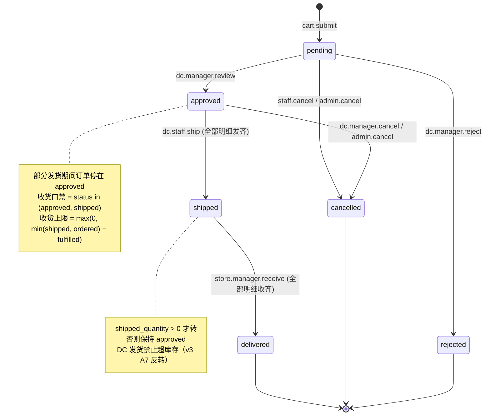

**跨仓发货（2026-10-29，多仓履约 Task 5）**：发货协议见 §7.3。行级来源固化后，
本仓发货只处理 `COALESCE(source_warehouse_code, 头仓) = 会话仓` 的未发齐行；旧入口
收口也遵守同一口径——表单空提交的全发兜底与旧 `qty` 字段都**仅作用本仓**，不会越仓
发货（`tests/test_ship_op_protocol.py` 场景 g）。`ship_partial()` 是唯一跨库提交入口；
`ship_order` / `ship_order_full` 保留为纯函数兼容包装（单一来源仓时自动推导操作仓，
跨仓必须显式传 `operator_dc_code`）。所有失败点均以 `op_no` 可恢复：同键重试幂等，
仓库已提交而主库未落由 `reconcile_orphan_shipments` 红字冲销。

**通知（多仓履约 Task 10，spec §11）**：每次状态迁移走 `store_ordering_pure.notify_order_event()` 向站内用户 fan-out，**收件人按有效权限解析，不硬编码角色名**：参与仓侧 = 在任一参与仓持有 `order.approve` 的在职用户 + 在职平台管理员；门店侧 = 下单人 + 在门店仓持有 `order.receive` 的在职用户。逐事件方向：提交 → 各参与仓审批人；批准/拒绝 → 门店侧；部分收货 → 门店 + **该批**来源仓（按最近一批 receipt 的 `order_item_id` 回溯来源仓，无收货行时回落全部参与仓）；全发齐 `shipped` → 门店（由 §8 条件迁移保证恰一条）；取消 → 参与仓审批人 + 门店；调货事件方向维持现状（发起/批准/发货 → 收货门店，收货 → 发货仓侧）。所有方向均排除操作者自己。**只有 `pending` 那一跳（`cart.submit`）额外推一条企微群消息**——见 §3.9；审批 / 发货 / 取消事件在 `WEBHOOK_EVENT_MAP` 里未登记，不对外推送。

**建单/目录/购物车去 DC 化（2026-10-29，多仓履约 Task 7）**：由 `config.MULTI_WAREHOUSE_FULFILLMENT` 控制（env `DAILYCHECK_MULTI_WAREHOUSE`，未设置时 `False`，见 §13.15），**关闭时行为与存量完全一致**，新逻辑只在开启后生效。

- **目录**：不再出现 DC 选择器，也不再读 session `store_ordering_dc`（开启路径直接 `session.pop`）。品项范围 = 既有四道门禁（canonical 有效 / 来源行 `is_orderable` / 门店启停 / 起订倍数）**∩ `item_routing` 配置**，再排除 `is_store_exclusive` 的门店行——`list_available_routed_items()` 按路由到各 DC 分别复用 `list_available_dc_items()` 再取交集，未配置路由与门店专属品项**不出现在目录**。
- **购物车**：`store_order_carts.dc_warehouse_code` 写 `NULL`，一用户一门店仍只有一行（`UNIQUE(user_id, store_warehouse_code)`）；行上展示的来源仓由当前路由派生，属显示态。
- **提交**：逐行一次性解析并**固化**——`item_routing` → `resolve_fulfillment_item()` → 价格/倍数快照，写入行的 `source_warehouse_code` / `dc_item_id`；此后路由变更只影响新订单（`tests/test_submit_routing.py` 的路由变更用例）。任一行未配置路由 → **整单退回**并列品项（D6）；门店专属品项同样整单拒绝。头 `dc_warehouse_code` 按 D8 取「行数最多的来源仓，并列取仓库码字典序最小」。
- **价格/倍数变化确认**：提交页把本页展示的单价与起订倍数随 `snapshot_price_<canonical_id>` / `snapshot_multiple_<canonical_id>` 回传；与提交时刻解析值不一致时**不建单**，渲染差异并要求勾选 `confirm_price_change=1` 重新提交。
- **草稿键 v2**：`dc.catalogDraft.v2:<user_id>:<store_warehouse_code>`（原 v1 为 `:<dc>`，见「未提交选择的草稿」）。catalog 写入与 cart 消费/清理同步切换；检测到旧 v1 键**立即丢弃并提示**，恢复草稿前按当前目录有效项剪枝，无效项列给用户。
- 回归：`tests/test_catalog_multi_dc.py`（6 例）、`tests/test_submit_routing.py`（9 例）、`tests/test_store_ordering_store_route.py` 的开关默认关闭用例；共享夹具 `tests/multi_warehouse_env.py`（两 DC + 路由 + 门店专属 / 未路由品项）。

**未提交选择的草稿（2026-10-17，Issue #100）**：catalog 页的品类 chip 与搜索框都是**整页 GET 跳转**，而弹窗确认的数量原先只活在当页 DOM 的 hidden input 里，一换筛选就重建清零。现在按 `dc.catalogDraft.v1:<user_id>:<warehouse_code>` 落 localStorage（7 天过期），**只存 canonical_id → 数量 / 单位名 / 单位档位**，不存整页快照：被筛选隐藏的项留在草稿里等下次露面，当前可见项由服务端重新渲染后再回填。选 localStorage 而非服务端 session，是因为弹窗「确认」是纯前端动作，走 session 得为每次点击加一次往返请求。三个收口点必须联动，缺一个就变静默漏单：

1. **弹窗确认** → 写/删对应条目 + 回填卡片；
2. **「加入购物车」submit** → 把草稿里**未在当前页渲染**的条目追加成 hidden input 一并提交（`cart_add_batch` 校验三组等长，追加时须同步 `selected[]`/`qty[]`/`unit[]`）。否则「A 品类填完 → 切到 B 品类 → 提交」只会提交 B；
3. **购物车页渲染时清空该 dc 的草稿** —— 批次加购已把草稿整体消费，不清的话从 bfcache 回退到 catalog 会拿旧 DOM 重复加购（`add_cart_item` 是**累加**语义）。

「清空选择」按钮同时清草稿；`pageshow(persisted)` 时按草稿重新同步一次卡片，修复 bfcache 的陈旧 DOM。附带修复：卡片 `unit[]` 存的是中文单位名（后端契约），弹窗单位 pill 的回填改读 `data-saved-unit` 的 `base`/`aux` 档位——原先直接读 `unit[]`，导致重复编辑同一张卡片时两个 pill 都不高亮、点「确认」静默无响应。

> 多仓开关开启后上述键与清理点整体切到 v2（`<user>:<store>`），见上一节「建单/目录/购物车去 DC 化」。

**起订倍数（2026-10-18）**：DC 可对每个品项设一个正整数倍数（`items.order_multiple`，1 = 不限），门店下单数量必须是它的整数倍（例：设 5 → 只能订 5/10/15…）。配置入口在 **DC 品项管理页**（`/store-ordering/dc-items`，`store_ordering.set_dc_item_multiple`），与「可订开关」同级同页，属**本仓字段**，主数据扇出不覆盖。

四道关口，缺一道就会被绕过：

1. **catalog 弹窗**（`templates/store_ordering/catalog.html`）：卡片 `data-multiple` → 弹窗给 `cm-qty` 设 `step/min`，确认时前端先拦一次并提示最近的合法值；
2. **加购**（`add_cart_item`）：按「合并后的数量」校验（3 + 2 = 5 通过，5 + 3 = 8 拒绝），抛 `OrderMultipleError`；
3. **改数量**（`update_cart_item_quantity`）：同源校验，路由 catch `ValueError` 后 flash；
4. **提交**（`validate_cart_for_submit` → `multiples` 列表 + `submit_order` 二次校验）：把「之前合法、后来倍数被调大」的存量购物车挡在订单外，模板禁用「发送」按钮。

**门店订货「中文名 + 审批入口」（Issue #122，2026-10-19）**：
- 订货单系列页面（`/store-ordering/review`、`/store-ordering/orders`、`/store-ordering/orders/<id>`）的「门店」「配送中心」列显示 `name (code)` 形式（`fmt_warehouse(name, code)` filter，定义在 `blueprints/_helpers.py`；name 缺失或与 code 等同时降级为 code），便于审批人识别门店。SQL 在 `blueprints/store_ordering_pure.list_orders` / `get_order_detail` 里 `LEFT JOIN warehouses ws/wd` 取 name。
- 桌面侧栏 `templates/base.html` 与移动端全模块页 `templates/land.html` 的「门店订货」模块组新增「订货审批」子项（条件 `is_admin or is_distribution_center`），让 DC 用户不必绕通知链接即可进审批页（修复前 DC 用户的导航组里只有 admin 子项，DC 用户找不到入口）。
- 「fmt_warehouse 注册方式」铁律：注册走 `app.jinja_env.globals["fmt_warehouse"] = fmt_warehouse`（**非 filters**），因为模板端是双参函数调用 `{{ fmt_warehouse(a, b) }}` 而非 filter pipe 形式 `{{ a | fmt_warehouse }}`；filter pipe 在双参情形下会被 Jinja 解析为「未知 filter」报 `UndefinedError`。
- 测试：`tests/test_jinja_helpers.py::TestFmtWarehouse`（5 个 case 覆盖 None / 空串 / name==code / code 缺失）；`tests/test_store_ordering_pure.py::TestIssue122WarehouseNames`（3 个 case 验证 list_orders / get_order_detail 返回 name + LEFT JOIN 守门员）；`tests/test_issue_122_nav.py::TestNavHasReviewEntry`（6 个 parametrized case 验证侧栏 + /land 链接集对 DC / admin / storefront 各角色正确显隐「订货审批」）。

`is_multiple_of` 用**相对容差**（`abs(qty − round(qty/step)·step) ≤ max(1e-9, step·1e-9)`）判定，不用 `%`——浮点二进制误差会让 `0.3 / 0.1` 判成 False。`normalize_order_multiple` 把脏值（None/非数字/≤0）一律回落成 1，避免配置错误把某个品项永久锁死。

**持久发货占用（Issue #144）**：所有 full/partial/legacy 包装最终进入同一
ship_partial：解析冻结履约行后，在 master 短事务重新校验 approved、DC staff
原能力、来源/有效量和 pending 受影响行，完整请求 hash 绑定订单、操作仓和全部
正数量行；整批登记后才扣库存。active/recovering 每行独占，无 TTL。
仓库写锁内检查 active、冻结 item/unit/line revision 与 REV；master finalize
同锁检查后写配送并将整批 committed。恢复先在 master active→recovering fence，
再取仓库锁按原流水 REV 幂等冲销，最后 master→aborted；失败保持占用，重复
恢复可继续，终态不复活。committed 先赢则恢复不冲销，fence 先赢则迟到 finalize
不可落配送。旧 cancel 也检查活动占用；人工孤儿核对对有 claim 的请求先走 fence，
旧无 claim 请求仍按原人工核对边界处理，不能在旧执行者未排空时运行此核对。
自动全发跳过暂停/占用行，显式批次含任一暂停正数量行整批拒绝。
三入口保留原始 `request_mode=explicit|legacy_qty|full`，模式与 scalar 原始归一量
进入完整 payload hash；explicit 始终比较调用者完整 map，full/scalar 仅重放首次冻结批次。
锁外读取只是提示：选行、旧流水观察、仓库连接/绑定解析及真实异常均为准备结果。
唯一最终 `BEGIN IMMEDIATE` 先读当前 claim、比原始意图/完整 hash 并重查权限，
committed 直接返回原配送，不依赖最新 remaining/blocked/绑定；active 恢复冻结行继续既有
执行协议，不能因迟到者准备失败触发 fence；recovering/aborted 拒绝，只有仍无 claim
才核对旧记录、当前 approved/有效量/pending、准备计划和冻结绑定后注册。
准备与锁内新选批不一致时明确拒绝重试，不持 master 写锁重新连接/迁移仓库。
发货要求独立 master 事务；调用者自有事务会在访问仓库前明确拒绝，不能把
`in_transaction` 当作已取得写入序列化能力。执行/恢复的锁顺序及 finalize 的 REV 检查保留。
旧无 mode 且有 legacy_quantity 的 scalar 只在原量可证及原完整 JSON/hash 严格匹配时重放；
无 mode 且无 scalar 的歧义键失败关闭待核对，不猜 explicit/full，不回写历史 hash。
explicit 的原始 map 同时保留给新批次的成员校验；hash 虽仅含正数量行，外来行 ID
即使数量为零仍沿用原能力明确拒绝，不能先滤除零项而绕过此校验。
最终短 master 事务匹配原始身份/hash 后，归属校验也覆盖已有 claim 的 explicit 重放；
新批次沿用选行器的归属校验。两者只读订单成员集合，不重算重放请求当前的
remaining、不重新解析单位/绑定，避免把合法 committed 重放重新绑定到可变准备状态。
dict 兼容包装省略操作仓时，selector 先校验完整 raw map 的全部 ID、沿用数量解析，
返回仅正数量的实际执行行；来源集合从该执行行集合推导，再复用同一集合登记/扣库。
同单其他仓零项不参与推导；指定操作仓时仍对完整输入执行主线来源归属限制。
已有 claim 的外单 ID 拒绝沿用主线含明细/订单 ID 的错误格式，身份与状态裁决不变。
显式指定操作仓的 matched-claim 路径亦保留 main 的完整 raw 来源归属限制；仅检查
master 中冻结的订单成员/来源，不连接仓库或重算 remaining/单位。省略操作仓的
dict 包装允许同单他仓零项，正量来源与权限仍由原冻结批次及 fresh 权限裁决。

部署前所有 Web 写实例必须具备此协议且旧执行者排空；提议入口持续关闭，
兼容回退不可删除 active/recovering claim。

**价格与有效量的兼容底座（Issue #144 / 父 #142 阶段一）**：普通新单在服务端
解析冻结来源行时同时保存商品名称/SKU/基础与辅单位、Decimal 文本单价及来源
（selling_price 优先，否则 unit_cost），legacy 与多仓提交均如此。每行扩展金额
按 quantity × 原精度单价 ROUND_HALF_UP 到分，再求和；运费按该合计与保存的
规则参数计算，同样 HALF_UP 到分。来源改价/改成本/换 active 规则不再改变旧单
金额；库存仍读来源仓当前值。两种提交路径均拒绝与履约基础单位不一致的购物车，
不推定隐式单位换算。历史未知价格、商品/运费规则快照保持 NULL，
金额显示待核对，当前价仅标参考；已记录的 shipping_fee 不伪称原规则或已付。
调货仍无金额语义。新商品/价格/原始量快照由 schema 触发器保护，历史 NULL
可在后续凭据核对后填入；不能反向猜测过去成交价格。

quantity 是包含已发部分的有效合同量，original_quantity 只用于审计；替换行
追加并通过 replaces_order_item_id / introduced_by_proposal_line_id 关联原行。
ship/receive 共用有效量聚合（取消行不进分母，applied=0 收货不能完成）；
未来接受事务调用 refresh_effective_order_state，取消最后未发量后可直接完成，
不伪造配送/收货，也不修写旧 shipped/fulfilled 历史。

**回退时的变更读取/撤回**：proposal 是独立整份实体，只有 pending 暂停受影响行；
GET/旧 MCP 仅投影摘要、历史和暂停原因。撤回不依赖 ORDER_CHANGES_ENABLED，
原提议人或全部联合仓审批者可执行，活跃/租户/权限在 POST master 锁内重查。
请求键绑定 actor/order/proposal/action/note；状态、command、审计及站内通知
同事务落盘。notifications_pure.enqueue_event 不提交，旧 emit_event 仍提交。
旧 cancel / review reject 原子令 pending stale，approve 遇 pending 明确拒绝；
原 DC staff 发货、仓范围与平台管理员明确操作仓能力保留。

**整份订单变更入口（Issue #145 / 父 #142 第二阶段）**：
`order_changes_pure.preview_proposal/create_proposal/accept_proposal/reject_proposal`
集中管理整份方案；`/store-ordering/orders/<id>/changes/new` 的原生表单先服务端预览，
再显式发布；成对 order/proposal 详情提供“同意整份方案”或必填留言拒绝。
新建/同意/拒绝由 `DAILYCHECK_ORDER_CHANGES` 默认关闭的开关控制，读取、撤回和
原 claim/fence/恢复协议持续有效，不增加 schema、MCP 工具或外部消息。

服务器按 version=1 生成不可变完整 before/after 行、货品/运费/总计/差额、
历史核对引用/说明/人/时间、联合仓与替换报价指纹；不信任客户端价格与金额。
原单正量的全部 NULL 单价须逐行核对（包括未改与将取消行），发布不填原价，
整份接受才锁为 verified；无历史商品快照时明确标当前识别描述，不能补造历史规格。
原已记录运费为 before_fee；新单按原规则快照重算，旧规则 NULL 默认沿用旧费，
调整须明确非负新费及凭据说明。行额 HALF_UP 到分后求和、整单费用再量化，
差额仅表示订单计价、待线下核对，不代表已付款/退款，不增加支付结算状态。

每条命令拒绝 caller 事务；仓库候选只读准备在 master 写锁外完成，短
BEGIN IMMEDIATE 内重读同租户活跃身份/角色包、全部原来源与新来源审批权、
目标店原下单人或经理/管理员的决定权、商业/受影响行基线与占用及 master 准备指纹。
平台管理员仍须明确目标店并记录代确认，提议人不能自确认；按钮共用 fresh 策略。
当前候选同时验证租户路由、canonical active、门店停用/专属、唯一 active 非 alias
履约行、单位/冲突、可订、倍数及服务端报价。跨库配置无法原子锁定，仅记录观测
指纹/时间及边界；接受后库存仍只在实际发货时扣减、冻结 item/unit 仍由原协议复核。

pending 仅冻结方案并暂停 affected 行，其他已审批行发货、已发收货照常。
接受原子条件更新有效量/行 revision、锁 NULL 历史价、追加唯一关联替换行、
递增商业 revision/锁定费用、决定/event/command/站内通知；原订单号、原行身份/
original_quantity、已发已收及配送/收货历史行不变。小数有效量先按 Decimal
计算，再条件写最终数值，避免 REAL 减法越过已发下限；proposal line 的 REAL
移除量兼容既有 baseline 差值约束，展示/计价仍用冻结 Decimal 文本。
全未发归零且无履约记录/占用时取消且费零；pending 接受仍待原整单审批。
其余接受在无活动/恢复 claim 或未决方案时调用既有有效量聚合，applied=0 不完成，
不伪造配送/收货。拒绝只记整份决定，不改变有效内容；终态重提必须新 pid/sequence。

全局 request_key 的 canonical hash 绑定 actor/action/order/proposal/标准意图/
所见 digest/证据/留言，先匹配身份/hash 与 fresh 权限再返回持久结果，已完成重放
不依赖最新候选。新 key 同方向终态只回原决定，相反方向冲突；合法接受发现
版本/基线、背书或报价变化，独立提交 stale/event/通知/command 并返回409，
无权请求只403且不使他人方案失效。enqueue 不自行提交，失败全回滚。
通知收件按目标租户重新过滤活跃/权限、去重排操作者；新仓在接受成为实际参与仓后
才收到可打开的订单深链。所有变更 GET no-store，GET/MCP 不落业务写入。

移动页面保留原导航与SSR，320/375/390px 单列，禁用JS亦可预览/发布/整份决定。
订单详情表格直接输出 table-scroll 包装，含变更深链的通知表格有本功能限定的
CSS滚动容器，避免依赖全局JS包装。浏览器离线点击不会排队同意，联网后须显式重试。
`test_order_changes_{pure,http,concurrency}` 覆盖真实SQLite/独立连接barrier与loopback
HTTP/CSRF；`dev_smoke_order_changes.py --browser --root <新空根>` 通过真实create
产生方案，保留三尺寸无JS通知→比较→决定→发收截图和每步主/仓库SQL dump。
关键断言在独占源码副本逐项变异并恢复验证。
B1 数量回归通过原生单批、分批、顺序变化与收货累加对照，断言整份决定、金额及原始
REAL 历史保持；真实 loopback HTTP 覆盖无关行和受影响行的分批发货。固定 d10 候选
在合法分批后会误失效或无法接受，这些回归先以失败提交，再修复 B 数量消费边界。
B 的 `_contract_quantity` 将持久数量导出为既有 HALF_UP 两位 Decimal，并仅容许
距该精度不超过原生 1e-9 的尾差；非有限、负数和更大偏差仍拒绝。历史四量校验、
未发量算术和冻结基线检查共用此边界。接受在同一 master 写锁内以实际原始 REAL
数量/已发值作精确 CAS，已发下限用两位 ROUND 与已校验语义一致；只改有效数量，
不改 original/shipped/fulfilled 原值、配送/收货/库存流水或 A 发收及 claim 协议。

B 回退到 A 保留有效 quantity、快照、追加行和 active/recovering 占用，不能回到
不识别 claim 的 pre-A 写者。开放提议前所有 Web 写者必须支持 claim、旧执行者
排空；生产何时启用由 Prod 标准流程决定，当前不改 CI/部署脚本。

### 10.3.1 总仓调货（2026-10-19）

**不新建单据体系**：调货单是 `store_orders` 里 `flow_type='dc_transfer'` 的一行，方向列复用 —— `dc_warehouse_code` = 发货总仓、`store_warehouse_code` = 收货分仓。明细、批次发货、部分收货、状态历史、库存流水全部复用订货实现（`blueprints/store_ordering_pure.py`），新增代码只在 `blueprints/dc_transfer{,_pure}.py`（列表 + 建单 + 状态派生）。

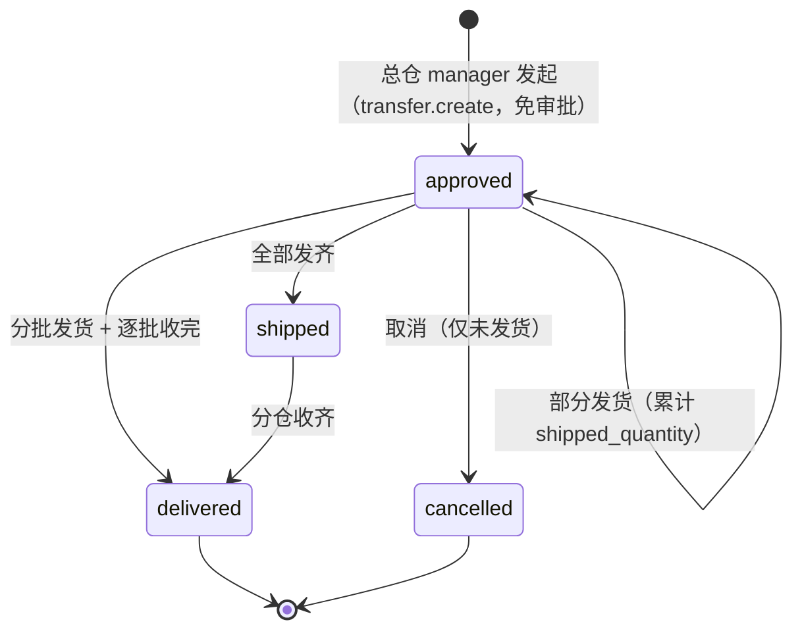

**两个视角、两套状态**（同一张单，派生而非落库）：

- 发送单（总仓）：`awaiting_ship → partial_shipped → shipped → completed`（+ `cancelled`）
- 收货视角（门店，不叫「接收单」）：`awaiting_ship → pending_receive → partial_received → received`（+ `cancelled`）

状态**不能只看主状态**：分批发货期间主状态停在 `approved`，只看 `status` 会把「已发 5 待收 5」显示成「待发货」。收货状态逐行用 `order_item_receivable_qty()` 派生，与收货门禁同源（列表上的「待收 N」= 详情页收货上限）。

**与订货流程的差异**：① 无 `pending` 审批（创建即 `approved`，`approved_by` 记发起人）；② 单号 `DT-`；③ 运费恒 0、详情页不显示金额；④ 库存流水用 `总仓调货出库/入库`（已同步 `reports_health_pure` 的 `INBOUND_ACTIONS`/`CONSUME_ACTIONS` 与 `restock` 入库历史，漏改会静默漏算）；⑤ `compute_store_order_report` 排除调货单；⑥ `cancel_order` 新增「已发货不可取消」守卫（对订货单同样生效，修掉「部分发货后作废导致在途货悬空」的旧缺口）。

**权限**：新增 `transfer.create`（manager/admin 包，26 点 / `manager 18`、`admin 19`）。建单要求 DC 类型 + 该权限；列表对 DC / 门店分别开放，发货与收货复用 `store_ordering` 的既有路由与角色守卫。

**配送中心间调货（Issue #107，2026-11-01 Owner comment966 批准 comment961）**：
发货方仍为持 `transfer.create` 的 DC；收货方可为同租户的其他 DC 或门店，禁止自调货、
研发仓与跨租户目标，候选列表和 pure 建单校验一致。DC 的 `/dc-transfer/` 默认仅本仓发送单，
`?scope=incoming` 仅本仓收货单，查询中的发/收仓由会话固定，不接收客户端仓码覆盖；
门店仍走「本店订单」。DC 收货详情按目标仓识别，显示收货进度、收货表单和本仓入库流水，
不会当作本仓出货。`receive`（order.receive）与 `deliver`（order.ship）仍须经理/管理员角色，
且会话仓必须是目标仓（平台管理员也须选对仓）；仅 `dc_transfer` 放开 DC 收货，普通门店订货不放开。
收货仓不能取消来货，即使同一用户另有发货仓权限；发货/取消仍受来源与已发货约束。
调货的整批收货表单也携带 op_no，复用 receive_partial：重放只处理原批次，不吞入后续到货，
未应用的跨库 receipt 可原键恢复；无新增收货不发通知，部分收货发 RECEIVED、收齐才发 DELIVERED。
既有通知权限收件人、发货协议、冻结行来源及门店订货流程保持原口径，无 schema/权限包变更。
上述目标仓约束仅针对 `dc_transfer`；普通门店订单保留平台管理员跨门店会话代收、
门店 staff 拒绝后的原跳转语义，以及 DC 普通订货收货入口的旧类型守卫与跳转。
收货路由的局部适配器只为 DC 调货绕过原 storefront 守卫，未找到订单仍走原入口规则。

**列表口径（2026-10-19 修正）**：门店侧**不设独立调货入口**——调货单对门店就是一张待收货的订单，直接列在「本店订单」（`store_orders_list`）里；模板按 `flow_type` 显示「类型」列，状态用**收货进度**（待发货 / 待收货 / 部分收货 / 已收货）而非主状态——分批发货期间主状态停在 `approved`，直接展示会变成门店看不懂的「已审批」。`dc_transfer.transfer_list` 对门店 302 回订单列表；只有总仓／平台管理员有「总仓调货」入口。管理员订单板（`admin_orders`）同源处理。

**订单板合并（2026-10-24，Issue #19）**：`admin_orders`（`/admin/orders`，平台视角）与 `review_list`（`/review`，配送中心视角）原是两个模块、两张模板（`orders.html` / `review.html`）两套筛选，导航里并列出现，用户反馈「功能重复」。现合并为**一份实现 + 一张模板**：视图 `_render_order_board()`（`blueprints/store_ordering.py`）同时服务两个端点，模板 `templates/store_ordering/order_board.html`（状态页签 = 全部 / 待审批 / 待出库 / 已发货 / 已送达 / 已拒绝 / 已取消，计数来自 `store_ordering_pure.count_orders_by_status()` 的 SQL `GROUP BY status`——不在应用层捞全表再数）；原 `review.html` 已删除。
数据范围按身份裁剪、**逻辑上不放宽**：`is_admin` → 全量且 `?dc=` / `?store=` 生效；非管理员 → `dc_warehouse_code` 硬锁当前仓库，且**忽略** query 里的 `?dc=` / `?store=`（否则改一个参数就能枚举别家配送中心的订单）。权限意图两侧统一为 `dc>role:staff`（admin 由装饰器直通）——`admin_orders` 因此从 `role:admin` 改为 `dc>role:staff`，DC staff 可访问该 URL，但可见数据集仍是本 DC。`tests/test_store_ordering_board.py` 逐条锁死：同页面两 URL / 范围锁定 / 越权参数无效 / 导航单入口（admin 与 DC 各一条断言）/ admin 全量与跨仓筛选 / 门店 403 / 页签计数与过滤。导航（`base.html` + `land.html`）只保留一项：admin 落 `/admin/orders`「订单管理」，DC 落 `/review`「订货审批」；`/shipments` 仍是 302 到 `/review` 的旧别名。

**多仓履约：参与仓视角分离与仓库筛选（2026-10-29，Task 8）**：一张订单的明细行可来自多个配送中心（`store_order_items.source_warehouse_code`），因此订单板的「本仓」判定从**头仓 `dc_warehouse_code`** 改为**参与仓口径**——统一谓词 `order_participation_sql()`：`EXISTS (SELECT 1 FROM store_order_items soi WHERE soi.order_id = so.id AND COALESCE(soi.source_warehouse_code, so.dc_warehouse_code) = ?)`，历史**无明细行**的单据回落到头仓（`so.dc_warehouse_code = ? AND NOT EXISTS (...)`），避免旧数据从原头仓看板消失。`list_orders` / `count_orders_by_status` 新增 `participant_warehouse_code`：非管理员锁当前仓库并**忽略** `?warehouse=`；平台管理员新增 `?warehouse=` 参与仓筛选（与按头仓的 `?dc=` 并存）。页签计数在 SQL 层用 EXISTS 判定，**不会因多行 JOIN 翻倍**。`get_order_detail` / `list_orders` 同时回填 `participant_warehouses`、`is_multi_warehouse`、行级 `effective_source_warehouse_code` + `source_warehouse_name`。

审批与发货的操作面分离（设计 D4/D5/D7/D12）：`review_order_route` 的批准/拒绝改走 `can_act_on_order(user_id, order_id, perm="order.approve")`——必须对**全部参与仓**都有审批权，否则 403 且错误信息列出缺失仓（平台管理员直通）；`can_review` 展示门禁同源（`is_dc_view and review_allowed`），详情页显示「缺少审批权限的参与仓」提示。发货侧**不收紧**既有能力：路由仍是 `require_role('staff')`，但详情页按会话仓过滤操作面——只有 `effective_source_warehouse_code == current_warehouse_code` 的行渲染 `shipped_items[...]` 输入框，他仓行只读展示「由 X 发货」；跨仓单顶部给「本仓 x/y 待发 · 全单 m/n 待发」双口径徽标。详情页 / 付款凭证下载的深链守卫使用同一参与仓判定（`_order_viewable`），非参与仓直接 403。

无全权审批人诊断（设计 §11）：跨仓待审批单若不存在任何**非管理员**活跃用户同时持有全部参与仓的 `order.approve`，订单板行显示「无全权审批人」徽标，并向平台管理员写**一条**站内告警（事件 `store_order_no_approver_alert`，按 `(event_type, target_url, admin)` 幂等去重，重复渲染 / 重复建单不重复告警）。实现：`store_ordering_pure.has_full_approver()` / `alert_no_full_approver()`（纯 SQL，镜像 `permissions` 的租户与内置角色规则）。测试：`tests/test_approve_multi_dc.py`。

详见 `docs/2026-10-19-dc-transfer-design.md`；测试 `tests/test_dc_transfer.py`。

### 10.3.2 订单板日期筛选（2026-10-24，Issue #23）

**WHERE 列名必须限定（2026-10-24，Issue #23）**：`store_ordering_pure.list_orders()` 的查询 `FROM store_orders so` 同时 `LEFT JOIN users` 与 `LEFT JOIN warehouses`——这三张表**都有 `created_at` 列**。此前 WHERE 子句用未限定列名拼日期条件（`created_at >= ?`），带 `?start_date=` / `?end_date=` 的订单板整页 500（`sqlite3.OperationalError: ambiguous column name: created_at`）；`ORDER BY so.created_at` 是限定过的，所以只有日期过滤炸，不带日期不炸。**铁律：凡查询 JOIN 了多张可能同名列的表，WHERE / GROUP BY / ORDER BY 的列名一律带表别名前缀**（本处统一 `so.`）。本次把 `list_orders()` 与 `count_orders_by_status()` 的全部条件都限定（不只 `created_at`——`status` / `store_warehouse_code` 等今天恰好不重名，但将来给 `users` / `warehouses` 加同名列时同样会炸）。**受影响 URL 有三条**（共用同一 `list_orders()`，但范围裁剪各不相同，必须逐条验）：`/store-ordering/admin/orders`（平台）、`/store-ordering/review`（DC）、`/store-ordering/orders`（门店「我的订单」）。回归 `tests/test_store_ordering_date_filter.py`（17 用例：纯层最小复现 / 区间过滤 / **边界含当日 00:00:00 与 23:59:59**（种子订单刻意落在区间两个端点上，`>=` 改 `>`、`23:59:59` 改 `23:59:58` 均会让本文件打红）/ 与其他过滤叠加 / 计数口径一致 / 三条 URL 带日期参数 200 + 内容过滤）。页签计数**不吃日期条件**（`count_orders_by_status()` 签名没有 start/end，`_render_order_board()` 也没传）：带日期筛选时列表是区间内订单、页签仍是全时段计数。这是**既有行为，本次未改**（改它属产品口径变更），本 PR 只保证它不因加前缀而漂移。

**已知盲区（2026-10-24，未修，待 owner 拍板）**：蓝绿 `verify.sh` 的「八项」没有任何一项带 `start_date` / `?end_date` 参数——既有 bug 至今没被 verify 拦住（绿 verify 全绿 ≠ 用户路径全通）。加第 9 项要同步改 `docs/agent-framework/workflow.md`（红线 6 路径）且蓝绿子系统是最高危面，故本次未动；本 PR 的回归测试会被 verify 第 1 项（集成测试 pytest）跑到，算部分补网。

### 10.3.3 报表与补货的参与仓口径（2026-10-29，多仓履约 Task 9）

**订货报表**（`store_ordering_pure.compute_store_order_report` → `/store-ordering/admin/report`）：
明细数量按**行来源仓** `COALESCE(soi.source_warehouse_code, so.dc_warehouse_code)` 分组
（`by_dc` 即履约来源仓维度；历史 NULL 来源行回落头仓，与开关关闭时的数据恒等）。
实现分两个查询：①「过滤后明细集合」（SUM 数量）；②「去重订单集合」
（`GROUP BY so.id, store, 来源仓` 得到 (订单, 门店, 仓) 三元组）。订单数 = 去重订单集：
summary 全局一次，仓维度各计一次（同单多行不翻倍、跨仓单在每个参与仓各计一次）。
**运费 D11**：`shipping_fee` 是头级事实，全局按去重订单累加一次；仓维度列显示相关订单的
**全单值**（模板注明「各行不可相加」），**禁止 JOIN 明细后 SUM 头级字段**，也禁止把仓维度
相加当作全局。仓 / 品类 / 日期过滤在明细集合与订单集合上共用同一 WHERE 片段。

**健康报表**（`reports_health_pure.compute_fulfillment`）：积压 / 在途 / 平均履约周期从
`dc_warehouse_code = ?` 改为**参与仓**判定——`store_warehouse_code = ? OR EXISTS(参与仓行) OR
(头仓 AND 无明细行)`。EXISTS 保证一单多行不把计数放大；`NOT EXISTS` 只为历史/最小 schema
的无明细单保留头仓兜底。本模块是顶层纯模块，谓词**独立落地一份**（镜像
`order_participation_sql`，见文件头注释），改口径时两处同步。

**补货 / 采购按路由归仓**（spec §10）：`replenishment_data.load_routing_map()` 读取
`item_routing`（**开关 `MULTI_WAREHOUSE_FULFILLMENT` 关闭时返回空**，行为回落到现状）。
`build_board()`：DC 的下游拉动需求只给**路由来源仓**；同 canonical 的非来源仓镜像用自己的
出库史算水位（不承接门店需求、也不静默归零）；未配置路由的 canonical 保持现状（所有 DC
都按下游拉动）。可订开关 `dc_orderable` 从**来源仓**解析（修复多 DC last-wins 覆盖 bug），
过期路由（来源仓没有该 canonical 绑定）不生效。`procurement_digest_pure.pick_purchase_rows`
新增 `routing` 注入参数（纯层不碰 DB），按路由去重 DC 行——双 DC 镜像同 canonical、路由=B
时采购单只出现 B 一次；`build_digest` / `collect_digest` 透传。测试：
`tests/test_report_multi_dc.py`、`tests/test_replenishment_routing.py`。

### 10.3.4 DC 发货入口与路由同判定（2026-11-02）

订单详情页的 `can_ship` 必须与 `POST /orders/<id>/ship` 的鉴权**同一口径**：
`is_dc_view and (is_admin or role in ("staff", "manager", "admin"))`。

原因是两个事实源不同步：`g.role` 按 `(user_id, warehouse_id)` 从 `warehouse_users` 解析，
而平台管理员跨仓**免绑定**（`auth._warehouse_visible_to` 直接放行），于是能进仓但 `g.role` 为 None；
`permissions.require_role` 对 `is_admin` 一律放行，路由本身是可写的。模板若只按 `g.role`
判角色，就会出现「路由允许写、界面不给按钮」。2026-11-02 的实例：蓝天大厦 `wh_005` 的
`warehouse_users` 一条绑定都没有，从该仓视角打开已审批订单时整块发货区不渲染。

同源排查口径：凡是「模板里按 `role in (...)` 控制动作按钮」的地方，都要对照对应路由装饰器
是否对 `is_admin` 直通；不一致就是这一类缺陷。回归：
`tests/test_store_ordering_dc_route.py::test_admin_without_warehouse_binding_sees_ship_form`。

### 10.4 Canonical 扇出流程

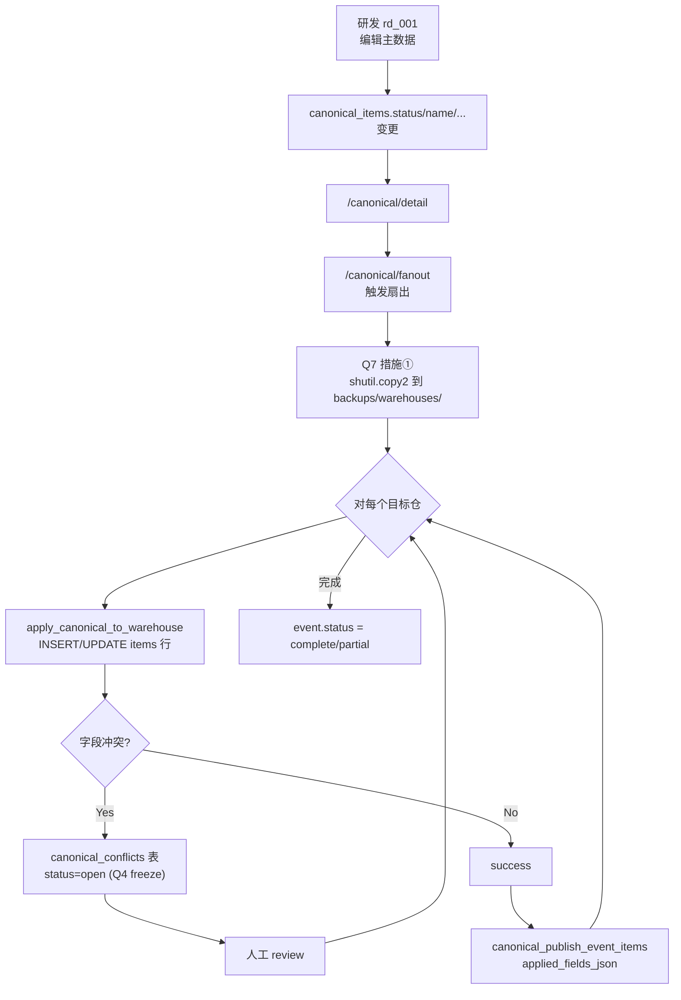

**两道闸门**（`fac7691` 定稿）：
1. **总闸** = `canonical_items.status='active'`（主数据侧）
2. **分闸** = 仓内 `items.is_orderable=1`（DC 单独控制可订）

主数据 disable 后**不自动扇出到仓内**（`is_active` 仍是 1）；仓内列表要等手动 `/canonical/fanout` 才生效。

**跨页跳转契约 — 筛选条件透传**（`feat/canonical-list-filter-preserve`，2026-10-12）：
- list → edit/detail：`url_for` 把当前 `q/category/status` 拼到 query string（URL 即状态、可分享）
- edit POST 成功：直跳带筛选的 list（不再过 detail），避免「保存→详情→后退」两步走
- edit POST 缺筛选字段：`referer` 同源 list URL 兜底（外部直链进 edit 时不丢上下文）
- detail 页头部「← 返回筛选结果」（有筛选时）/「← 返回品项列表」（无筛选时）
- 目的：用户在筛选结果里点编辑/查看 → 保存 → 直接回到原筛选上下文，不丢工作流

**库存健康页主数据同步**（Issue #121，2026-10-19）：
- `/report/health` 与 `/report/health/export` 的所有展示口径（库存金额 SUM / 风险段 out_of_stock+below_safety / 超期未盘 unstale / 呆滞/超储/SKU 派生 / SKU 明细表）一律排除 `is_active=0` **且** `canonical_status='disabled'`（主数据扇出停用）的扇出行。
- 谓词统一封装在 `reports_health_pure._visible_items_clause(alias=''|'i')`，与 `blueprints.canonical_pure.store_visible_clause()` 同源，独立落地一份以避免 `reports_health_pure`（顶层模块）回引 `blueprints`。
- 修复前用户反馈：库存健康页展示了已经被主数据停用的品项；admin 判定：应被品项主数据同步。
- 测试：`tests/test_reports_health.py::TestIssue121CanonicalDisabledExcluded`（5 个 case，覆盖五个口径 + is_active 守门员回归）。

### 10.99 补货看板（`/forecast`，2026-10-20 重构）

**为什么重做**：旧页面是「单仓前 50 条品项的日均 + 预测总量」，用 `outbound_requests`
当消耗。该表混有盘点盘亏记录，回测（`scripts/forecast_backtest.py`，298 个观测）
显示旧口径 **WAPE 191.9%、系统性高估 145%** —— 拿它算补货量会稳定积压。

**分层**（与「为什么」绑定，改动前先读）：

| 层 | 文件 | 职责 | 铁律 |
|---|---|---|---|
| 模型 | `blueprints/replenishment_pure.py` | 需求估计 / 安全库存 / 目标水位 / 建议量 / ABC / 周转率 | **纯函数，不打 DB、不 import flask**；全部参数走 `PolicyParams` |
| 装配 | `blueprints/replenishment_data.py` | 跨仓取数、三口径融合、视图装配 | 只做 I/O 与聚合，业务公式一律回 pure 层 |
| 路由 | `blueprints/forecast.py` | `/forecast`（HTML）、`/forecast/board.json` | 两个入口共用 `build_board()`，不许各算一套 |

**三口径**：产量（`production_runs.output_qty`）× 单耗 / 领料（`stock_movements`）/
盘点（`C = I_期初 + 入库 − I_期末`）。`production_run_items.actual_qty` **不是**独立信号
——它与「生产消耗」动账是同一本账，当第二信号用等于同一份数据算两遍。

**数据**：`master.db` 新增单行表 `replenishment_config`，列名与 `PolicyParams`
字段一一对应，`load_params()` 按 dataclass 字段名反射读取（加参数只改 dataclass +
ALTER，不要另写映射）。

**三处容易写错的地方**：

1. `is_orderable=0` 是**门店自采**（不再由 DC 统配备货），不是"暂时下不了单"。
   DC 侧这类品项整行退出补货计算，否则会把门店消耗算成 DC 采购。
2. 周转率的分母是**时点**库存，`turns ≡ 365 ÷ 可支撑天数`；目标值由 `Σ(target×cost)`
   逐行累加（DC 3+7、门店 1+7，同一套政策反推），不套行业基准。
3. 聚合指标会骗人：某店聚合覆盖 34 天却要订 16 个品项 —— 天数被呆滞品拉高，
   底层快销品已跌破再订货点。**看板必须同时给聚合与明细**。
4. `critical`（断货风险）与 `due`（本周到点）**不是并列关系**：`critical` 更急，
   但两者都产生建议量、都要本周下单。所以行动清单的总额是 `actions | length`
   （两者之和），**不能**只数 `due`。2026-10-20 反馈 #132 就是这么来的：配送中心
   提前期 3+7，待订项几乎全部直接落进 `critical`，`due` 恒为 0；若把 `due` 叫作
   「本周需订」，页面就读成「19 个断货风险，本周却不用采购」。`due=0` 时还须给出
   空态解释，别只留一个光秃秃的 0。

**多仓路由（2026-10-29，Task 9）**：门店需求只拉动 `item_routing` 指向的**来源仓**
（`replenishment_data.load_routing_map()`；开关关闭返回空 → 现状恒等）。双 DC 镜像同
canonical 时，非来源仓用自己的出库史算水位、不承接门店需求；未配置路由的 canonical
维持「所有 DC 都按下游拉动」的现状。可订开关以来源仓 `is_orderable` 为准（修复按 DC
遍历 last-wins 的覆盖 bug）。采购邮件按路由去重 DC 行（`pick_purchase_rows(routing=...)`）。

设计说明：`docs/2026-10-20-replenishment-board.md`（11 章，含回测与口径取舍）。

---

## 11. PWA / 移动端

外仓页使用限定 `.wms-*` 的 `static/wms.css`，复用主题与裸表格的全局
`.table-scroll` 包装；窄屏筛选单列，平板双列，桌面横排。`base.html` 新增
`extra_css` 槽，资源查询版本与 SW cache 名同步更新。外仓页响应均为
`Cache-Control: no-store`，且不加入 APP_SHELL；既有 SW 仅缓存静态资源的边界不变。

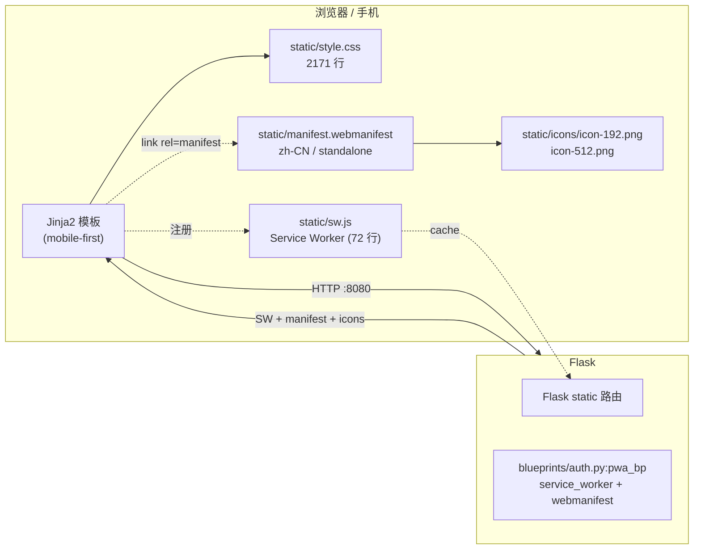

**现状**：
- ✅ Service Worker 离线缓存 + PWA install
- ✅ CSRF token 全表单覆盖（P0-3，2026-10-10）
- ✅ manifest.webmanifest（standalone、minimal-ui、theme_color teal）
- ❌ **无 push notifications**

**SW 缓存边界（2026-10-13 收窄，重要）**：`sw.js` 的 cache-first 分支**只对同源 `/static/` 生效**，其余非导航 GET（HTML 片段、JSON、接口）一律 network-only（不 respondWith，交给浏览器直连）。导航请求仍 network-first + 离线回落 app shell / `offline.html`。
- 反例（已实测复现，勿回退）：收窄前对所有非导航 GET 无差别 `cache-first` + `cache.put`。一旦页面内 `fetch` 一个 HTML 页面（`users-admin.js` 的工具栏就是这么刷 `/users?<筛选>` 的），该页面会被写进 Cache API，后果两条 —— ① 服务端数据变了列表仍返回旧副本且不报错；② 缓存副本按 URL 命中即返回、**不经过服务端鉴权**，匿名会话也能拿到 200 的管理员页面（响应自带的 `Vary: Cookie` 挡不住 Cache API 匹配，实测拿到含 `bulk01` 的完整页）。
- `/users` 的 HTML 与 `?format=json` 响应都带 `Cache-Control: no-store`（`blueprints/users.py:_no_store`）。⚠️ **no-store 只约束浏览器 HTTP 缓存与中间代理，对 Cache API 无效**——实测 `cache.put()` 照常落盘（MDN 的 `Cache.put` 异常清单里没有 no-store 规则）。所以**在这条「非导航 GET」路径上，唯一防线是上面那条范围判断**（`tests/test_users_admin_v2.py` 有字面量 + 顺序双断言钉住它）；no-store 只是 HTTP 层的附加收益，不要据此放宽范围判断。
  - 范围之外：sw.js 的**导航分支**仍有 `caches.match(req)` 离线回落，会把带会话的 SSR HTML 按 URL 命中返回而不经鉴权（APP_SHELL 存量问题，与本 PR 解耦另开 issue）。范围判断只解决非导航 GET 这条路。
  - 唯一例外：`_helpers.py` 的 AJAX 3xx 信封（`X-Requested-With: fetch` 时返回的 `{ok, location, message}`）是新响应对象、不带 no-store；它不含管理员数据，无可利用面，登记备查。
- **改 `/static/` 下的资源必须 bump 模板里的 `?v=`（或 bump `CACHE_NAME`）**：`/static/` 走 cache-first 且不回源，暖缓存客户端会永久拿到旧文件。
- 改 `sw.js` 的缓存策略记得 bump `CACHE_NAME`（当前 `dailycheck-v5`）：activate 时按名字清旧缓存，否则已中毒的缓存条目会一直活着。
- ❌ **无 background sync**（离线写不能排队）
- ❌ iOS Safari PWA 有已知限制（storage quota、push）

**导航三载体（2026-10-13 导航模块化）**：
- 桌面侧边栏（`base.html:aside.sidebar`）：7 个 `.nav-group` 模块分组（`nav-group-title` + 链接）；
  模块内无可见子项则整块不渲染；管理员模块置底。
- 移动底栏（`base.html:nav.mobile-nav`）：≤5 个高频模块入口 + 「更多」→ `/land`；
  flex 布局（角色不同条目数 3~5 动态），不再固定 5 列 grid。
- 模块索引页（`land.html`，`/land`，no_sidebar）：每模块一张 `section.land-card`，按角色过滤；
  **卡内 `ul.land-links` 必须列全该角色在该模块可见的每一个页面**（不是只链模块首屏）。
- ⚠️ **不变量（有测试固化）**：三载体的模块归属与角色口径逐条一致；
  `<961px` 时侧边栏 `display:none`，**「更多」→ `/land` 是移动端唯一全模块入口**，
  故 `/land` 一旦漏列二级页，该页在移动端即整页无路可达（v0.1 曾漏 汇总/盘点/入库/出库 4 页）。
  守卫用例：`tests/test_nav_integration.py`（模块集行列式 + 移动端可达性）。
- ⚠️ 角色口径一律取 `_helpers.register_template_context` 注入变量，禁止 block 内 ``（§13.2）。
- 改 `static/*` 后按约定 bump 模板里的 `?v=`（本次 `style.css?v=16` / `login.html?v=12`）。
- **总览模块单链接级角色门（2026-10-15 起）**：总览组内「库存健康」链接单独包
  ``——同一 nav-group 内
  按链接级可见性过滤的既有先例（同「门店订货」组内 `品项管理` 的写法），
  侧栏与 `/land` 两载体条件逐字一致，双向不变量由 `tests/test_reports_health.py::TestNavCarriers` 钉住。

**DC 出库记录（Issue #64，2026-10-27）**：`/outbound` 在配送中心上下文增加「来源」
列和订单回链，沿用现有裸 `<table>` + 自动 `.table-scroll` 契约；移动端不新增固定层
或特殊交互。页面隐藏「新建出库」，因为 DC 的人工出库入口不存在，发货由订单详情驱动。

**DC 调货收货视角（Issue #107）**：既有调货列表增加发送/收货链接，表格沿用自动
`.table-scroll`；收货详情复用原单行及整批收货表单（CSRF + data-ajax reload-stay），
返回本仓收货列表。无新 JS、样式或导航模块，门店仍使用本店订单入口。

**订货目录库存展示（Issue #67，2026-10-27）**：门店 catalog 的每张卡片复用既有
`.inv-card-body` 指标区显示 `门店库存`，弹窗顶部也以同一 `data-stock` 显示本店库存与单价；
数据在既有目录查询内一次解析，不新增异步请求，也不改变移动端提交链路。

**响应式布局契约（2026-10-20 排版审计后确立，改样式前必读）**：

- **断点**：480 / 560 / 600 / 640 / 720 / 760 / 960 / 1100 px。721–1099 是中屏档
  （iPad 竖屏 768），历史上多次漏覆盖，新增 grid 容器务必为该档显式定义。
- **表格必须保持 `display: table`**。历史上用 `table { display: block; overflow-x: auto }`
  换横滚，实测代价是 ① 丢 `width:100%`（收缩到内容自然宽度）② `table-layout:fixed` 失效
  ③ 圆角裁切失效。**列对齐不受影响**（thead/tbody 仍进同一匿名表），勿再以「表头错位」为由回退。
- **横滚的唯一载体是 `.table-scroll`**：`base.html` 在 `DOMContentLoaded` 给 `main` 内未包装的
  表格自动补一层 `.table-scroll`，父级已有 `overflow-x: auto/scroll` 的跳过。新增页面直接写裸
  `<table>` 即可，不需要手工包裹。
- **`style.css:156` 的 `input, select, button { width: 100% }` 是全局陷阱**：任何 flex/grid
  头栏里的 button 都会被撑满、挤掉同级文本（`/users` 抽屉标题曾因此被压成竖排，实测 h3 仅 29px 宽）。
  容器内的按钮一律显式 `width: auto` + `flex: 0 0 auto`。
- **固定层 z-index 层级**：`.mobile-nav` = 100 → `.users-drawer` = 120 → 顶层模态 = 999
  → `.ajax-flash` = 9999。抽屉类浮层在 `<main>` 内、DOM 早于 mobile-nav，**必须高于 100**。
- **`position: sticky` + 固定高度只用于双列布局**（如 `.recipe-pane` 的 500px）；
  单列降级时必须同步解除（`≤720px` 改 `static` + `height:auto`），否则手机上吃掉半屏。
- 改 `static/*` 后按约定 bump 模板里的 `?v=`（本次 `style.css?v=22` / `login.html?v=13` /
  `users.html` 的 `users-admin.css?v=3`）。

---

## 12. 测试架构

Issue #144 的 test_order_changes_{migration,claims,money,route} 以真实临时库
覆盖 init/runner 原子迁移、完整 payload、独立进程 Event barrier 的扣库前/仓库锁内/
扣库后 fence 交错、冲销后主库未回写、同键并发重放、Decimal 半分及原能力回归。
并发/撤权探针先核对实际库存、配送和 claim 状态，再核对异常类型；权限变更只在
绑定解析的第一次调用发生，不能让错误文案或非预期锁异常冒充安全不变量证据。
请求身份回归用真实 loopback HTTP/CSRF 和 Event 控制初读缺失、仓库已提交及
master 锁前窗口，断言同键结果、库存/流水/配送和完整 hash；另覆盖绑定变化、
后续批次与 full/explicit/scalar 六方向模式互换，先提交失败复现再修复裁决顺序。
R3 的 dict 包装回归以零数量行的增删/重排性质约束来源推导：同单其他仓零项不改变
实际发仓、库存、配送或重放结果；外单零 ID、两仓正量、全零与显式仓越权仍拒绝。
同时对照本轮 main 的显式仓合同：他仓零项在新请求及已有 claim 重放均拒绝，
比较完整库存/流水/配送/通知/claim 前后状态，不以异常文案代替行为断言。

HTTP 用例开启真实 CSRF，覆盖 AJAX/PRG、撤权后拒绝和通知 enqueue 后故障回滚。
scripts/dev_smoke_order_changes.py 必须显式指定空的 /tmp/dailycheck-order-change-*
根，启动独占随机 loopback 端口，拒绝外部 HTTP；用于实际浏览器 375/320 宽验证，
不连接共享 localhost:8080。master v7 与 warehouse v7 的编号相同但注册表与迁移
目标仍严格分离，仓库 CLI 必须拒绝 master 文件。

Issue #146 的 `tests/test_shipping_ownership.py` 用 DC staff 会话、强制开启的 CSRF
及详情页生成的新 `op_no` 驱动发货 HTTP 入口，覆盖新请求、原样重放、同单零数量行、
外单零/正/空数量行及同单他仓行；拒绝前后比较两订单、配送头/行、状态历史和各仓
库存/流水，另以领域完整 map 调用对照外单零 ID。显式空批次不得回落全发。

Issue #140 的 `tests/test_wms_dashboard.py` 覆盖真实 Cookie/DC/viewer 权限、导航双载体、
多货主分页、详情/原筛选返回、ID/范围攻击、故障与部分结果丢弃、空/截断、转义和只读方法。
`test_wms_web_service.py` 用真实已核验 schema 的合成 SQLite 数据与 SQL 方言适配执行查询，
验证 >500 行唯一分页、跨货主同编码、空仓历史、双方向同编号、库位一对多及其他仓单货主边界。
`test_mcp_wms.py` 与 MCP 契约门禁验证旧调用；CI 禁止连接第三方生产库，真实验证归 Prod。

Issue #130 的 `tests/test_store_ordering_receive.py` 覆盖自动建行复制来源仓
`selling_price` / `unit_cost`、来源仓存在同 `canonical_id` 的 inactive/alias 重复行时
仍取 active 非 alias 行、源价与成本同为 0 时保持 0 且输出 WARN、已有绑定行
价格不被收货改写；临时变异把 INSERT 的售价/成本改回 0 后两条新用例必红。

Issue #107 在 `tests/test_dc_transfer.py` 使用真实临时 master、发送 DC、接收 DC、门店及
无关/跨租户仓库，覆盖候选/创建一致性、双向列表隔离、接收详情、角色/权限/仓库归属、
普通门店订货 DC 收货拒绝、取消与已发约束、部分/最终收货和库存流水、通知去重、
原键重放及跨库故障恢复。整批收货另覆盖旧请求重放不接收后续批次的到货。
普通门店订单另锁定平台管理员跨 storefront 会话的收货兼容性及 DC 会话的旧拒绝跳转，
防止为调货新增的目标仓检查误收紧既有管理员行为；原门店 staff 拒绝路径继续由验收 B11 覆盖。
关键类型、方向、归属与幂等条件需用临时变异证明测试会失败；全量原生测试仍包含 MCP。

Issue #108 的 `tests/test_canonical_unclaim_portability.py` 在真实临时master/warehouse
数据库经实际MCP dispatch和TextContent序列化验证解绑回执、仅取消最新匹配approved记录、
旧approved/新pending与rejected/其他仓及品项隔离、无匹配或空历史、默认note及重复解绑拒绝；
逐字段核对库存/价格/非绑定字段不变，备份落临时目录。旧SQL在标准3.12/3.13先跑红；
变异分别还原可选UPDATE语法、反转ID顺序或去掉仓/品项/approved筛选，须被回归打红。

Issue #105 的 `tests/test_mcp_impact_gate.py` 用独立临时 Git 仓库验证 main 前进时的
merge-base、新增工具（含 SDK 合法的大小写/前导下划线名称）、schema 变化、删除/重命名、
仅 requirements/pyproject 依赖变化、非法/缺失声明及失败关闭；另验证模板占位
必须消解、现有 reports job 的两项检查确实保留失败退出码。示例和结构化格式与 workflow 同步。

Issue #104 的 `tests/test_mcp_registry.py` 验证32声明/全部实现/dispatch集合、重名与漏实现拒绝、
原始32声明SHA256快照、显式Bot22与canonical七写排除、生成文档逐字一致及`--check`漂移拒绝。
嵌套对象插入顺序不影响生成字节；元数据/输入输出字段/新增字段、数组值/次序/数量、计数变化
及非规范/畸形/尾随JSON均须被检出。SDK输出禁用守卫检查实际序列化结果，不依赖新SDK对象属性。
全部32项复用`tests/bot/test_mcp_integration.py::setup_db`的真实临时SQLite场景，通过真实
call_tool派发/序列化验证最小输出shape；三项外部WMS只读工具在该用例中桩化service层
（`_WMS_ROWS` / `stub_wms`），CI不连第三方SQL Server，只验派发与序列化形状；七canonical写只在临时库与临时备份目录实调，
不用Bot扩权或生产库。新增登记需同步该参数矩阵；形状元数据不改变运行时返回。
生成校验命令`python -m scripts.mcp_contracts --check`还核对AGENT/CLAUDE工具集合与测试引用，
以及维护中的`calculation-logic.md`入口32/19口径、订单只读范围和权威台账链接；
旧27项入口、缺订单说明或缺台账链接均由回归/变异证明不能通过校验；其历史公式段落不重写。
真实Starlette health与CLI回归锁住Bearer覆盖health、200/503及默认stdio/HTTP参数，
使文档口径可验证。命令适用于CI，本Issue不改workflow接线。

Issue #111 的回归用真实的不完整/无后缀/语法/重复列/标点变形 schema 坏库文件，经 helper
与生产式 HTTP 验证；断言健康行值、库文件字节不变、来源隔离与连接关闭、异常身份与错误码
优先级、master 来源错误，以及健康/坏库上的真实写入错误均不被吞。

Issue #109 的 `tests/test_order_detail_source_stock.py` 使用真实临时 master/两 DC/门店库，
先提交跨仓单再改路由，以跨库同 local item ID 的不同 canonical/库存/价格/品类复现串读；
覆盖门店/DC/平台订单板到详情渲染、历史 NULL 来源/行 ID、固化 ID 缺失/错绑/替换、
停用/别名/歧义/单位/阻断冲突、无效重复绑定、缺库不创建、负库存/成本兜底、
查询前后库文件不变和 `/inventory` 当前仓语义。临时变异验证头仓代替来源、
忽略固化 ID、歧义取首行和允许建缺库均会被回归检出。

Issue #111 的 `tests/test_order_detail_source_resilience.py` 复用 #109 的真实多仓夹具，
覆盖坏库/空库/缺表列/独占锁/缺库/不可打开、历史 NULL 头仓兜底，以及生产式异常处理
的 Flask HTTP 请求；断言健康行完整值、canonical 兜底与库文件字节不变。
多行锁源以实际第二连接持有 BEGIN EXCLUSIVE，核验忙等待配置、每来源开库/解析次数，
记录耗时；正常/异常关闭、BEGIN 与取行故障、master/程序/写错不吞和 WAL 并发快照均回归。
关键变异检验来源隔离、失败缓存、短等待、连接关闭和读快照，保留 #109 原 30 例。
兼容回归在真实 Python 3.10 与主验证 Python 3.12 执行 helper/HTTP；取行故障不注入
驱动版本专属元数据，并覆盖无元数据且消息相似的程序/约束/内部错误不被误归类。

2026-11-02 的 `tests/test_store_ordering_dc_route.py::test_admin_without_warehouse_binding_sees_ship_form`
锁定「平台管理员 + 无 `warehouse_users` 绑定的 DC 会话」下详情页仍渲染发货表单；
去掉 `is_admin` 直通后实测打红（缺 `shipped_items[`），防止再出现「路由可写、界面无入口」（§10.3.4）。

**完整 MCP 门禁（Issue #103，2026-10-31 起）**：CI test job、`verify.sh` check 1 与
`generate_reports.sh` 的本地 fallback 都收集 `tests/mcp_server/`，不再整目录排除。
三入口均给 pytest 注入临时 `DAILYCHECK_DB_DIR`；verify/fallback 在结束后清理该目录。
CI 继续把原生 pytest 摘要交给 reports job 复用，不重复全量执行。
`generate_reports.sh` 保留 known-failure checker 的真实退出码，即使失败仍生成报告，
`ci-summary.json` 的 `gate_exit` 与最终退出码不得被恒真后缀覆盖；已知失败清单只许收缩。

**完整 pytest 结果证据（Issue #114）**：`scripts/ci/pytest_evidence.py` 是显式启用的
只读观察插件，sessionfinish 写出 selected/completed、真实 outcome 统计及失败 nodeid。
`scripts/check_known_failures.py` 必须接真实 native exit（仅0/1）与会话记录，验证每个已选
用例完成、唯一终态摘要/统计/原始 FAILED 枚举一致，再核对 known 清单。收集/setup/teardown
异常、中断/internal error、提前停止、零用例、缺失/损坏/不匹配证据均拒绝；参数化 nodeid 保留旧授权范围：实际参数 nodeid 及其基础别名均须在 known 清单，基础ID不是
新增参数变体的通配许可；实际失败数与别名集合独立，不重复计算测试数。没有硬编码全仓测试总量。

CI test、verify check1 与 reports fallback 均启用插件并保留真实子进程退出码；不会把重定向、
tail 或摘要复用的退出码当作 pytest 成功。strict checker 可产出绑定输出 SHA256/native/session
的 portable evidence。compact helper 的 CLI 必须先验证证据，再将文本和证据放入 base64 JSON
信封；下游 decode 再验证并还原文本/证据。保留的纯提取工具只是诊断 API，不能直接放行门禁。

reports 仅显式请求才复用真实证据；未请求时即使默认文件/证据都存在也必须 fresh pytest，
显式空/缺失/损坏请求失败且不回退重跑；原生失败/无效证据仍
生成02/03和ci-summary，缺失退出码记null，complete=false。有效证据/文本一同落reports，
`check_reports.py` 重新校验hash/native/session/计数与known，而非仅相信gate_exit=0。
显式调用者负责路径来自本次候选/同一次流程；哈希和会话一致性绑定数据，不证明当前GitHEAD
或操作/进程身份。同一必需 test/reports check 名称、完整MCP收集和临时数据库隔离保持不变。

`tests/test_pytest_gate_completeness.py` 用真实 pytest 子进程覆盖完整成功/known-only/新失败、
参数化含空格ID、收集/运行异常、KeyboardInterrupt、退出码1提前停止、零用例、截断/重复/
不一致摘要及元数据；实际CI步骤在临时repo执行，确认native0/1/2捕获。报告与verify沙箱另锁
缺失/损坏复用不重跑、失败仍产报告、摘要不能伪造native0或complete。关键guard须变异打红。

`tests/mcp_server/conftest.py` 的 autouse fixture 为每例初始化临时 master，覆盖 root/db/
MCP config/UoW 的导入期路径绑定并隔离 access.log 与认证 ContextVar；SQLite 连接守卫
拒绝打开该例目录以外的文件（含 URI/软链解析），防止遗漏新别名后触及默认或真实库。
采购 hub 在实现不可用时先返回空结果，不再为降级路径读取仓库列表；测试分别断言全仓/
指定仓分支不执行 DB lookup。蓝绿 config 默认路径用例显式清除外层 DB env 后再验证默认值。

`test_protocol/test_consumption_http.py` 用 loopback 临时端口的真实 Uvicorn、生产 Starlette
app/lifespan、数据库 Bearer token 与 StreamableHTTP initialize/initialized/tools-call 链覆盖
两消费工具的空/错误/兄弟路径/仅写路径拒绝、正确/父级/通配路径成功、空仓范围/跨仓拒绝，
并验证每次审计归属与跨 token 请求不串身份。拒绝前后对 master、旧版本仓库及迁移产物做
完整文件字节快照，确保连隐式迁移也未发生。`tests/test_mcp_full_suite_gates.py` 在脚本
沙箱执行 verify 的 pytest/checker 与 reports 的复用/fallback 四象限：已知失败可通过、
新增 MCP 失败必拦截，失败仍产出报告。测试环境以 requirements 的 MCP 1.x 和 CI Python
3.12 为准；本地 `.venv` 若为 MCP 2.x 不作为兼容性证据。

Issue #87 根目录 `test_mcp_document_writes.py` / `test_warehouse_document_migrations.py`
覆盖旧位置调用、小数、HALF_EVEN与REAL精度边界、重放/冲突/删除后不复活、4写故障注入、
提交后缓存故障、SQLite条件UPDATE、multiprocessing.Barrier+独立连接的create和Web/MCP撤销竞争；
新库/旧v0/4/5/6/部分列/无Web预热首读首写、软链竞态、目标隔离、热备/恢复和down拒绝。
8项临时变异分别杀死journal唯一性、锁前库存读取、data提前commit、重复factor、HALF_UP、
跳过MCP预迁移、提前stamp以及删除清journal。MCP小夹具也走真实完整仓库迁移。

Issue #72 的入库读链路回归：`tests/mcp_server/test_data/test_warehouse.py` 用
`restock_requests` 播种 N>1 条（`status` 覆盖 `'入库'` 与 `'提交'`），锁
`list_restock_movements` 返回 N 条、原七字段齐全（#87额外增加四个身份/换算字段）（`id` / `item_id` / `item_name` /
`quantity` / `status` / `reason` / `created_at`）、`created_at DESC`；另有一条
「`restock_requests` 为空但 `stock_movements` 存在 `action='restock'` 流水行时返回空」
锁定数据源已切换。`tests/mcp_server/test_service/test_inbound.py` 与
`tests/mcp_server/test_protocol/test_inbound_tools.py`（新目录；共享
`tests/mcp_server/conftest.py` 的 `warehouse_db` 夹具）锁「MCP `restock_create`
写入后 `restock_list` 立即读回」。

Issue #64 在 `tests/test_store_ordering_dc_route.py` 增加两条路由级回归：审批后 DC
库存不变且 `/outbound` 解释「审批不锁库存」；发货后 `/outbound` 必须出现订单号、
「订单发货」来源及订单详情回链。

Issue #67 的订货目录库存展示由
`tests/test_store_ordering_store_route.py::test_catalog_displays_store_stock_not_dc_stock`
覆盖：同一 canonical 品项的 DC=100、门店=7 时必须渲染门店 7；门店无绑定行时即使 DC=5
也必须渲染 0，并同时锁定卡片、`data-stock` 与选品弹窗的本店库存文案。
`test_catalog_sums_duplicate_store_bindings` 再覆盖同一 canonical 的两条门店绑定行
7+3=10（首行 7、DC=100），锁定聚合值而非首行或 DC 值。

Issue #47 的研发配方页回归在 `tests/test_recipe_bom_delete.py`（20 例：冰激凌配方页
10 + 出品配方页 9 + 跨页权限 1）。覆盖「原料行删除只删目标行 / 跨配方行被拒 /
删除往返 / AJAX 拒绝返 ok:false / AJAX 成功返 ok:true / 重复原料整批回滚并指明第几行 /
正常保存不误伤 / 保存表单不再提交 bom_delete[] / 新建撞重复不留半保存配方」。
详见 §13.13。

Issue #85 的工具调用审计回归放在根目录 `tests/test_mcp_access_log.py`（CI 可收集，
不进 `tests/mcp_server/`）：通过 `build_server()` 注册的真实 `call_tool` 路由覆盖成功
读/写、McpError 403/400、未知工具 400、非预期异常 500；断言每次进入路由恰一条 JSONL、
`agent_token_id` 来自请求级 `AuthContext`、`duration_ms >= 0`、失败状态不冒充
`status=200`，以及日志不含 token/`Authorization`/arguments/reason。测试用临时路径替换
`_ACCESS_LOG_PATH`，不写生产 `access.log`。变异验证：临时去掉 writer 调用后 10/12 用例转红
（保留的 2 例分别是直接调用 writer 的兼容性用例与「写日志失败不影响响应」用例，符合预期）。

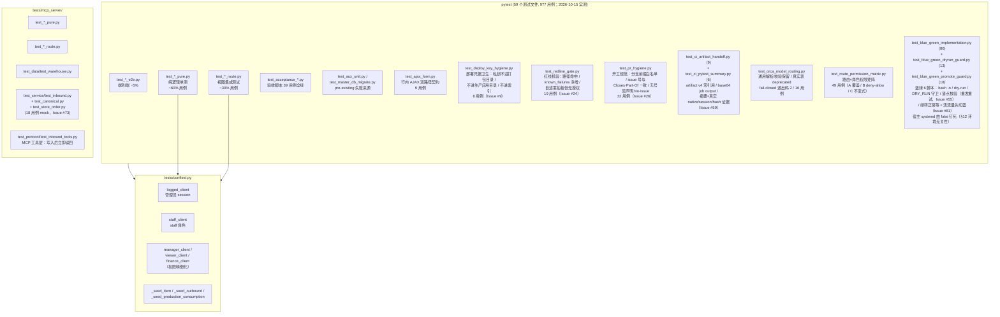

**运行**：
```bash
~/.local/bin/python3.12 -m pytest --basetemp=/tmp/pytest-dc   # 必须带 basetemp
```

**基线（2026-10-10）**：18 failed / 750 passed — 失败集与各次新开发严格逐行一致（owner SOP「零新增对比法」）。`feat/inline-form-ajax`（2026-10-11）新增 `test_ajax_form.py` 6 用例全过，零新增失败。`feat/user-admin-v2`（PR #17，2026-10-12）新增 `test_users_admin_v2.py` 40 用例，基线升至 **18 failed / 796 passed**，零新增失败。

**基线更新（2026-10-13，`feat/nav-modules`，rebase 至 `f00e490` 后）**：16 failed / 801 passed — `test_nav_integration.py` 旧断言（staff 应见采购）随导航模块化修正并扩充为 12 用例（796→801），失败集 18→16；`tests/known_failures.txt` 同步删 2 行（清单收缩为 16，与实际失败集逐条一致）。零新增。⚠️ 复用旧 basetemp（`/tmp/pytest-dc`）会因沙箱清理不完全随机出现 1~3 条 `sqlite3.OperationalError` ERROR；换全新 basetemp 即消失，与代码无关。

**时间种子稳定性（2026-10-26，Issue #52）**：订单窗口种子按测试当前的 UTC 时间生成，禁止写死日历日期。`tests/bot/test_tools_ext.py` 保留「1 天前在默认 7 天窗口内、40 天前在窗口外」的原语义，并用 6 天前/8 天前两条订单钉住午夜日期 cutoff 两侧，避免 UTC 跨日导致 CI 时间炸弹。

**整改基线（2026-10-14，`fix/pr-18-nav-modules-defects`）**：14 failed / 768 passed（CI 口径 `--ignore=tests/mcp_server`）。导航用例 12→57（`nav_client_factory` 角色矩阵 + 三载体链接集相等 + 全链接可达性 + 移动端可达性守卫），门禁 exit 0。

**权限精细化基线（2026-10-15，`feat/permission-granularity`，并流 main `9bb9d99` 后）**：14 failed / 928 passed（CI 口径；本地全量 16 failed / 1006 passed）。新增 `test_route_permission_matrix.py` 49 用例（A 覆盖 / B deny-allow / C 不变式）、`test_master_db_migrate.py` RBAC 迁移 +7 用例、`tests/conftest.py` 角色夹具（`manager_client` / `viewer_client` / `finance_client`）；并流后 `url_map` 实测 151 endpoint，Test A 双向断言无遗漏 / 无残留。失败集与 `known_failures.txt` 逐行一致，零新增，门禁 exit 0。

**外部通知基线（2026-10-16，`feat/store-order-wecom-notify`，基于 `1aa9cbc`）**：14 failed / 1156 passed（CI 口径 `pytest tests/ --ignore=tests/mcp_server`，`--basetemp=/tmp/pytest-dc`）。失败集与 `known_failures.txt` 逐行一致（14/16，`mcp_server` 两条在该口径下不收集），`scripts/check_known_failures.py` exit 0，零新增。新增 `test_wecom_notify_pure.py` 44 用例 + `test_wecom_notify_hook.py` 4 用例，全部 **monkeypatch `urllib.request.urlopen`、不透网**，夹具 webhook 为运行期拼接的假地址（不含真实 key）。

⚠️ **历史基线数字必须写明口径**（以下为 #103 之前，两套历史数字不能混用；当前 CI/本地均全量含 MCP）：
- **CI 口径** = `pytest tests/ --ignore=tests/mcp_server`：**以本文件最近一条基线为准**（2026-10-16：14 failed / 1156 passed）。CI 以此为准，`known_failures.txt` 的 `mcp_server` 两行在 CI 里永不触发（属超集）。
- **本地全量** = `pytest tests/`（本地 python3.12 能跑 mcp 测试：2 failed / 78 passed）：失败数 = CI 口径 + 2（2026-10-15 实测 16 failed / 1006 passed；passed 数随新增用例变化，引用旧值须换算）。
- 「零新增对比法」比对的是**失败集逐行**，不是 passed 总数；引用总数时必须带口径，否则跨环境对比会误判。

**CI 门禁（2026-10-10 起，`.github/workflows/ci.yml`；2026-10-22 起由 hub1 上的 Gitea Actions 执行）**：
- ruff（仅改动 .py，pin 0.16.10）→ pytest 全量（含 MCP、临时 DB）→ `scripts/check_known_failures.py` 零新增断言。
- `tests/known_failures.txt` = 已知失败清单，**只许收缩不许扩张**（修复一个删一行）。
- **防假绿（2026-10-11 起）**：门禁对 pytest 收集错误 / 空输出 / 0 passed 一律拒绝放行（收集错误不产生 FAILED 行，坏依赖曾致门禁空过假绿）。测试三方依赖（如 openpyxl）必须进 requirements.txt。
- **部署 job 已移除（2026-10-25，`f293746`）**：CI 只做门禁与通知；生产部署归 Prod Agent 蓝绿（§3.4/§3.8）。`scripts/deploy_vps.sh` 保留为应急手动路径，CI 不再调用。
- **pytest 摘要 job-output 交接（2026-10-26，Issue #59）**：Gitea 不支持 artifact v4，旧 `upload-artifact/download-artifact@v4` 会报 `GHESNotSupportedError`，reports job 下载失败后重跑全量 pytest（Issue 实测每次多耗 18–32 分钟）。CI 现已完全移除两对 artifact 动作：test job 在零新增门禁通过后用 `scripts/ci/pytest_summary.py` 只抽取全部 `FAILED`/`ERROR`、collection/interrupted 标记及最后 5 行，base64 后写入 `pytest_summary_b64` job output；上限 48 KiB，超限失败而非截断。reports job 解码到 `/tmp/ci-pytest/pytest-output.txt` 并设置 `PYTEST_REUSE_FILE`，缺失或损坏时显式失败；直接/手动运行 `generate_reports.sh` 仍保留“文件不存在则跑 pytest”的 fallback。
- **`agent-framework-reports` 门禁（2026-10-15 起）**：`check_reports.py` 要求 PR body 含 h2「报告 1/4」「Checklist」「生产侧事项」三段且无未消解 ❌；CI 读事件时刻 body 快照，事后补 body 须推空 commit。

**测试的环境无关性（2026-10-15 起，Issue #44）**：用例结果不得取决于「在哪台机器上跑」。最脆的一维是**宿主 systemd**：`switch.sh` 的 DRY_RUN 守卫（PR #42）以 `systemctl show -p MainPID / -p Environment --value <unit>` 取证，于是 dev/CI（**无可用 systemd** —— dev 机没有 `systemctl` 命令；CI 镜像有该命令，但 systemd 未作 PID 1 致取证为空；两者都判「无法判定」→ 仅告警放行）与生产 VPS（`dailycheck-green.service` 固定 `Environment=DRY_RUN=true`，绿未「转正」→ 按设计 `exit 3` 拒跑）结论相反 —— 同一批 `test_blue_green_implementation.py` 用例在 prod 全红、在 dev/CI 全绿（Issue #44 现场 = 跑 `verify.sh` 时 check 1 报 5 个 fail）。**约定**：凡调用 `scripts/blue_green/*.sh` 的用例，必须把宿主 systemd 态**显式钉死**，不许默认「本机没有 systemctl」。`test_blue_green_implementation.py` 用模块级 autouse fixture `_fake_systemctl` 前置 fake `systemctl`（`Environment` 恒 `DRY_RUN=false` =「绿转正后的合法生产态」→ 守卫判 `not_dry_run` 放行），使用例回到「验证切流量动作本身」的原始意图；守卫自身行为由 `test_blue_green_dryrun_guard.py` 专项覆盖（该文件自建按 unit 注入 `Environment` 的 fake）。两处 fake 均只接管 `show`，其余子命令 `exit 0`，故 `journalctl` 等真命令缺失仍能让 `verify.sh` 的失败路径用例保持原语义。

**宿主态隔离的第二维与第三维（2026-10-17，Issue #81）**：除宿主 systemd，还有两维会让同一批蓝绿用例「dev/CI 绿、prod 红」，PR #59（部署单飞）上线后同时踩中：

- **② 部署单飞状态目录**（`DAILYCHECK_DEPLOY_STATE_DIR`，默认 `/var/lib/dailycheck-deploy`）—— `verify.sh` / `switch.sh` 的锁守卫只在目录**存在**时生效。生产上该目录已随单飞机制激活：无锁（`deploy_state.py check` rc 0）或锁属他 PR（rc 12）都会让**嵌套调用的** `verify.sh` 在 check 1 之前 `exit 10`（#81 现场是后者 —— pytest 里跑的是 `verify.sh 22/24`，锁属于正在部署的 PR #80 → rc 12），dev/CI 上该目录不存在 → 放行。于是 live 调 `verify.sh` 的用例（`test_verify_writes_report_on_fail` / `test_verify_continues_after_check_fail_and_writes_report`）在 prod 拿到的 rc 是 10 而非 1，且锁守卫在 `trap` 注册之前拒绝 → 报告也不生成。
- **③ 真实 nginx conf**（`NGINX_DAILYCHECK_CONF`）—— `switch.sh` 的布局守卫与 `cp`/`sed` 只在 conf **存在**时动作。prod 上默认路径真实存在，dev/CI 上不存在；继承宿主 conf 时 dry-run 用例的退出码就取决于那台机器的 conf 布局。

**修法（Issue #81 定稿）**：fake systemctl 抽到共享模块 `tests/blue_green_testenv.py`（`install_fake_systemctl()`），`test_blue_green_implementation.py` 与 `test_blue_green_deploy_lock.py` **共用同一份实现**（此前是两份副本漂移 —— 后者漏装 fixture 即 #81 的 3 个 fail 之一）；`test_blue_green_deploy_lock.py` 追加 `test_fake_systemctl_pins_not_dry_run` 自检，把「fake 真的接管 PATH 且判 `not_dry_run`」钉成事实断言（否则 fake 退化成 unknown 时 CI 依然全绿 —— dev/CI 本就没有 systemctl）。`verify.sh` live 用例统一走 `_hermetic_verify_env()`：状态目录指向不存在的 tmp 路径（= 机制未激活）、`DAILYCHECK_BG_LOCK_HELD=1`（不碰 `/var/lock`）、conf 指向不存在的 tmp 路径（布局守卫跳过 + `cp` 在 `set -e` 下立即失败 → **check 4 的回滚演练永远到不了 `systemctl reload nginx`**，绝不改写生产 conf / 切真实流量）、`BACKUP_DIR` 与 `DC_PYTHON` / `DAILYCHECK_APP_DIR` 全部落 tmp；「绿不可达」场景改由闭端口显式制造，不再依赖宿主 `:8091` 恰好没起。`test_blue_green_dryrun_guard.py` 的 live 用例同族补齐（autouse 钉状态目录 + 跳过 flock），否则生产上「无活跃锁」时 9 例 `exit 10` 全红、持锁时还会往生产 `audit.log` 追加审计行（测试写生产状态）。**新增调用 `scripts/blue_green/*.sh` 的用例必须沿用这两条约定**：否则下一次 `up.sh` 会被 verify check 1 的「零新增违例」拒启（fail-closed → 部署整体卡死）。

**同族新增**：`tests/test_blue_green_promote_guard.py` 在 `_base_env()` 里统一注入同一套隔离（状态目录指向不存在的 tmp 路径、`DAILYCHECK_BG_LOCK_HELD=1`、`SYSTEMCTL_BIN` / `CURL_BIN` / fake `ss` 全部落 fakebin），故 `promote.sh` 与 `up.sh` 的 live 用例在 dev / CI / prod 三处同解。

**Pre-existing 16 failed 分布**（2026-10-13 起）：
- `mcp_server×2 / aux_unit×2 / forecast_pure×8 / items_route×2 / procurement_route×1 / recipe_cost_route×1`
- （`nav_integration×2` 已于 2026-10-13 随导航模块化修复并移除）

**门店订单 MCP 只读工具（Issue #73）**：`tests/test_store_order_mcp.py`（24 用例，真实 `master.db` 种子，覆盖「一单 6 行明细、2 次发货、0 次收货」验收种子 + ACL 三件套 + `tools/list` 注册一致性）与 `tests/mcp_server/test_service/test_store_order.py`（18 用例，mock 层，钉住 OR 可见性 → AND 过滤器的展开规则与返回形状）。前者落在 `tests/` 根目录；Issue #103 起 CI 同时收集根目录与 MCP 服务层目录。

**MCP 列表分页（Issue #74）**：`tests/test_mcp_list_pagination.py`（39 用例，真实临时
`master.db` + warehouse DB，默认种 120 条关联 outbound + 5 条孤儿 outbound / 120 条 restock，
另含 1630 + 17 条生产同形出库种子）——逐页拼接与
全量一致且无重复无遗漏、`total` 恒等于总行数、`truncated` 首末页翻转、limit/offset
clamp、非法类型的结构化错误、外部 `tools.json` 与运行时的分页契约一致性，
以及工具层端到端透传。断言用同一
`created_at` 的 120 行钉住 `id DESC` tie-break；三处变异（`truncated` 恒 False /
去掉 limit clamp / 数据层忽略 offset）均实测打红对应用例。该文件同样落在 `tests/`
根目录，CI 会跑。

**Bot PR2（Issue #80）**：`tests/bot/test_mcp_integration.py` 覆盖 22 项 schema→dispatch→临时库真实调用、19 读路径 ACL、全局读显式授权、三写允许/拒绝/并发/回执/审计、只读 SQLite 拒绝误写、缺库不创建、旧消费口径与父子开关；`test_agent_requests.py` 捕获 restock 关闭及八读逐项启停的真实请求构造。隔离 bot venv 不装入主站；权限/只读及相对路径、缺库、参与仓范围变异均由定向测试检出。

**Bot 管理配置台（Issue #79 PR1）**：`tests/test_bot_admin.py`（路由鉴权 / 默认 CSRF / 动态 34 主行 / 注入注册项 / 保存审计 / 7 天计数 / 非法值拒绝）、`tests/test_bot_admin_migration.py`（init 幂等 + v3 up/down）、`tests/bot/test_agent_config.py`（缺表/锁库/坏配置回退、五档校验、只收窄 9 项）、`tests/bot/test_agent_requests.py`（捕获真实请求体：顶层 `reasoning_effort`、tools 过滤、辅助调用、每消息只读一次）、`tests/bot/test_usage.py`（7 天边界/坏行/真实追加）。Issue #103 起 CI 全量收集这些文件与 MCP 目录。

---

## 13. 关键约定与坑

### 13.1 Schema 迁移

- ✅ 任何新列**只**加到 `migrate_warehouse_db_columns()`，**不**进 `WAREHOUSE_SCHEMA`（tests 断言）
- ✅ 改 ALTER 块必须 bump `WAREHOUSE_SCHEMA_VERSION`（当前 = 7）
- ✅ master.db 任何 schema 变更同步进 `init_master_db()`，否则 prod 首请求 `no such column`
- ✅ `init_master_db()` 用 `fcntl.flock` 保护 gunicorn 多 worker

### 13.2 Jinja2 陷阱

- ❌ **不要**在 `base.html` sidebar block 里 `` — block scope 不传子模板
- ✅ `is_admin` / `is_rd` / `is_storefront` 必须从 `blueprints/_helpers.py:register_template_context` 注入
- ✅ `current_tenant_id`（v2 账号管理）同样从 `register_template_context` 注入；缺失时回落 `None`，不要在模板里假设存在
- ✅ 仓库类型权威来源：`g.warehouse.warehouse_type`

### 13.3 时区不一致（**生产 bug**）

- **dev 容器 = UTC**（`/etc/timezone`）
- **CI = UTC**（Gitea Actions runner 默认同为 UTC；2026-10-18 实证：`test_dashboard_ops` 两个用例在 CI 判红、本地 CST 全绿）
- **prod 进程 = CST+8**（unit 未设 TZ）
- `datetime.now()` = 进程时区；`datetime('now')` SQL = UTC
- **时间类 bug 在 dev 不可复现、生产必现**；反方向也成立——**依赖进程本地时区的代码在 prod「侥幸正确」，在 CI/dev 判红**
- ⚠️ **「今日」判据必须显式 CST，禁止 `time.strftime("%Y-%m-%d")`**：后者取进程本地时区，只在 prod 成立。`render_ops.py` 用模块级 `CST = timezone(timedelta(hours=8))` + `datetime.now(CST)`，与同文件 `_cst_day()`（显式 +8h）、`ops_parse.TOKEN_SQL` 的 `'+8 hours'` **同源**——三处各自写 `+8` 迟早漂移（同型缺陷见 `inbox_watcher` 归一化漂移，Issue #51→#66）。错位窗口 = UTC 16:00–24:00（= CST 次日 00:00–08:00），症状是「今日部署/今日合并 PR」恒显 0。回归网：`test_kpi_today_boundary_is_tz_independent`（钉死时刻 + 切进程 TZ，任何真实时间跑都有区分度）。

### 13.4 数量精度

- 所有数量用 `Decimal` + 2dp 量化（`_helpers.parse_qty` / `fmt_qty`）
- float 会被 `0.1+0.2=0.30000000000000004` 污染
- MCP单据行只按来源量×factor一次HALF_EVEN，rollback读取stored requested_quantity；
  不复用Web辅单位除法。键跨rollback/delete永久保留；Prod切换需持久H/N互斥清单，
  未知结果隔离不推进游标，历史reason不自动认领，代码回退期间停止新sync。

### 13.5 主数据铁律

- `canonical_pure.NEVER_TOUCH_COLUMNS` 列出扇出永不覆盖的字段（仓内 `is_active` / `is_orderable` 等）
- `fanout` 必须先备份（`backups/warehouses/{code}-{tag}.db`）

### 13.6 dev 副本验证套路

```python
# 1. 复制 db
shutil.copytree('/opt/dailycheck/db', tmp/'db')
# 2. 在 import app 之前覆盖路径（auth.py 用 from config import BASE_DIR 在导入期绑定）
import config, db
config.BASE_DIR = tmp; config.MASTER_DB = tmp/'db/master.db'
config.WAREHOUSE_DB_DIR = tmp/'db/warehouses'
db.MASTER_DB = config.MASTER_DB; db.WAREHOUSE_DB_DIR = config.WAREHOUSE_DB_DIR
# 3. import app 并设 session
from app import create_app
app = create_app()
with app.test_client() as c, c.session_transaction() as s:
    s['user_id'] = ...; s['warehouse_id'] = ...
# 4. 测试
# 5. shutil.rmtree(tmp)
```

⚠️ **坑**：手动 `Cookie: session=<签名串>` 在 `test_client` 里**不被识别**，必须用 `session_transaction()`。

### 13.7 AJAX 双路径契约（2026-10-11 起）

`static/ajax-form.js` + `register_ajax_handlers(app)` 联合实现"行内小动作不再整页重画"。

**约定**：
- 视图函数**不感知** AJAX / 非 AJAX 差异，依旧 `redirect(url) + flash(msg)`（PRG 模式不变）。
- 客户端 marker：`X-Requested-With: fetch`（主） OR `Accept: application/json`（forward-compat）—— 任一即可。
- 服务端 after_request hook 仅在 3xx 命中时改写；4xx / 5xx 原样透传（让 `fetch().ok=false` 走 alert 失败分支）。
- ⚠️ **坑**：after_request hook **必须返回 Response 对象**，不能返回 `(jsonify(...), 200)` tuple。Flask 后处理 `response.vary.add("Cookie")` 对 tuple AttributeError。

**3xx 语义分流（2026-10-18 起，F2 假成功根修）**：
旧版 hook 把**任何** 3xx 无条件改写成 `200 {ok:true}` —— 会话过期时 `auth.before_app_request` 短路 `redirect(/login)` 也被包成成功，前端弹「已删除」并移除该行，服务端却一条没改。现按 `_redirect_kind(location, request.endpoint)` 分类：

| Location 去向 | endpoint | kind | 信封 |
|---|---|---|---|
| 登录页（`auth.login`） | 非 `auth.logout` | `auth` | **401** `{ok:false, reason:auth_required, location, message}` |
| 登录页 | `auth.logout`（登出成功） | `business` | 200 `{ok:true, ...}` |
| 选仓页（`auth.warehouse_picker`） | — | `warehouse` | **409** `{ok:false, reason:warehouse_required, location, message}` |
| 其余业务 PRG，且有 `flash(..., "error")` | — | `business_rule` | **409** `{ok:false, reason:business_rule, message}` |
| 其余业务 PRG | — | `business` | 200 `{ok:true, location, message}` |

- 分类**只认 Location 去向**（用 `url_for` 解析路径，不硬编码 `/login`），对新增端点天然成立，无需逐端点适配。
- `logout` 成功也回登录页，但 endpoint 是 `auth.logout` → 判 `business`，不误报「登录过期」。
- ⚠️ **业务拒绝必须 `flash(msg, "error")`**（2026-10-25 补，见 §13.12）：hook 只按 Location 分类时，「有生产记录的配方删不掉」这类**视图主动拒绝但仍 redirect** 的路径依旧被包成 `ok:true`，前端默认 remove 会把卡片摘掉 → 用户以为删除成功、刷新又回来。`error` category 是"这次 PRG 不是成功"的唯一信号。
- 前端 `ajax-form.js` 据 `reason` 给准话 + 跳转（auth→登录页、warehouse→选仓页），不再笼统「操作失败」；`feedback-widget.js` 的成功判据仍是 `ticket_no`（401 信封无单号，天然不误判）。
- 回归：`tests/test_ajax_form.py::test_ajax_expired_session_returns_401_not_false_success`（会话过期必 401）+ `test_redirect_kind_classification_matrix`（分类矩阵）；变异验证：把 `_redirect_kind` 调用改回恒 `business` → 401 用例变红。`tests/test_production_recipe_archive.py::test_ajax_delete_rejection_returns_ok_false` 锁 error-flash 分支。

**模板侧**：
- 行内 form 加 `data-ajax`；删除/回退类给行 `<tr>` / `<div>` 加 `data-row`，点完该行消失。
- toggle 类（启用停用、角色保存、标记已读）显式 `data-ajax-mode="reload-stay"` —— reload 但用 sessionStorage 缓存 scrollY + pageshow 还原，**不能**用默认 remove（会把状态文字一起删）。
- `onsubmit="return confirm(...)"` 在 ajax 路径下失效，必须迁移到 `data-ajax-confirm`。

**非 AJAX 路径**（curl / Python 测试 / MCP / 浏览器整页 POST）—— 302 redirect 字节级不变。

### 13.8 时间戳解析（**生产 500 来源**，Issue #38）

- **生产存量存在无秒形态**：2026-10-15 全 6 仓 + master 普查，只有 `wh_000.db` 的 `stock_movements.created_at` 与 `restock_requests.created_at` 各有 **54 行** 是 16 字符 `YYYY-MM-DD HH:MM`（跨度 2025-11-28 → 2026-10-13，**仍在产生**）。应用层所有写入点都走 `_helpers.now()` 的 19 字符格式，故来源是人工 / ops SQL。
- **读侧一律用 `reports_health_pure.parse_event_ts()`**，禁止裸 `datetime.strptime(ts, "%Y-%m-%d %H:%M:%S")`——严格匹配撞上无秒数据即 `ValueError` → `/report/health` 500（`replay_item_layers` 与 `compute_stocktake_quality` 两个站点都会炸）。
- **未知形态必须响亮失败**：`parse_event_ts` 抛 `ValueError` 且消息带原始值（原始值进 traceback 是本次事故能在 prod 一眼定位的原因）。**不许在调用点大面积 `try/except` 吞掉**——FIFO 账龄重放依赖每条流水的时间，静默跳过一条事件会把呆滞金额算错（错得无声无息，比 500 更难发现）。
- **唯一豁免：聚类型指标**。均值 / 占比类（如 `compute_fulfillment` 的平均履约周期）丢一个样本只让分母变小，**不会**像 FIFO 重放那样让整体结果错位，故允许 `except ValueError: continue`——但**必须留 WARNING 日志**（`logger.warning` 带原始异常消息），保持「不静默丢数据」这条线。
- **混排形态下 SQL 侧字典序比较在分钟粒度内非严格时序**：`created_at >= ?` / `>= recent_start`（`reports_health_pure.py` 的窗口过滤）是**字符串**比较，16 字符值在同一分钟内字典序排在 19 字符值之前。影响仅限 cutoff 前后 1 分钟内的行被不对称算入，量级可忽略，但别据此做严格时序推断。
- **不用 `datetime.fromisoformat` 兜底**：3.11+ 它会接受带时区偏移的字符串并返回 aware datetime，与调用方的 naive `now` 相减会 `TypeError`。本模块的时间语义是「本地 naive 字符串字典序」，不引入 aware 值。

### 13.9 DRY_RUN 拦截日志级别（2026-10-15 起，Issue #41）

- `db/dryrun.py` 的写拦截日志必须是 **WARNING** 级、带 `[dry_run] BLOCKED` 可检索前缀（`tests/test_dryrun_middleware.py` 有断言，降级即红）
- 原因：app 不设 `logging.basicConfig`（只有 `mcp_server/main.py` 设 INFO）→ 生产 root logger 默认阈值 WARNING，**INFO 级拦截日志被静默吞掉**——2026-10-15 事故取证时被吞写清单只能靠实例 access log 反推
- 约束：新增任何「必须留痕」的运维事件日志照此办理（WARNING + 可检索前缀），**不得**降级为 INFO/DEBUG

### 13.10 外部通道的开关与密钥（2026-10-16 起，§3.9）

- **env-only，不入仓库**：`WECOM_STORE_ORDER_WEBHOOK`（群机器人地址，含 `key=` = 密钥）与 `PUBLIC_BASE_URL`（消息链接域名）都由部署侧注入 `/etc/dailycheck/app.env`。仓库内缺省值为空串 / `https://kjtang.cn`，**任何真实 webhook 都不得出现在代码、测试夹具、文档、日志里**（同 §3.5 的 `WEBHOOK_SECRET` 口径）。
- **空值 = 功能关闭，不是错误**：`webhook_for_event()` 返回空串时静默 return。dev / CI 没有该 env 是常态，若在缺配置时抛错或刷 WARNING，会把「未启用」误报成故障。
- **日志只落脱敏 URL + errcode**：所有对外通道日志经 `mask_webhook_url()`，保留 host + path、查询串打码成 `key=***`。失败日志前缀可检索：`wecom_notify_attempt_failed` / `wecom_notify_dropped` / `wecom_notify_failed` / `wecom_notify_error`。
- **成功/失败均 WARNING，保证生产可观测**：`wecom_notify_ok` 与 `wecom_notify_failed` 同为 WARNING（同 §13.9 的成因——app 不设 `logging.basicConfig`，生产 root 阈值 WARNING，INFO 级被静默吞掉）。推送成功是「消息已出网」的运维事实，事后要能证明发过，因此不允许降级为 INFO；`tests/test_wecom_notify_pure.py::test_notify_ok_logged_at_warning` 钉住级别。
- **畸形 URL 必须就地降级，不得冒泡**：`urllib.request.Request()` 在**构造期**对缺 scheme / scheme 拼错 / 被引号包住的地址抛 `ValueError("unknown url type: '<完整 URL>'")`，异常文本即 `key=` 明文。它若冒出 `_post_once()`，会一路冒到 `_send_safely()` 的 `exc_info=True` → traceback 把密钥打进日志。因此 `Request` 构造必须与 `urlopen` 同在 `try` 内，`reason` 只放异常类型名（`unexpected=ValueError`）或数字码，**禁止拼接 URL 片段**；`send_webhook_markdown()` 对任何输入只返回 `bool`。回归用例覆盖「缺 scheme / scheme 拼错 / 带引号 / ftp」四形态，断言 `caplog.text` 不含密钥（2026-10-17 补，QA 阻断项）。
- **`PUBLIC_BASE_URL` 为空时消息里不带链接**：`build_order_url()` 在 base 为空时返回空串（不退回相对路径 `/store-ordering/orders/{id}`——群里点不开、只会误导），由 `build_store_order_markdown()` 整行省略。
- **`PUBLIC_BASE_URL` 必须是公网域名**：消息里的「查看单据」是给人点的，`127.0.0.1` / 内网地址在群里点不开；改部署布局（域名迁移）时同步改 env。
- **提交点接线必须有路由级用例**：`tests/test_wecom_notify_hook.py` 直接调悬挂挂钩函数，覆盖不到「视图里那一行有没有被删」；`tests/test_wecom_notify_route_wiring.py` 从 HTTP 入口断言「恰好调用 1 次 / 独立连接可见订单（commit 先于通知）/ 被拦提交不推送 / 通知异常不下沉」，删除 `submit_order_route` 中的 `_notify_wecom_new_order(order)` 即实战红（2026-10-17 补，QA 阻断项）。

- **开关粒度**：v1 是「一个事件一个 webhook」。要做多群 / 多事件时在 `WEBHOOK_EVENT_MAP` 登记新的 config 属性，不要在视图里写 `if 群A ... else 群B`。

### 13.11 品项级误差归因口径（2026-10-20 起）

设计见 [`docs/2026-10-20-production-loss-design.md`](2026-10-20-production-loss-design.md)，实现在 `reports_loss_pure.py`。
这一层的错判代价比普通报表高（会把「录入错误」报成「本月损耗 216 万」），所以立五条硬规矩：

- **机制证据优先于统计证据**：`confidence >= 0.8` 的判定必须至少含一条机制证据
  （BOM `qty_per_unit=0`、出库 `reason` 为空、品项不在任何 BOM、`unit_cost=0`）。
  仅靠「数值接近 / 方向一致」这类统计信号时置信度封顶 0.65，切进「待复核」队列。
  起因：PP091 出库 2208.18 与盘亏 2208.06 相差 0.005%，按数值匹配会判成「重复计量」，
  实际是先盘盈 +2208.35、次日盘亏 −2208.06 的冲销对，净影响仅 +0.29 桶。
- **冲销对识别必须排除盘点自身产生的流水**：盘盈写 `action='库存调整'`、盘亏写 `action='出库'`
  （note 均以 `盘点审核` 开头）。`reports_loss_pure._FLOW_ACTIONS` 刻意不含 `库存调整`，
  且查询带 `note NOT LIKE '盘点%'` —— 漏掉任一条，每对盘盈盘亏都会因「中间存在流水」而配不上，
  216 万会一直挂在损耗榜首。回归用例 `test_reversal_pair_ignores_stocktake_own_movements` 钉住，
  并做过变异验证（删过滤条件即变红）。
- **台账以 `items.sku` 为键，不用 `items.id`**：`db/clone.py` / `db/import_items.py` 重建库时
  `id` 会变，历史误差条目会整体错位；`sku` 是 `UNIQUE NOT NULL` 的业务长期键（5 仓 516 行、0 空、0 重复）。
  品名/单位/成本一律快照落表，不实时 join —— 改名或调价后判定理由必须仍可复现。
- **无法计价的误差不许显示为 0 元**：`unit_cost=0` 的品项落 `value_state='unknown'`，
  页面显示「—」，`summarize` 单列 `unknown_count` / `blind_spots`，金额合计只累加可计价行。
- **误差率分母必须含盘点次数**：L3 盘亏事件是盘点产生的，分母漏掉盘点会算出 120% 这种荒谬值（实测 PP056）。
  `err_rate = events / (出库 + 生产投料 + 盘点)`，分母为 0 返回 `None`（页面显示「—」）。

---

### 13.12 生产配方的「删除 vs 隐藏」与原料行删除（2026-10-25 起）

**背景**：门店删除配方时遇到三个连锁故障（韩国街店 wh_004 实测）——删不掉却提示成功、编辑删原料 500、新建报重名。根因各不相同，但都落在同一页。

**产品（配方）不做物理删除，改隐藏**：
- `products` 有生产记录（`production_runs`）时，`product_delete` 直接拒绝。物理删会连带 `production_runs` / `production_run_items` 一起 CASCADE，历史成本口径永久丢失。
- 替代方案 `products.is_hidden`（v5 迁移）：隐藏后不进产品列表、不进 `/production/session` 的产品下拉，但 BOM 与生产历史全留，管理员可随时恢复（列表页 `?show_hidden=1`）。
- 隐藏/恢复 = `POST /production/products/<id>/toggle-hidden`，仅 platform admin。
- ⚠️ **隐藏不解除 `products.name` 的 UNIQUE**：`UNIQUE(name)` 是建表时的表级约束，SQLite 无法 `DROP CONSTRAINT`。所以「隐藏旧的 + 新建同名配方」走不通（新建仍撞名）。想保留原名只有一条路：直接编辑现有配方的 BOM。

**原料行的删除是独立路由，不是表单里的 checkbox**：
- 旧实现用 `bom_delete[]` 与 `bom_row_id[]` 平行数组按索引配对。**checkbox 未勾选就不提交**，数组长度必然短于行数 → 索引整体错位 → 勾第 3 行却删掉第 1 行（静默数据损坏，比 500 更危险）。
- 现改为每行一个 `POST /production/products/<pid>/bom/<bid>/delete`：删除意图自带 `bom_id`，与任何数组顺序无关；路由内校验 `bom_id` 属于该 `product_id`，不能借 A 产品的 URL 删 B 产品的行。
- 「保存配方」表单只负责新增/改用量。历史行删除按钮用 HTML5 `form` 属性关联到表格外的 `<form>`（外层已是 `bom-form`，不能再嵌套 form）；未保存的新增行删除只摘 DOM。
- 保存时撞 `UNIQUE(product_id, item_id)` → 整批 `rollback()` + 指明第几行重复，不再 500 半保存。

回归：`tests/test_production_recipe_archive.py`（9 例，含"只删目标行"与"跨产品行拒绝"）。

### 13.13 研发配方编辑页的原料行删除与保存回滚（2026-10-27 起，Issue #47）

**背景**：PR #42 修了门店生产配方页（§13.12），但明确排除研发中心的两个配方编辑页 —— 冰激凌配方（`ic_recipe_edit.html`）与出品配方（`recipe_edit.html`）。Issue #47 承接被排除的范围。同型缺陷两条：

1. **原料行删除索引错位（静默数据损坏，比 500 更危险）**：`request.form.getlist("bom_delete")` 与 `bom_row_id[]` 平行数组按索引配对。**checkbox 未勾选就不提交** → `deletes` 长度必然短于 `bom_row_id` → 索引整体错位：勾第 3 行实际删掉第 1 行，BOM 与用量静默对不上且不报错。
2. **未捕获 IntegrityError → 500 + 半保存**：`except sqlite3.IntegrityError` 只 flash 不 rollback；新建配方时配方行已 commit、BOM 行却回滚 → 留下半保存的空配方。

**删除意图自带主键（两个页面各一条路由）**：
- `POST /recipe-cost/ic-recipes/<ic_recipe_id>/bom/<bom_id>/delete` → `recipe_cost.ic_recipe_bom_row_delete`
- `POST /recipe-cost/recipes/<recipe_id>/bom/<bom_id>/delete` → `recipe_cost.recipe_bom_row_delete`
- 路由内校验 `bom_id` 属于该配方（`WHERE id = ? AND <外键> = ?`）→ 不能借 A 配方的 URL 删 B 配方的行；不匹配时 `flash(..., "error")` → AJAX 侧是 409 `business_rule`（§13.7）。
- 「保存配方」表单**不再提交 `bom_delete[]`**，只负责新增与改用量。历史行的删除按钮用 HTML5 `form` 属性关联到表格外的 `<form>`（外层已是 `bom-form`，不能再嵌套 form，HTML 会截断 DOM）；未保存的新增行删除只摘 DOM（`static/recipe_cost.js` 的 `[data-remove-row]` 委托）。

**保存撞唯一约束 → 整批 rollback**：
- `ic_recipe_items` 有 `UNIQUE(ic_recipe_id, item_id)`：两行指向同一原料会撞唯一约束 → 整批 `rollback()` + `flash("保存失败：第 N 行的原料与配方中其它行重复，本次修改已全部撤销", "error")` → AJAX 侧 409 `business_rule`（与 §13.12 同语义）。
- `recipe_items` 是多态表（`item_id` / `ic_recipe_id` 二选一），**没有 UNIQUE 约束** → 重复原料在视图层判定（`(source_type, target_id)` 在本次提交内不得重复），否则同一原料被静默记两行、用量与成本口径一起失真。
- 配方行与 BOM 行必须**同生共死**：新建配方时配方 `INSERT` 不再提前 commit（`audit()` 内部自带 commit，故 create 审计移到最终 commit 之后写），失败时 `rollback()` 一并撤销配方行。
- 改名撞 `recipes.name` / `ic_recipes.name` 的 UNIQUE 同样整批回滚 + `flash(..., "error")`，不再 500。

回归：`tests/test_recipe_bom_delete.py`（20 例，冰激凌配方页 10 + 出品配方页 9 + 跨页权限 1）。变异验证：整包还原成 `origin/main` 的 bug 版 → 20 例中 17 例变红；定向还原「旧 IntegrityError 处理」→ 3 例红；把 `bom_delete[]` checkbox 放回保存表单 → 1 例红。

### 13.14 Bot 配置热加载与执行集合（Issue #79 PR1 / #80 PR2）

- `D = get_tools()` 实时注册名 + bot 五自有；34 是当前快照，不是永久行数。未知注册项展示待确认且不能执行。
- 批准 MCP 池固定在 `bot/tool_contract.py`：原 14 + 八读（19 读、3 写），另保留四旧名和五自有；schema 从 MCP 注册项复用、参数拒绝额外字段，派发只取批准名。七个 canonical 写和 get_price 即使配置 on 仍拒绝。
- 正常配置原 14（含三写）与旧九项默认 on，新增八读默认 off。实际请求 tools 和入口共用同一条消息的一次配置快照；入口另外落实可信发送者、路径与仓范围。父 off 阻断旧名，子名仍保留独立偏好/计数。订单旧名的行与状态总数复用当前 MCP 参与仓谓词（无明细存量单才回退头仓），不能绕过多仓履约的范围限制。配置和部署策略修改均在下一条消息生效，不改正在处理的快照。
- 配置失败回退**固定旧九只读 + medium、空写白名单**，不从扩大后的 schema 推导回退集；degraded 也不能绕过 sender ACL。所有读上下文的 `allowed_write_paths=[]`。
- `get_item_consumption` 保留 1–365 days、动作流水与日期 cutoff；MCP `item_consumption` 保留固定窗口、未回滚业务单据含生产领料/镜像去重口径。不可静默替换，也不可用 item_forecast/shortage 代替补货看板预测。
- 采购查询复用 `compute_store_procurement`/`aggregate_hub`，通过显式只读参数绕过初始化及缓存写；hub 在聚合前按授权仓过滤。canonical 详情只读收集 bindings，不做迁移；仓库相对路径由上下文的受信数据根统一解析，缺库明确失败；六个 canonical 读仍为全局数据，必须全局显式授权，不伪称按仓裁切。
- 审计复用 `append_admin_audit`，who 是可信 frame userid；每次调用记录工具/参数/真实结果或拒绝/耗时。写前 attempt 失败则不执行；写后结果审计失败保留真实回执并记录服务日志供核对。计数仍为 `bot_tool_calls.log`，不写业务库。

**验收证据**：[`2026-10-30-bot-mcp-pr2-validation.md`](2026-10-30-bot-mcp-pr2-validation.md)；关键临时库矩阵位于 `tests/bot/test_mcp_integration.py`，实际请求捕获位于 `test_agent_requests.py`（Issue #103 起与 tests/mcp_server 一并进入完整 CI 门禁）。


**与 #78 运行契约的关系（2026-10-30 起）**：§3.12 的展示/执行集合拆分是 #78 D1 的实现；历史「19 行」只是原 14 MCP + 五自有的展示基线，PR1 起 `D(t)` 动态计算，不写死 19 或 34。旧「所有 bot 一律只读」在查询连接 `mode=ro` 与七项 canonical 写禁止上不变；D4 仅对 `restock_create` / `outbound_create` / `outbound_rollback` 批准有条件例外，PR1 阶段不可执行；#80 PR2 实现三写护栏，生产未核实真实 userid 或未配置写范围时仍拒写。D2 八读、三写护栏与 D7 显式启用由 #80 实现，`replenishment_board` 归 #81。契约全文见 [`docs/integrations/dailycheck-bot-runtime-contract.md`](integrations/dailycheck-bot-runtime-contract.md)。

### 13.15 多仓履约开关是 env，不是代码常量（2026-11-02 起）

- ✅ 开关取值 = `os.environ['DAILYCHECK_MULTI_WAREHOUSE']`（`1/true/yes/on` 为开），**未设置即关闭**；`config.py` 里不再写死布尔值
- ✅ 生产开启/回滚 = 改 `/etc/dailycheck/app.env` + `systemctl restart dailycheck dailycheck-green`，不重新发版
- ❌ **不要**把默认值直接改成 `True`：85 个按单仓假设写的测试会红（2026-11-02 对照实测：`250 passed` → `85 failed + 12 errors`）
- ⚠️ 蓝绿共用一份代码与同一个 db 目录，两个 unit 必须同时生效；只重启一个会写出混着两种口径的订单
- ⚠️ 开启前的数据前置：每条 `item_routing` 的**目标仓**必须有 `is_active=1 AND is_alias=0` 的绑定行，否则该品项既进不了目录也发不了货（2026-11-02 由扇出事件 `#41` 给 `wh_005` 补了 75 项）

## 14. pre-existing 风险清单

| 风险 | 严重度 | 状态 | 处理 |
|------|--------|------|------|
| 14 条已知失败（全量含 MCP，Issue #103 起） | 中 | 清单未扩张；MCP 采购降级、默认 DB 环境依赖及测试库隔离已修复，CI/verify/reports 恢复完整收集 | 商业化前必须归零 |
| 订货目录把 DC 库存误作门店库存 | 中 | **已修复（Issue #67，2026-10-27）** | `list_available_dc_items()` 按 `canonical_id` 汇总本店全部绑定行 `SUM(items.quantity)`；重复绑定不再只取首行，未绑定行固定为 0，卡片/弹窗/`data-stock` 均不回退 DC 库存 |
| 时区不一致 | **高** | pre-existing（`render_ops` 一处已修，2026-10-18） | 多租户改造前必修。已修的一处：`render_ops._render_kpis` 的「今日」判据曾用 `time.strftime`（进程本地时区）→ 在 UTC 环境（CI / dev 容器）与 `_cst_day()`（显式 +8h）错位，UTC 16:00–24:00 窗口内「今日部署 / 今日合并 PR」恒显 0；改为 `datetime.now(CST)` 与三处 +8 同源（§13.3）。**其余站点仍是 pre-existing**：全仓 `datetime.now()` / SQL `datetime('now')` 混用未收敛 |
| **测试隐式依赖本机端口 / 环境** | 中 | pre-existing（2026-10-18 CI 实 hit） | `deploy_pipeline.sh` 的观察窗会真探 `http://127.0.0.1:8080/`。**本机 dev 容器在听该端口（返 302）→ 观察窗放行 → 用例通过；CI runner 无监听 → curl 得 000 → 触发「观察窗异常」→ 回滚 → exit 24**，表现为「本地全绿、CI 判红」。凡跑编排/部署脚本的测试必须注入 fake 外部命令（既有 `_observe_tools()` 提供 fake curl / journalctl；`blue_green_testenv.py` 提供 fake systemctl），不得依赖本机恰好有服务在跑。**新增这类用例前先看同文件既有测试怎么脱真环境**——本次就是漏抄了既有模式 |
| 配方成本 qty 语义不一致 | **高** | **已修复（2026-10-16，`feat/recipe-rd-upgrade`）** | ic_recipe 引用行 qty 统一为**克**（`_save_recipe` output_qty 累计 / pure 成本层 / 前端 JS / BOM CSV 四处对齐，旧「份」语义废弃）。两库 recipes 表均 0 行，无存量迁移。详见 `docs/2026-10-16-recipe-rd-upgrade.md` §D1 |
| 全仓 11 处 `strptime(..., "%Y-%m-%d %H:%M:%S")` 严格匹配 | 中 | pre-existing（2026-10-15 登记，Issue #38 同源） | `app.py:171` / `blueprints/consumption.py:27,67` / `blueprints/forecast.py:80,100` / `blueprints/procurement.py:185` / `rate_limit_pure.py:89,109` / `mcp_server/data/warehouse.py:265,316,676`（另有 `blueprints/store_ordering.py:91` 是 `%Y-%m-%d` 纯日期形态，同类不同款）。**当前无生产数据触发**（2026-10-15 普查显示它们读的 `outbound_requests` / `production_runs` / `rate_limit` 等列全为 19 字符），故 Issue #38 只收敛了 `reports_health_pure` 的 4 个调用点 / 3 个代码站点（`replay_item_layers`、`compute_stocktake_quality`、`compute_fulfillment`）；行号按 2026-10-15 `52516a8` 校准，改动这些模块时按符号名而非行号定位。后续改动这些模块的时间解析时按 §13.8 同一 helper 语义处理 |
| **绿环境以 `DRY_RUN=true` 承载真实流量 → 写操作被静默丢弃** | **高（已实际发生）** | 事故已止血；**根治已交付待 merge**（Issue #41 → PR #42） | prod nginx 已 `blue down / green weight=100`（自 ~16:53 起），而 `dailycheck-green.service` 声明 `Environment=DRY_RUN=true` → `DryRunConnection` 把 INSERT/UPDATE/DELETE 全部拦截 + 不 commit，用户侧仍收到 302 成功。**已确认丢失**：2026-10-15 18:11:35/37/43 三次 `POST /production/submit`（product_id=15）全部 302 但真库零落库。**结构性成因**：§3.4 的切流量流程没有任何一步清掉绿环境的 `DRY_RUN`。**处置**：生产侧已 `switch.sh blue 100` 止血（运行态 blue 100 / green down）；**根治**= §3.4 铁律新增的 `switch.sh` DRY_RUN 守卫（承接流量且 `DRY_RUN=true` → 拒跑 exit 3），已随 Issue #41 修复交付（PR #42）。⚠️ **下一次切流量前必须先按 `scripts/blue_green/README.md`「绿转正」关闭绿的写隔离**，否则会被守卫拒跑（预期行为） |
| MCP 门店订单只读工具需 token 显式授权路径 | 中 | 新增（Issue #73，2026-10-27；参与仓口径更新 2026-10-29） | `store_order_list` / `store_order_detail` 走路径级 ACL：token 的 `allowed_read_paths` 必须覆盖 `/api/v1/store-orders`（或 `*`），否则报 `forbidden_path`。仓库范围另走 `allowed_warehouses`：单的门店仓或**任一参与仓**（明细行来源仓，历史 NULL 回落头仓）命中才可见；命中任一参与仓即可读**全单**（含他仓行/金额/收货历史）。**部署后 Prod Agent 的同步 token 需补这条读路径**，否则读不到门店订单 |
| **外部 WMS 只读工具需另配上游凭据与读路径** | 中 | 新增（2026-11-02） | `wms_stock_list` / `wms_stock_summary` / `wms_documents_list` 要生效需两件事：① 注入 `DAILYCHECK_WMS_HOST` / `PORT` / `USER` / `PASSWORD` / `DATABASE` / `CUSTOMER_ID`；② token 的 `allowed_read_paths` 覆盖 `/api/v1/wms`（或 `*`）。缺①返回 `wms_not_configured`，缺②返回 `forbidden_path`，两者都不影响其余工具。上游是第三方生产库且带来源白名单，CI 只跑桩化用例，真实连通性须在部署环境单独确认；Issue #136 Web 页同样需要 Flask 进程的环境配置、可选驱动与网络白名单，使用 Cookie 权限而非 MCP token |
| `adjustment.py` 未注册 | 低 | pre-existing | 路由 404，前向兼容保留 |
| `fix/mcp-streamable-http` 落后主分支 | **高** | pre-existing | prod 不含本轮任何 P0 收敛 |
| `mcp-server` 进程 prod 未部署 | 中 | pre-existing | 仅 dev 有 |
| 导航是「隐藏式」而非「强制式」权限 | 中 | pre-existing（2026-10-14 登记） | 多处「路由权限 ≠ 导航可见性」：`/canonical/list` 仅 `@require_login`（任何登录角色可直连，导航只给 admin/rd）；`/store-ordering/{admin/orders,admin_report,shipping-rules}` 为 `@require_role("admin")`（仓库角色）而导航 gate 是平台 `is_admin`（单仓 `role=admin` 可直连但不显示）；对称地 DC 用户实际可访问 `/inventory` 但导航不展示。需在权限颗粒度项目中按统一权限模型收敛 |
| 侧边栏 `<h1>` 与模块标题同名 | 低 | pre-existing（2026-10-14 登记） | `base.html` 侧栏 `<h1>库存管理</h1>` 与「库存管理」模块标题重复；文案由 owner 定 |
| `/production*` 页无侧栏 | 低 | pre-existing（2026-10-14 登记） | `templates/production/{products,runs,product_edit,session}.html` 把 `sidebar` block 覆盖为空 → 桌面端在这些页没有导航（只能靠返回/页内链接）。本次新增的「生产记录」入口沿用同布局。移动端不受影响（`mobile-nav` 未被覆盖） |
| PWA push / background sync 缺失 | 中 | pre-existing | 商业化差异化卖点 |
| 企微推送无重发队列 / 无失败告警 | 低 | 已知限制（2026-10-16 登记，§3.9） | 对外通道失败只留 WARNING（`wecom_notify_dropped` + errcode），不阻塞下单、不回滚、不补发；机器人被移出群 / key 轮换后需人工更新 `/etc/dailycheck/app.env` 才恢复。通知 SLA 属商业化项，另立项 |
| Orca 模型 fallback 依赖 Coordinator 调用路由工具 | 中 | 已登记（2026-10-26，§3.15） | 直接调用 `worker-start` 会绕过项目 fallback；Coordinator 必须在失败结算后显式运行 `classify`，且 `fallback_allowed=true` 才用 `next` 生成的同 Task 重试命令 |
| 出品配方的多态行 `bom_item_id[]` / `bom_ic_recipe_id[]` 与 `bom_row_id[]` **不按位对齐** | **高** | pre-existing（Issue #47 复核时发现，**本次未修**，已另立 issue） | 模板每行只渲染「当前类型」的那一个 select（`bom_item_id` 或 `bom_ic_recipe_id`），浏览器提交时两个数组各自按类型计数、与 `bom_row_id[]` 长度不等；后端按 `item_ids[i]` / `ic_ids[i]` 取值 → **混合来源**的出品配方保存时，部分行的原料/用量被静默跳过，甚至写错行（行序为 [ic_recipe, item, item] 时，第 2 行可能被写成第 3 行的原料）。与 §13.13 同属「平行数组按位配对」家族，但根因在**模板渲染 ≠ 表单契约**，与 Issue #47 的两条缺陷不同源 → 按 workflow.md D2 另立 issue，不在本 PR 修。**修法**：每行同时渲染另一类型的 hidden 占位（`value=""`），或后端改为按行解析。存量风险：混合来源的出品配方保存后行数/用量可能与预期不符，**改配方前先核对行数** |
| `sw.js` 导航分支的离线回落缓存不过鉴权 | 中 | pre-existing | `caches.match(req)` 会把安装时用会话凭据抓的 SSR HTML 按 URL 命中返回（缓存在同 profile 的离线/共享设备场景可读到他人页面）。与 §11「SW 缓存边界」的收窄范围无关（那条只覆盖非导航 GET），待另开 issue |
| DC 发货入口与路由权限不一致（管理员无绑定→无入口） | 中 | **已修复（2026-11-02）** | `can_ship` 原为显式角色判断（`role in staff/manager/admin`），不含 `is_admin`；而 `@require_role("staff")` 对平台管理员直通 → 蓝天大厦 `wh_005` 无任何 `warehouse_users` 绑定时，管理员从该仓视角看不到发货表单。已改为 `is_admin or role in (...)`（§10.3.4），并给 `admin` 补 wh_005 绑定。**同类待查**：模板里其他按 `g.role` 控制动作按钮的位置（如门店侧 `can_deliver`）尚未逐个对齐 |

---

## 15. 文档索引

### 必读

- [`ARCHITECTURE_MAP.md`](ARCHITECTURE_MAP.md) — **架构事实图**（机器生成）：全部路由 × 鉴权、数据表、蓝图装配状态。先看这个，再看本文件
- [`CLAUDE.md`](../CLAUDE.md) — 项目权威文档（dev 环境、目录、提交规范）
- [`AGENT.md`](../AGENT.md) — 精简开发指南
- [`docs/DEV_ENV.md`](DEV_ENV.md) — wdg-systemd 容器部署细节
- [`docs/mcp-configuration.md`](mcp-configuration.md) — MCP 接入
- [`docs/agent-framework/workflow.md`](agent-framework/workflow.md) — Dev/Prod/Owner 三方协作工作流（角色、门禁、merge 政策、蓝绿部署、应急）
- [`docs/agent-framework/orca-model-orchestration.md`](agent-framework/orca-model-orchestration.md) — Orca 角色、模型、effort、fallback 与同 Task 重试规则

### 部署 / 运维

- [`scripts/blue_green/README.md`](../scripts/blue_green/README.md) — 蓝绿部署操作手册（6 脚本用法 / 验证矩阵 / **「绿转正」标准步骤**，2026-10-15 事故后增补）
- [`docs/superpowers/specs/2026-10-25-deploy-before-merge-design.md`](superpowers/specs/2026-10-25-deploy-before-merge-design.md) — deploy-first 设计稿（2026-10-25：候选部署 → verify/切流/观察 → FF-only merge）

### 业务领域

- [`docs/2026-10-09-item-master-unify-plan.md`](2026-10-09-item-master-unify-plan.md) — canonical 主数据统一（P0-1~13）
- [`docs/2026-10-03-canonical-item-design.md`](2026-10-03-canonical-item-design.md) — 主数据原始设计
- [`docs/2026-10-03-canonical-item-prd.md`](2026-10-03-canonical-item-prd.md) — 主数据 PRD
- `docs/2026-10-04-store-ordering-*` — 订货流程 5 篇文档 + 4 张 mermaid
- `docs/2026-10-05-store-ordering-*` — v2/v3 迭代

### UI / 导航

- [`docs/2026-10-13-nav-modules.md`](2026-10-13-nav-modules.md) — 导航模块化 7 模块 IA（归属决策 + 三载体规则）

### 评估 / 计划

- [`docs/2026-10-10-commercialization-gap-assessment.md`](2026-10-10-commercialization-gap-assessment.md) — 商业化差距评估
- [`docs/2026-10-10-commercialization-p0-dev-test-plan.md`](2026-10-10-commercialization-p0-dev-test-plan.md) — P0 收敛开发/测试计划
- [`docs/runbook-dr.md`](runbook-dr.md) — 灾难恢复手册（备份/还原/整机重建）

### 集成

- [`integrations/dailycheck-mcp/registry.md`](integrations/dailycheck-mcp/registry.md) / `registry.json` — MCP完整29项生成契约；`tools.json`仅16项外部集成子集，校验入口`scripts.mcp_contracts`。

- `docs/integrations/dailycheck-mcp/` — MCP 接入文档 + examples
- [`docs/integrations/dailycheck-bot-runtime-contract.md`](integrations/dailycheck-bot-runtime-contract.md) — Bot 工具运行契约（#78 批准口径：D1–D7、三写限定例外、PR1 / #80 / #81 阶段）

### 工作记忆

- [`.workbuddy/memory/MEMORY.md`](../.workbuddy/memory/MEMORY.md) — 跨 session 项目约定
- `.workbuddy/memory/YYYY-MM-DD.md` — 每日工作日志
- [issue-reports/](../issue-reports/) — 自动生成的 issue 检查报告（55 份）

---

## 附：维护本文件的工作流

每次 commit 触及下列子系统时，**必须**同步更新对应章节：

| 触及文件 | 须更新章节 |
|----------|-----------|
| `app.py` / `config.py` / `permissions.py` | §2 §3 §8 |
| `db/*.py` | §4 |
| `blueprints/auth.py` | §7 §8 |
| `blueprints/items*.py` | §5 §6 §10 |
| `blueprints/canonical*.py` | §5 §6 §10.2 §10.4 |
| `blueprints/store_ordering*.py` | §5 §6 §10.3 |
| `blueprints/recipe_cost*.py` | §5 §6 |
| `blueprints/forecast*.py` / `procurement*.py` / `notifications*.py` | §5 §6 |
| `blueprints/production.py` / `stocktake.py` / `restock.py` / `outbound.py` / `adjustment.py` / `consumption.py` / `reports.py` | §5 §6 |
| `blueprints/users.py` / `import_items.py` / `agent_tokens.py` | §5 §6 §8 |
| `mcp_server/*.py` | §9 |
| `templates/**` | §5 §11 |
| `static/**` | §11 |
| `tests/**` | §12 |
| `.github/workflows/*` / `deploy/**` / `scripts/**` | §3 §12 §附 |
| `docs/ARCHITECTURE.md`（本文件） | 自更新 |
| `scripts/arch_map.py` 或路由/权限/表结构 | 先改脚本语义，再 `python3 scripts/arch_map.py --write` 重生成 `docs/ARCHITECTURE_MAP.md`（一致性由 `tests/test_arch_map.py` 在 CI 强制） |

**门禁脚本**：`scripts/git-hooks/pre-commit` 已装。运行 `python scripts/arch_touched_sections.py` 看本 commit 该改哪些章节。
